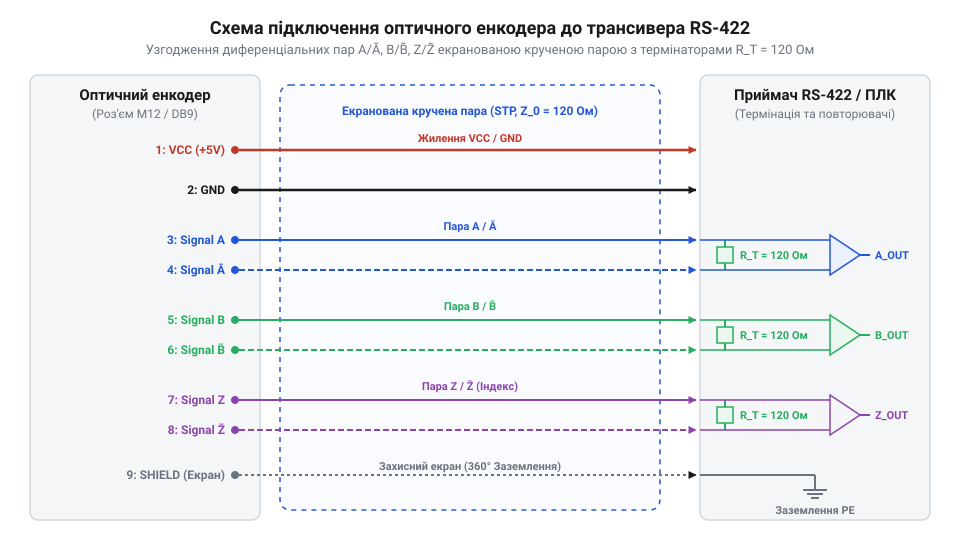
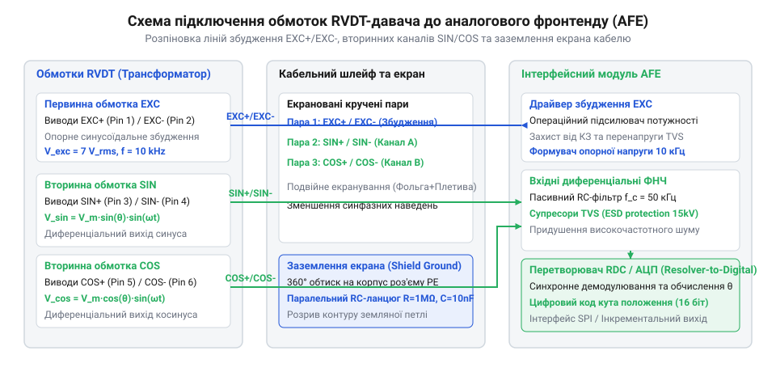

# Апаратний інтерфейс, розводка ліній та схемотехніка підключення оптичних й індуктивних давачів

<preknowlist>
- [Оптичні та механічні інкрементальні енкодери](root:cat-hw-controls/rotary-encoders-quadrature) — призначення квадратурних сигналів A, B та індексного імпульсу Z.
- [Поворотний потенціометр](root:cat-hw-controls/rotary-potentiometer) — аналогове зчитування напруги та базові принципи підключення трипровідної лінії.
</preknowlist>

## Проблема завад та призначення апаратних ліній

Підключення первинних давачів положення до плати системного контролера в умовах промислового цеху або кабіни літака вимагає захисту ліній зв'язку від потужних електромагнітних наводок. Коли кабельний джгут органу вводу прокладається поруч із силовими провідниками электродвигунів та реле, однополярні аналогові сигнали, як у класичних [поворотних потенціометрах](root:cat-hw-controls/rotary-potentiometer), зазнають викривлень через падіння напруги на спільному провіднику заземлення та наведення завад від суміжних кіл. Для забезпечення безперебійної передачі даних кожна сигнальна лінія повинна мати чітко визначене апаратне призначення та відповідний спосіб узгодження.

У джгутах оптичних інкрементальних та абсолютних енкодерів провідники розбиваються на три основні функціональні групи: лінії живлення, основні квадратурні канали та опорні індексні мітки. Провідники живлення `VCC` (+5 В для TTL-рівнів або +10...30 В для HTL-інтерфейсів) та `GND` забезпечують роботу внутрішніх світлодіодів і фотоприймальних підсилювачів. Основні інформаційні канали `A` та `B` передають квадратурні прямокутні імпульси, зсунуті на 90° електричних градусів, а канал `Z` формує один короткий імпульс на оберт для прив'язки нуля. Для пригнічення імпульсних наводок кожна інформаційна лінія дублюється інверсним провідником (`/A`, `/B`, `/Z`), утворюючи симетричні диференціальні пари. Гранична довжина кабельного джгута `L_max` обмежується паразитною ємністю крученої пари `C_cable` (англ. @@en|distributed cable capacitance@@, зазвичай `50...70 пФ/м`) та максимальною робочою частотою квадратурних імпульсів `f_max`. Оскільки вихідний драйвер працює на термінальне навантаження `R_term = 120 Ом`, тривалість фронту наростання сигналу визначається постійною часу `τ = R_term · (C_cable · L + C_in)`, де `C_in` — вхідна ємність трансивера (близько `10...15 пФ`). Щоб уникнути спотворення квадратурного зсуву, тривалість фронту `t_r ≈ 2.2 · τ` не повинна перевищувати `10%` від мінімальної тривалості логічного стану `t_state = 1 / (4 · f_max)`. Гранично припустима довжина кабельного провідника обчислюється з виразу:

        L_max ≤ (1 / (88 · f_max · R_term) - C_in) / C_cable

Приклад обчислення: для високочастотного енкодера з частотою проходження імпульсів `f_max = 500 кГц`, ємністю кабелю `C_cable = 60 пФ/м`, термінатором `R_term = 120 Ом` та ємністю входу `C_in = 10 пФ` тривалість фронту не повинна перевищувати `t_r,max = 50 нс`. Звідси максимальна довжина лінії складає:

        L_max ≤ (50 × 10⁻⁹ / (2.2 × 120) - 10 × 10⁻¹²) / (60 × 10⁻¹²)
        = (189.4 × 10⁻¹² - 10 × 10⁻¹²) / (60 × 10⁻¹²)    [підстановка параметрів та віднімання ємності входу]
        = 179.4 / 60                                       [ділення на погонну ємність метра кабелю]
        = 2.99 м                                            [гранична довжина лінії для частоти 500 кГц]

Перевищення цієї довжини призводить до завалювання фронтів імпульсів, зменшення фазового зсуву між каналами `A` та `B` нижче допустимих `45°` і виникнення помилок пропускання кроків лічильником контролера.

        L_max ≤ (1 / (88 · f_max · R_term) - C_in) / C_cable

Приклад обчислення: для високочастотного енкодера з частотою проходження імпульсів f_max = 500 кГц, ємністю кабелю C_cable = 60 пФ/м, термінатором R_term = 120 Ом та ємністю входу C_in = 10 пФ тривалість фронту не повинна перевищувати 	_r,max = 50 нс. Звідси максимальна довжина лінії складає:

Перевищення цієї довжини призводить до завалювання фронтів імпульсів, зменшення фазового зсуву між каналами A та B нижче допустимих 45° і виникнення помилок пропускання кроків лічильником контролера.

Індуктивні давачі положення (RVDT та LVDT) не мають активних електронних компонентів усередині корпусу і вимагають суто аналогової чотири- або шестипровідної лінії з'єднання. Первинна пара провідників `EXC+` та `EXC-` слугує для подачі високочастотної змінної напруги несучої частоти від генератора збудження контролера. Дві вторинні вимірювальні пари `SIN+` / `SIN-` та `COS+` / `COS-` знімають наведену в котушках ЕРС, амплітуда якої пропорційна синусу та косинусу кута повертання вала. Строгий поділ сигнальних провідників на симетричні пари дозволяє повністю пригнічувати синфазні завади та гарантує стабільність зчитування положення.

## Розводка сигнальних ліній оптичних енкодерів

Електричне сполучення оптичних енкодерів із контролером здійснюється за допомогою стандартних промислових роз'ємів серій M12 (на 8 пінів) або D-Sub (DB9, DB15). Для передачі даних на відстані понад 2...3 метри основним стандартом є диференціальний інтерфейс RS-422 (англ. @@en|RS-422 line driver@@), вихідні трансивери якого формують парафазні напруги з амплітудою близько ±2...5 В відносно один одного.

Для запобігання відбиткам сигналів на високих частотах перемикання хвильовий опір кабельної лінії повинен бути суворо узгоджений. Промисловий кабель зкручених пар має характерний хвильовий опір `Z_0 ≈ 120 Ом`. На приймальному боці контролера між прямим та інверсним провідником кожної диференціальної пари (`A` і `/A`, `B` і `/B`, `Z` і `/Z`) підключається паралельний термінальний резистор `R_term = 120 Ом`. Якщо термінатор відсутній, крутий фронт прямокутного імпульсу з часом наростання `t_r < 10 нс` відбивається від відкритого кінця лінії, створюючи зворотну хвилю та високочастотний джиттер фронтів, що сприймається лічильником контролера як хибні інкрементальні кроки. Проте постійне підключення низькоомного термінатора викликає теплові втрати на розсіювання потужності (англ. @@en|power dissipation@@), яка складається зі статичної складової струму RS-422 та динамічного перезаряду ємності лінії на робочій частоті перемикання `f_sw`. Повна потужність розсіювання на одному термінальному резисторі `P_term` обчислюється з виразу:

        P_term = P_static + P_dynamic
        = (V_diff² / R_term) + C_line · V_diff² · f_sw

**Приклад обчислення:** для диференціального трансивера з вихідною напругою `V_diff = 3.3 В`, термінатором `R_term = 120 Ом`, ємністю кабелю `C_line = 1 нФ` та частотою перемикання імпульсів `f_sw = 1 МГц` потужність розсіювання становить:

        P_term = (3.3² / 120) + 10⁻⁹ × 3.3² × 10⁶
        = (10.89 / 120) + 10⁻⁹ × 10.89 × 10⁶            [піднесення напруги до квадрата]
        = 0.09075 + 0.01089                               [статичні 90.75 мВт + динамічні 10.89 мВт]
        = 0.10164 Вт = 101.64 мВт                          [сумарне тепловиділення резистора]

Отже, для забезпечення довговічності схемотехніки та запобігання температурному дрейфу опору для кожного каналу необхідно обирати чип-резистори типорозміру 0805 або 1206 із номінальною потужністю розсіювання не менше `0.25 Вт` (`250 мВт`), що гарантує двократний запас за потужністю при роботі в закритому корпусі контролера.

*Схема розводки роз'єму оптичного енкодера та підключення диференціальних сигнальних пар A//A, B//B, Z//Z через термінатори 120 Ом до трансивера RS-422.*

Вихідні каскади типу Push-Pull (HTL) застосовують у середовищах із високим рівнем завад при живленні від 24 В, проте для прецизійних органів вводу кращим вибором є саме диференціальні лінії RS-422. На відміну від контактних [інкрементальних механічних енкодерів](root:cat-hw-controls/rotary-encoders-quadrature), оптичні енкодери з RS-422 передавачами не потребують апаратного придушення дребезгу контактів, але вимагають встановлення приймальних диференціальних компараторів (наприклад, MAX485 або AM26LV32) з порогом чутливості `V_diff = ±200 мВ`.

## Схемотехніка обмоток та з'єднання RVDT

Підключення індуктивного трансформаторного давача RVDT до аналогового фронтенду (AFE) вимагає суворого дотримання фазування обмоток та ізоляції первинного кола збудження від вторинних вимірювальних каналів. Первинна обмотка `EXC+` / `EXC-` підключається до виходу синусоїдального генератора контролера, який формує напругу несучої частоти `f_c = 1...10 кГц` з середньоквадратичним значенням `V_rms = 3...7 В`.

Вторинні котушки `SIN+` / `SIN-` та `COS+` / `COS-` видають слабострумові амплітудно-модульовані синусоїдальні сигнали, фаза яких змінюється на 180° при переході через кутовий нуль. Для захисту від паразитного ємнісного перехресного наведення (англ. @@en|capacitive crosstalk@@) високочастотна пара збудження `EXC` та вимірювальні пари `SIN`, `COS` прокладаються в окремих витих парах усередині спільного екранованого джгута.

*Схема підключення первинної обмотки збудження EXC та вторинних вимірювальних обмоток SIN і COS трансформаторного давача RVDT до аналогового фронтенду з фільтрацією.*

На вхідних клемах плати контролера кожна вимірювальна пара підключається до диференціального фільтра низьких частот (ФНЧ). Фільтр першого порядку складається з послідовних резисторів `R_f = 100 Ом` у кожному провіднику та міжлінійного конденсатора `C_f`, розрахованого на частоту зрізу `f_cutoff ≈ 3...5 · f_c`. Оскільки вимірювальний сигнал підводиться симетрично двома провідниками, еквівалентний диференціальний опір фільтра дорівнює сумі двох резисторів `R_diff = 2 · R_f = 200 Ом`. Для досягнення заданої частоти зрізу `f_cutoff` ємність міжлінійного конденсатора `C_f` обчислюється за формулою:

        C_f = 1 / (2 · π · R_diff · f_cutoff)
        = 1 / (4 · π · R_f · f_cutoff)

**Приклад обчислення:** для генератора збудження з несучою частотою `f_c = 10 кГц` обираємо частоту зрізу в `4` рази вищу за несучу `f_cutoff = 4 · f_c = 40 кГц`, щоб пригнічувати високочастотні наводки без фазового викривлення вимірювальної огинаючої. При `R_f = 100 Ом` необхідна міжлінійна ємність становить:

        C_f = 1 / (4 × 3.14159 × 100 × 40000)
        = 1 / (1256.636 × 40000)                [множення опору та частоти на 4π]
        = 1 / 50265482                            [обчислення знаменника]
        = 19.89 × 10⁻⁹ Ф ≈ 20 нФ                  [розрахункова ємність конденсатора]

Отримане значення округлюють до найближчого стандартного номіналу з ряду E24 `C_f = 22 нФ`, що дає фактичну частоту зрізу `f_cutoff = 36.2 кГц`. Для захисту чутливих входів аналогово-цифрового перетворювача від високовольтних електростатичних розрядів та сплесків перенапруги паралельно кожній вимірювальній лінії встановлюють зустрічно увімкнені супресорні TVS-діоди (англ. @@en|TVS diodes@@) з напругою обмеження `V_clamp ≈ 10...15 В`. Спеціалізовані мікросхеми демодуляції детальніше розкрито у матеріалі про [інтегральні фронтенди LVDT/RVDT](root:hw-sensing/lvdt-rvdt-signal-conditioners-and-afe).

## Екранування, заземлення та діагностика ліній

Надійність функціонування давачів положення в умовах промислових та авіаційних завад вирішальним чином залежить від правильної організації екранування кабелю (англ. @@en|cable shielding@@). Захисна плетена оболонка кабелю повинна пригнічувати як наведені електричні поля, так і випромінювання високочастотних сигналів у зовнішнє середовище.

Головною пасткою при розводці екранів є утворення земляних петель (англ. @@en|ground loops@@). Якщо екран кабелю жорстко заземлити з двох боків — і на металевому корпусі давача, і на шасі контролера, — різниця потенціалів заземлення `ΔV_gnd` між двома точками спричинить протікання по екрану значного вирівнювального струму `I_loop`. Цей струм індукує напругу завади безпосередньо у внутрішні сигнальні жили. Правило апаратного монтажу вимагає застосування одноточкового заземлення (англ. @@en|single-point shield grounding@@): екран кабелю жорстко з'єднується з заземлювальною шиною PE лише на боці контролера. На боці давача екран залишається ізольованим або підключається через високочастотну ємнісну розв'язку (керамічний конденсатор `C_shield = 10 нФ`, `1 кВ` паралельно з резистором `R = 1 МОм`), що стече високочастотні наводки, блокуючи струми низької частоти.

Апаратна діагностика несправностей фізичного каналу реалізується схемотехнічними та програмними методами. Для диференціальних ліній RS-422 оптичних енкодерів застосовують активну підтяжку входів трансивера (англ. @@en|fail-safe biasing@@): вхід `A` підтягується резистором `10 кОм` до `VCC`, а вхід `/A` — до `GND`. У разі фізичного обриву кабелю диференціальна напруга стає фіксовано позитивною `V_diff = +5 В`, запобігаючи хаотичному перемиканню компаратора від наводок та дозволяючи контролеру миттєво зафіксувати аварійний обрив лінії.

Для індуктивних RVDT-давачів програмно-апаратна діагностика спирається на перевірку тригонометричного інваріанта. Оскільки вихідні амплітуди дорівнюють `V_sin = V_m · sin(θ)` та `V_cos = V_m · cos(θ)`, сума їхніх квадратів є постійною величиною `V_sin^2 + V_cos^2 = V_m^2`. Якщо внаслідок обриву котушки чи короткого замикання на землю сума амплітуд падає нижче допустимого порогу `sqrt(V_sin^2 + V_cos^2) < 0.7 · V_m`, контролер негайно генерує сигнал відмови інтерфейсу. Додатково [методи калібрування нейтрального положення](root:cat-hw-controls/stick-drift-mitigation) дозволяють компенсувати початковий механічний зсув після монтажу кабельного джгута.
