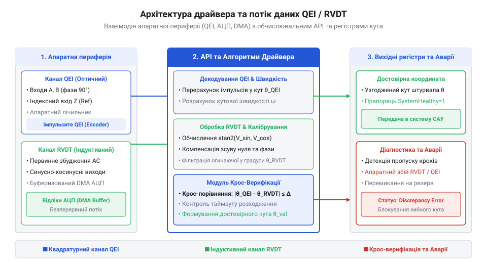
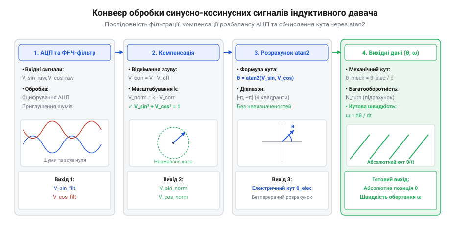

# Програмний інтерфейс драйвера декодування квадратури та індуктивної обробки положення

<preknowlist>
- [Оптичні та механічні інкрементальні енкодери](root:cat-hw-controls/rotary-encoders-quadrature) — геометрія квадратурних каналів A/B та значення індексного імпульсу Z
- [Дрейф нуля та калібрування органів вводу](root:cat-hw-controls/stick-drift-mitigation) — математичні принципи компенсації відхилення нуля та амплітудного розбалансу
</preknowlist>

## Архітектура драйвера та ініціалізація апаратури

Принциповою задачею низкорівневого @@en|API@@ (від англ. @@en|Application Programming Interface@@ — інтерфейс прикладного програмування) є об'єднання апаратного лічильника квадратури та аналого-цифрового перетворювача в єдину структуру даних. Без чітко сформованого дескриптора пристрою обробник переривань не має доступу до регістрів таймера та загрожує втратою кутових відліків при високій швидкості обертання вала. Для зчитування сигналів від таких вузлів, як [Оптичні та механічні інкрементальні енкодери](root:cat-hw-controls/rotary-encoders-quadrature), драйвер ініціалізує периферийний модуль @@en|QEI@@ (від англ. @@en|Quadrature Encoder Interface@@ — інтерфейс квадратурного енкодера).


*Архітектура програмного драйвера кутових давачів та потік обробки сигналів.*

Конфігураційна структура визначає параметри цифрового фільтра брязкоту контактів, коефіцієнт ділення частоти тактування та режим декодування (X1, X2 або X4). Процедура ініціалізації виділяє пам'ять під дескриптор `qei_driver_t` та налаштовує прямий доступ до пам'яті @@en|DMA@@ (від англ. @@en|Direct Memory Access@@) для буферизації аналогових каналів.

Вибір дільника тактування апаратного таймера @@en|QEI@@ визначається максимальними обертами вала та роздільною здатністю енкодера: для високошвидкісних валів (понад 5000 об/хв) дільник встановлюють на мінімальне значення (1:1) задля запобігання пропускам високочастотних імпульсів, тоді як для тихохідних органів ручного вводу (до 60 об/хв) вибирають підвищений дільник тактування (1:16 або 1:32) разом із максимальним цифровим фільтруванням, що дозволяє повністю придушити високочастотні завади брязкоту контактів та оптимізувати навантаження на процесорний модуль.

Для паралельної обробки високочастотних аналогових каналів індуктивних давачів драйвер конфігурує апаратний модуль прямого доступу до пам'яті (@@en|Direct Memory Access@@, DMA). Постійне обслуговування переривань АЦП на високих частотах опитування перевантажує процесорне ядро, тому модуль DMA автоматично пересилає оцифровані відліки огинаючих у кільцевий буфер оперативної пам'яті за схемою подвійної буферизації (@@en|ping-pong buffering@@, від @@en|ping-pong@@ — почерговий обмін). У цьому режимі масив розділено навпіл: поки периферичний контролер заповнює першу половину буфера відліками АЦП, обчислювальний потік опрацьовує другу половину. Події напівзаповнення та повного завершення кадру генерують групове переривання, що забезпечує безперервний потік даних без гонитви сигналів та без втрати жодного відліку, дозволяючи виконувати пакетну фільтрацію аналогічно до принципів первинної обробки в [поворотних потенціометрах](root:cat-hw-controls/rotary-potentiometer), вивільняючи обчислювальний ресурс для основних завдань керування.

:::tabs
@tab C
:::code api-sw-quadrature-and-rvdt-decoder-interface/c/qei-init.c
@tab C++
:::code api-sw-quadrature-and-rvdt-decoder-interface/cpp/quadraturedriver.cpp
:::

## Зчитування кута та конфігурація Z-переривань

Обчислення поточного кутового положення базується на опитуванні лічильного регістра або обробці накопичених приростів. Проте механічний брязкіт або завади в лінії можуть накопичувати похибку підрахунку. Для абсолютного прив'язування позиції використовують індексний канал `Z`, який генерує один імпульс на повний оберт вала, пристрої на зразок [KY-040 — поворотний енкодер](root:cat-hw-controls/ky-040-encoder) видають квадратуру для опитування лічильника.

Обробник апаратного переривання по фронту каналу `Z` виконує точну корекцію позиції, скидаючи або фіксуючи поточний відлік. Обчислення кутової швидкості `ω` виконується за часовим інтервалом між перериваннями або періодичним вимірюванням приросту відліків `ΔN`:

Для запобігання хибному скиданню кутового лічильника через високочастотні завади чи електричний брязкіт в індексній лінії контролер периферії конфігурує цифровий фільтр брязкоту (@@en|deglitch filter@@, від @@en|deglitch@@ — усунення сплесків). Такий фільтр виконує підрахунок послідовних стабільних відліків сигнальної лінії на підвищеній частоті тактування і пропускає фронт імпульсу до обробника переривань лише тоді, коли рівень сигналу не змінюється протягом заданої кількості тактових імпульсів. Додатково програмний обробник перевіряє фазове вікно — поточний стан каналів A та B, які формують квадратуру в [інкрементальних енкодерах](root:cat-hw-controls/rotary-encoders-quadrature), відкидаючи поодинокі завади в каналі Z, якщо вони виникають поза дозволеним сектором проходження нульової позначки.

Проте пряме обчислення миттєвої кутової швидкості за скінченними різницями відліків піддається високому рівню шуму через квантування часу та дискретність кроку енкодера. Оскільки апаратний лічильник та таймер дискретизують координату й час цілими значеннями тактів, зміна координати на один імпульс `ΔN = ±1` при малих інтервалах `Δt` викликає суттєві сплески розрахованої швидкості. Для усунення високочастотного дискретизаційного шуму без внесення критичного фазового запізнення в контур керування драйвер застосовує ковзне середнє (@@en|moving average filter@@, від @@en|moving average@@ — ковзне середнє). Алгоритм накопичує останні `M` вибірок приросту позиції у кільцевому буфері та обчислює усереднену швидкість за сумарним кутовим зміщенням за вікно накопичення, що згладжує пульсації від часового квантування та забезпечує стабільні показники швидкості при помірних і високих частотах обертання. У разі ж наднизьких швидкостей, коли за період дискретизації енкодер генерує лише поодинокі імпульси чи взагалі `ΔN = 0`, фіксоване вікно дискретизації дає грубу дискретну похибку або хибне свідчення зупинки; тоді драйвер перемикається на метод вимірювання періоду (@@en|period measurement@@). За цим підходом апаратний модуль захоплення (@@en|input capture unit@@) фіксує точний часовий інтервал `Δt` між двома послідовними фронтами квадратурного сигналу за допомогою високочастотного таймера, обчислюючи швидкість як величину, обернено пропорційну тривалості імпульсного періоду. Це забезпечує високу точність на наднизьких обертах, хоча вимагає від програмного драйвера обробки переповнення таймера (@@en|timer overflow@@) для виявлення повної зупинки вала, коли тривалість між імпульсами перевищує заданий поріг очікування.

```
omega = (delta_N * 2 * PI) / (PPR * delta_t)     [Формула кутової швидкості]
```

```c
void RAM_FUNC qei_z_index_isr(qei_driver_t* drv) {
    // Апаратне скидання кута при проходженні нульової мітки Z
    drv->position = 0;
}

float qei_calculate_speed(qei_driver_t* drv, float dt_sec, uint32_t ppr) {
    static int32_t last_pos = 0;
    int32_t current_pos = drv->position;
    int32_t diff = current_pos - last_pos;
    last_pos = current_pos;
    return ((float)diff * 2.0f * 3.14159265f) / ((float)ppr * dt_sec);
}
```

## Математична обробка індуктивних каналів і atan2

Аналогові індуктивні давачі (синусно-косинусні індуктосини та @@en|RVDT@@ від англ. @@en|Rotary Variable Differential Transformer@@ — поворотний регульованій диференціальний трансформатор) вимагають обчислення кута за амплітудними огинаючими сигналів V_sin та V_cos.


*Послідовність аналогової фільтрації, компенсації розбалансу та підрахунку абсолютного кута.*

Для відновлення кута в діапазоні від `-pi` до `+pi` використовують функцію арктангенса двох аргументів `atan2f(v_sin, v_cos)`. Перед розрахунком кута необхідно застосувати алгоритми компенсації зсуву нуля та корекції амплітудного розбалансу, як описано в матеріалі [Дрейф нуля та калібрування органів вводу](root:cat-hw-controls/stick-drift-mitigation).

```c
float compute_inductive_angle(float v_sin, float v_cos, float offset_sin, float offset_cos, float gain_ratio) {
    // Усунення постійної складової та вирівнювання коефіцієнтів підсилення
    float corrected_sin = (v_sin - offset_sin) * gain_ratio;
    float corrected_cos = v_cos - offset_cos;
    
    // Обчислення точного кута в радіанах
    return atan2f(corrected_sin, corrected_cos);
}
```

Для прискорення обчислень у мікроконтролерах без апаратного блоку плаваючої коми виклик стандартної функції `atan2f` замінюють на табличне наближення (@@en|Look-Up Table@@, LUT, від @@en|look-up@@ — шукати в таблиці). Оскільки прямолінійна вибірка зі структури фіксованого розміру обмежена дискретністю кроку, драйвер застосовує кусочно-лінійну інтерполяцію: за старшими бітами нормованого співвідношення сигналів обирають опорне значення з таблиці, а за молодшими бітами обчислюють проміжне зміщення. Це дозволяє уникнути кривої дрейфу обчислень під час калібрування, аналогічно до процедур, описаних у матеріалі про [калібрування органів вводу](root:cat-hw-controls/stick-drift-mitigation), зменшуючи обчислювальну складність до кількох тактів процесора.

Крім амплітудного розбалансу, механічний незбіг котушок та просторовий зсув обмоток спричиняють порушення ортогональності — кутовий зсув фаз між каналами відхиляється від ідеальних 90 градусів. Це відхилення деформує коловий векторний тракт у еліпс, створюючи гармонійні спотворення відновленого кута. Для відновлення зсуву фаз драйвер виконує ортогоналізацію Грама — Шмідта (@@en|Gram-Schmidt orthogonalization@@, від @@en|orthogonalization@@ — ортогоналізація): обчислений кут кутового зсуву застосовують у матричному перетворенні, де з косинусного сигналу віднімають проекцію синусної складової, повністю відновлюючи ідеальну колову траєкторію ліссажу перед викликом тригонометричних функцій відповідно до принципів у матеріалі про [калібрування органів вводу](root:cat-hw-controls/stick-drift-mitigation).

## Обробка крайових ситуацій та аварійні режими

Надійність промислового електропривода вимагає безперервної діагностики цілісності сигнальних ліній. Апаратні 16-бітні лічильники таймерів піддаються переповненню при тривалому обертанні в один бік. Драйвер реалізує розширення розрядності до 32 або 64 біт у програмному обробнику переповнення.

Крім того, для індуктивних та оптичних аналогових каналів перевіряється математичний інваріант радіуса векторного сигналу:

```
V_mag^2 = V_sin^2 + V_cos^2     [Перевірка цілісності сигналів]
```

Якщо величина `V_mag` відхиляється від еталонного значення більше ніж на заданий допуск (наприклад, ±15%), драйвер реєструє обрив лінії або апаратну несправність та активує аварійне перемикання на резервний давач.

```c
bool check_encoder_health(float v_sin, float v_cos, float ref_voltage, float tolerance) {
    float magnitude_sq = (v_sin * v_sin) + (v_cos * v_cos);
    float ref_sq = ref_voltage * ref_voltage;
    float min_sq = ref_sq * (1.0f - tolerance) * (1.0f - tolerance);
    float max_sq = ref_sq * (1.0f + tolerance) * (1.0f + tolerance);

    if (magnitude_sq < min_sq || magnitude_sq > max_sq) {
        // Помилка цілісності сигналу: обрив або КЗ
        return false;
    }
    return true;
}
```

Миттєве аварійне перемикання на резервний давач при короткочасних сплесках завад спричиняє паразиторні осциляції (@@en|chattering@@, від @@en|chatter@@ — брязкати) та збої у контурі керування. Для стабілізації системи драйвер впроваджує часову затримку фіксації помилки (@@en|failover delay@@) та амплітудний гістерезис (@@en|hysteresis@@, від грец. @@en|hysteresis@@ — спізнення). Перемикання на дублюючий канал відбувається лише після утримання сигналу поза допуском протягом заданої кількості послідовних тактів опитування, а повернення на основний давач дозволяється тільки тоді, коли векторна амплітуда повертається в звужену нормовану зону і залишається стабільною протягом тривалого контрольного інтервалу, запобігаючи стрибкам у каналі [давачів Холла](root:cat-hw-controls/hall-effect-gimbal-joystick).

Для подальшої діагностики причини апаратного збою або обриву сигнальних ліній драйвер записує часові мітки та кодові прапори несправностей у кільцевий буфер пам'яті (@@en|circular buffer@@, від @@en|circular@@ — круговий). Замість повільного блокуючого запису у зовнішнє енергонезалежне сховище, кожна фіксація помилки відмикає миттєве збереження маски помилок, поточного відліку позиції та синусно-косинусних амплітуд у швидкісний статичний масив оперативної пам'яті. При настанні аварійного стану буфер блокується від перезапису, зберігаючи історію останніх подій перед аварією для аналізу причин відмови, аналогічно телеметрії в [давачах Холла](root:cat-hw-controls/hall-effect-gimbal-joystick).
