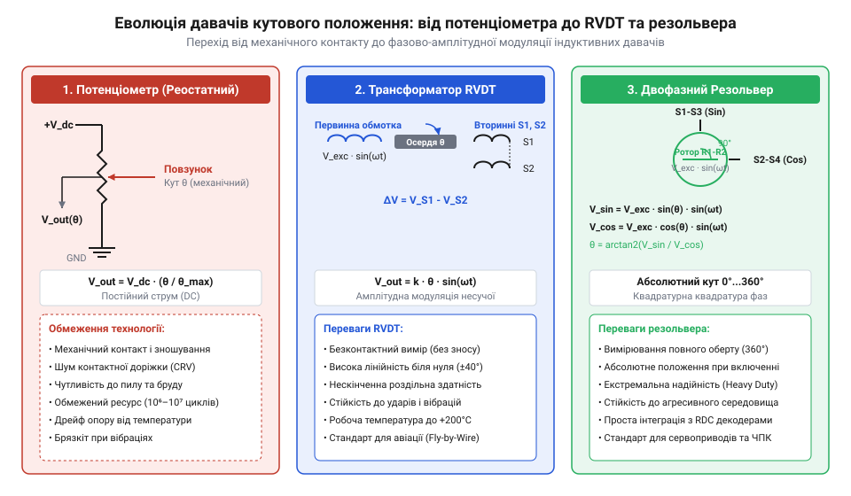
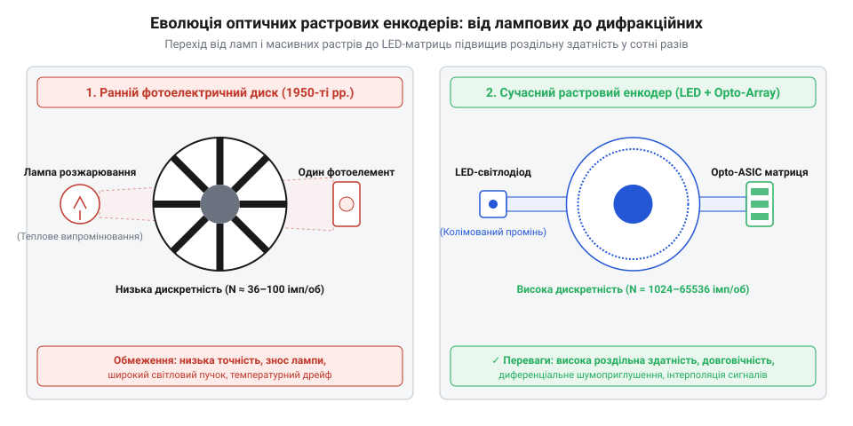

# Еволюція оптичних та індуктивних перетворювачів кута й переміщення

<preknowlist>
- [Поворотний потенціометр](root:cat-hw-controls/rotary-potentiometer) — принцип резистивного дільника напруги та механіка зносу контактної групи
- [Оптичні та механічні інкрементальні енкодери](root:cat-hw-controls/rotary-encoders-quadrature) — загальний принцип оптичного зчитування та формування квадратурних сигналів
</preknowlist>

## Обмеження контактних потенціометрів у промисловості

У середині XX століття швидкий розвиток авіації, аналогової обчислювальної техніки та сервосистем висунув жорсткі вимоги до точності вимірювання кутового положення валів. Основним вузлом зворотного зв'язку слугували пристрої на основі [контактних поворотних потенціометрів](root:cat-hw-controls/rotary-potentiometer) (від латинського *potentia* — сила та грецького *metron* — вимір; @@en|rotary potentiometer@@). Конструкція потенціометра базувалася на графітовому або дротовому резистивному треку, по якому ковзав пружний металевий повзунок. Фізичне тертя між повзунком і резистивним шаром спричиняло швидкий абразивний знос контактної доріжки та суттєво обмежувало максимальну швидкість обертання вала: при високій частоті обертів сухе тертя викликало локальне перегрівання вузла, а інерційні сили та механічний резонанс призводили до відриву пружного повзунка від доріжки (@@en|contact bounce@@) із повним розривом кола зворотного зв'язку. Зношування металевих струмознімачів додатково викликало виникнення дрібного струмопровідного пилу, який шунтував суміжні витки обмотки. Додатковим джерелом вимірювальних похибок виступав температурний коефіцієнт опору (англ. @@en|temperature coefficient of resistance@@) сплавів обмотки: при нагріванні від власного струму навантаження чи змінах температури довкілля опір прецизійних манганінових або ніхромових дротів дрейфував, що спотворювало лінійність дільника напруги та призводило до системного кутового зсуву вихідного сигналу.

В умовах підвищеної вібрації промислового обладнання та авіаційних приводів рухомий повзунок підстрибував над доріжкою. Механічний відрив контакту викликав брязкіт сигналу та тимчасові розриви кола зворотного зв'язку. Нестабільність контактного опору та падіння напруги створювали суттєві похибки у зчитуванні кута. Робота в запиленому або масляному середовищі призводила до обвуглювання ізоляційних підкладок і повного виходу з ладу датчика через кілька тисяч циклів обертання. Для забезпечення надійної експлуатації у важких умовах виникла гостра потреба у розробці повністю безконтактних методів зчитування кутового переміщення.

## Поява індуктивних розщеплювачів та трансформаторів RVDT

Шукаючи альтернативу контактним [потенціометрам](root:cat-hw-controls/rotary-potentiometer), інженери 1940-х років звернулися до явищ електромагнітної індукції. Першим успішним рішенням стало створення безконтактних індуктивних розщеплювачів та поворотних диференціальних трансформаторів (від латинського *rotatio* — обертання, *variabilis* — змінний, *differentia* — різниця та *transformo* — перетворюю; @@en|rotary variable differential transformer@@, RVDT). Конструкція RVDT складається з первинної обмотки збудження, двох симетричних вторинних обмоток та феромагнітного ротора кулачкового профілю на центральному валу. Подача змінної напруги на первинну обмотку наводила ЕРС у вторинних обмотках, амплітуда якої пропорційна куту повороту ротора. Для забезпечення стабільного трансформаторного зв'язку та запобігання насиченню феромагнітного осердя первинну обмотку живлять синусоїдальною несучою напругою, частота якої становить від 400 Гц у традиційних авіаційних бортових мережах до 10 кГц у високоточних промислових та військових сервосистемах. Проте через специфічну геометрію кулачкового ротора RVDT забезпечує високу лінійність перетворення лише у вузькому робочому діапазоні кутів (зазвичай від ±40° до ±60°), за межами якого магнітне поле насичується і лінійність втрачається. На відміну від RVDT, повнооборотні резольвери (@@en|rotary resolver@@) із двома перпендикулярно розташованими вторинними обмотками формують безперервні синусно-косинусні сигнали в усьому діапазоні 360°, що визначило чіткий розподіл застосувань: RVDT використовували в органах вводу з обмеженим ходом вала, як-от авіаційні ручки керування чи педалі, тоді як резольвери стали стандартом для повнооборотних штурвалів та поворотних селекторів.

*Еволюція схемотехніки від контактного потенціометра до безконтактного диференціального трансформатора RVDT та резольвера.*

Повна відсутність ковзних електричних контактів у вимірювальному тракті забезпечила датчикам RVDT та резольверам практично нескінченний механічний ресурс. Металевий герметичний корпус захищав внутрішні обмотки від пилу, масел, вологи та екстремальних вібрацій у військовій та цивільній авіації. Отриманий вихідний змінний сигнал вирізнявся високою лінійністю та низьким рівнем власних шумів. Проте аналогова природа вихідної напруги вимагала складних фазочутливих демодуляторів та аналого-цифрових перетворювачів для сполучення з цифровими обчислювальними машинами.

## Становлення оптичних фотоелектричних енкодерів

Розвиток цифрової обчислювальної техніки та верстатів із ЧПК наприкінці 1950-х років вимагав датчиків із безпосереднім виходом у вигляді послідовності електричних імпульсів. Це стимулювало створення фотоелектричних кутових енкодерів (від грецького *phos* — світло, *elektron* — бурштин та англійського *encoder* — кодувальник; @@en|photoelectric rotary encoder@@). Ранні конструкції 1960-х років містили скляний диск із нанесеними фотолітографічним способом прозорими й непрозорими радіальними штрихами, лампу розжарювання та вакуумні фотоелементи. Виготовлення кодового растра базувалося на термовакуумному напиленні тонкого шару хрому на заготовку з оптичного скла з подальшим нанесенням фоторезисту, світловим експонуванням через еталонний шаблон і хімічним травленням, що дозволяло отримати надійні хромовані маски з мікронною точністю меж штрихів. Для визначення не лише величини, а й напрямку переміщення інженери розробили схему зчитування з двома фотодетекторами, зсунутими один відносно одного на чверть періоду растрової ґратки (фазовий кут 90° або π/2). При обертанні вала за годинниковою стрілкою вихідний сигнал каналу `A` випереджає канал `B` на 90°, а при зміні напрямку на зворотний фазове співвідношення змінюється на протилежне. Таке квадратурне формування сигналів у [інкрементальних оптичних енкодерах](root:cat-hw-controls/rotary-encoders-quadrature) дозволило безпомилково розпізнавати вектор руху та помножувати кількість відліків на один оберт у два або чотири рази за фронтами імпульсів.

*Порівняльна схема раннього фотоелектричного диска з лампою та сучасного растрового оптичного енкодера зі світлодіодною матрицею.*

Лампи розжарювання мали короткий строк служби, високе теплове випромінювання та чутливість до удару. Справжній технологічний прорив відбувся у 1970-х роках із появою напівпровідникових світлодіодів та інтегральних фотодіодних матриць. Застосування растрових зчитувальних сіток та дифракційних ґраток дозволило отримати високу роздільну здатність у десятки тисяч імпульсів на оборот. Сучасні [інкрементальні оптичні енкодери](root:cat-hw-controls/rotary-encoders-quadrature) сформували стандарт цифрового зворотного зв'язку для промислової автоматики.

## Винайдення індуктосинів та планарних котушок

У 1950-х роках швидкий розвиток важкого машинобудування та прецизійних верстатів із числовим програмним керуванням виявив межі стійкості перших оптичних систем. Мастильно-охолоджувальні рідини, металева стружка та сильні вібрації важких верстатних станин забруднювали прозорі секції растрових дисків. Для розв'язання цієї проблеми американська компанія @@en|Farrand Controls@@ під керівництвом інженерів Роберта та Вольтера Тріппів (англ. @@en|Robert Tripp@@, @@en|Walter Tripp@@, патент США 1953 року) розробила планарний індуктивний датчик положення — індуктосин (англ. @@en|Inductosyn@@, від лат. @@la|inductio@@ — наведення та грец. @@el|σύγχρονος@@ — одночасний). Конструктивно технологія втілювалася у двох основних модифікаціях: лінійні індуктосини (англ. @@en|linear Inductosyn@@) мали вигляд довгих планарних лінійок із періодичним змієподібним треком для відстеження поздовжнього переміщення супортів верстатів, тоді як поворотні індуктосини (англ. @@en|rotary Inductosyn@@) виконувалися у формі дискових пластин із радіально рознесеними секторами обмоток для високоточного контролю кута повороту поворотно-ділильних столів та осей телескопів. Базовим елементом обох модифікацій став стандартизований фізичний крок вимірювального растра планарних доріжок, який дорівнював фіксованому просторовому періоду `P = 2 мм` (або `0.1 дюйма` у дюймовому стандарті) для лінійних шкали-статорів чи `360`–`720` періодам на один оберт для дискових роторів. Кожен такий просторовий період друкованого змійкового провідника описував один повний циклічний фазовий зсув напруги в 360°, що дозволяло за допомогою фазової інтерполяції виділяти мікроклітинні частки відліку аж до десятків часток мікрона без втрати точності на довгих вимірювальних дистанціях.

Конструктивна ідея індуктосина полягала у поєднанні принципу обертового трансформатора з друкованими планарними обмотками. На плоскі скляні або сталеві пластини методом фотолітографічного травлення наносилися мідні зигзагоподібні доріжки, які формували безперервний вимірювальний растр з кроком у частки міліметра. Подача двох протифазних високочастотних сигналів збудження у первинні планарні котушки індукувала у рухомій вторинній обмотці вихідну напругу, амплітуда й фаза якої строго пропорційні кутовому або лінійному зміщенню. Це дозволило досягти прецизійної точності оптичних дисків у поєднанні з повною абсолютною стійкістю до бруду й масел. Технологія планарних індуктивних котушок лягла в основу сучасних вбудованих [інкрементальних енкодерів](root:cat-hw-controls/rotary-encoders-quadrature) промислових роботів.

## Спірні атрибуції та міфи історії енкодерів

Історія розробки кодових дисків містить чимало спрощених міфів про «єдиного винахідника». Найпопулярнішим є уявлення, ніби циклічний двійковий код було створено виключно для позиціонування датчиків. Насправді фізик і дослідник лабораторій @@en|Bell Labs@@ Франк Ґрей (англ. @@en|Frank Gray@@, патент 1953 року, заявка 1947 року) розробив відображений двійковий код — код Ґрея (англ. @@en|Gray code@@) — для усунення помилок у вакуумних трубах імпульсно-кодової модуляції телевізійного сигналу. Лише пізніше розробники цифрово-аналогових перетворювачів та кутових енкодерів застосували цей принцип для усунення неоднозначності переходів на межі кодових секторів. Ключова вимірювальна перевага коду Ґрея полягала у порівнянні зі стандартним двійковим кодуванням BCD (від англ. @@en|binary-coded decimal@@): у коді Ґрея між сусідніми відліками змінює стан лише один біт, тоді як у коді BCD під час переходу між деякими комбінаціями (наприклад, від 0111 до 1000) відбувалося одночасне перемикання трьох або чотирьох контактних груп. Механічні допуски розташування фотоелементів чи контактів викликали асинхронізм їх перемикання, створюючи на межах секторів хибні проміжні двійкові коди та катастрофічні похибки позиціонування. Паралельно відбувалася еволюція і самих оптичних дисків: компанія @@en|Baldwin Piano Company@@, яка створювала електронні органи з оптичними тембровими колесами, адаптувала свої прозорі диски зі світлооптичними фонограмами музичних інструментів для цифрового позиціонування антен військових радарів. Прецизійні оптичні звукові доріжки органів, що раніше модулювали світловий потік для синтезу звуку, інженери Baldwin перетворили на дискретні двійкові кодові маски, перенісши технології оптичного звукозапису в системи прецизійного військового та промислового позиціонування.

Другим поширеним міфом є твердження про раптове створення фотоелектричного кодера в рамках одного патенту. Перші контактні кодові диски виникли ще у телеграфії XIX століття на базі комутаторів Бодо, а перші оптичні растрові диски розроблялися у 1940-х роках компанією @@en|Baldwin Piano Company@@, яка адаптувала оптичні фонограми музичних інструментів для цифрових систем наведення військових радарів. Становлення енкодерів стало результатом колективного внеску інженерних шкіл США, Європи та Японії, де ключовим проривом виявилася не поодинока ідея, а масове впровадження напівпровідникових світлодіодів і дифракційних ґраток.
