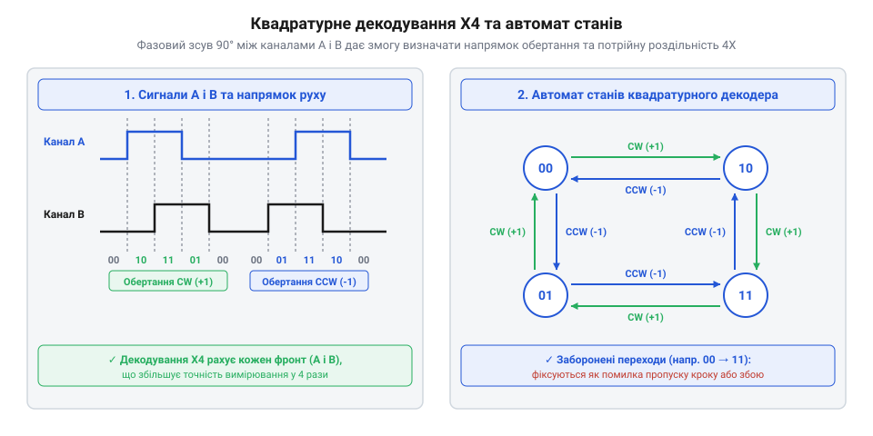
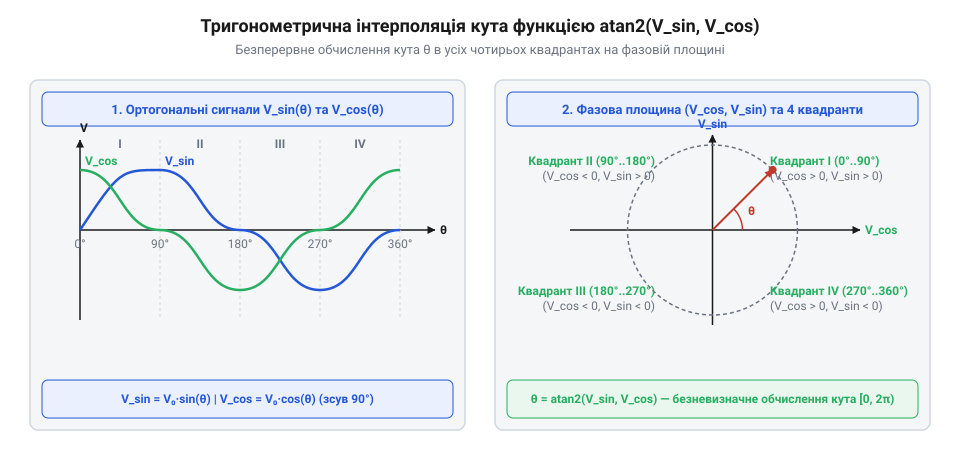

# Математика квадратурного декодування, коду Ґрея та індуктивної інтерполяції

<preknowlist>
- [KY-040 — поворотний енкодер](root:cat-hw-controls/ky-040-encoder) — принципи формування прямокутних імпульсів на виходах A і B.
- [Оптичні та механічні інкрементальні енкодери](root:cat-hw-controls/rotary-encoders-quadrature) — будова оптичних дисків та розсунутих фотоприймальних сіток.
</preknowlist>

## Проблема непевності кутового зміщення

Одноканальне зчитування імпульсів від дискретного сенсора положення не здатне забезпечити однозначне визначення кутового чи лінійного зміщення. Якщо розімкнення й замикання вхідного контакту генерує послідовність логічних рівнів, лічильник мікроконтролера інкрементує своє значення `N = N + 1` при кожному наростаючому фронті. Проте у реальних механічних системах вал піддається вібраціям, а пружні зчитувальні щітки спричиняють брязкіт контактів. Якщо вал зупиниться точно на межі розрізу растрового диска, механічне тремтіння буде почергово відкривати й замикати світловий потік або контакт. Одноканальна система сприйме це тремтіння як швидке поступальне обертання в один бік і неперервно збільшуватиме кутову координату, створюючи хибне зміщення при фізично нерухомому валі. Хронологічно цей процес накопичення помилки розгортається наступним чином: при зупинці вала на порозі комутації фізична координата залишається незмінною `Δθ_real = 0`, однак високочастотний брязкіт генерує серію з `M` мікроскопічних коливань напруги за короткий інтервал часу. Оскільки апаратний лічильник опитується за фронтом і не має інформації про знак переміщення, кожен окремий перехід з логічного нуля в одиницю `0 → 1` викликає безумовний інкремент лічильника `N_k+1 = N_k + 1`. У результаті за кілька мілісекунд вібрації значення координатного регістра хибно зростає на `M` відліків `N_accum = N_real + M`, що призводить до неконтрольованого дрейфу програмного нуля системи позиціонування без жодного реального зміщення ротора.

Другою фундаментальною обмеженістю одноканального сигналу є відсутність інформації про вектор (напрямок) руху. Один цифровий імпульсний потік не містить жодної ознаки того, у який бік обертається ротор — за годинниковою стрілкою чи проти неї. Для обчислення вектора кутової швидкості `ω` та однозначного визначення напрямку руху виникає математична необхідність у введенні другого сигнального каналу.

Математичне розв'язання цієї проблеми полягає у формуванні двох паралельних сигнальних ліній `A` та `B`, які просторово або оптично зміщені одна відносно одної на чверть періоду `T / 4` (що відповідає фазовому куту `π / 2` або `90°`). У кожен момент часу стан системи описується двобінарним вектором:

    S(t) = [A(t), B(t)]      [вектор фазових станів квадратурної пари]

Наявність фазового зсуву гарантує, що при зміні напрямку руху послідовність зміни компонентів вектора `S(t)` дзеркально інвертується. Це дозволяє контролеру не лише відрізнити корисне обертання від механічного брязкоту, а й однозначно визначати значущий знак кутового переміщення `Δθ`.

## Автомати та логіка квадратурного декодування

Об'єднання логічних рівнів двох зміщених на 90° сигналів `A` та `B` дає двобінарний кодовий ряд, який приймає чотири фазові стани: `00`, `01`, `11` та `10`. Оскільки при обертанні в будь-який бік кожен крок змінює стан лише одного каналу, ця послідовність є кодом Ґрея (англ. @@en|Gray code@@).

При обертанні вала за годинниковою стрілкою (прямий хід `CW`) стани послідовно змінюються за циклом:

    00 → 01 → 11 → 10 → 00      [послідовність фаз прямого обертання CW]

При зміні напрямку обертання проти годинникової стрілки (реверс `CCW`) послідовність переходів змінюється на зворотну:

    00 → 10 → 11 → 01 → 00      [послідовність фаз зворотного обертання CCW]

Математичною основою декодування є скінченний автомат станів (англ. @@en|finite-state machine@@, FSM). Перехід між поточним станом `S_curr` та наступним станом `S_next` визначається матрицею переходів `M_trans`, де рядки відповідають попередньому стану, а стовпчики — новому. Значення елемента матриці показує приріст лічильника координати `ΔN`:

    M_trans =
      |  0, +1, ERR, -1 |      [попередній стан 00]
      | -1,  0, +1, ERR |      [попередній стан 01]
      | ERR, -1,  0, +1 |      [попередній стан 11]
      | +1, ERR, -1,  0 |      [попередній стан 10]

Стейт-матриця містить захисне значення `ERR` для подвійних перемикань (наприклад, `00 → 11` або `01 → 10`). Фіксація стану `ERR` вказує на пропускання вибірки через перевищення граничної швидкості обертання або на високовольтну заваду в лінії.

У програмній реалізації скінченного автомата при виникненні переходу зі значенням `ERR` алгоритм призупиняє зміну позиційного лічильника `N` та інкрементує лічильник апаратних збоїв `N_err = N_err + 1`. Якщо поодинокий перехід `ERR` трапляється ізольовано (через короткочасну електромагнітну заваду), FSM зберігає попереднє значення координати й очікує відновлення коректного фазового стану. Проте якщо кількість помилок перевищує критичний поріг `K_err` у ковзному часовому вікні `Δt` або події `ERR` виникають поспіль, контролер фіксує втрату синхронізації вибірок. Для діагностики перевищення граничної кутової швидкості `ω_max` алгоритм зіставляє поточний період опитування `t_sample` із найменшим припустимим інтервалом фазового переходу `t_phase = 1 / (4 × PPR × ω_max)`: якщо швидкість обертання вала перевищує частоту Найквіста `f_Nyquist = f_sample / 2`, квадратурний диск проскакує проміжні стани за один такт опитування. У цьому разі декодер встановлює прапорець помилки перевищення швидкості (англ. @@en|overspeed error flag@@) та ініціює безпечну зупинку приводу для запобігання накопиченню фазової похибки.

*Діаграма станів кінцевого автомата квадратурного декодування: послідовність фазових переходів визначає напрямок обертання та обчислює роздільну здатність у режимах 1X, 2X та 4X.*

Залежно від того, які саме фронти прямокутних імпульсів фіксуються обродником, квадратурне декодування підтримує три режими обчислення роздільної здатності:

1. **Режим `1X`**: лічильник змінюється лише за наростаючим фронтом каналу `A`. Підсумкова кількість відліків на оберт `CPR` дорівнює фізичній кількості періодів диска `PPR`:

    CPR_1X = PPR      [роздільна здатність у режимі 1X]

2. **Режим `2X`**: лічильник змінюється за наростаючим та спадним фронтами каналу `A`:

    CPR_2X
    = 2 × PPR      [помноження роздільної здатності у режимі 2X]

3. **Режим `4X`**: лічильник змінюється за кожною зміною стану обох ліній `A` та `B` (чотири події на період):

    CPR_4X
    = 4 × PPR      [максимальне помноження роздільної здатності у режимі 4X]

Режим `4X` забезпечує найвищу точність позиціонування та автоматично фільтрує контактний брязкіт у [механічних енкодерах](root:cat-hw-controls/rotary-encoders-quadrature): вібрація на межі розрізу створює послідовність переходів `00 → 01 → 00`, що дає сумарний внесок `(+1) + (-1) = 0` і зберігає підсумкову координату незмінною.

## Декодування абсолютного коду Ґрея

При використанні багаторозрядних абсолютних кодових дисків позиція об'єкта зчитується паралельним двійковим кодом із `N` оптичних або магнітних доріжок. У звичайній позиційній двійковій системі числення перехід між деякими сусідніми числами вимагає одночасної зміни кількох бітів. Наприклад, при переході від значення `3_10` (`011_2`) до `4_10` (`100_2`) змінюються всі три розряди.

Через неминучі механічні допуски виготовлення та оптичне розюстування фотоприймачів розрядні елементи перемикаються не строго одночасно. Під час транзитного переходу тривалістю кілька наносекунд або мікросекунд зчитувальний пристрій фіксує хибні проміжні коди, як-от `111_2` (`7_10`) або `000_2` (`0_10`). Цей феномен називається апаратним глітчем (англ. @@en|glitch@@) або похибкою однозначності зчитування.

Для усунення цієї проблеми в абсолютних енкодерах застосовують код Ґрея, кодові комбінації якого побудовані так, що для будь-яких двох сусідніх позицій кодова відстань Геммінга (англ. @@en|Hamming distance@@) дорівнює одиниці:

    d_H(G_k, G_k+1) = 1      [властивість коду Ґрея для сусідніх відліків]

Оскільки при переміщенні вала між сусідніми секторами завжди змінюється лише один біт, невизначеність транзитних станів повністю виключається.

Для використання зчитаного коду Ґрея `G` у математичних розрахунках його необхідно конвертувати у стандартне позиційне двійкове число `B`. Алгоритм перетворення розрядів описується побітовою операцією додавання за модулем 2 (виключальне АБО `XOR`, `⊕`).

Найстарший розряд двійкового числа `b_N-1` дорівнює найстаршому розряду коду Ґрея `g_N-1`. Кожен наступний молодший розряд `b_i` обчислюється як виключальне АБО між попередньо розрахованим двійковим розрядом `b_i+1` та відповідним розрядом коду Ґрея `g_i`:

    b_N-1 = g_N-1                                 [найстарший біт двійкового числа]
    b_i = b_i+1 ⊕ g_i      (для i = N-2 ... 0)    [послідовне побітове розгортання]

У цифрових мікроконтролерах це перетворення реалізується високоефективним побітовим зсувом та операцією `XOR`. Для `N`-розрядного числа перетворення виконується паралельно за `log2(N)` кроків замість послідовного ітеративного циклу. Замість повільного перебору розрядів у циклі з умовними переходами, паралельний побітовий алгоритм обчислює двійкове значення через фіксовану послідовність логарифмічних зсувів та операцій виключального АБО (англ. @@en|shift-XOR sequence@@). Для 16-бітового регістра розрядність розгортається за 4 кроки: спочатку виконується початковий зсув `b = g ^ (g >> 1)`, після чого результат послідовно комбінується із власними зсувами на 2, 4 та 8 бітів (`b ^= (b >> 2)`, `b ^= (b >> 4)`, `b ^= (b >> 8)`). Для 32-бітового регістра до цієї послідовності додається лише один завершальний крок — зсув на 16 бітів (`b ^= (b >> 16)`). На кожному `k`-му кроці зсув на `2^(k-1)` бітів поширює накопичену парність розрядів на подвоєну ширину масиву, розповсюджуючи значення старших бітів на всі молодші. Головна перевага цього підходу полягає у повній відсутності умовних розгалужень, що запобігає скиданню конвеєра процесора (англ. @@en|pipeline stall@@) і забезпечує детермінований час виконання перетворення за `O(log2 N)` машинних тактів у реальному часі.

    B_0 = G
    B_1 = B_0 ⊕ (B_0 >> 1)      [перший крок побітового згортання]
    B_2 = B_1 ⊕ (B_1 >> 2)      [другий крок побітового згортання]
    B_k = B_k-1 ⊕ (B_k-1 >> 2^(k-1))

Приклад обчислення для 4-бітного коду Ґрея `G = 1010_2` (`12_10` у коді Ґрея, що відповідає двійковому `1100_2` = `12_10`):

    b_3 = g_3 = 1
    b_2 = b_3 ⊕ g_2 = 1 ⊕ 0 = 1
    b_1 = b_2 ⊕ g_1 = 1 ⊕ 1 = 0
    b_0 = b_1 ⊕ g_0 = 0 ⊕ 0 = 0

Підсумкове двійкове число `B = 1100_2` повністю збігається з абсолютною кутовою координатою вала.

## Аналогова інтерполяція та тригонометрія atan2

Для досягнення високої кутової та лінійної роздільної здатності в індуктивних давачах положення (RVDT, LVDT) та високопрецизійних оптичних сенсорах використовуються аналогові гармонійні сигнали. Замість дискретних квадратних рівнів сенсорні елементи генерують дві вихідні напруги `V_sin` та `V_cos`, розмах яких пропорційний синусу та косинусу поточного кута `θ`:

    V_sin = A × sin(θ)      [амплітудна модель синусного каналу]
    V_cos = A × cos(θ)      [амплітудна модель косинусного каналу]

Де `A` — амплітуда огинаючої напруги. На відміну від дискретного підрахунку імпульсів, неперервні аналогові сигнали дозволяють обчислити точне значення кута `θ` всередині одного періоду растрової сітки, що забезпечує аналогову тригонометричну інтерполяцію.

Пряме застосування класичної функції арктангенса `θ = atan(V_sin / V_cos)` є непридатним у реальних цифрових обробниках з двох причин. По-перше, при значеннях кута `θ = 90°` або `270°` косинус дорівнює нулю (`V_cos = 0`), що викликає виняткову помилку ділення на нуль. По-друге, оскільки звичайна тригонометрична функція `atan(x)` повертає значення лише в обмеженому діапазоні від `-π / 2` до `+π / 2` (`-90°` ... `+90°`), вона не здатна відрізнити перший квадрант від третього чи другий від четвертого, де відношення `V_sin / V_cos` має однакові знаки. Для прискорення обчислень та нормалізації аргументу в мікроконтролерах фазову площину ділять на вісім октантів по `45°` (`π / 4`), зіставляючи абсолютні величини `|V_sin|` та `|V_cos|`. Якщо `|V_sin| ≤ |V_cos|`, фазовий вектор лежить у межах октанту, де дріб `x = |V_sin| / |V_cos|` не перевищує одиницю (`0 ≤ x ≤ 1`). У протилежному разі `|V_sin| > |V_cos|` аргумент інвертують `x = |V_cos| / |V_sin|`, що також дзеркально зводить значення до діапазону `[0, 1]`. Таке редукційне зведення до робочого октанту (англ. @@en|octant reduction@@) дозволяє реалізувати функцію `atan2` через табличні наближення (англ. @@en|lookup table@@, LUT) або поліноміальні апроксимації лише на обмеженому відрізку `[0, 1]`, усуваючи обчислювальні тупики ділення на нуль та оптимізуючи швидкість обробки аналогового сигналу в реальному часі.

*Ортогональні синусно-косинусні сигнали V_sin і V_cos на фазовій площині та розрахунок кута θ за допомогою функції atan2: геометричне представлення фазового вектора дозволяє однозначно обчислювати кут у всіх чотирьох квадрантах.*

Для однозначного розрахунку кута в повному колі від `-π` до `+π` (`-180°` ... `+180°`) використовують арктангенс двох аргументів `atan2(V_sin, V_cos)`. Ця функція окремо аналізує знаки чисельника `V_sin` та знаменника `V_cos`:

    θ
    = atan2(V_sin, V_cos)
    = atan(V_sin / V_cos)              [якщо V_cos > 0 (I та IV квадранти)]
    = atan(V_sin / V_cos) + π          [якщо V_cos < 0 та V_sin ≥ 0 (II квадрант)]
    = atan(V_sin / V_cos) - π          [якщо V_cos < 0 та V_sin < 0 (III квадрант)]

Раціометричний характер ділення `V_sin / V_cos` дає важливу перевагу: якщо синфазні коливання живлення або температурний дрейф однаково змінюють амплітуду `A(T)` обох каналів, множник `A(T)` тотожно скорочується у дробі, не чинячи жодного впливу на обчислений кут `θ`.

## Корекція неідеальностей та реалізація

У реальних індуктивних та оптичних сенсорних системах аналогові сигнали `V_sin` та `V_cos` відхиляються від ідеальних тригонометричних функцій. Первинні вимірювальні траси піддаються трьом основним типам геометричних та електричних спотворень:

1. **Постійний зсув нуля (`V_off_sin`, `V_off_cos`)**: виникає через дрейф нуля операційних підсилювачів та зсув АЦП, що зміщує центр фазової траєкторії з точки `(0, 0)`.
2. **Амплітудний розбаланс (`A_sin ≠ A_cos`)**: спричиняється несиметрією індуктивностей котушок або різною чутливістю фотодіодів, що перетворює коло колової траєкторії на еліпс.
3. **Фазова неортогональність (`φ ≠ 90°`)**: кутовий зсув між каналами відхиляється від `90°` на похибку `ε`, спричиняючи деформацію еліпса вздовж похилої осі.

Наявність цих спотворень призводить до появи циклічної кутової похибки в розрахунках `atan2`. Для їх компенсації застосовують математичний алгоритм еліптичної корекції. Першим кроком від первинних напруг `V_sin_raw` та `V_cos_raw` віднімають опірні зсуви та нормують їх на відповідні підсилення:

    V_s1
    = (V_sin_raw - V_off_sin) ÷ A_sin      [компенсація зсуву та масштабного коефіцієнта синуса]

    V_c1
    = (V_cos_raw - V_off_cos) ÷ A_cos      [компенсація зсуву та масштабного коефіцієнта косинуса]

Другим кроком виконують ортогоналізацію Грамма-Шмідта для усунення фазової неперпендикулярності `ε`:

    V_sin_corr = V_s1                                        [ортогоналізований синусний канал]
    V_cos_corr = (V_c1 - V_s1 × sin(ε)) ÷ cos(ε)             [коригований косинусний канал]

Після попередньої нормалізації відкориговані сигнали `V_sin_corr` та `V_cos_corr` подаються на вхід `atan2`, що дає змогу отримати лінійну характеристику кута без дрейфу.

Обчислення арктангенса в мікроконтролерах без блоку плаваючої коми (FPU) вимагає цифрової оптимізації. Найбільш поширеними апаратними та програмними методами є:

- **Алгоритм CORDIC (англ. @@en|CORDIC algorithm@@)**: ітераційний метод обчислення тригонометрії за допомогою послідовних поворотів вектора на фіксовані кути. Вимагає лише операцій побітового зсуву та додавання, що дозволяє виконувати `atan2` за `N` тактів процесора.
- **Таблиці пошуку (англ. @@en|look-up table@@, LUT)**: зберігають попередньо обчислені значення арктангенса в ПЗП для першого октанту (`0°` ... `45°`). Проміжні значення між вузлами сітки розраховуються за допомогою швидкої лінійної інтерполяції.
