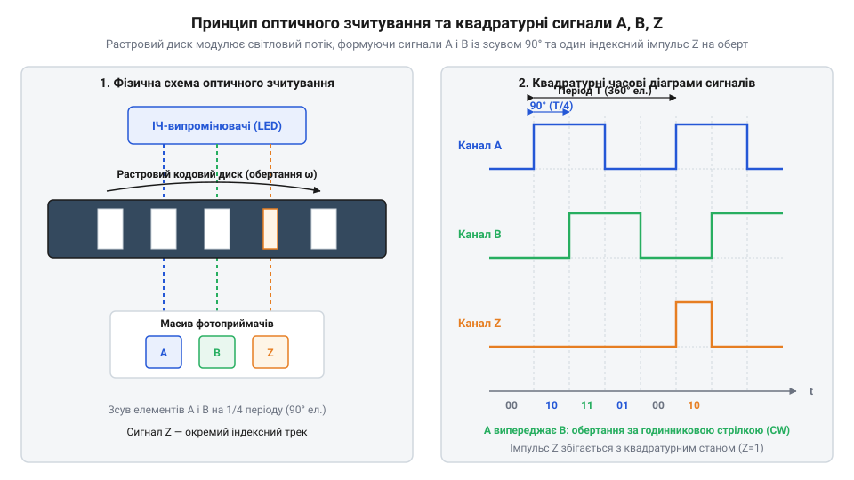
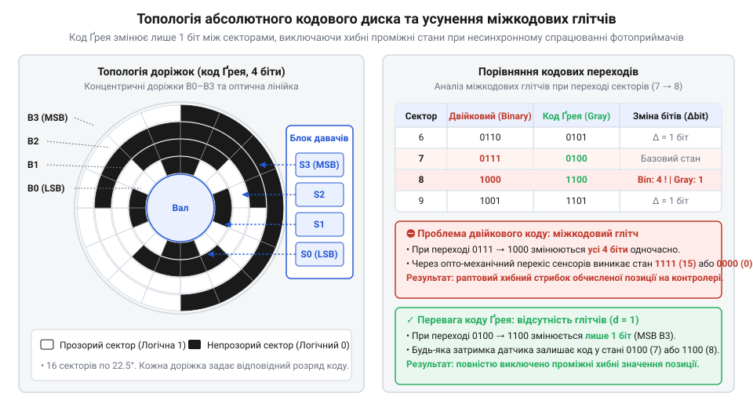
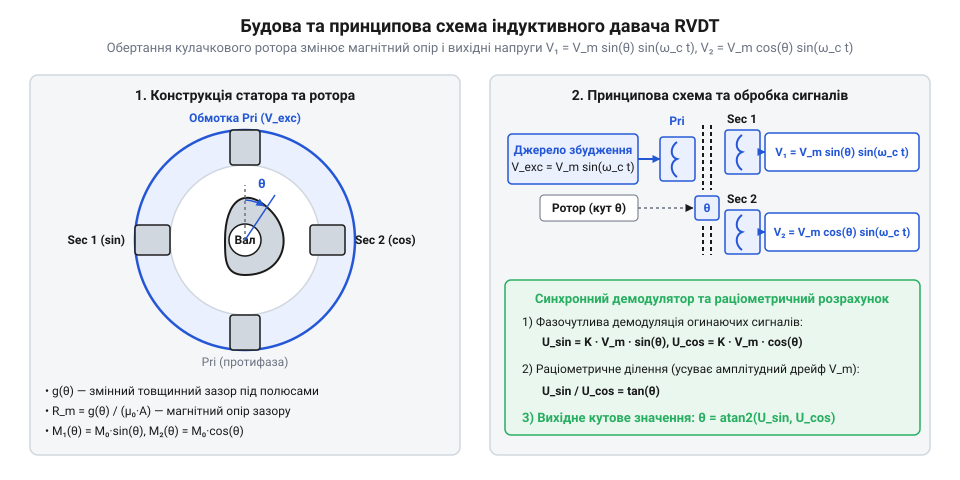
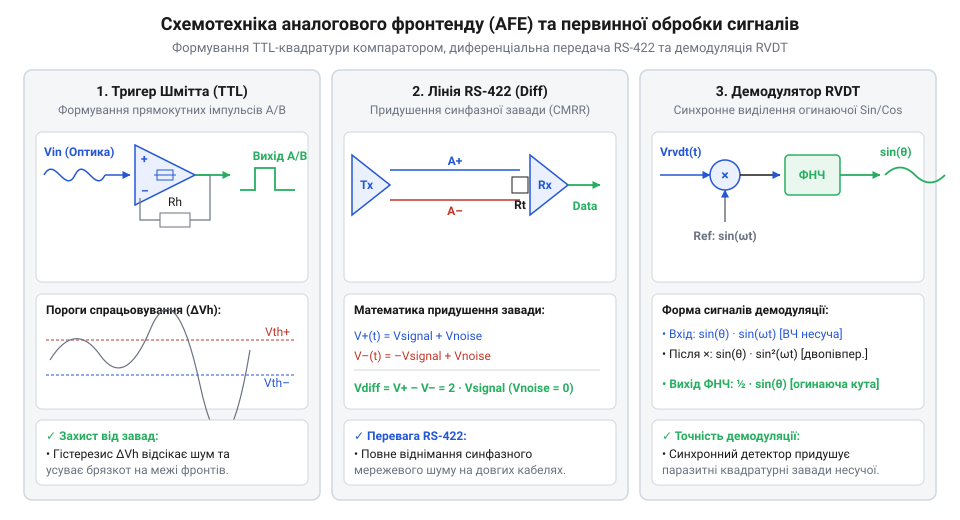

# Оптичні та індуктивні давачі положення органів вводу

<preknowlist>
- [Поворотний потенціометр](root:cat-hw-controls/rotary-potentiometer) — принцип аналогового зчитування кута обертання та його обмеження за зносостійкістю.
- [Оптичні та механічні інкрементальні енкодери](root:cat-hw-controls/rotary-encoders-quadrature) — базові поняття про інкрементальне лічіння імпульсів та контактні механічні енкодери.
- [Дрейф нуля та калібрування органів вводу](root:cat-hw-controls/stick-drift-mitigation) — методи калібрування нейтрального положення та компенсації температурного й механічного відхилення.
</preknowlist>

## Проблема зносу потенціометрів та оптичне вирішення

Тривала експлуатація органів ручного вводу в промислових та авіаційних системах висуває жорсткі вимоги до надійності механізму зчитування положення. Коли оператор повертає ручку або відхиляє штурвал, класичний [поворотний потенціометр](root:cat-hw-controls/rotary-potentiometer) зчитує кут через безпосередній механічний контакт ковзного струмознімача з графітовим чи керметним резистивним шаром. Постійне тертя неминуче призводить до стирання струмопровідної доріжки, виникнення мікротріщин та випадання контакту під дією вібрацій, що проявляється як шум і стрибки напруги. Додатково пил, волога та масляний туман, потрапляючи всередину корпусу, прискорюють окислення металевих контактів та спричиняють незворотне погіршення точності. Детальніше про шлях від контактних розмикачів до безконтактних сенсорів читайте у матеріалі про [еволюцію оптичних перетворювачів](root:cat-hw-controls/optical-and-inductive-position-encoders/hist-evolution-of-optical-and-inductive-encoders.md).

Радикальним розв'язком проблеми механічного зносу стало усунення гальванічного та механічного контакту між рухомим валом і вимірювальною схемою за допомогою світла. Оптичний фотоелектричний енкодер (від грецького *phōs* — світло та англійського @@en|encoder@@) складається з джерела випромінювання (зазвичай інфрачервоного світлодіода з довжиною хвилі λ ≈ 850 нм), непрозорого растрового диска з прецизійними радіальними щілинами та фотоприймальної матриці. Фізичний механізм перетворення ґрунтується на модуляції світлового потоку: фотони, проходячи крізь щілини, генерують електронно-діркові пари в p-n переходах фотодіодів, формуючи аналоговий фотострум. Геометрична апертура (від латинського *apertura* — отвір; англійською @@en|aperture@@) растрових щілин шириною `w`, крок растра `p` (англ. @@en|pitch@@) та їхнє співвідношення визначають форму оптичного випромінювання на фотоприймачі. При геометричному оптичному проектуванні світловий промінь утворює чітку трапецієподібну або прямокутну освітленість, однак зі зменшенням ширини щілини `w` до десятків мікрометрів та наявності повітряного зазору `z` між диском і нерухомою індикаторною маскою виникає дифракція Френеля (англ. @@en|Fresnel diffraction@@). Хвильова природа світла спричиняє обгинання країв непрозорих штрихів та інтерференцію світлових хвиль у зоні тіні, через що прямокутний профіль освітленості розмивається і перетворюється на квазісинусоїдальний сигнал з амплітудою, що залежить від параметра Френеля `N_F = w² / (λ · z)`. Для отримання стійких до завад прямокутних імпульсів із високою крутизною наростання та спаду фронтів, первинний аналоговий струм фотодіодів пропускається через трансімпедансний підсилювач та швидкісний компаратор із тригером Шмітта.


*Схема оптичного розмикання променя світлодіода растровим кодовим диском та часові діаграми фазово зсунутих на 90° сигналів A і B з індексним імпульсом Z.*

Для визначення не лише кількості здійснених кроків, а й напрямку обертання вала, оптична система генерує два незалежні квадратурні сигнали (від латинського *quadratura* — надання квадратурної форми; англійською @@en|quadrature signals@@) `A` та `B`. Матриця фотоприймачів розташована так, що оптичні сітки двох каналів зсунуті одна відносно одної на чверть кроку растрових щілин, що відповідає фазовому зсуву у 90° електричних градусів. При обертанні за годинниковою стрілкою фронт сигналу `A` випереджає фронт сигналу `B` на 90°, тоді як при обертанні проти годинникової стрілки сигнал `B` наростає раніше за `A`. Аналіз стану одного сигналу в момент наростаючого фронту іншого дозволяє цифровому контролеру миттєво визначати вектор руху.

Апаратна реалізація точно зсунутих на 90° квадратурних сигналів у прецизійних енкодерах спирається на використання нерухомої індикаторної маски (англ. @@en|stationary index mask@@) та схемотехніки диференціального оптичного зчитування (англ. @@en|push-pull sensing@@). Індикаторна маска розташовується між джерелом світла та рухомим кодовим диском і містить чотири окремі групи растрових щілин, що відповідають каналам `A`, `B`, `/A` та `/B`. Просторова сітка каналу `B` зміщена відносно каналу `A` на дробовий крок `(k + 1/4) · p` (де `p` — крок растра, а `k` — ціле число щілин), що геометрично формує фазовий зсув у 90° електричних градусів, тоді як протифазні канали `/A` та `/B` зміщені на півкроку `(k + 1/2) · p` (зсув 180°). Фотоприймачі зчитують освітленість парно: коли промінь світла проходить крізь щілину маски на фотодіод каналу `A`, фотодіод протифазного каналу `/A` перекривається непрозорим штрихом. Диференціальний підсилювач первинної обробки віднімає отримані фотоструми `I_diff_A = I_A - I_/A`, що повністю синфазно пригнічує постійну складову засвічення та температурний дрейф інтенсивності світлодіода. Отриманий чисто симетричний змінно-полярний сигнал подається на компаратор, формуючи прямокутні виходи `A` та `B` із суворо 50-відсотковою скважністю та стабільним 90-градусним зсувом фаз.

На відміну від спрощених контактних вимикачів, якими є [інкрементальні механічні енкодери](root:cat-hw-controls/rotary-encoders-quadrature) побутового рівня, прецизійні промислові енкодери додатково формують один опорний індексний імпульс `Z` (англ. @@en|Index pulse@@) на кожен повний оберт у 360°. Сигнал `Z` має ширину в один електричний період і слугує для точної прив'язки нуля при ініціалізації системи. Для захисту слабострумових виходів від електромагнітних наводок при передачі на довгі відстані застосовують диференціальні лінії стандарту RS-422 (англ. @@en|RS-422@@). Спеціалізований передавач (драйвер лінії) перетворює однополярні рівні `A`, `B`, `Z` у диференціальні парафазні пари `A`/`/A`, `B`/`/B` та `Z`/`/Z`. Часове узгодження та фазова симетрія перемикання елементів драйвера є критичними: апаратна розсинхронізація фронтів (англ. @@en|skew@@) `t_skew = |t_pLH - t_pHL|` між прямою та інверсною лінією не перевищує `1...2 нс`. Це гарантує, що точка перетину фазних напруг виникає чітко на середині амплітуди, запобігаючи спотворенню 90-градусного квадричного зсуву та джиттеру фазових фронтів при високій частоті обертання. При передачі заплутаними провідниками крученої пари зовнішня електромагнітна завада наводить у обох провідниках однакову синфазну напругу `V_noise`, проте на приймальному боці диференціальний компаратор з порогом чутливості `V_diff = ±200 мВ` віднімає вихідні потенціали: `(V_A + V_noise) - (V_/A + V_noise) = V_A - V_/A`. Завдяки високому коефіцієнту приглушення синфазних завад (англ. @@en|common-mode rejection ratio@@, CMRR) наводка повністю взаємно знищується, а корисний сигнал подвоюється за амплітудою. Детальна схемотехніка та розводка сигнальних пар `A`/`/A` та `B`/`/B` розкрита в описі [апаратного сигнального інтерфейсу](root:cat-hw-controls/optical-and-inductive-position-encoders/api-hw-optical-and-inductive-encoder-wiring.md), а алгоритми обробки фазових станів розібрані в матеріалі про [математику квадратурного декодування](root:cat-hw-controls/optical-and-inductive-position-encoders/math-quadrature-decoding-and-inductive-interpolation.md).

## Абсолютне оптичне кодування та код Ґрея

Інкрементальні оптичні давачі бездоганно відстежують відносне кутове переміщення, проте мають фундаментальний недолік: при раптовому знеструмленні або перезавантаженні системи інформація про поточне кутове положення повністю втрачається. Щоб відновити відлік, орган керування змушений здійснювати процедуру автоматичного або ручного виходу у вихідну точку (англ. @@en|homing procedure@@) до моменту спрацьовування кінцевого вимикача чи фіксації індексного імпульсу `Z`. У критичних органах вводу, таких як авіаційні штурвали чи селектори режимів польоту, подібна затримка та необов'язкові механічні переміщення є неприпустимими.

Потреба в миттєвому отриманні дійсного кута одразу після подачі живлення зумовила розробку абсолютних оптичних енкодерів. Замість однієї растрової доріжки кодовий диск абсолютного енкодера містить кілька концентричних кодових колів, кожне з яких освітлюється окремим світлодіодом і зчитується власним фотоприймачем. Кількість доріжок `N` визначає розрядність кутового коду в бітах, забезпечуючи роздільну здатність у `2ⁿ` унікальних кутових позицій на один оберт.


*Топологія доріжок абсолютного оптичного диска та порівняльна кодова таблиця двійкового коду і коду Ґрея, що ілюструє відсутність міжкодових глітчів.*

Застосування звичайного двійкового коду (англ. @@en|binary code@@) для абсолютного дискримінування кута створює підступну апаратну проблему при паралельному зчитуванні бітів. Розглянемо перехід від стану 7 (`0111₂`) до стану 8 (`1000₂`): у цій межовій точці змінюють свій логічний стан одночасно всі чотири біти. Апаратний механізм виникнення відмов полягає в тому, що через неминучі механічні допуски виготовлення оптичної маски, розкид порогів спрацьовування фотодіодів та індивідуальні затримки розповсюдження сигналів (англ. @@en|propagation delays@@) у підсилювальних каскадах, фронти перемикання окремих розрядів не збігаються в часі. Упродовж часового вікна транзитного стану `Δt` тривалістю в кілька наносекунд паралельна шина даних опиняється у невизначеному стані. Наприклад, якщо фотоприймач старшого розряду `B3` спрацьовує на `5 нс` швидше, ніж розмикаються фотодіоди молодших розрядів `B0...B2`, у моментному часовому інтервалі на шині з'являється хаотична комбінація `1111₂` (десятичний стан 15), а при зсуві часових фронтів в інший бік — `0000₂` (стан 0). Якщо тактовий імпульс зчитування цифрового контролера потрапляє у проміжок `Δt`, система фіксує катастрофічні міжкодові сплески — глітчі (англ. @@en|glitches@@), сприймаючи короткочасну часову неузгодженість каналів як миттєвий хибний стрибок вала органу вводу на пів шкали. Для запобігання зчитуванню недостовірних даних у проміжку `Δt` застосовують схемотехнічне стробування (англ. @@en|strobe track gating@@) або архітектуру подвійних фотоприймачів (англ. @@en|V-scan decoding scheme@@). У першому випадку на кодовий диск додається додаткова стробувальна доріжка із вузькими прозорими вікнами, що розміщені чітко по центру кутових секторів. Апаратний регістр-защіпка контролера зчитує паралельний двійковий код лише за наростаючим фронтом строб-імпульсу, коли всі транзитні процеси в розрядах гарантовано завершилися. У схемах без строб-доріжки на кожну розрядну доріжку (крім молодшого біта) встановлюють два фотоприймачі — випереджальний (англ. @@en|leading sensor@@) та запізнювальний (англ. @@en|lagging sensor@@), зсунуті у формі літери V. Логічний стан молодшого розряду через мультиплексор апаратно вибирає, з якого саме фотоприймача — випереджального чи запізнювального — слід зчитувати наступний старший біт. Це виключає потрапляння фотодіодів на межу непрозорого штриха в момент опитування, гарантуючи строгу монотонність вихідного коду навіть при використанні звичайного двійкового формування.

Усунення загрози міжкодових аномалій досягається використанням рефлексивного бінарного коду — коду Ґрея (названого на честь інженера Френка Ґрея; англійською @@en|Gray code@@). Ключова властивість коду Ґрея полягає в тому, що при переході між будь-якими двома сусідніми кутовими секторами змінює свій стан рівно один біт. Завдяки цьому часова неузгодженість спрацьовування фотоприймачів більше не може викликати хибних сплесків, оскільки невизначеність виникає лише між двома суміжними дійсними значеннями.

Перетворення отриманого з диска коду Ґрея `G` у двійковий код `B` для подальших арифметичних обчислень здійснюється за допомогою послідовної операції «виключне АБО» (XOR, позначуване як `⊕`). Для `N`-розрядного слова старший біт двійкового коду збігається зі старшим бітом коду Ґрея: `B[N-1] = G[N-1]`, а кожен наступний молодший біт обчислюється як `B[i] = B[i+1] ⊕ G[i]`. Апаратна реалізація такого перетворювача на комбінаційних логічних вентилях побудована за каскадною схемою, де вихід вентиля XOR розряду `i+1` подається на вхід вентиля наступного молодшого розряду `i`. Через таку послідовну залежність сигнал мусить послідовно пройти крізь увесь ланцюжок від старшого розряду до молодшого, формуючи сумарну затримку розповсюдження (англ. @@en|propagation delay@@). Якщо затримка одного вентиля XOR становить `t_pd`, то загальний час встановлення двійкового слова для `N`-розрядного енкодера обчислюється за формулою `t_total = (N - 1) × t_pd`. Для високої розрядності `N = 12` та затримки вентиля `t_pd = 5 нс` сумарна апаратна затримка складає `55 нс`, що накладає жорстке обмеження на максимальну частоту опитування шини даних при швидкому обертанні вала. Для первинного налаштування абсолютних органів вводу та усунення похибок монтажу використовують [методи калібрування нуля](root:cat-hw-controls/stick-drift-mitigation). Архітектура та виклики програмного драйвера обробки паралельних й послідовних даних абсолютних енкодерів детально висвітлені у матеріалі про [програмний інтерфейс драйвера декодування](root:cat-hw-controls/optical-and-inductive-position-encoders/api-sw-quadrature-and-rvdt-decoder-interface.md).

```
B[N-1] = G[N-1]
B[i]   = B[i+1] ⊕ G[i]      [де i змінюється від N-2 до 0]
```

Апаратна реалізація такого перетворювача на комбінаційних логічних вентилях побудована за каскадною схемою, де вихід вентиля XOR розряду `i+1` подається на вхід вентиля наступного молодшого розряду `i`. Через таку послідовну залежність сигнал мусить послідовно пройти крізь увесь ланцюжок від старшого розряду до молодшого, формуючи сумарну затримку розповсюдження (англ. @@en|propagation delay@@). Якщо затримка одного вентиля XOR становить `t_pd`, то загальний час встановлення двійкового слова для `N`-розрядного енкодера обчислюється як `t_total = (N - 1) × t_pd`. Для високої розрядності `N = 12` та затримки вентиля `t_pd = 5 нс` сумарна апаратна затримка складає `55 нс`, що накладає жорстке обмеження на максимальну частоту опитування шини даних при швидкому обертанні вала. Для первинного налаштування абсолютних органів вводу та усунення похибок монтажу використовують [методи калібрування нуля](root:cat-hw-controls/stick-drift-mitigation). Архітектура та виклики програмного драйвера обробки паралельних й послідовних даних абсолютних енкодерів детально висвітлені у матеріалі про [програмний інтерфейс драйвера декодування](root:cat-hw-controls/optical-and-inductive-position-encoders/api-sw-quadrature-and-rvdt-decoder-interface.md).

```
B[N-1] = G[N-1]
B[i]   = B[i+1] ⊕ G[i]      [де i змінюється від N-2 до 0]
```

Для первинного налаштування абсолютних органів вводу та усунення похибок монтажу використовують [методи калібрування нуля](root:cat-hw-controls/stick-drift-mitigation). Архітектура та виклики програмного драйвера обробки паралельних й послідовних даних абсолютних енкодерів детально висвітлені у матеріалі про [програмний інтерфейс драйвера декодування](root:cat-hw-controls/optical-and-inductive-position-encoders/api-sw-quadrature-and-rvdt-decoder-interface.md).

## Індуктивне зчитування положення та трансформаторні RVDT

Попри високу точність, оптичні енкодери мають критичну вразливість до умов навколишнього середовища. Навіть дрібний пил, масляна плівка, водяний конденсат або пряме сонячне засвічення в оптичному зазорі здатні спотворити світловий промінь, що призводить до втрати імпульсів або хибного декодування кута. У важкій будівельній техніці, морській навігації та військовій електроніці застосовують індуктивні давачі положення, які базуються на зміні електромагнітного поля і є повністю інертними до будь-яких поверхневих забруднень.

Фізичний принцип роботи індуктивного перетворювача ґрунтується на явищі взаємоіндукції між первинною обмоткою збудження та вторинними вимірювальними обмотками, або на зміні добротності LC-контуру під дією вихрових струмів (англ. @@en|eddy currents@@) у металевій мішені. Класичним представником цього класу пристроїв є обертовий диференціальний трансформатор RVDT (від англійського @@en|Rotary Variable Differential Transformer@@).


*Принципова схема та конструкція обертового диференціального трансформатора RVDT з первинною обмоткою збудження та двома вторинними вимірювальними обмотками.*

RVDT містить профільований або ексцентричний феромагнітний ротор, який обертається всередині статора з трьома обмотками. На первинну обмотку подається високочастотна змінна напруга збудження несучої частоти (від 1 кГц до 10 кГц) вигляду `V_exc(t) = V_m · sin(ω_c · t)`. Фізика перетворення полягає в перерозподілі магнітного опору (англ. @@en|reluctance@@) повітряних зазорів `R_m = g / (μ₀ · A)`, де `g` — товщина зазору, `μ₀` — магнітна стала, а `A` — площа перерізу полюса. Кулачкова форма ротора при повертанні на кут `θ` безперервно змінює товщину зазору під статорними полюсами `g(θ)`, що викликає модуляцію взаємної індуктивності (англ. @@en|mutual inductance@@) `M = N₁ · N₂ / R_m` між первинною обмоткою з `N₁` витками та вторинними обмотками з `N₂` витками. Дві вторинні обмотки розташовані геометрично під кутом 90° або з'єднані диференціально, завдяки чому їхні взаємні індуктивності змінюються за тригонометричним законом `M₁(θ) = M₀ · sin(θ)` та `M₂(θ) = M₀ · cos(θ)`. Відповідно до закону електромагнітної індукції Фарадея, амплітуда огинаючої наведеної ЕРС першого каналу стає пропорційною `V₁ = V_m · sin(θ) · sin(ω_c · t)`, а другого — `V₂ = V_m · cos(θ) · sin(ω_c · t)`. Відношення цих амплітуд `V₁ / V₂ = tan(θ)` однозначно визначає кутове положення вала через `θ = atan2(V₁, V₂)` незалежно від можливих температурних чи часових коливань амплітуди вхідного збудження `V_m`.

Сучасною альтернативою масивним трансформаторним RVDT стали планарні індуктивні енкодери на базі друкованих планарних котушок (англ. @@en|PCB coils@@). У цих пристроях багатошарова друкована плата статора містить периметральну котушку збудження та приймальні котушки складної просторової топології, а ротором слугує легкий металевий диск-мішень. Просторова геометрія приймальних провідників реалізується у вигляді синусоїдально вигнутих пелюсткових завитків (англ. @@en|petals@@), згрупованих у кілька періодичних секторів на різних шарах плати. Периметральна котушка збудження генерує високочастотне магнітне поле (частотою від 1 МГц до 10 МГц), яке пронизує площину плати. Механізм локального екранування ґрунтується на законі Ленца: високочастотний потік індукує у суцільних металевих пелюстках рухомого ротора замкнені вихрові струми (англ. @@en|eddy currents@@), які створюють зустрічне магнітне поле `B_counter`. Це зустрічне поле витісняє та екранує вихідний магнітний потік під тими ділянками статора, над якими в даний момент перебувають пелюстки ротора. Завдяки взаємному фазовому зсуву двох систем приймальних пелюсткових котушок на 90° електричних градусів, площа екранування при обертанні змінюється безперервно, а наведена в них ЕРС вихідного сигналу стає пропорційною синусу `V_sin` та косинусу `V_cos` кута повертання ротора. Водночас високе значення `dV/dt` напруги збудження на частотах у кілька мегагерц створює загрозу паразитної ємнісної наводки (англ. @@en|parasitic capacitive coupling@@) крізь міжшаровий діелектрик плати на приймальні котушки. Для усунення цього ефекту використовують симетричне просторове переплетення приймальних провідників на суміжних шарах із середньою точкою та проміжну розрізну заземлену сітку — екрануючу маску Фарадея (англ. @@en|Faraday shield grid@@). Просторове перехрещування витків забезпечує однакову міжшарову ємність `C_p` для обох плечей диференціальної приймальної котушки, завдяки чому ємнісний струм зсуву `I_c = C_p · (dV/dt)` наводиться строго синфазно і повністю взаємно знищується на первинному диференціальному підсилювачі. На відміну від чутливих до зовнішніх магнітних полів компонентів, якими є [давачі на ефекті Голла](root:ph-condensed/magnetic-hall-and-amr-position-encoders), індуктивні енкодери з високочастотним LC-збудженням реагують виключно на наявність струмопровідного ротора, забезпечуючи високу вібростійкість та механічну довговічність.

## Схемотехніка збудження, демодуляції та інтерполяції

Первинні електричні сигнали оптичних та індуктивних давачів не можуть бути безпосередньо оброблені цифровим мікропроцесором без попереднього схемотехнічного узгодження. Оптичні фотодіоди формують слабострумові аналогові сигнали, які вимагають підсилення трансімпедансними підсилювачами та перетворення у чіткі прямокутні рівні за допомогою компараторів із тригером Шмітта. Захист від імпульсних завад при передачі квадратурних ліній розкрито в описі [апаратного сигнального інтерфейсу](root:cat-hw-controls/optical-and-inductive-position-encoders/api-hw-optical-and-inductive-encoder-wiring.md).


*Схемотехніка первинної обробки сигналів: компаратор із тригером Шмітта, диференціальний трансивер RS-422 та синхронний демодулятор синусно-косинусних виходів.*

Для індуктивних давачів RVDT аналоговий фронтенд (англ. @@en|analog front-end@@, AFE) виконує складнішу задачу: генерацію синусоїдального збудження високої стабільності та синхронну демодуляцію (від латинського *demodulatio* — зворотне перетворення; англійською @@en|synchronous demodulation@@) вихідних огинаючих сигналів. Просте амплітудне випрямлення діодами чи піковими детекторами тут непридатне, оскільки воно втрачає інформацію про фазовий зсув та викривляє сигнал у зоні нульового переходу. Схемотехніка фазочутливого синхронного демодулятора реалізується на аналогових ключових перемикачах або чотириквадрантних перемножувачах, які здійснюють математичне множення вхідного модульованого сигналу `v_in(t) = A_s(θ) · sin(ω_c · t)` на прямокутну фазу опорного сигналу `sq(ω_c · t) = sgn(sin(ω_c · t))`. У результаті множення від'ємні півперіоди інвертуються, утворюючи двопівперіодну випрямлену напругу `v_demod(t) = A_s(θ) · |sin(ω_c · t)|`. Розклад модуля синуса в ряд Фур'є містить постійну складову `(2 / π)` та парні гармоніки несучої частоти `(4 / (3π)) · cos(2ω_c · t)`. Після проходження через фільтр низьких частот (ФНЧ) усі високочастотні гармоніки `2ω_c`, `4ω_c` пригнічуються, залишаючи чисто постійну напругу `V_out = (2 / π) · A_s(θ)`. Якщо ротор переходить через нуль і фаза сигналу змінюється на 180° (сигнал `A_s(θ)` змінює знак на протилежний), результат множення виходить від'ємним `V_out = -(2 / π) · |A_s(θ)|`, що забезпечує точне збереження знака та амплітуди без будь-яких діодних падінь напруги чи нелінійностей. Виділені синусний `V_sin` та косинусний `V_cos` огинаючі сигнали подаються на двохканальний аналогово-цифровий перетворювач, після чого кут обертання обчислюється через функцію арктангенса двох аргументів `atan2(V_sin, V_cos)`. Детально спеціалізовані інтегральні рішення висвітлені у статті про [мікросхеми демодуляції LVDT та RVDT](root:ph-electromagnetism/lvdt-rvdt-signal-conditioners-and-afe).

Застосування аналогових синусно-косинусних сигналів дозволяє підвищити кутову роздільну здатність за допомогою цифрової інтерполяції (від латинського *interpolatio* — відновлення, переробка; англійською @@en|digital interpolation@@). Водночас через технологічний розкид параметрів аналогових компонентів та геометричні допуски монтажу первинні вихідні сигнали мають амплітудне розбалансування `A_sin ≠ A_cos`, зсув постійної складової (англ. @@en|DC offset@@) `V_off` та відхилення ортогональності фаз `φ ≠ 90°`. Без попередньої корекції такі спотворення спотворюють колову траєкторію Ліссажу в еліпс, спричиняючи циклічну похибку інтерполяції (англ. @@en|sub-divisional error@@). Тому перед завантаженням кодів у таблицю ПЗУ оцифровані шиною АЦП відліки проходять крізь апаратний блок нормалізації (англ. @@en|gain and phase normalization@@). Спочатку від аналогових сигналів віднімаються постійні зміщення `V_s = V_raw_sin - V_off_sin` та `V_c = V_raw_cos - V_off_cos`, після чого амплітуди вирівнюються за коефіцієнтами підсилення `V_s1 = V_s / A_sin` і `V_c1 = V_c / A_cos`. Апаратна компенсація фазового зсуву `ε = φ - 90°` здійснюється математичним формуванням ортогональної косинусної компоненти `V_c_corr = (V_c1 - V_s1 · sin(ε)) / cos(ε)`. Відновлений ідеальний одиничний круг `V_s1² + V_c_corr² = 1` гарантує відсутність циклічних викривлень. Апаратна схемотехніка інтерполятора будується на поєднанні двохканального аналогово-цифрового АЦП, фазового автопідстроювання частоти (ФАПЧ, англійською @@en|phase-locked loop@@, PLL) та апаратної ПЗУ-таблиці арктангенсів (англ. @@en|lookup table@@, LUT). Отримані відкориговані амплітуди `V_s1` та `V_c_corr` слугують безпосередньою комбінаційною адресою для зчитування попередньо розрахованого дробового кутового значення `θ_fine = atan2(V_s1, V_c_corr)` з енергонезалежної пам'яті ПЗУ LUT, що усуває процесорну затримку обчислення тригонометрії. Структура LUT розбита на квадрантні сектори, де за співвідношенням кодів вибирається прецизійна кутова фаза всередині одного періоду. Водночас контур ФАПЧ порівнює фазу переходу через нуль первинного синусоїдального сигналу з виходом дільника зворотного зв'язку на `N_div` (наприклад, `N_div = 1024`), підлаштовуючи генератор керований напругою (ГУН) на помножену частоту `f_vco = N_div · f_in`. Синхронізовані імпульси ГУН та кутовий стан LUT формують вихідні синтезовані квадратурні імпульси з високою щільністю відліків без фазового запізнення при зміні швидкості обертання. Практична реалізація прийому й обробки таких даних у мікроконтролері продемонстрована у матеріалі про [модуль обробки сигналів RVDT](root:cat-hw-controls/optical-and-inductive-position-encoders/proj-dual-technology-rotary-input-interface.md), а алгоритмічний базис описаний у розборі [математики квадратурного декодування](root:cat-hw-controls/optical-and-inductive-position-encoders/math-quadrature-decoding-and-inductive-interpolation.md). Опис функцій програмних драйверів наведено в матеріалі про [програмний інтерфейс драйвера декодування](root:cat-hw-controls/optical-and-inductive-position-encoders/api-sw-quadrature-and-rvdt-decoder-interface.md).

## Порівняльний вибір давача під умови експлуатації

Вибір системної технології для органів ручного вводу завжди є результатом інженерного компромісу між роздільною здатністю, енергоспоживанням, габаритами, вартістю та стійкістю до агресивних чинників зовнішнього середовища. Порівнюючи безконтактні оптичні та індуктивні давачі з традиційними рішеннями, розробник повинен чітко оцінювати граничні умови експлуатації кінцевого виробу.

Оптичні енкодери забезпечують найвищу дискретність вимірювання кута (до сотень тисяч імпульсів на оберт) при мінімальних габаритах та низькому енергоспоживанні. Вони є ідеальними для прецизійних вимірювальних приладів, лабораторних панелей та пультних органів вводу, що працюють у чистих приміщеннях з регульованим мікрокліматом. Проте у середовищах із високою запиленістю, ризиком утворення конденсату чи суворими вібраційними навантаженнями оптичний канал вимагає дорогого герметичного виконання корпусу із захисними сальниками вала, що збільшує моментум тертя ручки.

Індуктивні давачі положення (трансформаторні RVDT та планарні PCB-енкодери) забезпечують абсолютну надійність у найжорсткіших промислових та польових умовах. Завдяки відсутності оптичних зазорів та нечутливості до бруду, мастила і вологи, вони зберігають стабільність показників у діапазоні температур від −55 °C до +125 °C та при вібраціях рівня авіаційних стандартів. У планарних друкованих котушках температурне розширення матеріалу підкладки (наприклад, склотекстоліту FR-4 з коефіцієнтом температурного розширення `α_xy ≈ 14...17 ppm/°C`) змінює лінійні розміри провідників `L(T) = L_0 · (1 + α_xy · ΔT)`. Унаслідок цього площа пелюсткових витків змінюється квадратично `A(T) ≈ A_0 · (1 + 2α_xy · ΔT)`, що викликає мультиплікативний дрейф взаємної індуктивності `M(T) = M_0 · (1 + 2α_xy · ΔT)` та амплітуди вихідних огинаючих сигналів. Проте оскільки термічна деформація планарної плати є ізотропною в площині XY і рівномірно змінює масштаб обох каналів на коефіцієнт `k(T) = 1 + 2α_xy · ΔT`, застосування раціометричного обчислення (англ. @@en|ratiometric calculation@@) через відношення сигналів повністю усуває цей вплив: при розрахунку кута `θ = atan2(V_sin, V_cos)` або нормуванні на векторну суму `sqrt(V_sin^2 + V_cos^2)` температурний множник `k(T)` тотожно скорочується у чисельнику та знаменнику `(V_sin0 · k(T)) / (V_cos0 · k(T)) = V_sin0 / V_cos0`. Заміна масивних RVDT на планарні друковані котушки дозволила суттєво зменшити вагу та собівартість конструкції, роблячи індуктивний принцип основним вибором для важкої спецтехніки, промислових штурвалів та бортових систем керування. Проте при розгортанні планарних PCB-енкодерів поблизу силових електричних приводів та частотних перетворювачів виникає проблема чутливості відкритих друкованих витків до високочастотного електромагнітного поля (ЕМП). Змінне магнітне поле, створене широтно-імпульсною модуляцією силових інверторів, наводить у сигнальних пелюстках паразитну електрорушійну силу `e_parasitic = -dΦ_ext / dt`, яка спотворює огинаючі напруги `V_sin` та `V_cos` і формує кутовую похибку декодування. Для нейтралізації цього впливу планарну топологію котушок виконують у вигляді диференційно-збалансованих пелюсток із зустрічним напрямком намотування суміжних секцій: однорідне зовнішнє ЕМП наводить у протилежних витках рівні за модулем, але протилежні за знаком паразитні напруги, які взаємно віднімаються `e_+ - e_- = 0`. Крім того, на внутрішніх шарах друкованої плати розводять сітчасте електростатичне екранування (англ. @@en|Faraday shield@@), яке заземлюють в одній точці для відведення ємнісних завад без створення замкнених контурів вихрових струмів, а зі зворотного боку плати встановлюють тонкий феритовий поглинач або пермалоєвий екран, що повністю ізолює сенсорну зону від зовнішніх магнітних наводок.

Для менш відповідальних або бюджетних застосувань альтернативою залишається класичний [поворотний потенціометр](root:cat-hw-controls/rotary-potentiometer) або [стик на давачах Холла](root:cat-hw-controls/hall-effect-gimbal-joystick). Водночас при побудові критичних органів керування (авіаційних штурвалів чи систем ЕДСУ) застосовують дубльовані гібридні канали зчитування, поєднуючи прецизійний оптичний енкодер та вібростійкий індуктивний RVDT на спільному валу. Апаратний алгоритм порівняння кутових відліків забезпечує синхронну фіксацію положення: єдиний стробувальний імпульс таймера одночасно фіксує поточне значення квадратурного лічильника оптичного енкодера θ_opt у регістрі захоплення та запускає АЦП-перетворення відфільтрованого аналогового сигналу RVDT θ_ind, що усуває часовий зсув вибірок при високій кутовій швидкості обертання ω. У кожному такті обробки цифровий компаратор визначає модуль різниці двох кутів та зіставляє його з динамічним порогом Δ_threshold = Δ_static + K_dyn · |ω|, де Δ_static враховує різницю дискретності квантування, а K_dyn · |ω| компенсує фазову затримку аналогового фільтра демодулятора RVDT. Щоб уникнути хибних тривог від короткочасних імпульсних завад, умова |θ_opt - θ_ind| > Δ_threshold фільтрується апаратним лічильником послідовних збоїв (англ. @@en|persistence filter@@): дискрепанція вважається підтвердженою лише після перевищення допуску протягом N послідовних тактів вибірки. У разі підтвердження відхилення системний контролер миттєво фіксує апаратну дискрепанцію (англ. @@en|discrepancy@@) або забруднення оптичного каналу, генерує сигнал переривання відмови та здійснює безпечне перемикання (англ. @@en|fail-safe switchover@@) на резервний індуктивний канал, зберігаючи безперервність керування. Практичний приклад побудови такого резервованого вузла розкрито у матеріалі про [модуль обробки сигналів RVDT](root:cat-hw-controls/optical-and-inductive-position-encoders/proj-dual-technology-rotary-input-interface.md). Процедури налаштування електричних ліній описано в описі [апаратного сигнального інтерфейсу](root:cat-hw-controls/optical-and-inductive-position-encoders/api-hw-optical-and-inductive-encoder-wiring.md), а програмна обробка — в довіднику про [програмний інтерфейс драйвера декодування](root:cat-hw-controls/optical-and-inductive-position-encoders/api-sw-quadrature-and-rvdt-decoder-interface.md).
