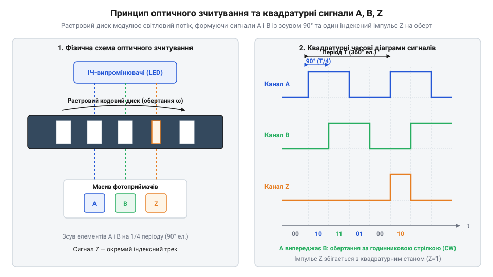
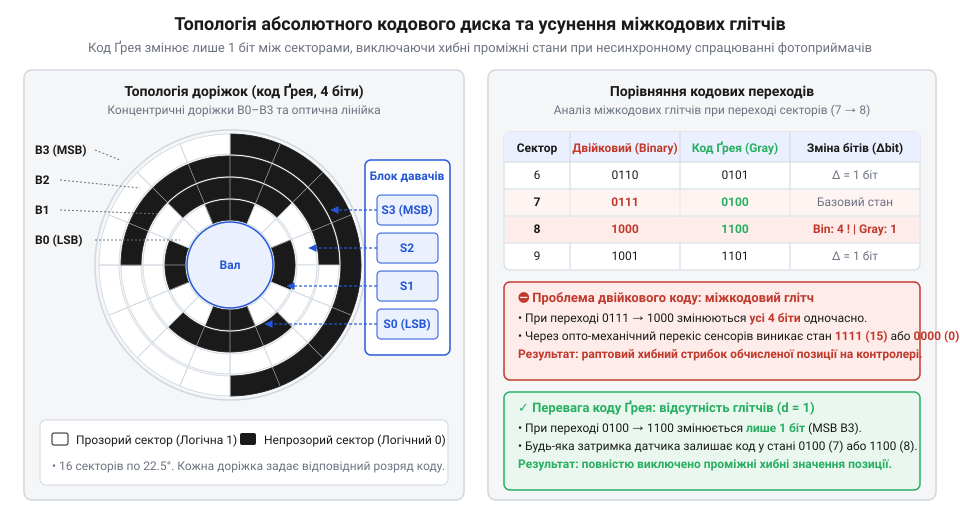
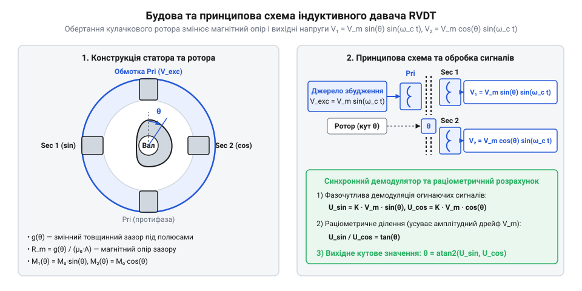
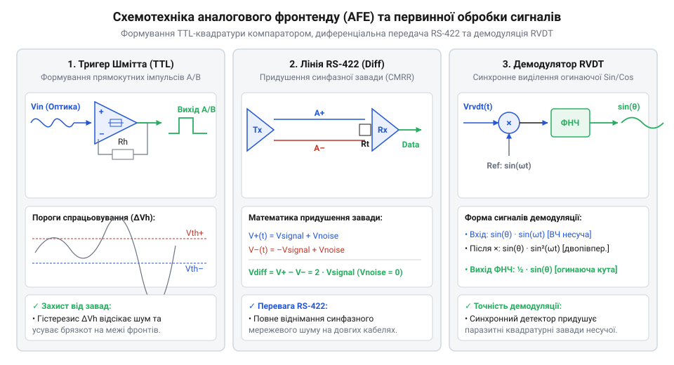

# Оптичні та індуктивні давачі положення органів вводу

<preknowlist>
- [Поворотний потенціометр](root:cat-hw-controls/rotary-potentiometer) — Принцип аналогового зчитування кута обертання та його обмеження за зносостійкістю.
- [Оптичні та механічні інкрементальні енкодери](root:cat-hw-controls/rotary-encoders-quadrature) — Базові поняття про інкрементальне лічіння імпульсів та контактні механічні енкодери.
- [Дрейф нуля та калібрування органів вводу](root:cat-hw-controls/stick-drift-mitigation) — Методи калібрування нейтрального положення та компенсації температурного й механічного відхилення.
</preknowlist>

## Проблема зносу та оптичне вирішення

Традиційні графітові доріжки, на яких побудовано [поворотний потенціометр](root:cat-hw-controls/rotary-potentiometer), піддаються неминучому фрикційному зносу під час активного обертання, що спричиняє шуми й дрейф потенціалу. Для створення безконтактних органів вводу застосовують оптичну модуляцію: світлодіод просвічує обертовий диск із радіальними прозорими та непрозорими секторами, а фотоприймачна матриця фіксує переривання світлового потоку.

*Формування фазово зсунутих на 90° квадратурних сигналів A і B для визначення напрямку обертання.*

Щоб визначати не лише швидкість, а й напрямок руху, застосовують дві фотодіодні маски, які формують квадратурні сигнали (від англ. @@en|quadrature signals@@) `A` і `B`, зсунуті за фазою на `90°`. Додаткова нульова мітка `Z` дає один індексний імпульс на оберт для прив'язки відліку, що детально описують [оптичні та механічні інкрементальні енкодери](root:cat-hw-controls/rotary-encoders-quadrature).

## Абсолютне оптичне кодування й код Ґрея

При знеструмленні контролера інкрементальні сенсори втрачають поточну позицію, вимагаючи виходу в нульову точку при повторному ввімкненні. Для миттєвого визначення кута застосовують абсолютні диски із кількома концентричними кодовими доріжками, де кожному кутовому сектору відповідає унікальне цифрове слово.

*Мапування доріжок абсолютного диска у коді Ґрея для усунення некоректних транзитних станів.*

Якщо використовувати звичайний двійковий код, при переході між сусідніми секторами (наприклад, `0111` в `1000`) через асинхронність спрацьовування фотоприймачів виникають короткочасні міжкодові глітчі (від англ. @@en|inter-code glitch@@). Для запобігання аномаліям кодовий диск розмічають кодом Ґрея (від англ. @@en|Gray code@@), у якому при переході між сусідніми позиціями змінюється стан лише одного біта. Детальніше це розкривають [абсолютні поворотні енкодери](root:cat-hw-controls/rotary-encoders-absolute-single-multi-turn).

## Індуктивне зчитування та трансформатори RVDT

У важких умовах експлуатації зі запиленістю, оксидною вологістю або постійною вібрацією оптичні лінзи та растрові диски забруднюються. Для таких середовищ застосовують індуктивні давачі положення, принцип роботи яких базується на взаємній індукції.

*Конструкція індуктивного давача з первинною обмоткою та вторинними диференціальними котушками.*

Безконтактні [обертові трансформатори RVDT](root:cat-hw-controls/rvdt-operating-principles) (від англ. @@en|Rotary Variable Differential Transformer@@, @@en|RVDT@@) мають первинну обмотку збудження та дві вторинні обмотки, увімкнені зустрічно: зміна кута ротора перерозподіляє магнітний опір повітряних зазорів, пропорційно змінюючи амплітуду вихідної напруги. У компактних органах вводу використовують планарні PCB-котушки, де струмопровідний пелюстковий ротор під час обертання наводить вихрові струми (від англ. @@en|eddy currents@@) за законом Ленца, послаблюючи індуктивний зв'язок відповідних секторів без фізичного контакту.

## Схемотехніка збудження, демодуляції та інтерполяції

Первинні аналогові сигнали сенсорів вимагають підготовки для обробки мікроконтролером. Фотодіодні струми оптичних давачів підсилюються трансімпедансними каскадами (від англ. @@en|transimpedance amplifier@@), оцифровуються тригерами Шмітта та передаються диференціальними трансиверами RS-422 для усунення синфазних наводок.

*Схема підготовки сигналів енкодера з диференціальним підсилюванням RS-422 та оцифруванням.*

Для індуктивних давачів генератор формує високочастотне синусоїдальне збудження, а вихідні амплітудно-модульовані сигнали вторинних котушок випрямляються фазочутливим синхронним демодулятором (від англ. @@en|synchronous demodulator@@) для виділення огинаючих синуса та косинуса. Шляхом аналогово-цифрового перетворення та обчислення арктангенса `atan2` виконується цифрове інтерполювання, що підвищує роздільну здатність зчитування кута.

## Вибір давача під умови експлуатації

Вибір між оптичними та індуктивними сенсорами визначається вимогами до роздільної здатності й умов довкілля. Оптичні давачі забезпечують найвищу дискретність (понад `10000` імпульсів на оберт), проте є чутливими до пилу й термомеханічних деформацій. Індуктивні давачі мають абсолютну герметичність IP67/IP69K, однак вимагають компенсації температурного дрейфу.

Застосування раціометричного обчислення (від англ. @@en|ratiometric calculation@@) `atan2(V_sin, V_cos)` скасовує вплив температурних коливань живлення й розширення плати. Для відповідальних органів керування реалізують резервовані дубльовані канали (від англ. @@en|redundant dual channels@@) сенсорів та [калібрування органів вводу](root:cat-hw-controls/stick-drift-mitigation) для діагностики відхилень у реальному часі.
