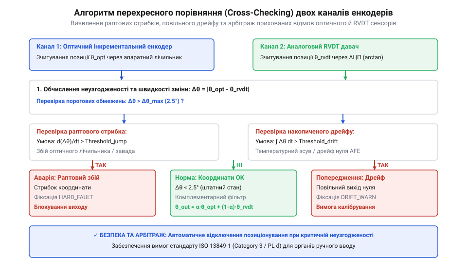
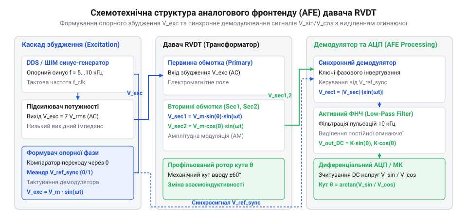

# Модуль обробки сигналів оптичного енкодера та індуктивного давача RVDT для промислового штурвала

<preknowlist>
- [Оптичні та механічні інкрементальні енкодери](root:cat-hw-controls/rotary-encoders-quadrature) — принцип формування квадратурних сигналів A, B та індексного імпульсу Z
- [Дрейф нуля та калібрування органів вводу](root:cat-hw-controls/stick-drift-mitigation) — механізми виявлення часового зсуву координат та компенсації нульового положення
</preknowlist>

## Архітектура двоканального зчитування кутового положення

У відповідальних системах керування, таких як авіаційні штурвали, операторські пульти бурових установок або селектори важкої будівельної техніки, одноканальні вимірювачі створюють ризик катастрофічної відмови. Випадковий оптичний розрив, механічний дрейф чи апаратний збій одного сенсора в умовах вібрацій та електромагнітних завад може призвести до втрати контролю над об'єктом. Для гарантування високої надійності використовують гетерогенне (різнорідне) дублювання, поєднуючи дві принципово різні технології вимірювання кута повороту: оптичну та індуктивну.

Оптичний інкрементальний енкодер забезпечує високу роздільну здатність і швидку динаміку зчитування квадратурних імпульсів A та B, проте втрачає абсолютну координату при збої живлення та чутливий до оптичного забруднення диска. Детальний принцип формування квадратурного сигналу розглянуто в матеріалі про [оптичні та механічні інкрементальні енкодери](root:cat-hw-controls/rotary-encoders-quadrature). Другий канал будується на основі безконтактного індуктивного давача @@en|RVDT@@ (англ. *Rotary Variable Differential Transformer* — обертовий змінно-диференціальний трансформатор). Давач RVDT є міцним пристроєм без зношуваних контактів, який зберігає працездатність у брудному середовищі, але має обмежену аналогову точність. Фізичні основи індукційного перетворення кута детально розкрито у матеріалі про [принцип роботи та конструкцію давача RVDT](root:cat-hw-controls/rvdt-operating-principles).

Поєднання оптичного та індуктивного каналів дозволяє реалізувати безперервний перехресний моніторинг (@@en|Cross-Comparison@@). Оптичний канал надає точні значення кутової швидкості та мікропереміщень, а RVDT забезпечує миттєву фіксацію абсолютної позиції при включенні живлення та верифікує відсутність пропуску імпульсів.

При зведенні підсумкової координати виміряні кути двох каналів усереднюються за допомогою вагових коефіцієнтів, співвідношення яких визначається роздільною здатністю та спектральним шумом кожного давача. Оскільки оптичний енкодер володіє високою дискретністю та відсутністю аналогових наводок, йому надається більша вага (наприклад, `w_opt = 0.7`), що гарантує високу точність і плавність відслідковування швидких операторських дій. Індуктивний канал @@en|RVDT@@ забезпечує абсолютний відлік, але схильний до дрібномасштабного амплітудного шуму AFE, тому його ваговий коефіцієнт обирають меншим (`w_rvdt = 0.3`), що дозволяє безперервно компенсувати накопичений дрейф оптичного каналу без погіршення загальної динаміки інтерфейсу при дотриманні умови нормування `w_opt + w_rvdt = 1.0`.

Окрім виявлення електричних відмов, дубльована архітектура дозволяє діагностувати механічне проковзування муфти (@@en|Shaft Coupling Slippage@@), яка з'єднує ротор штурвала з первинними давачами. Критерієм виявлення механічного зсуву є наявність прогресуючого часового дрейфу (@@en|Cumulative Position Drift@@) між кутами `θ_QEI` та `θ_RVDT` під час інтенсивного реверсивного обертання. Якщо під час динамічного маневру кутова швидкість оптичного каналу `dθ_QEI/dt` значно перевищує швидкість індуктивного каналу `dθ_RVDT/dt` (помилка похідної `Δω > ω_thresh`), або якщо після зупинки вала залишковий кутовий зсув `Δθ_rest` перестає повертатися до нуля і стабільно зростає від циклу до циклу, контролер ідентифікує це як механічне послаблення фіксуючих гвинтів або проковзування фрикційної муфти. На відміну від електричного брязкоту, механічне проковзування має монотонний накопичувальний характер, тому при досягненні накопиченого порогу (наприклад, `|Δθ_rest| > 3.0°`) система деактивує прапорець здоров'я `system_healthy = false` і генерує діагностичне сповіщення про необхідність механічного обслуговування вузла.

*Блок-схема алгоритму перехресного порівняння координат оптичного та RVDT каналів з арбітражем відмов.*

При виявленні відхилення між координатами двох каналів, що перевищує заданий поріг, система фіксує подійний розсинхрон і переходить у захищений режим, запобігаючи хибному спрацьовуванню виконавчих механізмів.

## Приймальний каскад RS-422 оптичного каналу

Передача високочастотних квадратурних сигналів оптичного енкодера подовженими кабелями в промислових умовах супроводжується значними імпульсними завадами та наводками від силових перетворювачів. Для захисту інформаційних ліній застосовують диференціальний фізичний інтерфейс стандарту @@en|RS-422@@ (англ. *Recommended Standard 422*). Сигнали фаз A, B та індексного імпульсу Z передаються у вигляді витих пар протифазних напруг (A+/A-, B+/B-, Z+/Z-).

На вході електронного модуля розташовується узгоджувальний термінатор — резистор `R_T = 120` Ом, підключений паралельно між прямою та інверсною лініями витої пари. Він узгоджує імпеданс кабелю й запобігає відбиванню високочастотних сигналів від кінців лінії. Для зрізання високочастотних наводок кожна лінія оснащується симетричним RC-фільтром низьких частот із послідовними резисторами `R_f = 22` Ом та шунтувальним керамічним конденсатором `C_f = 100` пФ. Для забезпечення завадостійкості важливе значення має розрахунок допустимої синфазної завади, яка наводиться одночасно на обидва провідники витої пари. Синфазна напруга визначається як середнє арифметичне потенціалів ліній `V_CM = (V_A+ + V_A-) / 2`. Стандарт @@en|RS-422@@ регламентує допустимий діапазон синфазної напруги диференціального приймача в межах від `V_CM_min = -7` В до `V_CM_max = +12` В відносно землі приймача `GND`. З урахуванням власного постійного зсуву вихідного каскаду передавача `V_OS ≈ 2.5` В, максимальна допустима амплітуда синфазної завади обчислюється як `V_noise_max = V_CM_max - V_OS = 12 - 2.5 = 9.5` В у позитивній полярності та `V_noise_min = V_CM_min - V_OS = -7 - 2.5 = -9.5` В у негативній. Перевищення цих меж призводить до насичення вхідних транзисторів диференціального каскаду, різкого падіння коефіцієнта пригнічення синфазної завади @@en|CMRR@@ (англ. *Common-Mode Rejection Ratio*) та виникнення хибних логічних перемикань на виході приймача.

Основою приймального каскаду є диференціальний приймач ліній (@@en|Differential Line Receiver@@), такий як мікросхема MAX3095 або AM26LV32. Вхідний каскад приймача обробляє різницю потенціалів між провідниками витої пари:

    V_diff = V_plus - V_minus
    [Порогова напруга перевищує ±200 мВ]

Спеціальний тригер Шмітта (@@en|Schmitt Trigger@@) із вбудованим гістерезисом 50 мВ перетворює аналогову різницю напруг у чисті логічні рівні TTL/CMOS, усуваючи брязкіт на фронтах імпульсів. Для захисту від обриву кабелю застосовують схему захисного зсуву (@@en|Fail-Safe Biasing@@): внутрішня підтяжка лінії A+ до живлення `V_CC` через 4.7 кОм та лінії A- до землі `GND` фіксує високий логічний рівень на виході приймача у випадку відключення давача. Для збереження фронтів імпульсів при максимальній швидкості обертання вала (наприклад, 6000 об/хв при 4096 PPR, що дає частоту проходження сигналів `f_sig = 409.6` кГц) гранична частота зрізу вхідного RC-фільтра обчислюється як `f_c = 1 / (2π · R_f · C_f) = 1 / (2π · 22 · 100 · 10⁻¹²) ≈ 72.3` МГц. Таке значення створює багатократний запас за смугою пропускання, запобігаючи фазовому зсуву меандрів квадратури і водночас пригнічуючи високочастотні радіочастотні наводки в кабелі.

## Аналоговий фронтенд давача RVDT

Аналоговий фронтенд (@@en|AFE@@, *Analog Front-End*) індуктивного давача RVDT забезпечує збудження первинної обмотки та обробку вихідних сигналів вторинних обмоток. Первинна обмотка потребує високостабільного синусоїдального живлення частотою 5–10 кГц та амплітудою 3–5 В RMS. Згенерований мікроконтролером генератор ШІМ з подальшою активною фільтрацією або генератор на операційному підсилювачі подає збуджувальну напругу:

    U_exc(t) = U_m · sin(2π · f_exc · t)
    [Формування опорного гармонійного сигналу]

Кутове зміщення ротора RVDT змінює коефіцієнт взаємоіндукції між первинною та двома вторинними обмотками. Вторинні напруги e₁(t) та e₂(t) змінюють амплітуди пропорційно синусу й косинусу кута повороту вала θ:

    e₁(t) = K · U_m · sin(θ) · sin(2π · f_exc · t + φ)
    e₂(t) = K · U_m · cos(θ) · sin(2π · f_exc · t + φ)
    [Модуляція опорної частоти кутом повороту]

*Схемотехнічна структура аналогового фронтенду RVDT із генератором збудження та синхронним демодулятором.*

Для виділення корисного сигналу огинаючої застосовують синфазне демодулювання (@@en|Phase-Sensitive Demodulation@@). Синхронний детектор на аналогових ключах (наприклад, ADG1419), керований опорним сигналом збудження, множить вторинні напруги на фазований прямокутний меандр. Наступний активний фільтр низьких частот 4-го порядку Саллена-Кі з частотою зрізу 500 Гц видаляє носійну частоту f_exc, формуючи постійні напруги V_sin та V_cos, які подаються на входи аналого-цифрового перетворювача (АЦП) мікроконтролера. Схемотехнічно фільтр будується шляхом каскадування двох активних ланок Саллена-Кі 2-го порядку, що дає підсумкову передавальну функцію `H_total(s) = H₁(s) · H₂(s)`:

    H_total(s) = K_total / [((s / ω_c)² + s / (Q₁ · ω_c) + 1) · ((s / ω_c)² + s / (Q₂ · ω_c) + 1)]
    [Передавальна функція активного ФНЧ 4-го порядку]

де `ω_c = 2π · 500` рад/с — кутова частота зрізу, `K_total` — статичний коефіцієнт передачі, а розраховані добротності ланок Баттерворта `Q₁ ≈ 0.541` та `Q₂ ≈ 1.307` гарантують плоску АЧХ у смузі пропускання з крутизною спаду `-80` дБ/декаду, що послаблює носійну частоту збудження `f_exc` (5–10 кГц) щонайменше на 40 дБ.

## Апаратне декодування квадратури та АЦП

Для обробки високочастотних сигналів від інкрементального оптичного давача та аналогових напруг від RVDT без завантаження центрального процесора застосовують апаратну периферію мікроконтролера. Обробка квадратурного сигналу покладається на спеціалізований периферійний модуль @@en|QEI@@ (англ. *Quadrature Encoder Interface* — інтерфейс квадратурного енкодера), який апаратно відстежує фронти сигналів A та B, автоматично інкрементуючи або декрементуючи 32-бітний лічильник таймера залежно від напрямку обертання. Принципи формування квадратурного сигналу описано у матеріалі про [інкрементальні енкодери](root:cat-hw-controls/rotary-encoders-quadrature). Фіксація індексного імпульсу Z скидає лічильник або зберігає поточний відлік у регістрі захоплення для прив'язки до абсолютного нуля.

Паралельно з цим апаратний аналого-цифровий перетворювач (АЦП) зчитує вихідні напруги аналогового фронтенду RVDT. Для усунення процесорного накладу запуск перетворень АЦП здійснюється за тригером системного таймера з фіксованою частотою дискретизації, а передача вибірок у оперативну пам'ять відбувається через модуль прямого доступу до пам'яті (@@en|DMA@@, англ. *Direct Memory Access*). Зчитані у циклічний буфер значення піддаються цифровому усередненню для пригнічення високочастотного шуму.

При тривалому безперервному обертанні штурвала в одному напрямку значення 32-бітного лічильника таймера QEI неминуче досягає верхньої чи нижньої межі (від `-2 147 483 648` до `+2 147 483 647` відліків). Для запобігання аномальним стрибкам обчисленого кута при апаратному переповненні використовують властивості математичного додавання у додатковому коді. Оскільки роздільна здатність енкодера PPR (наприклад, 4096 імпульсів на оберт) є кратним дільником, операція взяття за модулем `pulse_count % PPR` коректно перераховує поточний стан лічильника у відносний кут циклічного діапазону `-180.0° ... +180.0°` навіть при факті переповнення 32-бітного регістра. Крім того, фіксація апаратного імпульсу Index (фаза Z) скидає накопичену похибку та поновлює точну прив'язку до фізичного нуля штурвала.

Отримані сирі відліки перераховуються у фізичні кутові координати. Для QEI кут обчислюється пропорційно роздільній здатності енкодера PPR (англ. *Pulses Per Revolution*):

    θ_QEI = (N_pulse / PPR) · 360°
    [Обчислення кута за кількістю імпульсів QEI]

Для індуктивного давача RVDT усереднена напруга АЦП перетворюється у кут з урахуванням чутливості та опорного зсуву пів-шкали:

    θ_RVDT = (V_ADC - V_ref/2) / S_RVDT
    [Обчислення кута за напругою огинаючої RVDT]

У файлі `proj-dual-technology-rotary-input-interface/c/src/encoder_driver.c` наведено функції первинної обробки сирих даних:

:::code proj-dual-technology-rotary-input-interface/c/src/encoder_driver.c 36-83

## Алгоритм перехресного моніторингу та діагностики

Після формування фізичних координат обох каналів виконується їхній циклічний перехресний моніторинг (@@en|Cross-Comparison@@) у кожному такті керування. Алгоритм арбітражу порівнює абсолютну різницю кутів `Δθ = |θ_QEI - θ_RVDT|` із максимально допустимим пороговим значенням. 

Якщо різниця `Δθ` перебуває у межах норми, вихідне значення кута штурвала формується шляхом вагового усереднення: оптичний канал забезпечує високу динамічну точність, а RVDT компенсує накопичену похибку. При цьому апаратний дрейф та методика усунення нульового зсуву аналогічні принципам, які описано у матеріалі про [калібрування органів вводу](root:cat-hw-controls/stick-drift-mitigation).

У разі перевищення допустимого допуску алгоритм переводить систему у стан фіксації тимчасової розбіжності (@@en|Discrepancy Event@@) та запускає таймер спостереження. Якщо розбіжність триває довше заданого часового вікна (наприклад, 100 мс), формується критичний прапор відмови, і система переходить у безпечний режим (@@en|Fail-Safe@@), блокуючи вихідні команди або перемикаючись на резервний канал. Після фізичного усунення несправності процедура скидання аварії (функція `yoke_reset_fault`) перевіряє факт повернення відхилення `Δθ` у допустиму норму та наявність прапорця апаратного здоров'я `signal_valid`. Лише після цього статус компаратора повертається до норми (`COMPARE_OK`). Для компенсації залишкового зсуву координат запускається автоматичне самокалібрування нульової точки (`start_auto_zero_calibration`): у нейтральному положенні штурвала накопичується вибірка відліків (наприклад, `N = 50`), за якими обчислюється середнє відхилення і коригуються зсуви `zero_offset_optical_deg` та `zero_offset_rvdt_deg`, відновлюючи стан повної достовірності даних (`CALIBRATED`).

Логіку порівняння та обробку часового таймауту розбіжності реалізовано у функції `yoke_process_cycle`:

:::code proj-dual-technology-rotary-input-interface/c/src/encoder_driver.c 85-125

У C++ драйвері ця логіка інкапсульована у класі `DualEncoderDriver`, який додатково реалізує фільтрацію аномальних стрибків та реєстрацію зворотних викликів (@@en|Callback@@):

:::code proj-dual-technology-rotary-input-interface/cpp/src/dual_encoder_driver.cpp 125-180
