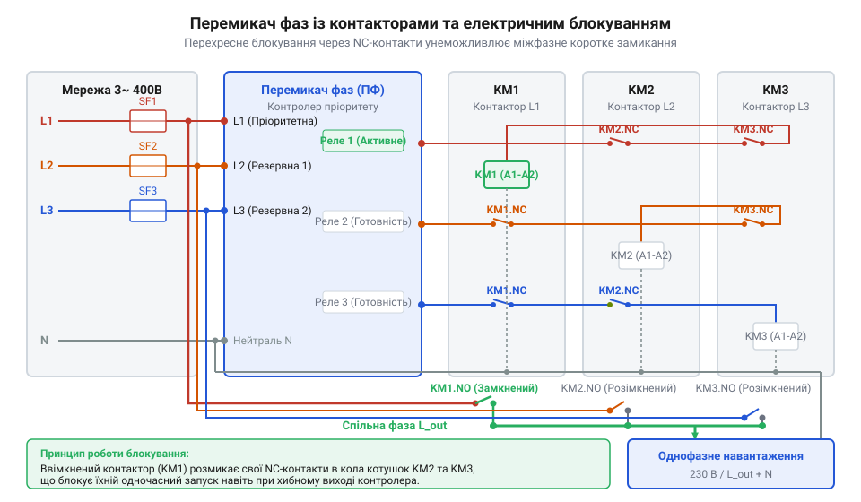
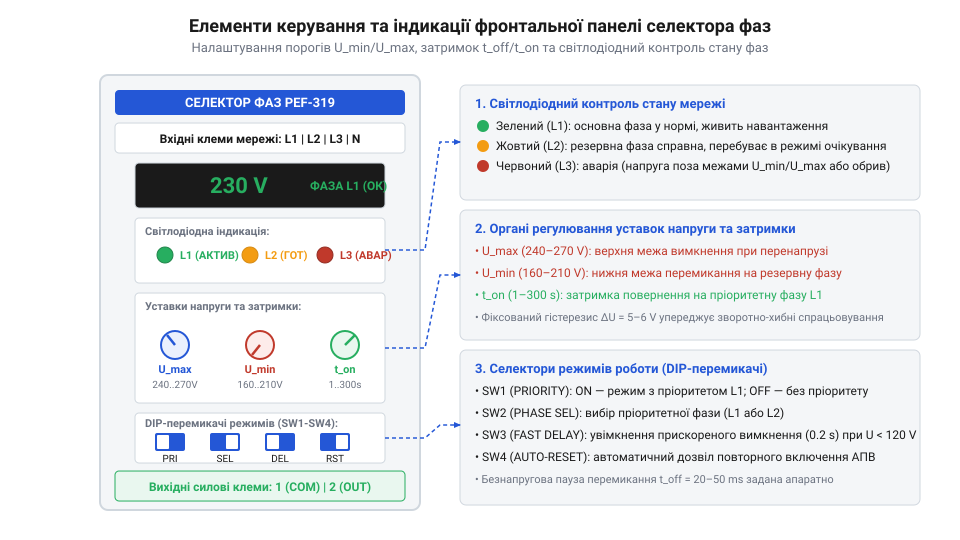

# Схеми підключення, клемні позначення та налаштування перемикачів фаз

<preknowlist>
- [Багатопозиційні галетні перемикачі (Rotary Switches)](root:cat-hw-controls/rotary-selector-switches) — Принцип багатопозиційного вибору кіл та ручної комутації фаз.
- [Ротаційні кодові DIP-перемикачі (Rotary DIP Switches)](root:cat-hw-controls/rotary-dip-switches) — Дискретне налаштування часових уставок та параметрів за допомогою кодових перемикачів.
- [Поворотний потенціометр](root:cat-hw-controls/rotary-potentiometer) — Аналогове регулювання опору для встановлення порогів напруги спрацьовування.
</preknowlist>

## Аварійне перекошення фаз і потреба селекції

У трифазних мережах електроживлення часто виникає ситуація, коли навантаження на окремі лінії розподіляється нерівномірно. Це призводить до явища, відомого як @@en|phase unbalance@@ (від англ. @@en|unbalance@@ — нерівновага, несиметрія), під час якого напруга на одній із фаз просідає нижче допустимої норми, тоді як на іншій зростає до небезпечних значень. Додатковою аварійною загрозою є @@en|обрив фази@@ внаслідок пошкодження повітряних ліній або спрацьовування запобіжників на трансформаторній підстанції. Для трифазного обладнання це загрожує виходом з ладу, а для критичних однофазних споживачів — повним знеструмленням.

Однофазні пристрої, такі як системи опалення, медичне обладнання, сервери та вузли зв'язку, вимагають стабільної фазної напруги `230 V`. Коли живильна фаза зникає або її напруга виходить за безпечний діапазон (наприклад, падає нижче `180 V`), пристрій припиняє роботу. Раніше розв'язанням цієї проблеми слугували ручні [багатопозиційні галетні перемикачі](root:cat-hw-controls/rotary-selector-switches) або масивні [кулачкові перемикачі](root:cat-hw-controls/rotary-cam-switches), які вимагали постійної присутності чергового оператора для перемикання щита на справну лінію.

Сучасним розв'язком є автоматичний @@en|phase selector@@ (від лат. @@la|selector@@ — вибирач). Цей електронний пристрій безперервно вимірює напругу на всіх трьох фазах і при погіршенні якості поточного джерела автоматично перемикає однофазне навантаження на найбільш якісну фазу за час від `10` до `50 ms`. Математична ефективність селекції визначається розрахунком імовірності безперебійного живлення `P_uptime`. Якщо інтенсивність відмов кожної з трьох фаз дорівнює `λ`, а середній час відновлення становить `MTTR = 1 ÷ μ`, то ймовірність аварійного виходу окремої лінії за допуск дорівнює `q = λ ÷ (λ + μ)`. Оскільки відмови незалежних вхідних фаз є сукупністю незалежних подій, повне знеструмлення навантаження виникає лише при одночасному аварійному стані всіх трьох ліній з імовірністю `Q_blackout = q³`. Відповідно, підсумкова готовність системи живлення зростає до виразу:

        P_uptime
        = 1 - q³
        = 1 - (λ ÷ (λ + μ))³      [імовірність наявності хоча б однієї придатної фази]

При типовій імовірності відсутності однієї фази `q = 0.05` (5% часу) використання трифазного селектора зменшує ризик знеструмлення до `q³ = 0.000125` (0.0125%), підвищуючи безперебійність живлення з 95% до 99.9875%. Система може працювати в режимі з виділеним поняттям @@en|пріоритетна фаза@@ (наприклад, `L1`), на яку навантаження завжди повертається після відновлення її параметрів, або у безпріоритетному режимі вибору довільної придатної лінії.

## Призначення вимірювальних і силових клем

Конструктивно електронний перемикач фаз виконується в модульному корпусі для монтажу на DIN-рейку. Його зовнішній електричний інтерфейс розділено на дві функціональні групи: вимірювальні входи контролю мережі та вихідні силові контакти комутації. З'єднання дротів здійснюється через гвинтову або пружинну клемну колодку (від нім. @@de|Klemme@@ — затискач), розраховану на відповідний переріз провідників.

Вимірювальна група включає чотири клемні затискачі: `L1`, `L2`, `L3` та `N`. Клеми `L1`, `L2`, `L3` підключаються безпосередньо до трьох фазних живильних провідників вхідного ввідного автомата. Клема `N` підключається до нейтрального провідника мережі й є обов'язковою, оскільки внутрішня схема вимірювання та внутрішнє джерело живлення пристрою розраховують фазну напругу саме відносно нейтралі. Обрив кола нейтралі унеможливлює точне вимірювання напруги й блокує роботу селектора.

Вихідна група залежить від силової спроможності пристрою. У пристроях прямої комутації присутні вихідні клеми фази `L_out` та нейтралі. У селекторах, призначених для керування зовнішніми контакторами, вихідна група містить три незалежні перекидні контакти (від укр. *перекидати*). Кожна з трьох вихідних контактних груп має спільний вихід `COM` та нормально відкритий контакт `NO`, призначений для подачі напруги на котушку відповідного контактора. Внутрішня електронна схема забезпечує надійну @@en|гальванічна розв'язака@@ (від ім'я *Galvani*) між вимірювальними колами та вихідними реле. Якість цієї ізоляції квантифікується коефіцієнтом послаблення спільних завад `CMRR` (від англ. @@en|Common-Mode Rejection Ratio@@), який характеризує здатність вимірювальних трансформаторів або оптронів пригнічувати синфазні високовольтні імпульси `V_cm` між фазною мережею та чутливим вузлом контролю. Розрахунок `CMRR` у логарифмічних одиницях децибел `dB` виражається через відношення амплітуди вхідної спільної завади `V_cm` до амплітуди наведеного паразитичного диференційного сигналу `V_out_cm`:

        CMRR
        = 20 · lg(V_cm ÷ V_out_cm)      [логарифмічний коефіцієнт пригнічення спільних завад]

При випробувальному імпульсі спільної завади `V_cm = 1000 V` та максимально допустимому паразитичному шумі на компараторі `V_out_cm = 0.1 V` необхідне значення становить `CMRR = 20 · lg(1000 ÷ 0.1) = 80 dB`. Таке високе пригнічення гарантує, що потужні мережеві сплески напруги `400 V` не спричинять хибного перемикання реле.

## Схеми прямої та контакторної комутації

Вибір принципової схеми підключення залежить від споживаного струму навантаження. Якщо струм споживача не перевищує номінальний струм внутрішніх реле пристрою (зазвичай `16 A`, що відповідає потужності близько `3.5 kW`), застосовують схему прямої комутації. У цьому разі фазні провідники `L1`, `L2`, `L3` та нейтраль `N` подаються на вхідні клеми, а силовий провідник навантаження підключається безпосередньо до вихідної клеми `L_out`.

Для живлення потужних об'єктів із струмом споживання `25 A`, `40 A`, `63 A` і більше вихідні контакти селектора фаз не здатні витримати пускові та робочі струми. У таких щитах застосовують схему керування трьома зовнішніми силовими контакторами `KM1`, `KM2`, `KM3`. Виходи `NO1`, `NO2`, `NO3` перемикача фаз подають керуючу напругу лише на котушки цих контакторів, а самі контактори комутують силові лінії.

*Принципова електрична схема керування трьома контакторами із задіянням нормально закритих допоміжних контактів для взаємного блокування.*

Для запобігання фазному короткому замиканню напругою `400 V` у разі залипання контактів одного з контакторів, у схему обов'язково вмикають перехресне електричне блокування. Нормально закриті допоміжні контакти `NC` контактора `KM1` вмикаються послідовно в коло живлення котушки контактора `KM2`, і навпаки. Це гарантує, що котушка контактора другої фази не отримає живлення, поки фізично не розімкнеться перший контактор. Для абсолютного усунення ризику міжфазного дугового перекриття часовий інтервал перемикання повинен розраховуватися з урахуванням гасіння електричної дуги `t_arc`. Повний час гасіння струму `t_ext` складається з механічного часу розмикання ламелей `t_off_mech` та тривалості горіння дуги до першого переходу струму через нуль `t_arc ≈ 1 ÷ (2 · f) = 10 ms` (при частоті `f = 50 Hz`). Мінімально необхідний дугогасний інтервал `Δt_dead` між розмиканням допоміжного `NC`-контакту першого контактора та замиканням головних `NO`-контактів другого контактора з механічним часом ввімкнення `t_on_mech` обчислюється за формулою:

        Δt_dead
        = t_off_mech + t_arc - t_on_mech      [розрахунок дугогасного паузи між контакторами]

При типових значеннях `t_off_mech = 15 ms`, `t_arc = 10 ms` та `t_on_mech = 20 ms` розрахована пауза дорівнює `Δt_dead = 15 + 10 - 20 = 5 ms`, що вимагає додавання технічного запасу завадостійкості `t_margin ≈ 10 ms` для гарантованої відсутності міжфазної дуги `400 V`.

## Налаштування порогів та часових затримок

Для адаптації селектора фаз під вимоги конкретного обладнання на його передній панелі передбачено органи налаштування електричних і часових параметрів. Основними електричними параметрами є нижній поріг напруги `U_min` та верхній поріг `U_max`. Нижній поріг регулюється у діапазоні `160–210 V`, а верхній — у діапазоні `230–280 V`. Встановлення аналогових уставок здійснюється через підлаштувальний [поворотний потенціометр](root:cat-hw-controls/rotary-potentiometer), шліц якого виведено на передню панель.

Часові параметри охоплюють затримку вимкнення `t_off` та затримку автоматичного повторного ввімкнення `t_on`. Затримка вимкнення `t_off` (налаштовується від `0.1` до `10 s`) запобігає хибним спрацьовуванням при короткочасних імпульсних просіданнях напруги, спричинених пуском потужних електродвигунів. Затримка ввімкнення `t_on` (налаштовується від `1` до `600 s`) необхідна після відновлення якості фази, щоб дати мережі стабілізуватися та захистити компресорне обладнання від частих запусків. У холодильних та кондиціонерних установках миттєва повторна подача живлення призводить до руйнівного гідроудару (від англ. @@en|hydraulic shock@@, або @@en|liquid slugging@@ — влучання рідкої фази холодоагенту в циліндр компресора). Під час раптової зупинки компресора між стороною нагнітання високого тиску `P_h` та стороною всмоктування низького тиску `P_l` зберігається значний перепад тиску `ΔP_max = P_h - P_l`. Якщо повторно ввімкнути двигун без паузи, пусковий момент не зможе подолати протитиск `ΔP`, що спричинить заклинювання ротора, пробій ізоляції через перегрів або механічне руйнування клапанної групи. Вирівнювання тиску через капілярну трубку чи розширювальний вентиль відбувається за експоненціальним законом із постійною часу холодильного контуру `τ_press` (зазвичай від `60` до `180 s`):

ΔP(t) = ΔP_max · e^(-t ÷ τ_press)              [модель експоненціального вирівнювання тиску хладагента]

Для гарантії того, що залишковий перепад тиску на момент пуску `ΔP(t_on)` не перевищить безпечного значення `ΔP_safe` (при якому пусковий момент двигуна достатній для розгону), мінімальну часову затримку АПВ `t_on` обчислюють за формулою:

t_on = τ_press · ln(ΔP_max ÷ ΔP_safe)          [розрахунок мінімальної затримки АПВ для компресора]

Завдяки встановленню затримки `t_on ≥ 180–300 s` тиск у контурі встигає повністю зрівнятися, що гарантує легкий пуск електродвигуна з нульовим протитиском і повністю виключає небезпеку гідроудару.

*Розташування органів регулювання уставок напруги, часових затримок та світлодіодних індикаторів станів на фронтальній панелі.*

Дискретне виставляння затримок та вибір пріоритету фази у компактних реле здійснюється за допомогою мікроперемикачів, серед яких застосовують [ротаційні кодові DIP-перемикачі](root:cat-hw-controls/rotary-dip-switches). Зміна комбінації важелів перемикача задає точний часовий інтервал за двійковою або кроковою сіткою уставок. Для більш складних електронних моделей розширені параметри задають через [цифрові меню та програмування селекторів фаз](root:cat-hw-controls/phase-selector-digital-microprocessor-menu) за допомогою РК-дисплея та кнопочного інтерфейсу.

## Індикація станів та пусконалагодження

Для візуального контролю роботи та швидкої діагностики аварій на передній панелі перемикача фаз розташовано світлодіодні індикатори. Індикатори фаз `L1`, `L2`, `L3` сигналізують про стан відповідних вхідних ліній: зелене світіння вказує на норму напруги, червоне або блимаюче — про вихід за межі `U_min`/`U_max` або перекіс фаз, а відсутність світіння означає повний обрив фази. Окремий світлодіод `Load` підтверджує наявність напруги на виході та вказує, яка саме фаза наразі підключена до споживача.

Пусконалагодження вузла починається з перевірки знеструмленого монтажу та надійності затяжки клемних гвинтів. Далі за допомогою мультиметра виконують перевірку правильного фазування на вхідному автоматі, переконуючись у відсутності міжфазного замикання та присутності нейтралі `N`. Після подачі напруги перевіряють відповідність світлодіодної індикації реальним значенням напруги на кожній фазі.

Для підтвердження працездатності здійснюють тестове імітування аварії шляхом почергового вимкнення вхідних захисних автоматів фаз `L1`, `L2`, `L3`. Під час вимкнення активної фази пристрій повинен безперебійно переключити контактор на наступну справну фазу за час `t_off`. Після ввімкнення вимкненого автомата селектор має витримати часову затримку `t_on` і повернутися на пріоритетну лінію. Регламентне обслуговування полягає в періодичному підтягуванні гвинтових клем та очищенні вентиляційних отворів корпусу від пилу.
