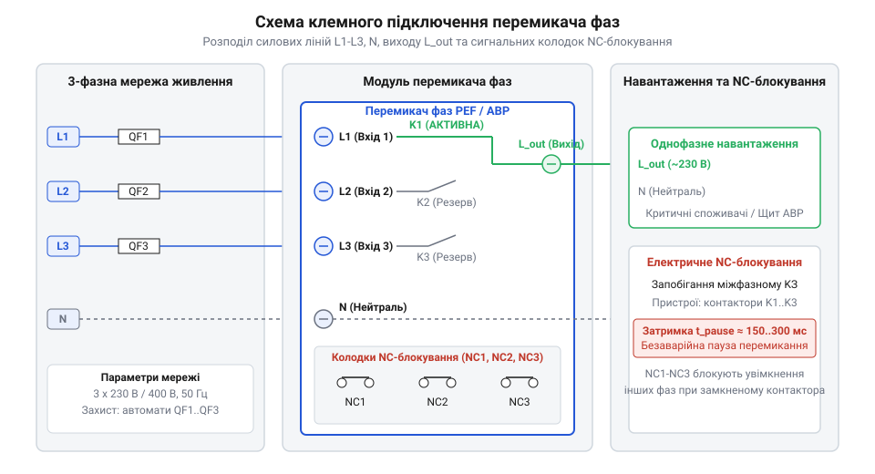
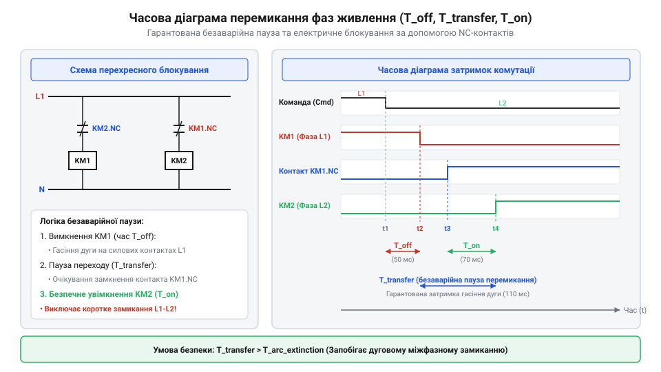

# Залізний інтерфейс: схема клем, часові діаграми та карти комутації перемикачів фаз

<preknowlist>
- [Кулачкові перемикачі (Cam Switches) та пакетні вимикачі](root:cat-hw-controls/rotary-cam-switches) — Принцип побудови кулачкового механізму та пакетних контактних груп
</preknowlist>

## Небезпека помилок підключення силових фаз

Пряме підключення кількох незалежних фаз трифазної мережі до єдиної шини навантаження супроводжується ризиком виникнення міжфазного короткого замикання (від англ. @@en|short circuit@@ — коротке замикання). У промислових та побутових мережах лінійна напруга між двома довільними фазними провідниками `L1`, `L2` чи `L3` становить 400 В змінного струму (від англ. @@en|alternating current@@ — змінний струм). Якщо схемотехніка автоматичного або ручного перемикача фаз (від англ. @@en|phase selector@@ — перемикач фаз) припуститься одночасного замкнення двох силових контактів, амплітуда витоку струму обмежиться лише власним опором джгутів та трансформаторної підстанції. Енергія аварійного дугового розряду пропорційна накопиченій у навантаженні магнітній енергії `E_arc = 1/2 · L · I²` та сталі часу `L/R`: що більша індуктивність кола відносно його активного опору, то довше підтримується іонізований плазмовий канал під час розмикання. Тривалість палання дуги критично залежить від швидкості розходження контактних накладок — недостатня швидкість не дає розриву швидко деіонізуватися, що призводить до миттєвого випаровування контактів, пробою ізоляції та газодинамічного вибуху всередині розподільного щита.

Головна фізична причина аварійних режимів під час комутації полягає в електричній дузі, яка спалахує між контактами в момент їхнього розмикання під навантаженням. Навіть коли рухомий контакт вже відійшов від нерухомого непорушного статора, іонізований повітряний проміжок продовжує проводити струм. Якщо другий контакт замкнеться на сусідню фазу раніше, ніж згасне дуга на першому, виникне міжфазне дугове замикання через спільний вихідний провідник `L_out`.

Щоб унеможливити подібні аварії, усі перемикальні пристрої силових кіл розробляють за суворим принципом розмикання перед замкненням (від англ. @@en|break-before-make@@). Механічні пристрої, такі як [кулачкові перемикачі](root:cat-hw-controls/rotary-cam-switches), гарантують цей режим кутовим проміжком між пазами кулачкової шайби. В автоматичних перемикачах фаз та блоках АВР цей захист реалізують комбінацією часових затримок керування та апаратного електричного блокування силових контакторів.

У силових модулях високої потужності природного розходження контактів недостатньо для миттєвого гасіння дуги, тому контактні камери оснащують дугогасними решітками (від англ. @@en|arc chute@@ — дугогасна решітка) та системами магнітного дуття (від англ. @@en|magnetic blowout@@ — магнітне дуття). Дугогасна решітка складається з пакета ізольованих сталевих пластин, які розбивають суцільну електричну дугу на серію коротких послідовних дуг. Це помножує сумарне падіння напруги в околоелектродних зонах та інтенсивно відводить тепло через конвективний контакт із металом. Магнітне дуття, створюване постійними магнітами або струмовими котушками, ґрунтується на силі Лоренца: вона виштовхує іонізований плазмовий шнур углиб дугогасної камери зі швидкістю понад 100 м/с, забезпечуючи стрімку деіонізацію повітряного розриву та гасіння розряду за долі півперіоду мережевої напруги.

## Схема клем та призначення сигналів

Залізний інтерфейс перемикача фаз складається з силової групи клем для комутації струму навантаження та сигнально-контрольної групи для моніторингу мережі й керування блокуванням. Силові клеми розраховані на значні перерізи провідників (від 2.5 мм² до 16 мм²) та забезпечуються ґвинтовими чи пружинними затискачами з нормованим моментом затягування.

Вхідна силова група містить три фазні клеми `L1`, `L2`, `L3` для підключення відповідних фаз вхідної трифазної мережі 230/400 В та клему робочого нуля `N` (від англ. @@en|neutral@@ — нейтраль). Нейтральний провідник необхідний для живлення внутрішньої електронної схеми контролю напруги та вимірювання фазного потенціалу кожної лінії відносно нуля. Вихідна силова клема `L_out` призначена для підключення фазної жили однофазного споживача або групи навантажень. Розрахунок перерізу фазних та нейтрального провідників залежить від струмового навантаження та симетрії мережі. Якщо за симетричного синусоїдального навантаження векторна сума струмів у нейтралі прямує до нуля, то за несиметрії фаз або наявності нелінійних споживачів виникає некомпенсований струм. Вищі гармоніки, кратні трьом (зокрема третя гармоніка 150 Гц), збігаються за фазою в усіх трьох лініях і арифметично складаються в провіднику `N`, спричиняючи перевищення струму нейтралі над фазним у `1.73` раза. Через це переріз нейтрального провідника не можна зменшувати порівняно з фазними провідниками `L1`–`L3`, а в мережах із високим рівнем гармонік його слід вибирати з коефіцієнтом запасу `1.5`–`2.0` для запобігання термічному руйнуванню ізоляції та відгоранню нуля.


*Схема розводки силових і контрольних клем перемикача фаз з електричним блокуванням.*

Контрольна група містить допоміжні нормально замкнені контакти (від англ. @@en|normally closed contacts@@ — нормально замкнені контакти, скорочено `NC`). Ці клеми слугують для побудови кіл перехресного електричного блокування між контакторами фаз. Якщо в системі використовуються зовнішні силові контактори `K1`, `K2`, `K3`, їхні обмотки живлення котушок 230 В змінного струму підключаються послідовно через розмикальні контакти сусідніх фазних каналів. Електричні параметри цих клем розраховані під індуктивне комутаційне навантаження категорії AC-15: тривалий струм `I_th` становить від 6 А до 10 А, а номінальна напруга ізоляції `U_i` становить не менше 500 В. Висока електрична міцність ізоляції (імпульсна витримувана напруга `U_imp` до 4 кВ) необхідна для витримання сплесків ЕРС самоіндукції, що виникають під час знеструмлення котушок контакторів. Недостатня струмова спроможність або низька дугостійкість накладок `NC`-контактів призводить до їхнього зварювання чи пробою ізоляційного зазору, що повністю виводить з ладу апаратне блокування і спричиняє міжфазне аварійне замикання.

## Карти комутації та матриця контактів

Алгоритм функціонування будь-якого перемикача фаз задається комутаційною матрицею (від англ. @@en|switching matrix@@ — комутаційна матриця), яка визначає стан кожного силового контакту залежно від положення ручного важеля або команд автоматичного контролера. У кулачкових перемикачах ручного типу матриця реалізована геометричним профілем ізоляційних дисків, що натискають на штовхачі контактних містків.

У трифазному чотирипозиційному перемикачі фаз передбачено чотири фіксовані стани: вимкнено `0`, фаза `L1`, фаза `L2` та фаза `L3`. У положенні `0` всі три силові контакти розімкнені, що забезпечує видимий розрив та безпеку обслуговування вихідного кола. У положеннях `L1`, `L2` чи `L3` замкненим є лише один відповідний контактний канал, а решта два надійно заблоковані у відкритому стані.

| Положення важеля | Контакт K1 (L1) | Контакт K2 (L2) | Контакт K3 (L3) | Стан виходу `L_out` |
| :--- | :--- | :--- | :--- | :--- |
| **0 (OFF)** | Розімкнений | Розімкнений | Розімкнений | Знеструмлено |
| **L1** | Замкнений | Розімкнений | Розімкнений | Живлення від фази L1 |
| **L2** | Розімкнений | Замкнений | Розімкнений | Живлення від фази L2 |
| **L3** | Розімкнений | Розімкнений | Замкнений | Живлення від фази L3 |
| **AUTO** | Автоматичний вибір | Автоматичний вибір | Автоматичний вибір | Пріоритетна справна фаза |

Автоматичні електронні перемикачі фаз мають додатковий режим `AUTO`. У цьому режимі контролер вимірює середньоквадратичну напругу (від англ. @@en|root mean square@@, скорочено `RMS`) на клемах `L1`, `L2`, `L3`. Якщо напруга пріоритетної фази `L1` перебуває в допустимих межах (наприклад, від 195 В до 253 В), замикається лише контакт `K1`. При просіданні чи обриві фази `L1` контролер розмикає `K1` і з витримкою часу перемикає навантаження на резервну фазу `L2` чи `L3`. Перевірка матриці комутації виконується мультиметром у режимі вимірювання опору або прозвонювання кіл при знеструмленому обладнанні.

Для захисту вимірювальних кіл та силової частини перемикача кожна вхідна фазна лінія підключається через окремий зовнішній захисний автомат. При автоматичному відключенні такого вимикача внаслідок короткого замикання чи перевантаження відбувається негайне схемотехнічне розмикання кола контролю напруги цієї фази. Це унеможливлює хибну оцінку наведеного потенціалу або зворотного зв'язку через паралельні навантаження: контролер сприймає розрив вимірювальної лінії як повну втрату напруги фази та примусово знімає керувальний сигнал із силового реле, запобігаючи спробам повторного замикання пошкодженого кола.

## Часові діаграми та перехресне блокування

Перехідний процес переключення живлення з однієї фази на іншу описується часовою діаграмою з трьома критичними інтервалами: часом відключення `T_off`, часом паузи передачі `T_transfer` та часом включення `T_on`. При виникненні аварії на робочій фазі контролер фіксує відхилення напруги й вимикає керуючий сигнал за час `T_off` (зазвичай від 10 мс до 40 мс).

Після розмикання силових контактів починається відлік безаварійної затримки передачі `T_transfer` (від англ. @@en|transfer delay@@ — затримка передачі). Тривалість цього інтервалу становить від 150 мс до 500 мс. Цей час необхідний для двох фізичних процесів: повного згасання електричної дуги на розімкнених контактах та розряджання індуктивної проти-ЕРС електродвигунів або трансформаторів навантаження. Лише після завершення паузи `T_transfer` подається імпульс на ввімкнення контактора резервної фази, який замикається за час `T_on`.


*Часова діаграма сигналів і станів контактів при перемиканні фаз.*

Для гарантованого захисту від програмних збоїв чи зварювання контактів контактора застосовують схему апаратного перехресного блокування (від англ. @@en|interlock circuit@@ — коло блокування). Котушка керування контактора `K1` вмикається через послідовно з'єднані допоміжні розмикальні контакти `K2_NC` та `K3_NC`. Умова подачі живлення на котушку `K1` формується логічним виразом:

```
[Подача живлення на котушку K1]
U_coil_K1 = U_control ∧ NC_K2 ∧ NC_K3      [послідовне коло розмикальних контактів]
```

Якщо з будь-якої причини контактор `K2` залишається в замкненому стані (наприклад, при механічному заклинюванні силового якоря), його допоміжний контакт `K2_NC` буде розімкнений. Це фізично розриває коло живлення котушки `K1` і унеможливлює ввімкнення фази `L1`, запобігаючи міжфазному короткому замиканню незалежно від команд мікроконтролера.

Для підвищення надійності до максимально можливого рівня апаратну електричну схему доповнюють механічним блокуванням (від англ. @@en|mechanical interlock@@ — механічне блокування) у вигляді важелевої засувки між корпусами контакторів. Механічний балансир або рухома коромислова засувка встановлюється між висувними штоками якорів контакторів `K1`, `K2` та `K3`. Коли шток першого контактора втягується, важіль фізично перекриває хід штоків сусідніх контакторів, унеможливлюючи їхнє механічне замикання навіть при ручному натисканні на штовхач якоря чи у разі пробою керуючого симистора. Поєднання електричного блокування через допоміжні контакти `NC` та механічної важелевої засувки створює дубльовану систему захисту: електричний бар'єр унеможливлює подачу живлення на котушку, а механічний — фізично утримує контакти у розімкненому стані.
