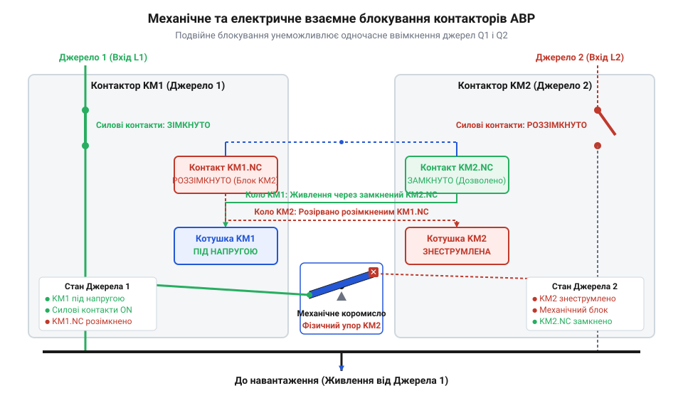
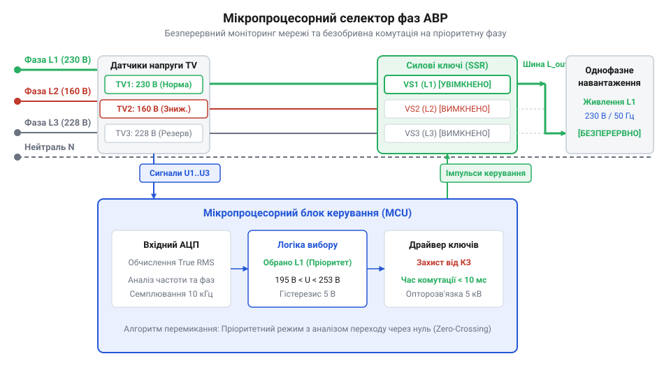

# Еволюція комутаторів резервного живлення від ручних перекидних рубильників до мікропроцесорних АВР

<preknowlist>
- [Кулачкові перемикачі (Cam Switches) та пакетні вимикачі](root:cat-hw-controls/rotary-cam-switches) — конструктивні особливості кулачкових механізмів та поворотних контактних груп, що використовувалися для ручного перемикання ліній.
- [Багатопозиційні галетні перемикачі (Rotary Switches)](root:cat-hw-controls/rotary-selector-switches) — принципи комутації багатопозиційних кіл для вибору між кількома фазами чи джерелами.
</preknowlist>

## Небезпека ручних рубильників першого покоління

Наприкінці `XIX` століття, з початком масової електрифікації промислових підприємств, виникла потреба в оперативному переключенні споживачів між основними та резервними генераторними лініями. Першим технологічним розв'язком цієї задачі став відкритий перекидний рубильник (від укр. *рубати*), який являв собою масивні мідні ножі, закріплені на спільній ізоляційній основі й укремлені шарнірами. Перемикання здійснювалося вручну за допомогою пружинної або жорсткої рукоятки, яку оператор переводив з одного крайнього положення в інше через нейтральну позицію.

Головним технічним обмеженням цієї конструкції була повна відсутність спеціалізованих засобів придушення електричного розряду. Під час розмикання ножів під навантаженням струм прагне зберегти свое протікання, унаслідок чого іонізується повітряний проміжок між ножем та нерухомою губкою. Утворюється стійка @@en|електрична дуга@@ (від прасл. *duga* — згин, дуга), температура плазмового шнура якої сягає понад `4000 °C`. Механізм деіонізації та гасіння дуги на відкритому повітрі спирається суто на її геометричне розтягнення до критичної довжини, коли мережева напруга вже не здатна підтримувати іонізаційний пробій. У перших рубильниках швидкість розведення контактів повністю визначалася мускульною швидкістю оператора та його психологічною рішучістю: за повільного руху рукоятки час горіння дуги тривав занадто довго. До того ж геометрична довжина мідного ножа обмежувала максимально можливий повітряний зазор при повному відхиленні рукоятки. За недостатньої довжини ножа або млявого ривка оператора плазмовий шнур взагалі не розривався, підтримуючись мережевою напругою й спричиняючи катастрофічне спалювання контактних поверхонь.

Висока температура дугового розряду спричиняла розплавлення мідних контактів і виникнення явища, відомого як @@en|контактне зварювання@@ (від прасл. *variti* — кип'ятити). Під час перекидання рубильника на резервне джерело підплавлені поверхні металу міцно зварювалися між собою, унеможливлюючи подальші оперативні перемикання або призводячи до утворення стійкого короткого замикання. Для операторів робота з такими апаратами становила пряму загрозу життю: термічні опіки від розбризканого рідкого металу та світлове випромінювання дуги були буденними аварійними ситуаціями.

Додатковим джерелом аварій слугував людський чинник під час психологічного напруження в момент знеструмлення. Оператор міг припуститися помилки й зафіксувати рубильник у проміжному стані або недостатньо швидко розірвати ножі. Усвідомлення цих небезпек змусило інженерів розробити закриті комутаційні пристрої, у яких швидкість розмикання контактів не залежала від зусилля руки, а сама дуга примусово охолоджувалася та гасилася в ізольованому об'ємі. Пізніші [кулачкові перемикачі](root:cat-hw-controls/rotary-cam-switches) частково вирішили проблему закритого виконання, але для потужних мереж знадобилися радикальніші конструктивні зміни.

## Упровадження дугогасильних камер та контакторів

Зростання потужності електромереж у першій половині `XX` століття вимагало відмови від прямого ручного керування силовими колами. Першим принциповим проривом стало створення закритих вимикачів, обладнаних @@la|дугогасильною камерою@@ (від лат. *camera* — склепінчаста кімната). Дугогасильна камера складається із серії паралельних сталевих пластин, розбитих ізоляційними прокладками. Коли при розмиканні контактів виникає електрична дуга, її магнітне поле втягує плазмовий стовп усередину сталевих ґрат. Там дуга розщеплюється на низку послідовних коротких дуг, інтенсивно охолоджується металевими пластинами й миттєво згасає під час першого проходження струму через нуль. Детальніше про фізику розщеплення й деіонізації плазмового стовпа у металевих ґратах описано в статті про [дугогасильні решітки та деіонізацію дуги](root:hw-components/arc-chutes-operating-principle).

Другим вирішальним кроком стала поява @@la|електромагнітного контактора@@ (від лат. *contactor* — той, що торкається). Замість мускульної сили людини силові контакти почав замикати електромагніт із пружинним поворотом. Це забезпечило нормовану швидкодію комутації на рівні `20–50 ms` незалежно від дій оператора. Фізика утримання якоря контактора спирається на рівновагу між електромагнітною силою котушки, пропорційною квадрату напруги, та протидіючою силою поворотної пружини. Якщо напруга в мережі просідає нижче критичної напруги втримування якоря (зазвичай `60–70%` від номінальної `U_n`), магнітний потік слабшає і пружина починає відривати якір. При межевих значеннях напруги виникає небезпечне вибраційне розмикання («деренчання якоря»), що супроводжується повторним дугоутворенням та вигорянням контактів. Крім того, застосування двох окремих контакторів для комутації основного й резервного джерел створило нову смертельну загрозу — ризик одночасного замкнення обох апаратів при просіданні напруги в обох лініях, що призводило до міжфазного короткого замикання між незалежними мережами.

Для виключення аварійного зустрічного ввімкнення інженери створили двоступеневу систему захисту: механічне блокування (від грец. *mechane* — знаряддя та фр. *bloquer* — затискати) та електричне блокування. Механічний @@en|інтерлок@@ є важелем або коромислом, розташованим між якорями двох контакторів: коли один контактор утягнутий, важіль фізично перешкоджає руху якоря другого контактора.

*Принцип взаємного блокування двох контакторів з механічним важелем та перехресними вимикальними допоміжними контактами.*

Електричне блокування доповнює механіку: нормальні закриті (`NC`) допоміжні контакти першого контактора вмикаються послідовно в коло живлення котушки другого контактора, і навпаки. Якщо котушка одного з контакторів перебуває під напругою, коло котушки іншого фізично розірване. Така комбінована схемотехніка стала стандартом побудови безпечних систем автоматичного введення резерву (АВР).

## Поява аналогових релейних селекторів фаз

У середині `XX` століття автоматичне перемикання живлення вийшло на новий рівень завдяки впровадженню аналогових елементів контролю. До цього комутація резерву вимагала присутності оператора або простих схем вимкнення за повної відсутності напруги. Поява таких апаратів, як реле контролю фаз (від фр. *relais* — перепряжка коней та грец. *phasis* — поява), дозволила безперервно відстежувати не лише наявність напруги, а й її рівень, асиметрію фаз та порядок чергування.

Перші автоматичні @@la|аналогові селектори фаз@@ (від лат. *selector* — вибирач) будувалися на основі електромеханічних реле напруги, ферорезонансних трансформаторів та електромагнітних вимірювальних елементів. Схема автоматичного вибору пріоритетної фази працювала за чіткою матричною логікою: напруга кожної з трьох фаз подавалася на власне вимірювальне реле із регульованим порогом спрацьовування (наприклад, `180–240 V`). Якщо напруга пріоритетної фази `L1` виходила за безпечні межі, контактна група реле розмикала коло контактора фази `L1` і з затримкою часу в `100–300 ms` замикала коло живлення фази `L2`. Для ручного перемикання або коригування режимів паралельно застосовували [багатопозиційні галетні перемикачі](root:cat-hw-controls/rotary-selector-switches).

У сучасній технічній літературі поширений міф, ніби автоматичний вибір якісної фази став можливим лише з появою цифрових мікроконтролерів у `1990-х` роках. Історичні факти спростовують це уявлення: аналогово-релейні схеми селекції фаз надійно працювали на відповідальних об'єктах зв'язку, у медичних установах та на тягових підстанціях ще у `1960-х` роках. Відсутність мікропроцесорів компенсувалася високою надійністю електромеханічного дискретного порівняння сигналів, хоча такі схеми мали більші габарити й обмежену точність налаштування порогів порівняно з сучасними блоками.

Ключовим елементом аналогової автоматики слугував @@la|ферорезонансний вимірювальний орган@@ (від лат. *ferrum* — залізо та *resonans* — лунаючий), побудований на поєднанні насичувального дроселя та конденсатора. При досягненні фазною напругою критичного значення в колі виникав стрибкоподібний ферорезонанс струму, який чітко й безпомилково перемикав електромеханічне реле без проміжних електронних підсилювачів. Три такі вимірювальні органи (по одному на фази `L1`, `L2`, `L3`) об'єднувалися в дискретну релейну логіку, де контакти вимірювальних реле формували послідовне перехресне коло. Якщо напруга пріоритетної фази `L1` просідала, її реле знеструмлювалося й через свій нормально закритий (`NC`) контакт миттєво подавало напругу на котушку контактора фази `L2`, реалізуючи апаратний алгоритм пріоритетного вибору.

## Цифрова революція та мікропроцесорні АВР

Наприкінці XX століття швидкий розвиток силової напівпровідникової техніки та мікроконтролерів докорінно змінив архітектуру перемикання джерел. На заміну електромеханічним реле прийшли мікропроцесорні блоки автозапуску та резервування, а замість механічних контактів у швидкісних вузлах почали застосовувати тиристори (від грец. @@el|thyra@@ — двері та англ. @@en|resistor@@ — резистор) і твердотілі ключі (англ. @@en|solid-state relay@@).

Аналогові схеми порівнювали напругу лише за піковою амплітудою з відчутною похибкою на викривлених синусоїдах, тоді як цифровий контролер за допомогою високошвидкісного аналогово-цифрового перетворювача (англ. @@en|analog-to-digital converter@@) здійснює дискретизацію сигналу з частотою в кілька кілогерц. Математичний алгоритм обчислення діючого середньоквадратичного значення @@en|RMS@@ (англ. @@en|root mean square@@) полягає в дискретному сумуванні квадратів миттєвих значень напруги `uᵢ` для `N` вибірок за період мережі `T = 20 ms` (при `50 Hz`):

U_RMS = √( (1 / N) · ∑ᵢ₌₀ⁿ⁻¹ uᵢ² )      [квадратний корінь із середнього квадрата вибірок]

Такий цифровий розрахунок True RMS точно визначає енергетичний еквівалент напруги незалежно від нелінійних спотворень та вищих гармонік у мережі. Одночасно контролер оцінює частоту й фазовий зсув, а напівпровідникова комутація скорочує час перемикання з десятків мілісекунд до мікросекундного діапазону, що виключає провали живлення для чутливої обчислювальної техніки.

*Структура цифрового автоматичного комутатора резерву з вимірювальними трансформаторами, мікроконтролерним блоком аналізу та силовими тиристорними ключами.*

Сучасна цифрова селекція фаз (від лат. @@la|selectio@@ — вибір) реалізує два основних алгоритми. У пріоритетному режимі пристрій постійно утримує навантаження на основній лінії L1, а перемикання на L2 чи L3 відбувається лише під час виходу параметрів L1 за допустимі межі з автоматичним поверненням після відновлення. У безпріоритетному режимі селектор залишається на будь-якій поточній якісній фазі без зайвих комутаційних циклів. На відміну від механічних ручних апаратів, таких як [кулачкові перемикачі](root:cat-hw-controls/rotary-cam-switches) чи [галетні перемикачі](root:cat-hw-controls/rotary-selector-switches), мікропроцесорний АВР здійснює перемикання без залучення оператора та без ризику виникнення електричної дуги.

## Сучасні стандарти надійності комутаторів резерву

Сучасні комутатори резервного живлення працюють в умовах високого рівня електромагнітних завад та імпульсних сплесків мережі. Для запобігання хибним спрацьвуванням під час короткочасних просідань напруги чи пускових струмів потужних електродвигунів у контролерах АВР застосовують програмно-апаратний гістерезис (від грец. @@el|hysteresis@@ — запізнення) і налаштовувані затримки спрацьвування.

Гістерезис створює розмежування між напругою відключення (наприклад, 180 В) та напругою зворотного ввімкнення фази (наприклад, 190 В). Це повністю усуває явище «деренчання» комутатора на межі спрацьвування, коли дрібні коливання мережі викликали б неперервне клацання контакторів. Завадостійкість вимірювальних кіл підтверджується жорсткими випробуваннями на стійкість до мікросекундних імпульсних завад великої енергії.

Сучасні цифрові селектори фаз та блоки АВР є повноцінними вузлами концепції розумних мереж (англ. @@en|Smart Grid@@). Завдяки інтеграції цифрових інтерфейсів Modbus та IEC 61850 пристрої передають телеметрію в реальному часі, дозволяючи віддалено моніторити якість електроенергії. Вибір архітектури АВР визначається категорією надійності об'єкта: для першої категорії особливої групи застосовують безконтактні статичні перемикачі @@en|STS@@ (англ. @@en|static transfer switch@@), тоді як для стандартних промислових навантажень використовують електромеханічні контактори з подвійним блокуванням. Принцип побудови безконтактних напівпровідникових комутаторів надшвидкої дії висвітлено в статті про [статичні перемикачі резерву STS](root:hw-power/ats-static-transfer-switches).
