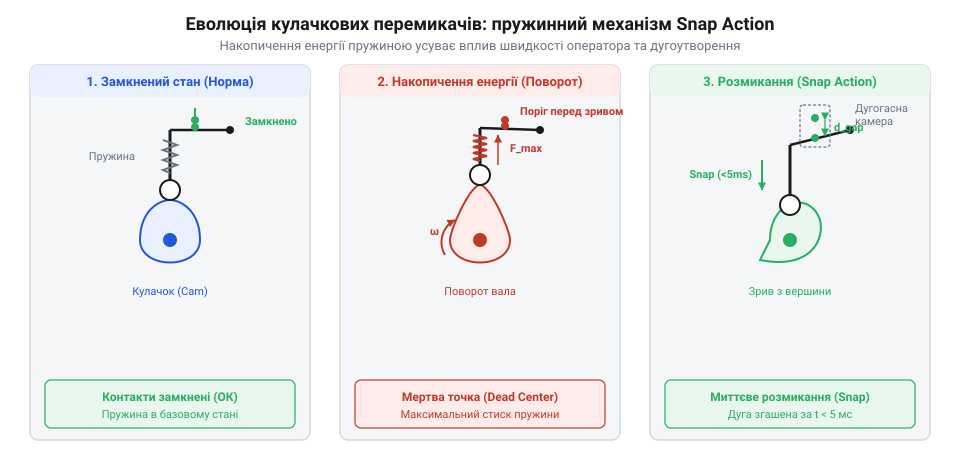
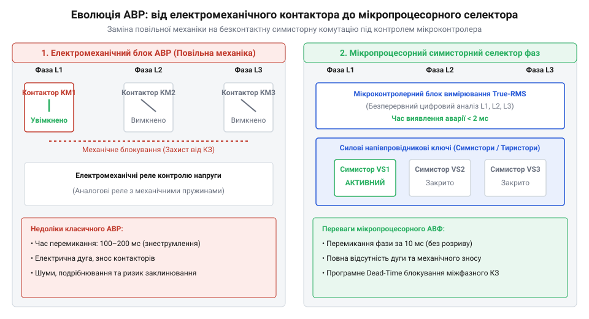

# Історія розвитку кулачкових перемикачів фаз та систем АВР

<preknowlist>
- [Кулачкові перемикачі (Cam Switches) та пакетні вимикачі](root:cat-hw-controls/rotary-cam-switches) — фізична будова кулачкового вала та контактних ламелей
</preknowlist>

## Небезпека відкритих рубильників та ручного перемикання

На початку XX століття, під час стрімкої електрифікації промислових підприємств і міських мереж, основним пристроєм комутації силових трифазних ліній слугували відкриті ножові рубильники (англ. *knife switch*, від англ. *knife* — ніж, @@en|knife switch@@). Вони являли собою відкриті мідні пластини, які оператор вручну вставляв у пружні губки. Коли виникала потреба переключити відповідальне навантаження з аварійної фази `L1` на резервну `L2`, черговий електрик мав вручну витягнути важіль одного рубильника й увімкнути інший.

Така примітивна конструкція спричиняла масу важких аварій та виробничих травм. Під час повільного відведення ножа під силовим навантаженням між контактами спалахувала відкрита комутаційна дуга завдовжки в десятки сантиметрів. Високотемпературний плазмовий шнур досягав температури від 5000 °C до 10000 °C, що багаторазово перевищувало температуру плавлення міді (1085 °C). Це спричиняло вибухове розплавлення й випаровування металу контактів, забризкування рідкою міддю та випалювання ізоляційних мармурових чи текстолітових щитів із незворотним руйнуванням діелектрика. Крім термічних опіків операторів, людський фактор був причиною катастрофічних міжфазних коротких замикань: неуважний оператор міг випадково замкнути новий рубильник до повного розмикання попереднього, утворюючи міжфазне замикання з лінійною напругою 400 В між фазами `L1` та `L2`. Масовий травматизм змусив нормативні комітети 1910–1920-х років розробити перші стандарти електробезпеки (зокрема американський National Electrical Code та німецькі норми VDE), які вперше законодавчо зобов'язали перейти до концепції закритих розподільчих щитів із глухим переднім фронтом (англ. *dead-front switchboard*, @@en|dead-front switchboard@@). Ці стандарти суворо забороняли розміщення відкритих струмопровідних частин на лицьовій панелі та вимагали повного ізолювання комутаційних вузлів усередині заземлених металевих чи бакелітових шаф.

Усвідомлення цих смертельних ризиків змусило інженерів 1910–1920-х років шукати принципово нові конструктивні рішення. Головним завданням стало повне ізолювання контактної групи у закритому діелектричному корпусі та усунення залежності швидкості розмикання контактів від плавності руху руки людини.

Першою конструктивною спробою приборкати комутаційну дугу без зміни механіки рукоятки стало занурення контактних пластин ручного перемикача у герметичний резервуар із мінеральною трансформаторною олією (англ. *oil switch*, @@en|oil switch@@). Під час розмикання електродів у рідкому середовищі висока температура дуги миттєво випаровувала й розкладала олію з утворенням газового пухиря високого тиску (переважно з водню), який інтенсивно охолоджував плазмовий шнур і гасив дугу за частки секунди. Проте масляні рубильники мали високу пожежонебезпеку, потребували регулярної заміни завуглецьованої олії та виточували токсичні випари, що змусило інженерів шукати сухі діелектричні рішення для закритих перемикачів.

## Кулачкові вали та розмикання Snap Action

Справжнім технічним проривом у 1920-х роках стала поява закритих поворотних пристроїв — [кулачкових перемикачів](root:cat-hw-controls/rotary-cam-switches) (англ. *rotary cam switch*, від нім. *Nocken* — кулачок, @@en|rotary cam switch@@). Вирішальний внесок у їхній розвиток зробили європейські інженерні компанії, зокрема Kraus & Naimer, які запатентували секційне набирання контактних блоків на єдиний приводний вал із профільованими діелектричними дисками.

Щоб припинити затяжне горіння дуги, інженери розробили механізм накопичення енергії та миттєвого розмикання (англ. *Snap Action*, від англ. *snap* — клацання, @@en|Snap Action@@). Його суть полягала у використанні проміжної заводної пружини: коли оператор повертає ручку перемикача, пружина стискається, накопичуючи механічну енергію, поки кулачковий профіль утримує контактний місток. У момент досягнення критичного кута фіксатор звільняється, і пружина миттєво розмикає контакти зі швидкістю у кілька метрів на секунду — незалежно від того, наскільки повільно людина обертала зовнішню рукоятку.

*Еволюція закритих кулачкових контактних груп із пружинним механізмом прискореного розмикання Snap Action.*

Паралельно у закриті камери перемикачів почали вбудовувати сталеві дугогасні решітки (англ. *arc chute*, від лат. *arcus* — дуга, @@en|arc chute@@). Вони розщеплювали плазмовий шнур на серію коротких дуг, охолоджуючи плазму й деіонізуючи повітряний зазор за частки мілісекунди. При комутації силового струму `I_comm = 100 А` деіонізаційна здатність камери визначається кількістю сталевих пластин `N`, кожна з яких створює навколоелектродне падіння напруги `U_gap` близько 20 В. Сумарна розрахункова напруга загасання дуги `U_total` розраховується як:

U_total = N · U_gap
        = 10 · 20 В              [сумарне катодно-анодне падіння напруги на 10 пластинах]
        = 200 В                  [мінімальний поріг гасіння плазмового шнура]

Такий поріг примусово перевищує миттєве значення напруги дуги, прискорюючи рекомбінацію іонів у міжкаскадних щілинах. Головним чинником успіху стало кінематичне прискорення розмикання: якщо оператор обертає ручку з повільною ручною кутовою швидкістю `ω_manual` близько 20 град/с, заводна пружина прискорювача Snap Action при виході з кута фіксації `θ_trip` розганяє контактний місток до кутової швидкості `ω_snap`:

        ω_snap = √( (k · Δθ²) / I_bridge )      [перетворення потенціальної енергії пружини в кінетичну]

Такий стрибок збільшує кутову швидкість розмикання до 1000–1500 град/с, що скорочує тривалість дугового інтервалу `t_break` з 100 мс до 2–4 мс і запобігає термоемісійному руйнуванню наплавок. Завдяки поєднанню кінематики кулачкового вала, прискорювачів Snap Action та дугогасіння виникли безпечні ручні селектори фаз, що витримували тисячі циклів комутації.

## Розвиток міжфазного блокування та схемотехніка АВР

Зі зростанням складності промислових підприємств у 1950–1970-х роках вимагалася повна автоматизація перемикання живлення без участі людини. Це спричинило появу систем Автоматичного Введення Резерву (англ. *automatic transfer switch*, @@en|automatic transfer switch@@, АВР) на основі силових електромагнітних контакторів та реле напруги.

Критичним завданням при проєктуванні схем АВР стало створення надійного міжфазного блокування (англ. *interlock*, від англ. *inter* — взаємно та *lock* — замок, @@en|interlock@@). Для абсолютного усунення міжфазного короткого замикання між контакторами двох фаз `L1` та `L2` застосували подвійний захист:
1. Механічне блокування: між якорними механізмами контакторів встановлювалася металева куліса-балансир, яка фізично перекривала хід другого контактора, поки перший перебував у замкненому стані.
2. Електричне блокування: котушка живлення контактора `KM2` підключалася через розмикальний допоміжний контакт `KM1.NC`. Доки `KM1` залишався увімкненим, його розмикальний контакт розривав коло керування `KM2`, унеможливлюючи подачу напруги.

Завдяки впровадженню подвійного блокування схемотехніка АВР досягла високого рівня надійності, проте критичним інженерним викликом залишалося забезпечення строгого узгодження часових параметрів комутації. Під час розмикання контактора `KM1` його механічна рухома система та дугогасна камера потребували часу на повернення якоря та остаточне гасіння комутаційної дуги. Якщо котушка контактора `KM2` отримувала живлення через допоміжний розмикальний контакт `KM1.NC` раніше, ніж силові контакти `KM1` встигали повністю розійтися і згасити дугу, виникало пряме міжфазне коротке замикання через дуговий проміжок. Для запобігання цьому тривалість затримки розмикання допоміжних контактів `t_nc` мусила враховувати час механічного відпускання якоря `t_release` та тривалість гасіння дуги `t_arc_ext`:

t_nc = t_release + t_arc_ext
     = 5..15 мс                  [сумарна часова затримка допоміжних NC-контактів]

Через це повна тривалість перемикання живлення `t_transfer` повинна була суворо перевищувати затримку `t_nc` з урахуванням механічного зносу пружин. Крім того, електромеханічні реле напруги перших поколінь мали суттєвий недолік — гістерезисну нестабільність та чутливість до температурного дрейфу, що призводило до нестійкого спрацьовування при межевих значеннях напруги.

## Мікропроцесори та напівпровідникова комутація фаз

Електромеханічні блоки АВР на контакторах тривалий час залишалися стандартом, проте їхня швидкодія обмежувалася часом спрацьовування соленоїда (30–100 мс). Для чутливої обчислювальної техніки та контролерів автоматики така безструмова пауза спричиняла збій і перезапуск. Наприкінці 1980-х років розвиток силової напівпровідникової техніки дозволив замкнути силові кола через симистори та тиристори, скоротивши час комутації до кількох мілісекунд.

Справжня революція у виборі фаз відбулася з масовим упровадженням 8-бітних мікроконтролерів у 1990-х роках. Мікропроцесорний блок автоматичного вибору фаз (АВФ) перейшов від простого аналогового порівняння напруг до цифрового обчислення середньоквадратичного значення (@@en|RMS@@, від англ. *Root Mean Square*). Для усунення впливу імпульсних завад аналогово-цифровий перетворювач (АЦП) контролера робить `N` дискретних замірів миттєвої напруги `u_k` протягом періоду мережі `T = 20 мс` (при частоті 50 Гц), після чого обчислюється дійсне значення `U_rms`:

        U_rms = √( (1/N) · ∑ₖ₌₁ⁿ uₖ² )      [цифрове дискретне усереднення квадратів замірів АЦП]

Такий алгоритмічний розрахунок відфільтровує короткочасні сплески та гарантує точно визначені пороги спрацьовування. Контролер у реальному часі аналізує якість живлення на фазах `L1`, `L2` та `L3`, програмуючи гістерезис (від грец. *hysteresis* — запізнення, @@en|hysteresis@@) та часові затримки відключення аварійної фази `T_off` й повернення на пріоритетну `T_return`.

*Принципова схема трансформації електромеханічного блоку АВР у мікропроцесорний симисторний селектор фаз.*

Завдяки цьому сучасні модульні селектори фаз на DIN-рейку об'єднують напівпровідникове бездугове перемикання з інтелектуальним моніторингом, гарантуючи абсолютно безперебійне живлення однофазних споживачів.

## Історичні міфи та спірна атрибуція винаходів

В історії комутаційної техніки існує чимало технічних оман та маркетингових міфів щодо першості розробки систем автоматичного введення резерву та селекторів фаз. Найпоширенішим міфом є твердження, ніби концепція АВР була одноосібно винайдена однією американською компанією в 1970-х роках. У дійсності перші патенти на автоматичні перемикачі джерел живлення з'явилися ще у 1920-х роках у залізничній автоматиці та енергетичних системах США й Німеччини (зокрема в розробках компаній Westinghouse та ASCO). Зокрема, патентна формула перших двохпозиційних контакторних перемикачів компанії ASCO (англ. *Automatic Switch Company*, @@en|Automatic Switch Company@@) 1920-х років описувала двопозиційний механізм із соленоїдним приводом та кінематичною фіксацією крайніх положень. Ключова суть патенту полягала у використанні спільного перекидного важеля, який фізично унеможливлював одночасне замкнення контактів основного й резервного джерел та гарантував примусове розмикання першої лінії до моменту торкання контактів другої.

Іншим поширеним міфом є уявлення, що кулачковий селектор фаз є лише модифікацією звичайного [поворотного потенціометра](root:cat-hw-controls/rotary-potentiometer) чи галетного перемикача. Насправді кулачковий вал силового селектора вимагав принципово іншої трибології контактних груп та кінематики Snap Action для протидії вибуховій дузі.

Спільним досягненням світової інженерної думки стало поєднання дискретної мікроелектроніки та силових напівпровідників. Автоматичний селектор фаз не є витвором одного винахідника, а є результатом еволюційного синтезу дугогасних камер початку XX століття, кулачкових механізмів 1930-х років та мікроконтролерного цифрового аналізу напруги початку XXI століття.
