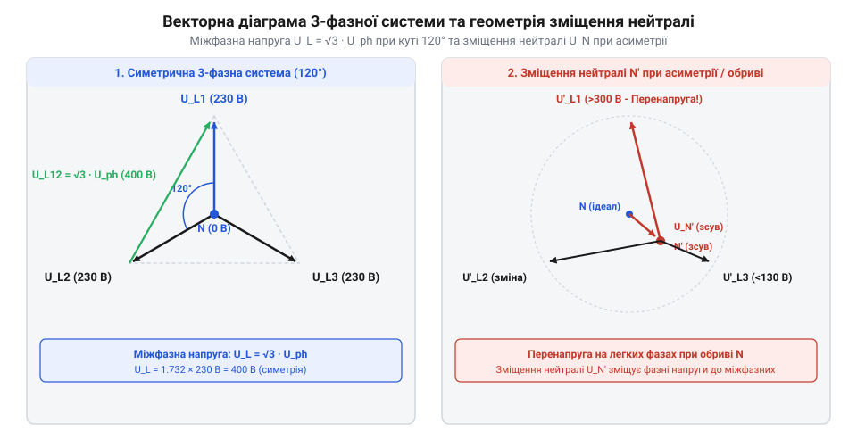

# Розрахунок параметрів комутації фаз, вектора напруг та пускових струмів

<preknowlist>
- [Кулачкові перемикачі (Cam Switches) та пакетні вимикачі](root:cat-hw-controls/rotary-cam-switches) — кінематика контактних груп та концепція механічного перемикання
- [Поворотний потенціометр](root:cat-hw-controls/rotary-potentiometer) — принцип аналогового дільника напруги
</preknowlist>

## Геометрія фазових векторів та зсув

Під час роботи трифазної мережі векторна різниця напруг між фазами визначається просторовим кутом зсуву @@en|phase shift@@ (від англ. phase shift — фазовий зсув) у 120° (2π/3 радіан). На @@en|phasor diagram@@ (від англ. phasor diagram — фазорна діаграма) у комплексній площині фазні напруги зображуються обертовими векторами (фазорами), зсунутими на однаковий кут: `U_A = U_m · exp(j0)`, `U_B = U_m · exp(-j2π/3)` та `U_C = U_m · exp(j2π/3)`. Геометричний зв'язок між фазорами дає змогу виразити різницю між ними через формулу Ейлера: вектор міжфазної напруги `ΔU_AB = U_A - U_B` утворює векторний трикутник, де модуль різниці обчислюється як довжина третьої сторони за теоремою косинусів чи через проекції на дійсну та уявну осі `Re{ΔU_AB} = U_m · (1 - cos(2π/3))` та `Im{ΔU_AB} = U_m · sin(2π/3)`. Оскільки перемикач фаз здійснює комутацію однофазного навантаження з однієї фази на іншу, критично важливо математично розрахувати миттєву різницю напруг між фазами ΔU(t), аби оцінити електричне напруження на контактах у момент їх розмикання та замикання.

Припустимо, що фазні напруги описуються гармонічними функціями з однаковою амплітудою U_m та коловою частотою ω:

```
U_A(t) = U_m · sin(ωt)
U_B(t) = U_m · sin(ωt - 2π/3)
U_C(t) = U_m · sin(ωt + 2π/3)
```

Різниця напруг між фазами A та B у будь-який момент часу t дорівнює:

```
ΔU_AB(t) = U_A(t) - U_B(t) = U_m · [sin(ωt) - sin(ωt - 2π/3)]
```

Використовуючи тригонометричну тотожність для різниці синусів sin(α) - sin(β) = 2 · sin((α - β)/2) · cos((α + β)/2), отримуємо:

```
α = ωt
β = ωt - 2π/3
(α - β)/2 = π/3
(α + β)/2 = ωt - π/3

ΔU_AB(t) = 2 · U_m · sin(π/3) · cos(ωt - π/3)
```

Оскільки sin(π/3) = √3 / 2, вираз спрощується до:

```
ΔU_AB(t) = √3 · U_m · cos(ωt - π/3)
```

Отже, максимальне значення миттєвої різниці напруг між двома фазами становить U_line_max = √3 · U_m, що відповідає амплітуді міжфазної (лінійної) напруги. У випадку несинхронної комутації або дугового пробою між контактами перемикача (таких пристроїв як [кулачкові перемикачі](root:cat-hw-controls/rotary-cam-switches)) ізоляція контакторів піддається впливу саме лінійної напруги.



Математичне розгортання різниці гармонійних функцій `ΔU_AB(t) = U_A(t) - U_B(t)` спирається на тригонометричне виведення різниці синусів двох кутів `sin(α) - sin(β) = 2 · sin((α - β)/2) · cos((α + β)/2)`. У трифазній системі кутовий зсув між аргументами синусів дорівнює `α - β = 2π/3`, тому напіврізниця дає постійний коефіцієнт `sin(π/3) = √3 / 2`, який під час множення на 2 масштабує амплітуду фазної напруги `U_m` у `√3` разів. Отриманий гармонійний вираз `ΔU_AB(t) = √3 · U_m · cos(ωt - π/3)` доводить, що миттєве значення міжфазної напруги здійснює коливання з тією ж частотою `ω`, але з фазовою зсувкою `-π/3` та амплітудою `U_line_max = √3 · U_m ≈ 1.73 · U_m`. Це показує, що при комутації навантаження між фазами електрична ізоляція між контактами перемикача піддається напруженню, розрахованому саме на повну амплітуду лінійної напруги.

Для обчислення потенціалу точки нейтралі `N'` у разі несиметричного навантаження фаз застосовується метод вузлових потенціалів (теорема Міллмана). За відсутності або обриві робочого нейтрального провідника `N` потенціал зміщеної нейтралі `U_N'` визначається як частка від ділення векторної суми добутків фазних напруг джерела на їхні комплексні провідності `Y_A`, `Y_B`, `Y_C` до суми цих провідностей: `U_N' = (U_A · Y_A + U_B · Y_B + U_C · Y_C) / (Y_A + Y_B + Y_C)`. Якщо одна з фаз знеструмлюється або підключається до потужного споживача з малим опором, зміщення нейтралі спричиняє спотворення фазних напруг `U_A'`, `U_B'`, `U_C'`, через що напруга на найменш навантаженій фазі може зрости майже до міжфазного значення `√3 · U_ph`, створюючи аварійний режим перенапруги для чутливого однофазного обладнання.

При комутації живлення асинхронного двигуна магнітне поле ротора згасає за експоненційним законом `E_rem(t) = E_0 · exp(-t / τ_decay) · sin(ω_r · t + φ_0)`, де `τ_decay` — електромагнітна постійна часу ротора, а `ω_r` — частота обертання. Якщо перемикач подає нову фазу мережі через час `T_transfer` у протифазі до залишкової проти-ЕРС, векторне додавання амплітуд утворює максимальну напругу `U_sum_max = U_m + E_rem(T_transfer)`. Внаслідок цього амплітуда пускового кидка струму @@en|inrush current@@ (від англ. inrush current — пусковий струм) обмежується лише еквівалентним опором розсіювання обмоток статора `Z_eq` і обчислюється як `I_peak = U_sum_max / Z_eq`, що при короткій безструмовій паузі (`T_transfer → 0`) призводить до виникнення струму `I_peak ≈ 2 · U_m / Z_eq`, перевищуючи номінальний пусковий струм двигуна вдвічі.

## Зсув нейтралі та оцінка перенапруги

При обриві або комутації нейтрального провідника N в трифазній мережі з несиметричним навантаженням виникає @@en|neutral drift@@ (від англ. neutral drift — зсув нейтралі). Точка нейтралі навантаження N' зміщується відносно нейтралі джерела N, що призводить до небезпечного перерозподілу напруг на однофазних споживачах.

Для математичного розрахунку зсуву нейтралі U_N'N застосовується метод вузлових потенціалів (теорема Міллмана). При наявності реактивної складової навантаження (індуктивностей обмоток електродвигунів або ємностей кабельній мережі) комплексна провідність кожної фази містить активну G та реактивну B складові: `Y_A = G_A + jB_A`, `Y_B = G_B + jB_B`, `Y_C = G_C + jB_C`. Додавання реактивних провідностей спричиняє не лише зміну амплітуди потенціалу нейтралі, а й фазовий зсув вектора зміщення `φ_N = arctg(Im{U_N'} / Re{U_N'})` відносно нейтралі джерела N. У комплексному вигляді векторний потенціал зміщеної нейтралі U_N' визначається виразом:

```
U_N' = (U_A · Y_A + U_B · Y_B + U_C · Y_C) / (Y_A + Y_B + Y_C + Y_N)
```

де Y_A, Y_B, Y_C — комплексна провідність фаз навантаження (Y = 1 / Z), a Y_N — провідність нейтрального провідника. При відключеному або відсутньому нейтральному провіднику (Y_N = 0) формула набуває вигляду:

```
U_N' = (U_A · Y_A + U_B · Y_B + U_C · Y_C) / (Y_A + Y_B + Y_C)
```

Розглянемо найгірший випадок несиметрії: фаза A навантажена потужним споживачем з малим опором Z_A = R, фаза B має дуже високий опір Z_B → ∞ (відключена), а фаза C має опір Z_C = 10 · R. Тоді провідності становлять Y_A = 1/R, Y_B = 0, Y_C = 0.1/R.

Підставляючи провідності у вираз для потенціалу зміщеної нейтралі:

```
U_N' = (U_A · (1/R) + U_C · (0.1/R)) / (1/R + 0.1/R) = (U_A + 0.1 · U_C) / 1.1
```

Напруга на фазі C навантаження визначається як U_C' = U_C - U_N':

```
U_C' = U_C - (U_A + 0.1 · U_C) / 1.1 = (1.1 · U_C - U_A - 0.1 · U_C) / 1.1 = (U_C - U_A) / 1.1
```

Оскільки U_C - U_A = U_CA (лінійна напруга), амплітудне значення напруги на найменш навантаженій фазі C зростає майже до лінійного значення (до √3 · U_ph ≈ 1.73 · U_ph), що спричиняє вихід з ладу чутливої електроніки.

## Залишкова проти-ЕРС та пусковий струм

Під час комутації живлення асинхронних електродвигунів або трансформаторів у статорі зберігається залишкова @@en|back-EMF@@ (від англ. back electromotive force — проти-електрорушійна сила). При відключенні фази магнітне поле ротора згасає не миттєво, а за експоненційним законом через замкнений контур роторних обмоток. Електромагнітна постійна часу затухання `τ_decay` визначається співвідношенням сумарної індуктивності намагнічування та індуктивності розсіювання `L_r = L_m + L_σr` до ефективного активного опору роторного кола `R_r` з урахуванням реактивного впливу статорного опору `R_st`: `τ_decay = (L_m + L_σr) / R_r`. Накопичена в магнітопроводі енергія розсіюється у вигляді тепла на активних опорах, зберігаючи проти-ЕРС на контактах протягом декількох періодів мережевої напруги. Математично затухання проти-ЕРС описується таким експоненційним законом:

```
E_rem(t) = E_0 · exp(-t / τ_decay) · sin(ω_r · t + φ_0)
```

де E_0 — амплітуда проти-ЕРС у момент відключення, τ_decay = L_r / R_r — електромагнітна постійна часу ротора, ω_r — роторна частота обертання.

Якщо перемикач фаз подає нову фазу мережі через час перемикання T_transfer, коли залишкова проти-ЕРС E_rem ще не затухла і знаходиться у протифазі з напругою нової фази U_new(t), виникає найгірший випадок додавання напруг:

```
U_sum_max = U_m + E_rem(T_transfer) = U_m + E_0 · exp(-T_transfer / τ_decay)
```

Внаслідок цього виникає колосальний @@en|inrush current@@ (від англ. inrush current — пусковий струм), який обмежується лише еквівалентним індуктивним опором розсіювання статора та мережі Z_eq:

```
I_peak = U_sum_max / Z_eq = [U_m + E_0 · exp(-T_transfer / τ_decay)] / √(R_st² + (ω · L_st)²)
```

Якщо комутація відбувається без витримки паузи (T_transfer → 0), то E_rem ≈ U_m, а суммарна амплітуда напруги на контактах та обмотці сягає 2 · U_m. Пусковий струм в такому разі перевищує номінальний пусковий струм двигуна вдвічі, досягаючи 12–20 · I_nom, що спричиняє спрацьовування захисних автоматів та механічний удар у редукторах.

## Устави затримок та гістерезис компараторів

Автоматичний перемикач фаз здійснює моніторинг напруги за допомогою електронних компараторів або мікроконтролера (де вимірювання можуть коректувати [потенціометри](root:cat-hw-controls/rotary-potentiometer)). Щоб запобігти частим хибним спрацьовуванням при незначних коливаннях мережі, застосовується @@en|hysteresis@@ (від англ. hysteresis — гістерезис) порогів спрацьовування.

Математична модель алгоритму перемикання базується на нижній `U_min` та верхній `U_max` межах напруги, а також величині гістерезису `ΔU_hyst`. Наприклад, для номінальної мережі 230 В нижній поріг уставляють на рівні `U_min = 198 В` (-14%), верхній — `U_max = 253 В` (+10%), а гістерезис — `ΔU_hyst = 5 В`, що визначає поріг повернення `U_ret_low = 203 В`. Безструмову затримку увімкнення нової фази обирають зауважуючи постійну часу проти-ЕРС електродвигунів `τ_decay = 40 мс` та час гасіння дуги `t_arc = 15 мс`, що дає розраховану паузу `T_transfer ≥ max(15, 3 · 40) = 120 мс`. Для системи моніторингу напруги устави порогів та затримок визначаються такими математичними співвідношеннями:

```
Поріг відключення аварійної фази (нижній): U_off_low = U_min
Поріг повернення на фазу (нижній):          U_ret_low = U_min + ΔU_hyst

Поріг відключення аварійної фази (верхній): U_off_high = U_max
Поріг повернення на фазу (верхній):         U_ret_high = U_max - ΔU_hyst
```

Часові параметри алгоритму керування визначаються трьома основними затриманнями:
1. T_off — час затримки відключення при виході напруги за межі (запобігає реагуванню на короткі імпульсні завади):

```
Якщо U(t) < U_min або U(t) > U_max протягом t < T_off → відключення не відбувається.
Якщо відхилення триває t ≥ T_off → розмикання контактів поточного реле.
```

2. T_transfer — час паузи перемикання (затримка увімкнення нової фази), необхідний для гасіння електричної дуги та затухання проти-ЕРС двигунів:

```
T_transfer ≥ max(t_arc_extinction, 3 · τ_decay)
```

3. T_return — час затримки повернення на пріоритетну фазу після відновлення її параметрів до норми:

```
U_prior(t) ∈ [U_min + ΔU_hyst, U_max - ΔU_hyst] протягом t ≥ T_return
```

Дотримання розрахованих математичних співвідношень між U_hyst, T_off, T_transfer та T_return забезпечує стійкість системи живлення та продовжує ресурс комутаційної апаратури.
