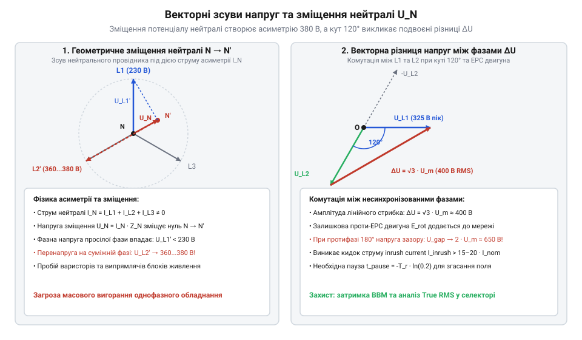
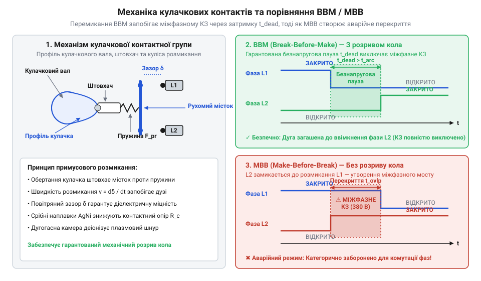
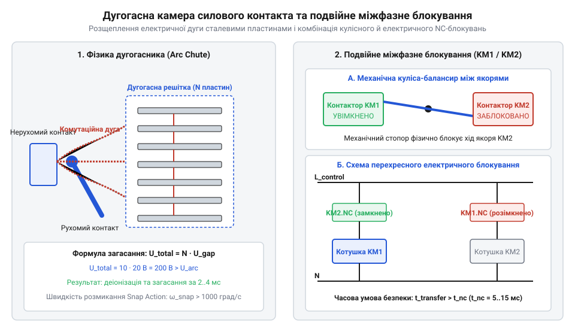

# Перемикачі фаз та резервного живлення

<preknowlist>
- [Кулачкові перемикачі (Cam Switches) та пакетні вимикачі](root:cat-hw-controls/rotary-cam-switches) — фізична будова кулачкового вала та перемикання контактних ламелей
- [Багатопозиційні галетні перемикачі (Rotary Switches)](root:cat-hw-controls/rotary-selector-switches) — загальні принципи комутації силових та сигнальних кіл поворотними секціями
</preknowlist>

## Проблема безперебійності та резервування живлення

У трифазній промисловій та побутовій електромережі зникнення однієї з фаз або глибоке просідання напруги — поширена аварійна ситуація. Коли через перевантаження фідера, порив лінії чи асиметрію навантаження фаза `L1` виходить за припустимі межі, усі підключені до неї однофазні споживачі — контролери автоматики, сервери, помпи опалення чи медичне обладнання — миттєво знеструмлюються або переходять у хаотичний перезапуск.

Спроба вручну відновлювати живлення, переключаючи кабель на іншу фазу за допомогою кулачкового перемикача (англ. *rotary cam switch*, від нім. *Nocken* — кулачок) чи ручного рубильника, вимагає присутності чергового оператора й займає хвилини. За цей час стаються зупинки технологічних ліній, псування продукції та втрата даних у пам'яті контролерів. Крім того, перемикання силових ліній під навантаженням важелем створює загрозу виникнення розплавлювальної комутаційної дуги та людського фактора, коли через неуважність оператор може замкнути різноіменні фази між собою.

Коли однофазна лінія комутується між двома фазами трифазної системи (наприклад, з `L1` на `L2`), між ними завжди існує фазовий зсув 120 градусів. У момент розмикання на контактах виникає міжфазна напруга 400 В. При живленні несиметричних однофазних споживачів у чотирипровідній мережі через робочий нейтральний провідник `N` протікає геометрична сума фазних струмів `I_N = I_L1 + I_L2 + I_L3`. Комутація потужного навантаження створює асиметрію струмів, яка на імпедансі нейтралі `Z_N` викликає @@en|neutral drift@@ (зміщення нейтралі) з векторним потенціалом `U_N = I_N · Z_N`. Векторний зв'язок між фазними напругами джерела та напругою на навантаженні визначається зміщенням вузла зірки `N'` відносно фізичного нуля `N`: реальна фазна напруга кожної фази `i` стає векторною різницею `U_Li' = U_Li - U_N`. Це векторне зміщення розриває симетрію фазних напруг: напруга на просілій фазі впадає, тоді як на сусідніх фазах фазна напруга відносно зміщеного нуля піддається векторному підйому до 330–380 В. Більше того, при наявності ємностей кабельних ліній та індуктивностей обмоток некомутованих фаз виникає ефект резонансного перенапруження, коли напруга на непереключених фазах через ферорезонансні коливання сягає амплітуди лінійного значення `U_line = √3 · U_phase` (до 400 В), що викликає термічний пробій варисторів та випрямлячів блоків живлення. Водночас при комутації індуктивного навантаження — асинхронних електродвигунів — проявляється специфічний фізичний ефект. Під час безструмової паузи ротор двигуна продовжує обертатися за інерцією, і його залишкове магнітне поле наводить у статорних обмотках згасаючу проти-ЕРС (@@en|back-EMF@@). Якщо замикання контакту на фазу `L2` стається у момент, коли ця проти-ЕРС перебуває у протифазі до напруги мережі, векторна різниця потенціалів на контактному зазорі підскочить до подвоєної амплітудної напруги. Оскільки індуктивний струм прагне зберегти своє значення, накопичена в електромагнітному полі енергія розриває діелектричний проміжок і призводить до вибухового дугоутворення на ламелях. Щоб обчислити амплітудні стрибки та розрахувати тривалість згасання поля, застосовують [розрахунок параметрів комутації](root:cat-hw-controls/phase-selector-switches/math-phase-switching-and-inrush-calculations.md).


*Геометрія фазових векторів трифазної системи та виникнення міжфазної напруги під час перемикання між несинхронізованими джерелами.*

Історично промислові комутаційні вузли пройшли шлях від важких відкритих ножових рубильників першої половини XX століття до напівпровідникових та мікропроцесорних блоків. Для ознайомлення з цією еволюцією створено [історію розвитку селекторів](root:cat-hw-controls/phase-selector-switches/hist-phase-selectors-evolution.md).

Критичний ризик знеструмлення робить неминучим застосування селекторів фаз (англ. *phase selector switch*, від лат. *selectio* — вибір) та автоматичних перемикачів. Щоб з'ясувати, як побудовано сучасне [автоматичне введення резерву](root:hw-power/automatic-transfer-switch-controllers), вивчають їхню системну архітектуру та логіку моніторингу напруги.

## Конструкція кулачкових селекторів та АВР

Основу механічного селектора фаз становить @@en|rotary cam switch@@, побудований на базі приводного вала з набором профільних кулачкових дисків із діелектрика. Принцип того, як функціонують [кулачкові перемикачі](root:cat-hw-controls/rotary-cam-switches), ґрунтується на геометрії кулачка, який при повертанні вала тисне на штовхач рухомого контактного містка, примусово розмикаючи один ланцюг і дозволяючи пружині замкнути наступний. Механічна тривалість безструмової паузи `t_{mech}` при перемиканні режиму @@en|Break-Before-Make@@ задається кінематичним кутом нейтрального профілю кулачка `θ_{dead}` (кутовий сектор, у якому обидва контакти розімкнені) та кутовою швидкістю обертання вала `ω`. Якщо пружинний привід розганяє вал до кутової швидкості `ω = 120 рад/с`, а геометрія диска має дугу розмикання `θ_{dead} = 18°` (`0.314 рад`), то механічний часовий інтервал обчислюється як:

        t_{mech}
        = θ_{dead} ÷ ω
        = 0.314 ÷ 120           [ділення кута нейтрального профілю на кутову швидкість пружинного вала]
        = 0.00262 с
        ≈ 2.62 мс               [механічна тривалість безструмової паузи кулачка]

Цей обчислений кінематичний час `t_{mech}` разом із часом деіонізації дуги визначає повний часовий зазор `t_{dead}`, необхідний для запобігання міжфазному короткому замиканню.

Конструкція контактної групи селектора реалізує один із двох часових алгоритмів комутації:
1. @@en|Break-Before-Make@@ (BBM, розрив перед замиканням): рухомий контакт спочатку повністю розмикається з фазою `L1`, долає безструмовий діелектричний зазор, і лише після цього замикається з фазою `L2`. Це єдиний безпечний спосіб комутації силових ліній з різними фазами, оскільки він унеможливлює міжфазне коротке замикання.
2. @@en|Make-Before-Break@@ (MBB, замикання перед розривом): рухомий контакт торкається лінії `L2` до того, як розімкнеться з `L1`. У силових мережах перемикання фаз це неприпустимо, адже короткочасне перекриття `L1` та `L2` утворює катастрофічне міжфазне замикання з розплавленням контактів.

Щоб безструмовий зазор алгоритму BBM гарантував надійну комутацію, тривалість гасіння плазми не повинна перевищувати механічну паузу перемикання. Швидкість @@en|deionization@@ (деіонізація) дугового проміжку напряму залежить від хімічного складу та товщини срібних наплавок силових ламелей. Застосування композитних сплавів срібла з оксидом олова (AgSnO₂) або оксидом кадмію (AgCdO) підвищує роботу виходу електронів та дугостійкість контактів, що прискорює згасання плазмового шнура. Збільшена товщина контактної наплавки `d_{pad}` (1.5–2.0 мм) забезпечує високу теплоємність та інтенсивне відведення тепла від опорної плями дуги в мідну основу, миттєво припиняючи термоелектронну емісію металевих парів і запобігаючи повторному пробою зазору.


*Кінематична схема кулачкового вала та порівняння часових діаграм безструмової паузи BBM та небезпечного міжфазного перекриття MBB.*

Під час розмикання силових контактів під навантаженням між ними спалахує комутаційна дуга. Швидкість її механічного розтягування залежить від геометрії кулачкового диска: прискорений розрив забезпечує лінійну швидкість розмикання ламелей `v_rel = ω · (dr / dθ)`, де `dr / dθ` — радіальний градієнт профілю кулачка. Чим вища кінематична швидкість розмикання контактів, тим швидше зростає опір плазмового шнура. Для миттєвого гасіння дуги використовують @@en|arc chute@@ (від англ. arc chute — дугогасна камера), яка розщеплює плазмовий шнур на серію коротких дуг між сталевими деіонізаційними пластинами. Термодинамічна оцінка деіонізаційного потенціалу камери базується на інтенсивному відведенні тепла крізь поверхню пластин площею `S_chute`: питомий тепловий потік `q_heat = P_arc / S_chute` охолоджує плазму нижче порогу іонізації газу (нижче 6000 К), прискорюючи рекомбінацію іонів та відновлення діелектричної міцності зазору. Пояснення того, як влаштовані [дугогасні камери](root:hw-components/arc-extinction-chambers-and-interruption), спирається на фізику інтенсивного охолодження й деіонізації комутаційного інтервалу.

В автоматичних селекторах фаз на контакторах застосовують подвійне блокування: механічну кулісу-коромисло та електричне зв'язування розмикальних (NC) допоміжних контактів. Принцип, за яким діє [електричне блокування пускачів](root:hw-power/contactor-interlocking-and-safety), унеможливлює подачу живлення на котушку другого контактора до повного фізичного повернення першого у вимкнений стан.


*Будова дугогасної камери силового контакта та схема взаємного механічного й електричного блокування контакторів селектора фаз.*

Залежно від комутованої потужності та необхідної швидкодії селектори фаз поділяють на три конструктивні типи:
- Релейні селектори (на DIN-рейку, струми до 16 А): внутрішні електромагнітні реле керуються мікропроцесором, забезпечуючи перемикання за кілька мілісекунд.
- Контакторні селектори (струми від 25 А до сотень ампер): складаються з двох або трьох промислових контакторів із зовнішнім блоком контролю напруги та механічним @@en|interlock@@ (міжфазне блокування).
- Мотор-приводні селектори: приводять у рух силовий кулачковий перемикач за допомогою серводвигуна чи редукторного мотора.

Конкретну карту клем та часові діаграми перемикання дає [залізний інтерфейс перемикачів](root:cat-hw-controls/phase-selector-switches/api-phase-selector-terminals-and-wiring.md). Практичну методику складання 3-фазного щита розгортає [проєктування 3-фазного перемикача](root:cat-hw-controls/phase-selector-switches/proj-automatic-phase-selector-panel.md).

## Векторні зсуви та пускові струми

Під час перемикання однофазного споживача з однієї фази трифазної мережі на іншу (наприклад, з `L1` на `L2`) навантаження миттєво підключається до напруги, синусоїда якої зсунута в часі на кут 120 градусів. Якщо джерела не симетричні за величиною або у момент комутації виникає асиметрія струмів, у системі стається @@en|neutral drift@@ (зміщення нейтралі). Потенціал робочого нейтрального провідника `N` відносно землі зміщується, утворюючи перенапругу на суміжних фазах, що загрожує пошкодженням чутливої автоматики.

Найбільшу проблему становить перемикання індуктивних навантажень — силових трансформаторів та обертальних електродвигунів. Протягом безструмової паузи перемикання ротор асинхронного двигуна продовжує обертатися за інерцією, а його залишкове магнітне поле наводить у обмотках статора згасаючу проти-ЕРС (від англ. @@en|back electromotive force@@, @@en|back-EMF@@). Швидкість згасання амплітуди залишкової напруги визначається електромагнітною сталою часу ротора `T_r = L_r ÷ R_r` (відношення індуктивності `L_r` до активного опору ротора `R_r`). Для гарантії безпечної комутації амплітуда проти-ЕРС повинна впасти до безпечного рівня `20%` від номінальної амплітуди джерела `E_0 = 325 В` (`E_{target} = 65 В`). Розрахунок мінімально необхідної часової затримки перемикання `t_{pause}` для двигуна зі сталою часу `T_r = 150 мс` (`0.15 с`) виконується через рівняння експоненційного згасання:

        E_{target} ÷ E_0
        = e^{-t_{pause} / T_r}                   [рівняння експоненційного спадання магнітного потоку ротора]
        = e^{-t_{pause} / 0.15} = 0.20           [підстановка цільової частки напруги 20%]

        t_{pause}
        = -T_r · ln(0.20)                        [вираження часу затримки через натуральний логарифм]
        = -0.15 · (-1.6094)                      [підстановка значень T_r та логарифма ln(0.2)]
        = 0.2414 с
        ≈ 241 мс                                 [розрахована часова затримка безнапругової паузи]

Витримана пауза `t_{pause} ≈ 241 мс` гарантує згасання зчепленого магнітного потоку ротора до рівня, при якому повторне ввімкнення резервної фази під кутом 180° не викликає важких струмових ударів та пошкодження обмоток.

Якщо контакт селектора замикається на фазу `L2` у момент, коли залишкова проти-ЕРС ротора перебуває у протифазі до мережевої напруги, векторна різниця напруг на контактах підскочить до подвоєного амплітудного значення. Для виведення різниці синусоїдальних сигналів використовують розрахунковий код-блок:

```
U_L1 = U_m · sin(ωt)
U_L2 = U_m · sin(ωt - 2π/3)
ΔU = U_L1 - U_L2
= 2 · U_m · sin(π/3) · cos(ωt - π/3)      [формула різниці синусів]
= √3 · U_m · cos(ωt - π/3)                [значення sin(π/3) = √3/2]
```

Аналогічно при комутації силових трансформаторів перемикання фаз поблизу переходу напруги через нуль або за наявності залишкової намагніченості осердя `B_{res}` вганяє магнітопровід у глибоке насичення. Відносна магнітна проникність сталі стрімко падає, і опір первинної обмотки знижується до індуктивності розсіювання `L_{leak}`. Амплітуда кидка струму @@en|inrush current@@ (намагнічувальний струмовий стрибок) `I_{inrush}` обчислюється через коефіцієнт залишкової індукції `k_{res} = 1.8`, пікову напругу мережі `V_{peak} = 325 В`, реактивний опір `X_{leak}` (при індуктивності `L_{leak} = 5 мГн` на частоті `f = 50 Гц`) та активний опір обмотки `R_{pri} = 0.4 Ом`:

Величина намагнічувального кидка струму під час перемикання фаз залежить від миттєвої фази напруги `α` у момент замкнення контактів. За законом електромагнітної індукції Фарадея, магнітний потік в осерді `Φ(t)` є інтегралом підведення синусоїдальної напруги `u(t) = V_{peak} · sin(ωt + α)`. Якщо комутація стається на піку напруги (`α = 90°`), потік змінюється симетрично відносно нуля між `-Φ_m` та `+Φ_m`, і насичення не виникає. Проте при ввімкненні у момент переходу напруги через нуль (`α = 0°`) інтеграл синусоїди подвоює амплітуду потоку до `2 · Φ_m`, а з урахуванням залишкової намагніченості `Φ_{res}` сумарний потік сягає `Φ_{max} = 2 · Φ_m + Φ_{res}`. Такий надлишковий потік зміщує робочу точку на нелінійній кривій намагнічування `B-H` глибоко за коліно насичення, де диференціальна магнітна проникність сталі `μ_{diff} = dB / dH` падає до проникності повітря `μ_0`. Внаслідок цього обмотка втрачає індуктивний опір, і струм @@en|inrush current@@ досягає свого максимуму при `α = 0°`, спадаючи за гармонійним законом протягом трьох-чотирьох періодів мережі.

        X_{leak}
        = 2 · π · f · L_{leak}                    [реактивний опір розсіювання насиченої обмотки]
        = 2 · 3.1416 · 50 · 0.005                 [підстановка частоти 50 Гц та індуктивності 5 мГн]
        = 1.57 Ом                                 [індуктивний опір насиченого трансформатора]

        I_{inrush}
        = (k_{res} · V_{peak}) ÷ (X_{leak} + R_{pri}) [піковий кидок струму залишками магнітного потоку]
        = (1.8 · 325) ÷ (1.57 + 0.4)              [підстановка фактора 1.8, амплітуди 325 В та опорів]
        = 585 ÷ 1.97
        = 296.95 А
        ≈ 297 А                                   [амплітудне значення струмового кидка inrush current]

Амплітудне значення `I_{inrush} ≈ 297 А` майже у 20 разів перевищує номінальний струм трансформатора (`15 А`), що без часових витримок та адаптивного обмеження викликає хибні спрацьовування захисних автоматів та електродинамічні удари по контактах.

```
U_L1 = U_m · sin(ωt)
U_L2 = U_m · sin(ωt - 2π/3)
ΔU = U_L1 - U_L2
= 2 · U_m · sin(π/3) · cos(ωt - π/3)      [формула різниці синусів]
= √3 · U_m · cos(ωt - π/3)                [значення sin(π/3) = √3/2]
```

Зсув потенціалу та подвоєння напруги викликають потужний комутаційний кидок струму (англ. *inrush current*), що в 10–20 разів перевищує номінальне значення `I_nom`. Визначити час згасання магнітного потоку та розрахувати безпечну затримку допоможе [розрахунок параметрів комутації](root:cat-hw-controls/phase-selector-switches/math-phase-switching-and-inrush-calculations.md).

## Гасіння електричної дуги та блокування

При розмиканні силових контактів селектора фаз під навантаженням у діелектричному зазорі виникає висока напруженість електричного поля. Вона вибиває електрони з поверхні металу, іонізуючи повітря та утворюючи високотемпературну плазму — спалахує електрична комутаційна дуга.

Якщо дуговий розряд не припинити за кілька мілісекунд, плазма розплавляє контактні наплавки, призводячи до їхнього приварювання та руйнування корпусу. Для гасіння дуги у конструкцію додають @@en|arc chute@@ (дугогасна камера). Вона затягує плазмовий шнур між сталевими пластинами решітки, де дуга розщеплюється на серію коротких дуг, охолоджується та миттєво згасає при переході струму через нуль. З'ясувати фізику термоемісії та деіонізації дозволяють [дугогасні камери](root:hw-components/arc-extinction-chambers-and-interruption).

Під час протікання струмів короткого замикання між паралельними контактними містками виникає @@en|electrodynamic blow-off force@@ (електродинамічне зусилля відштовхування). Ця сила намагається віджати рухомий контакт від нерухомого через стягування ліній струму до мікроскопічних точок фактичного торкання наплавок (ефект звуження Хольма), створюючи мікродуги й ерозію. Величина сили відштовхування `F_{ed}` розраховується пропорційно квадрату пікового струму короткого замикання `i_{peak}` за формулою `F_{ed} = k_{fd} · i_{peak}²` (де `k_{fd}` — коефіцієнт геометрії контактної групи та радіуса контактної плями). Для надструму замикання з амплітудою `i_{peak} = 5000 А` та коефіцієнта геометрії `k_{fd} = 1.5 · 10⁻⁴ Н/А²` покрокове обчислення виглядає так:

        F_{ed}
        = k_{fd} · i_{peak}²                       [залежність сили відштовхування від квадрата струму замикання]
        = 0.00015 · 5000²                          [підстановка коефіцієнта геометрії та амплітуди надструму 5000 А]
        = 0.00015 · 25 000 000
        = 3750 Н                                   [електродинамічне зусилля відштовхування контактів]

Якщо сила притиску контактної пружини `F_{pr}` виявиться меншою за розраховане електродинамічне зусилля `F_{ed}` (`F_{pr} < 3750 Н`), виникає апаратне розмикання контактів під струмом, утворення високотемпературної дуги та миттєве приварювання срібних наплавок. Щоб цьому запобігти, контактний вузол оснащують потужними притискними пружинами та оптимізованими струмопідвідними петлями, що створюють компенсаційне магнітне притискання.

Паралельно розраховують термічну стійкість струмоведучих шин та фізику мікрозварювання контактних наплавок при короткому замиканні. Протікання надструмів замикання викликає локальне концентраційне виділення тепла Джоуля у мікроскопічних плямах фактичного торкання контактів (точки звуження Хольма). Мікроскопічна густина струму в цих точках досягає `10⁶ А/мм²`, розігріваючи срібні наплавки AgNi понад температуру плавлення срібла (`961 °C`) та створюючи мостики рідкого металу. При переході струму через нуль металевий розплав кристалізується, формуючи жорсткий зварний контактний місток, сила відриву якого залежить від квадрата пікового струму замикання. Щоб запобігти апаратному розмиканню та вібрації контактів, притисна пружина повинна створювати необхідне протидіюче зусилля `F_{pr_req}`, що перевищує електродинамічне відштовхування `F_{ed}`. Водночас мідна шина перерізом `S_{bus}` під дією струму замикання `I_{sc}` протягом часу відключення `t_{sc}` повинна витримати термічний імпульс `A_{th} = I_{sc}² · t_{sc}` без розплавлення ізоляції. При струмі `I_{sc} = 3000 А`, часі `t_{sc} = 0.04 с` (40 мс) та матеріальній константі міді `k_{mat} = 176 А·с⁰·⁵/мм²` розрахунок мінімального перерізу `S_{min}` та сили зварювання `F_{weld}` при коефіцієнті зварювання `K_{weld} = 12 Н/кА²` та піковому струмі `i_{peak} = 5000 А` виглядає так:

        A_{th}
        = I_{sc}² · t_{sc}                          [інтеграл Джоуля / термічна дія струму замикання]
        = 3000² · 0.04                             [підстановка струму 3000 А та часу 0.04 с]
        = 360 000 А²·с                             [значення теплового імпульсу замикання]

        S_{min}
        = √(A_{th}) ÷ k_{mat}                     [мінімальний переріз шини з умови термічної стійкості]
        = 600 ÷ 176                               [ділення кореня імпульсу 600 на константу міді 176]
        = 3.41 мм²                                [необхідний термічно стійкий переріз]

        F_{weld}
        = K_{weld} · (i_{peak} ÷ 1000)²            [залежність сили зварювання контактів від пікового струму]
        = 12 · (5000 ÷ 1000)²                      [підстановка коефіцієнта 12 Н/кА² та піка 5000 А]
        = 12 · 25
        = 300 Н                                    [зусилля розриву мікрозварного містка]

Отже, обраний переріз шини `S_{bus} = 10 мм²` з запасом перекриває мінімальний норматив `S_{min} = 3.41 мм²`, а відключальне зусилля механізму приводу `F_{open}` має перевищувати `F_{weld} = 300 Н` для гарантованого відриву зварених срібних наплавок без заклинювання.

Критичною аварійною ситуацією є одночасне подання двох різних фаз на спільну шину, що спричиняє міжфазне коротке замикання. Для запобігання цьому конструюють подвійний @@en|interlock@@ (англ. *interlock*, від англ. *inter* — взаємно та *lock* — замок, міжфазне блокування):
1. Механічне блокування: кулісний балансир фізично блокує хід приводу другого контактора, поки перший не повернувся у вимкнений стан.
2. Електричне блокування: коло живлення котушки контактора `KM2` прокладають через розмикальний допоміжний контакт `KM1.NC`. Поки `KM1` увімкнений, його розмикальний контакт відкритий, і подача напруги на котушку `KM2` є неможливою.

Принципи та правила, за якими проєктують [електричне блокування пускачів](root:hw-power/contactor-interlocking-and-safety), гарантують повну безпеку комутації. Повні принципові схеми та клемні карти надає [залізний інтерфейс перемикачів](root:cat-hw-controls/phase-selector-switches/api-phase-selector-terminals-and-wiring.md), а монтажні рекомендації з збирання щита описує [проєктування 3-фазного перемикача](root:cat-hw-controls/phase-selector-switches/proj-automatic-phase-selector-panel.md).

## Налаштування уставок та параметрів спрацьовування

У разі просідання або стрибка напруги на пріоритетній фазі `L1` надто швидка або непродумана реакція селектора фаз призведе до постійних хибних перемикань при короткочасних імпульсних завадах або запуску потужного двигуна на сусідній лінії. З іншого боку, надмірна затримка спричинить вимкнення та перезапуск чутливого контролера автоматики.

Для обґрунтованого відсікання аварійних станів мікропроцесорний блок автоматичного вибору фаз (АВФ) вимагає налаштування порогів напруги `U_max` (наприклад, 250 В) та `U_min` (наприклад, 195 В). Запобігання коранню та швидким повторним перемиканням реалізують через @@en|hysteresis@@ (англ. *hysteresis*, від грец. *hysteresis* — запізнення, відставання амплітуд відновлення). Якщо переключення з фази `L1` відбувається при 195 В, то повернення на неї стається лише тоді, коли напруга підніметься вище 205 В (гістерезис 10 В). Однак у мережах із високим внутрішнім опором `R_{net}` підключення потужного навантаження зі струмом `I_{load}` викликає миттєве спадання напруги на величину `ΔU_{drop} = I_{load} · R_{net}`. Якщо ширина гістерезису `ΔU_{hys}` менша за спад напруги `ΔU_{drop}`, то повернення на фазу `L1` викликає повторне просідання нижче порогу `U_min`, провокуючи нескінченний цикл хибних відключень та повторних ввімкнень — @@en|chattering@@ (автоколивання). Для запобігання зворотній комутаційній нестабільності розраховують мінімально допустиму ширину гістерезису `ΔU_{hys}` із коефіцієнтом запасу `k_s = 1.3...1.5`. При струмі навантаження `I_{load} = 25 А`, опорі мережі `R_{net} = 0.3 Ом` та коефіцієнті `k_s = 1.5` покроковий розрахунок має такий вигляд:

        ΔU_{drop}
        = I_{load} · R_{net}                      [спад напруги на внутрішньому опорі мережі під навантаженням]
        = 25 · 0.3                                [підстановка струму навантаження 25 А та опору 0.3 Ом]
        = 7.5 В                                   [миттєве спадання напруги при комутації]

        ΔU_{hys}
        ≥ k_s · ΔU_{drop}                         [умова запобігання автоколиванням із коефіцієнтом запасу]
        = 1.5 · 7.5                               [підстановка коефіцієнта запасу 1.5 та знайденого спаду напруги]
        = 11.25 В
        ≈ 12 В                                    [мінімальна ширина петлі гістерезису]

Налаштування гістерезису `ΔU_{hys} ≥ 12 В` (наприклад, поріг повернення `207 В` при `U_min = 195 В`) повністю компенсує стрибок напруги від накиду навантаження `7.5 В` і гарантує стійкість системи АВФ без безперервних клацань реле.

Крім напруги, алгоритм АВФ підтримує часові устави затримок:
- `T_off` (затримка відключення аварійної фази, 0.1–10 с): ігнорує короткочасні просідання від пускових струмів сусідніх споживачів.
- `T_transfer` (пауза переключення BBM, 0.05–0.5 с): гарантує гасіння електричної дуги та згасання проти-ЕРС індуктивного навантаження до замикання контактів нової фази.
- `T_return` (затримка повернення на пріоритетну фазу, 5–600 с): переконується у тому, що напруга на фазі `L1` остаточно стабілізувалася й не просяде знову при підключенні навантаження.

Для усунення хибних спрацьовувань під час різнотипних просідань мікропроцесорний контролер застосовує алгоритм адаптивної часової корекції та цифрової фільтрації напруги. Первинний аналоговий сигнал фаз проходить через цифровий ФНЧ (фільтр низьких частот) з ковзним інтегруванням True RMS `U_{rms} = √( (1/N) · ∑ u[k]² )`, який відфільтровує короткочасні високочастотні імпульсні завади від комутацій грозозахисних варисторів та силових ключів. Затримка відключення `T_{off}` функціонує за інверсно-залежною математичною характеристикою `T_{off}(U) = T_{off,min} + (T_{off,max} - T_{off,min}) · ((U - U_{crit}) ÷ (U_{min} - U_{crit}))²`: при незначному відхиленні напруги (`185–194 В`) затримка динамічно збільшується до максимуму `T_{off,max} = 10 с`, дозволяючи мережі відновлюватись самостійно, тоді як при глибокому просіданні нижче критичної межі `U < U_{crit}` (`150 В`) вона миттєво скорочується до мінімуму `T_{off,min} = 0.05 с`. Для затримки повернення `T_{return}` реалізують алгоритм накопичення аварійних подій: при фіксації серії повторних просідань `N_{events}` за спостережуваний інтервал базовий час повернення `T_{return,base}` адаптивно збільшується за математичною залежністю:

        T_{return,adapt}
        = T_{return,base} · (1 + N_{events} · k_{st}) [динамічне збільшення часу повернення на нестабільну фазу]
        = 30 · (1 + 3 · 0.5)                       [підстановка базового часу 30 с, 3 аварій та коефіцієнта 0.5]
        = 30 · 2.5
        = 75 с                                     [адаптована затримка повернення на пріоритетну фазу]

Таке динамічне адаптування `T_{return,adapt} = 75 с` запобігає «метанням» селектора між фазами при серійних аваріях у мережі живлення.

Призначення сигнальних клем та часові діаграми уставок наочно описує [залізний інтерфейс перемикачів](root:cat-hw-controls/phase-selector-switches/api-phase-selector-terminals-and-wiring.md). Алгоритм обчислення векторних зсувів для розрахунку тривалості без струмової паузи розгортає [розрахунок параметрів комутації](root:cat-hw-controls/phase-selector-switches/math-phase-switching-and-inrush-calculations.md).

## Категорії застосування та вибір перемикача

Підбір селектора фаз за суто номінальним струмом активного навантаження (наприклад, 16 А за паспортними даними) — поширена помилка, яка призводить до швидкого виходу контактів з ладу при комутації реактивних споживачів (електродвигунів, силових трансформаторів, імпульсних блоків живлення).

Відповідно до стандарту IEC 60947-6-1 комутаційна здатність селекторів та блоків АВР класифікується за @@en|utilization category@@ (категорія застосування):
- `AC-31A` / `AC-31B`: комутація безіндуктивного або слабоіндуктивного навантаження (нагрівачі, лампи розжарювання, `cos φ ≥ 0.95`).
- `AC-33B`: комутація змішаного навантаження, що включає двигуни та освітлення, із пусковими струмами до `6·I_nom`.
- `AC-1`: загальна комутація безіндуктивних кіл контакторами.
- `AC-3`: прямий пуск та вимкнення асинхронних електродвигунів під час обертання.

При встановленні пристрою у закриту шафу автоматики висока щільність монтажу на DIN-рейці підвищує локальну температуру. Для оцінки теплового стану розраховують тепловий баланс за закритою оболонкою. Сумарна потужність тепловиділення `P_{diss}` складається з втрат на перехідних опорах контактів `R_{cont}` під струмом `I_{load}` та споживання котушок і блоку керування `P_{loss}`. Перегрів повітря у шафі `ΔT_{cab}` залежить від ефективної площі поверхні оболонки `S_{cab}` та коефіцієнта теплопередачі `k_{heat}` (для листової сталі близько `5.5 Вт/(м²·°C)`). Розрахунок внутрішньої температури `T_{int}` при температурі довкілля `T_{amb} = 35 °C`, площі щита `S_{cab} = 0.4 м²` та струмі `I_{load} = 25 А` виконується за покроковим алгоритмом:

        P_{diss}
        = N_{poles} · I_{load}² · R_{cont} + P_{loss} [загальне тепловиділення контактних груп та електроніки]
        = 3 · 25² · 0.008 + 7                    [підстановка 3 полюсів струмом 25 А, опору 0.008 Ом та втрат 7 Вт]
        = 15 + 7
        = 22 Вт                                   [сумарна теплова потужність у закритій шафі]

        ΔT_{cab}
        = P_{diss} ÷ (k_{heat} · S_{cab})         [формула перегріву повітря всередині щита]
        = 22 ÷ (5.5 · 0.4)                        [підстановка потужності 22 Вт, коефіцієнта 5.5 Вт/(м²·°C) та площі 0.4 м²]
        = 22 ÷ 2.2
        = 10 °C                                   [температурне перевищення всередині шафи]

        T_{int}
        = T_{amb} + ΔT_{cab}                      [внутрішня температура середовища DIN-рейки]
        = 35 + 10                                 [підстановка зовнішньої температури довкілля 35 °C]
        = 45 °C                                   [локальна температура навколо контакторів]

Оскільки розрахована внутрішня температура `T_{int} = 45 °C` перевищує порогову норму 40 °C на 5 °C, проводиться @@en|derating@@ (зниження номінальних параметрів), коли припустимий струм контактів зменшують на 10–15% на кожні 10 °C підвищення температури (у даному випадку струм знижують на 5–7.5%). Ситуація додатково ускладнюється при живленні нелінійних споживачів — частотних перетворювачів та випрямлячів з високим коефіцієнтом гармонійних спотворень `THD_I`. Вищі гармоніки струму (особливо 3-тя, 5-та та 7-ма) викликають @@en|skin effect@@ (скін-ефект), який витісняє електромагнітне поле до поверхні силових шин та контактних містків. Це зменшує ефективний переріз провідника і збільшує його активний опір змінного струму `R_{ac} = R_{dc} · k_{skin}`, що за виразом `P_{harm} = ∑ I_h² · R_{ac,h}` генерує додаткове питоме тепловиділення в контакторах. Для гарантованої довговічності обирають коефіцієнт запасу за потужністю `K_{reserve} = 1.3 - 1.5` або монтують між модулями вентиляційні розпірки для вільної конвекції.

Для складених умов експлуатації підсумковий припустимий струм контактів розраховують через сумарний коефіцієнт @@en|derating@@ `K_{derating_total} = k_{temp} · k_{alt} · k_{harm}`, який враховує одночасну дію декількох деструктивних факторів. При монтажі щита на висоті `H = 3000 м` над рівнем моря розріджене повітря погіршує конвекційне охолодження та діелектричну міцність зазору, даючи висотний коефіцієнт `k_{alt} = 0.88`. Робота з нелінійними споживачами (імпульсні блоки живлення, частотні приводи) викликає вищі гармоніки струму, де через скін-ефект збільшується активний опір шин. При коефіцієнті гармонійних спотворень струму `THD_I = 30%` (`0.30`), температурному коефіцієнті `k_{temp} = 0.925` (при 45 °C) та номінальному струмі контактора `I_{nom} = 32 А` покроковий розрахунок має вигляд:

        k_{harm}
        = 1 ÷ √(1 + THD_I²)                       [коефіцієнт зниження струму через вищі гармоніки]
        = 1 ÷ √(1 + 0.30²)                        [підстановка гармонійного спотворення THD_I = 30%]
        = 1 ÷ √1.09
        = 1 ÷ 1.044
        = 0.958

        K_{derating_total}
        = k_{temp} · k_{alt} · k_{harm}            [сумарний коефіцієнт зниження номінального струму]
        = 0.925 · 0.88 · 0.958                    [підстановка температурного, висотного та гармонійного факторів]
        = 0.780                                    [результуючий коефіцієнт зниження]

        I_{perm}
        = I_{nom} · K_{derating_total}            [допустимий тривалий струм у реальних умовах]
        = 32 · 0.780                              [підстановка номінального струму 32 А]
        = 24.96 А
        ≈ 25 А                                    [підсумковий обмежений струм контактів]

Повний розрахунок зниження номіналу `I_{perm} ≈ 25 А` демонструє, що без урахування висоти та гармонік контактор на 32 А перегріється й вийде з ладу. Методику розрахунку струмів та покроковий монтаж автоматичного щита із закладеними категоріями застосування дає [проєктування 3-фазного перемикача](root:cat-hw-controls/phase-selector-switches/proj-automatic-phase-selector-panel.md). Системну взаємодію селектора з іншими джерелами живлення описує [автоматичне введення резерву](root:hw-power/automatic-transfer-switch-controllers).
