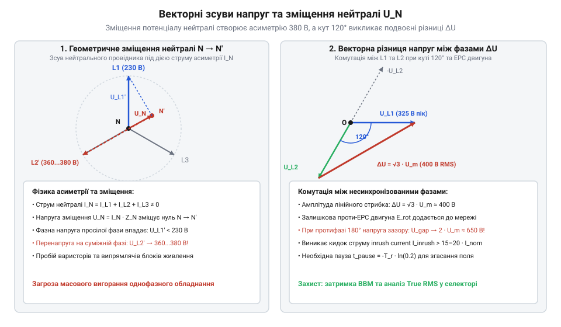
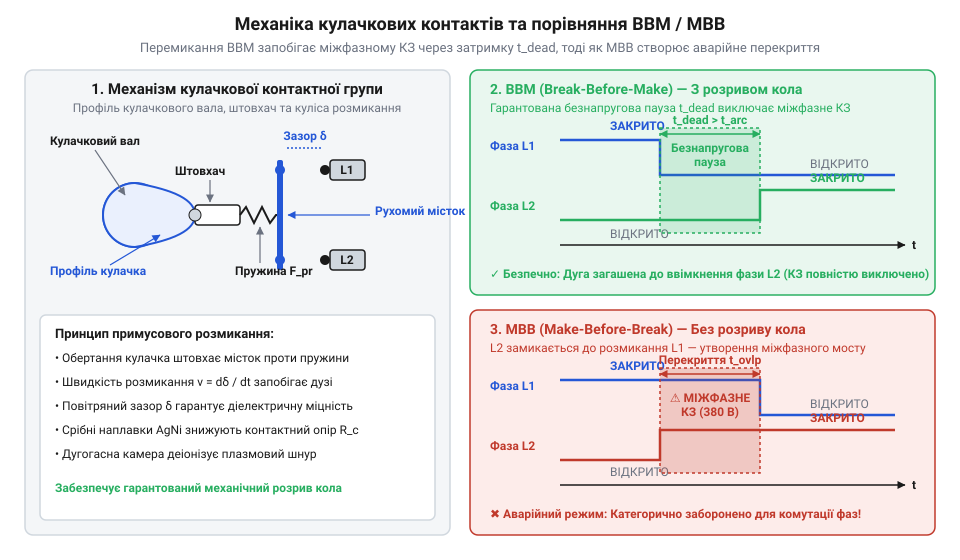
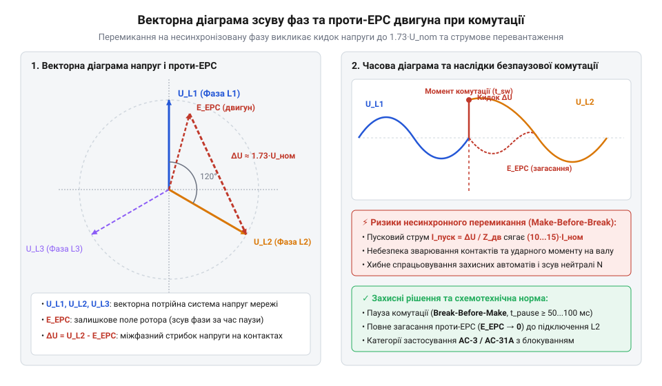
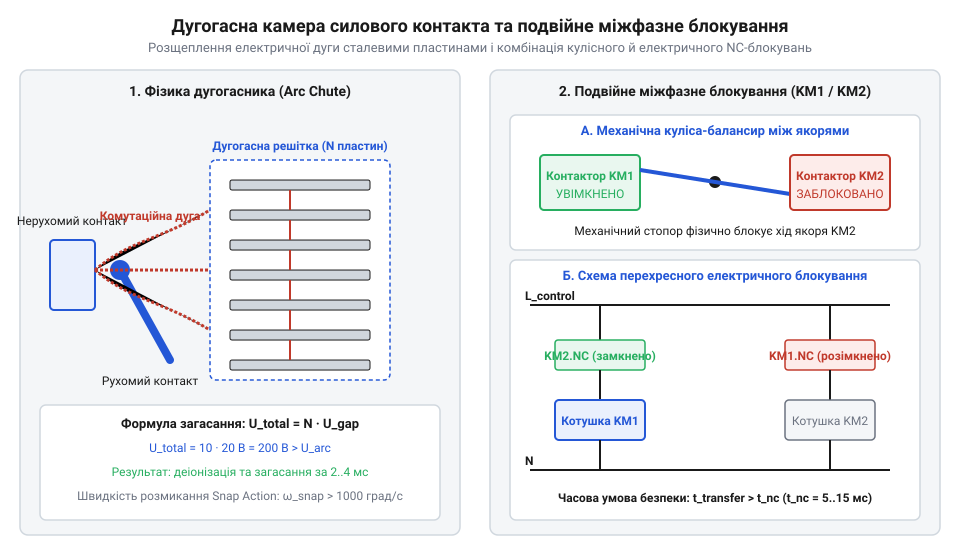

# Перемикачі фаз та резервного живлення

<preknowlist>
- [Кулачкові перемикачі (Cam Switches) та пакетні вимикачі](root:cat-hw-controls/rotary-cam-switches) — Конструкція кулачкового вала та механізм примусового розмикання контактних ламелей.
- [Багатопозиційні галетні перемикачі (Rotary Switches)](root:cat-hw-controls/rotary-selector-switches) — Загальні принци принципової комутації багатопозиційних поворотних кіл.
</preknowlist>

## Нерівномірність навантаження та зміщення нейтралі

Нерівномірне підключення однофазних споживачів до трифазної мережі викликає несиметрію струмів та перекіс напруг. У разі аварійного обриву нульового провідника потенціал зсунутої нейтралі переміщується у бік більш завантаженої фази, через що напруга на найменш завантаженій фазі зростає від номінальних 230 В до міжфазного значення 380 В і спалює однофазну електроніку.

Для захисту обладнання застосовують перемикачі фаз (від англ. @@en|phase selector switch@@) та блоки автоматичного введення резерву (від англ. @@en|Automatic Transfer Switch@@, @@en|ATS@@). Ручна комутація за допомогою [галетних перемикачів](root:cat-hw-controls/rotary-selector-switches) чи [кулачкових вимикачів](root:cat-hw-controls/rotary-cam-switches) у таких умовах є занадто повільною. Електронний перемикач фаз безперервно вимірює напругу всіх трьох ліній і при аварії пріоритетної фази за мілісекунди автоматично переключає навантаження на резервну лінію з нормальними параметрами.

*Геометричне зміщення нейтралі при обриві нульового провідника та перекосі фазних навантажень.*

## Механіка комутації та принципи BBM

Перемикання силових ліній вимагає суворого дотримання часової послідовності спрацьовування контактів. У силових мережах використовують перемикання з розривом кола — розмикання перед замиканням (від англ. @@en|Break-Before-Make@@, @@en|BBM@@). Перед замиканням резервної фази стара фаза повинна розімкнутися, формуючи безнапругову паузу `t_dead`. Якщо застосувати замикання перед розмиканням (від англ. @@en|Make-Before-Break@@, @@en|MBB@@), короткочасне одночасне замкнення двох фаз викличе міжфазне коротке замикання з руйнуванням контактора.

*Конструкція контактної групи та часове співвідношення інтервалів розмикання й замикання в режимах BBM та MBB.*

Для стійкості до ерозійного зносу силові контакти оснащують наплавками зі срібно-нікелевих (AgNi) або срібно-оксид-кадмієвих (AgCdO) сплавів, що запобігають зварюванню контактів під дією дуги.

## Векторний зсув та пускові струми

Перемикання моторного навантаження між фазами зі зсувом 120° супроводжується важкими перехідними процесами. Під час безнапругової паузи `t_dead` ротор асинхронного двигуна працює як генератор, індукуючи в обмотках статора згасаючу проти-ЕРС (від англ. @@en|back electromotive force@@, @@en|back-EMF@@). У момент підключення резервної фази векторна різниця між напругою мережі та проти-ЕРС ротора може сягати подвоєного амплітудного значення, що спричиняє важкий пусковий кидок струму (від англ. @@en|inrush current@@).

*Векторне додавання напруги мережі та залишкової проти-ЕРС обмоток двигуна при фазовому зсуві.*

Для захисту двигунів контролер @@en|ATS@@ реалізує алгоритм синхронного переключення (від англ. @@en|in-phase transfer@@) у момент збігу фаз проти-ЕРС і мережі або витримує паузу до згасання проти-ЕРС нижче 20% від номіналу. Детальніше принцип роботи та схемотехніку фазового моніторингу висвітлюють [автоматичні контролери АВР та алгоритми фазової синхронізації](root:hw-power/automatic-transfer-switch-controllers).

## Гасіння дуги та взаємне блокування

Розмикання силових контактів під струмом супроводжується виникненням плазмової дуги. Для її придушення комутаційну камеру оснащують деіонною дугогасною решіткою зі сталевих пластин. Магнітне поле затягує плазмовий шнур углиб камери, де він розщеплюється на короткі дуги, охолоджується й миттєво гасне.

*Розщеплення електричної дуги на пластинах дугогасної камери та схема блокування через NC-контакти.*

Щоб унеможливити зустрічне ввімкнення двох джерел, застосовують подвійне взаємне блокування. Механічний коромисловий важіль фізично блокує ввімкнення одного контактора при замкненому другому, а електричне блокування розриває котушку ввімкнення через розмикальні допоміжні контакти (від англ. @@en|Normally Closed auxiliary contacts@@, @@en|NC contacts@@).

## Уставки напруги та вибір контакторів

Електронні модулі перемикання фаз налаштовуються за допомогою уставок напруги й часу. Нижній поріг `U_min` (180...200 В) вимикає фазу при просіданні, а верхній поріг `U_max` (240...260 В) захищає від перенапруги. Для запобігання хаотичному перемиканню вводиться гістерезис напруги `ΔU` (5...10 В). Контролер використовує вимірювання True RMS (від англ. @@en|True Root Mean Square@@), що виключає хибні спрацьовування від гармонік.

Комутаційні сплески пригнічуються TVS-супресорами та RC-ланцюгами. Залежно від типу навантаження обирають категорію застосування IEC: `AC-31A` (неіндуктивні кола), `AC-33B` (моторні навантаження) або `AC-3` (прямий пуск двигунів). У закритих шафах номінальний струм контактора обчислюють з урахуванням температурного зниження номіналу (від англ. @@en|derating factor@@).
