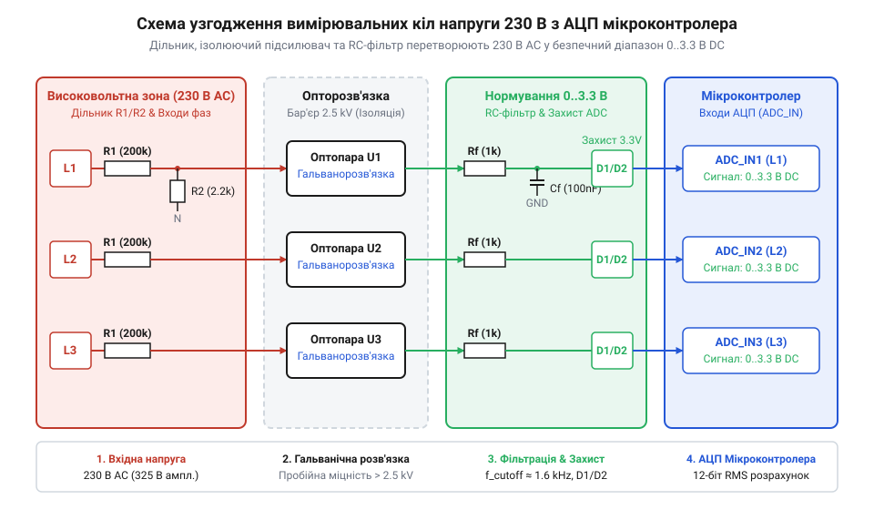
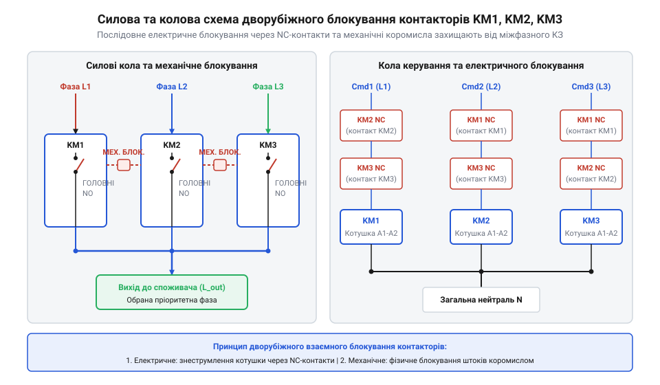

# Проєкт трифазного селектора пріоритетної фази для однофазних споживачів

<preknowlist>
- [Багатопозиційні галетні перемикачі (Rotary Switches)](root:cat-hw-controls/rotary-selector-switches) — Розуміння принципів механічної комутації кількох альтернативних кіл.
- [Кулачкові перемикачі (Cam Switches) та пакетні вимикачі](root:cat-hw-controls/rotary-cam-switches) — Розуміння ручного перемикання силових ліній живлення та комутації фаз.
</preknowlist>

## Ризики аварій фаз та задача селектора

У трифазних мережах електропостачання споживачі часто стикаються з нерівномірним розподілом навантаження, що призводить до перекосу фаз та небезпечних коливань напруги. При обриві нейтрального провідника (нуля) виникає зміщення потенціалу нейтралі (англ. @@en|neutral displacement voltage@@, від лат. @@la|neutralis@@ — нічийний). Для математичного розрахунку цього ефекту використовують метод вузлових потенціалів (англ. @@en|Millman's theorem@@). Позначимо фазні ЕРС джерела як `E_A`, `E_B`, `E_C`, комплекси провідностей фазного навантаження (англ. @@en|admittance@@, від лат. @@la|admittere@@ — допускати) як `Y_A`, `Y_B`, `Y_C` (де `Y = 1 / Z`, а `Z` — повний опір фази), а провідність нейтрального провідника як `Y_N`. За відсутності нуля (`Y_N = 0`) потенціал зміщеної нейтралі `U_N'` відносно глухозаземленої точки генератора та реальна напруга на фазі `U_A'` розраховуються за ланцюжком рівнянь:

    U_N' = (E_A · Y_A + E_B · Y_B + E_C · Y_C) / (Y_A + Y_B + Y_C + Y_N)   [закон вузлових потенціалів Міллмана]
         = (E_A · Y_A + E_B · Y_B + E_C · Y_C) / (Y_A + Y_B + Y_C)         [умова обриву нуля: Y_N = 0]
    U_A' = E_A - U_N'                                                      [реальна напруга на фазі A]

Крім зміщення потенціалу нейтралі, несиметрія струмів (англ. @@en|current asymmetry@@) викликає суттєвий спад напруги (англ. @@en|voltage drop@@) на опорі підвідної лінії навантаженої фази. Позначивши повний опір лінії живлення як `Z_line = R_line + j·X_line`, струм у нейтральному провіднику розраховується як векторна сума фазних струмів: `I_N = I_A + I_B + I_C`. Падіння напруги `ΔU_B` на перевантаженій фазі B та підсумкова напруга у споживача `U_B_load` розраховуються за рівняннями:

    ΔU_B     = I_B · Z_line + I_N · Z_N                                   [спад напруги з урахуванням струму нейтралі]
    U_B_load = E_B - ΔU_B                                                 [фактична напруга на клемах споживача фази B]

При великому струмі навантаження `I_B = 50 А` та опорі лінії `R_line = 0.8 Ом` падіння напруги `ΔU_B = 50 · 0.8 = 40 В` просідає робочий рівень напруги з 230 В до небезпечних 190 В, викликаючи зупинку електроприводів.

Коли навантаження несиметричне, наприклад на фазі A споживання мінімальне (`Z_A` прямує до безкінечності, тобто `Y_A ≈ 0`), а фази B і C сильно навантажені (`Y_B, Y_C >> Y_A`), потенціал `U_N'` зміщується в бік фаз B та C. У результаті напруга на незавантаженій фазі з найменшим споживанням може різко зрости до міжфазного значення `U_L = √3 · U_ph` (до 350–400 В), викликаючи пробій ізоляції та вихід з ладу чутливої побутової й промислової електроніки. Натомість перевантажені лінії просідають нижче критичної межі 180 В, що спричиняє перегрів двигунів та зупинку технологічних процесів. Традиційне ручне перемикання ліній через [кулачкові перемикачі живлення](root:cat-hw-controls/rotary-cam-switches) вимагає постійної присутності оператора та унеможливлює оперативну реакцію на раптові мережеві аварії.

Для автоматичного захисту та безперебійного живлення відповідального однофазного навантаження застосовують автоматичний селектор фаз (англ. @@en|automatic phase selector@@, від @@en|select@@). Пристрій безперервно контролює амплітудні параметри всіх трьох вхідних ліній L1, L2 та L3. У разі виходу напруги активної лінії за припустимі межі селектор автоматично відключає її від споживача та перемикає живлення на справну фазу з найвищим пріоритетом.

## Схемотехніка вимірювання та захисту входів

Вимірювання високої мережевої напруги 230 В (із піковим амплітудним значенням близько 325 В) вимагає точного нормування сигналу до безпечного діапазону аналогово-цифрового перетворювача (англ. @@en|analog-to-digital converter@@, від @@en|convert@@, скорочено @@en|ADC@@) мікроконтролера. Первинне зниження амплітуди здійснюють за допомогою високовольтного резистивного дільника (англ. @@en|voltage divider@@, від лат. @@la|dividere@@ — ділити) або вимірювального трансформатора напруги. Позначимо середньоквадратичну напругу мережі як `V_rms` (230 В), її пікову амплітуду як `V_peak` (`V_rms · √2 ≈ 325 В`), опір верхнього плеча дільника як `R_1`, опір нижнього плеча як `R_2`, а вихідну пікову напругу як `V_out_peak`. При виборі опору нижнього плеча `R_2 = 1 кОм` та коефіцієнта ділення `K = 1 / 201` опір верхнього плеча `R_1` становить `200 кОм`. Потужність розсіювання (англ. @@en|power dissipation@@, від лат. @@la|dissipatio@@ — розвіювання) `P_R1` на верхньому плечі та потужність `P_R2` на нижньому плечі розраховуються за ланцюжком рівнянь:

Для захисту входу АЦП від високочастотних мережевих завад та аліасингу застосовують пасивний RC-фільтр нижніх частот (англ. @@en|low-pass filter@@). Його частота зрізу (англ. @@en|cutoff frequency@@) `f_c` розраховується через еквівалентний вихідний опір дільника `R_eq = (R_1 · R_2) / (R_1 + R_2) ≈ R_2 = 1 кОм` та ємність фільтруючого конденсатора `C`:

    f_c = 1 / (2π · R_eq · C)                                              [формула частоти зрізу RC-фільтра]

Задавши цільову частоту зрізу `f_c ≈ 1000 Гц` для придушення завад від комутації без фазового спотворення основної гармоніки 50 Гц (фазовий зсув `Δφ < 3°`), необхідна ємність розраховується за формулою `C = 1 / (2π · 1000 · 1000) ≈ 159 нФ`. Обираючи стандартний номінал керамічного конденсатора `C = 150 нФ`, отримуємо фактичну частоту зрізу `f_c = 1 / (2π · 1000 · 150·10⁻⁹) ≈ 1061 Гц`, що забезпечує надійне демпфування високочастотного шуму.

    V_peak = V_rms · √2
           = 230 · 1.414                                                   [амплітудне значення синусоїди]
           = 325.27 В                                                      [пікова напруга мережі]
    P_R1   = V_rms² / R_1
           = 230² / 200000                                                 [закон Джоуля-Ленца через RMS напругу]
           = 52900 / 200000                                                [піднесення напруги до квадрата]
           = 0.265 Вт                                                      [потужність розсіювання верхнього плеча]
    P_R2   = (V_rms · (R_2 / (R_1 + R_2)))² / R_2
           = (230 · (1000 / 201000))² / 1000                               [напруга нижнього плеча в квадраті на опір]
           = 1.144² / 1000                                                 [розрахунок напруги нижнього плеча 1.144 В]
           = 0.0013 Вт                                                     [потужність розсіювання нижнього плеча]

Оскільки виділення теплової потужності `P_R1 = 0.265 Вт` на одному елементі перевищує номінал стандартного SMD-резистора 1206 (0.25 Вт) і його граничну напругу (200 В), верхнє плече `R_1` розбивають на послідовний ланцюжок із чотирьох однакових резисторів опором по `50 кОм` кожен. Це зменшує напругу до `81.3 В` та потужність до `0.066 Вт` на один резистор, гарантуючи захист від теплового пробою. Для забезпечення електричної безпеки оператора та захисту обчислювального ядра від пробою в схему впроваджують оптичну розв'язку (англ. @@en|optical isolation@@, від @@en|isolate@@) на основі лінійного оптопари.

*Принципова електрична схема нормування мережевої напруги 230 В для безпечного введення в аналогово-цифровий перетворювач мікроконтролера.*

Для захисту входів від імпульсних мережевих завад та комутаційних сплесків вихідний сигнал нормується пасивним фільтром нижніх частот (англ. @@en|low-pass filter@@) та зрізається захисними діодами Шотткі (англ. @@en|clamping diodes@@). Опорне значення діючої напруги (англ. @@en|root mean square@@, скорочено @@en|RMS@@) розраховується за квадратним коренем із середнього значення квадратів миттєвих відліків:

        V_rms = √( (1 ÷ N) × ∑ vᵢ² )    [формула розрахунку середньоквадратичної напруги]

Розрахований коефіцієнт дільника дозволяє алгоритму відновлювати реальне значення напруги кожної фази у вольтах.

## Алгоритм моніторингу та гістерезису

Коли напруга фази коливається поблизу порогових меж (наприклад, 195 В), звичайне порогове порівняння спричиняє брязкіт (англ. @@en|chatter@@) контакторів — часті хибні перемикання туди й назад. Щоб усунути цей ефект, у програмному забезпеченні реалізують гістерезис (англ. @@en|hysteresis@@, від грец. @@grc|ὑστέρησις@@ — відставання). Якщо фаза була призначена придатною, вона вважається аварійною лише при падінні нижче `V_min - V_hyst` або підйомі вище `V_max + V_hyst`. Зворотне повернення фази в статус придатності відбувається лише при жорсткому входженні напруги в інтервал `[V_min, V_max]`. Для запобігання хибним спрацьовуванням під час високочастотних мережевих завад та імпульсних сплесків від комутації потужних індуктивних навантажень алгоритм застосовує динамічну адаптацію ширини вікна `V_hyst` (англ. @@en|adaptive hysteresis@@). Програма підраховує частоту переходів напруги через проміжний рівень або обчислює середньоквадратичне відхилення вибірок АЦП: при зростанні частоти завад ширина вікна адаптивно розширюється від номінальних `5 В` до `10–12 В`, демпфуючи швидкі пульсації. Після стабілізації мережі та зниження рівня завад величина `V_hyst` автоматично звужується до базового значення, відновлюючи високу чутливість системи до реальних аварійних відхилень.

Логіка керування будується на основі неблокуючого скінченного автомата станів (англ. @@en|finite-state machine@@, скорочено @@en|FSM@@). Автомат послідовно проходить стани моніторингу, захисної паузи розмикання (англ. @@en|dead-time@@) та затримки підтвердження нової фази перед увімкненням силових ключів.

:::tabs
:::code proj-automatic-phase-selector-circuit/c/phase_selector.h 15-57
:::code proj-automatic-phase-selector-circuit/c/phase_selector.c 41-136
:::code proj-automatic-phase-selector-circuit/c/phase_selector.c 138-224
<!-- slide -->
:::code proj-automatic-phase-selector-circuit/cpp/phase_fsm.hpp 13-50
:::code proj-automatic-phase-selector-circuit/cpp/phase_fsm.hpp 56-135
:::code proj-automatic-phase-selector-circuit/cpp/phase_selector.hpp 15-42
:::

Алгоритм забезпечує пріоритетне повернення на лінію L1, якщо вона відновлює параметр напруги до норми, забезпечуючи роботу споживача від основного джерела.

## Дворубіжне блокування силових контакторів

Комутація силових фазних ліній напругою 230 В вимагає абсолютного унеможливлення одночасного замикання двох або трьох контакторів, оскільки міжфазна напруга 400 В викликає міжфазне коротке замикання з руйнівним струмом дуги. При відключенні контактора під навантаженням між його силовими контактами виникає @@en|electric arc@@ (англ. @@en|electric arc@@, електрична дуга). Навіть якщо керуючий мікроконтролер миттєво зняв сигнал із котушки одного контактора, іонізований плазмовий проміжок зберігає провідність упродовж кількох мілісекунд. Якщо подати напругу на котушку сусіднього контактора без витримання захисної бездаркової паузи @@en|break-before-make@@ (англ. @@en|break-before-make@@, розмикання перед замиканням), відбудеться перекриття дугою міжфазного інтервалу та зварювання контактних груп. Для обґрунтованого вибору значення затримки `break_delay_ms` розраховують максимальний час гасіння дуги `t_arc`. У мережі змінного струму частотою 50 Гц (період 20 мс) струм проходить через нуль кожні 10 мс. Оскільки електрична дуга природним чином гасне при переході струму через нульове значення, максимальний час очікування нульової фази становить `t_zero = 10 мс`. З урахуванням механічного часу повернення якірної системи контактора (`t_rel ≈ 10–15 мс`) та деіонізації (англ. @@en|deionization@@) плазмового проміжку (`t_deion ≈ 3–5 мс`), сумарна тривалість існування дугового розряду становить: `t_arc = t_rel + t_zero + t_deion ≈ 15 + 10 + 5 = 30 мс`. Для гарантування безпеки із коефіцієнтом запасу 1.5 програмну паузу `break_delay_ms` обирають у діапазоні від 30 до 50 мс, що повністю виключає виникнення міжфазного короткого замикання через плазмовий міст.

Для захисту від програмних збоїв чи механічного заклинювання застосовують дворубіжне блокування, яке поєднує електричний та механічний захисні бар'єри. Перший рубеж — електричний захист — реалізується послідовним включенням котушки кожного контактора через допоміжні нормально замкнені (англ. @@en|normally closed@@, NC) контакти двох інших контакторів. Другий рубеж — механічний захист — забезпечується встановленням між корпусами контакторів спеціального блокувального коромисла (англ. @@en|mechanical interlock@@, механічне блокування), яке фізично фіксує рухому систему одного контактора у вимкненому стані при спрацьовуванні сусіднього.

_Силова схема підключення трьох контакторів із дворубіжним блокуванням._

Програмний рівень забезпечує неблокуючу витримку затримки `break_delay_ms` (зазвичай 20–50 мс) між зняттям сигналу з активного контактора та видачею команди на ввімкнення цільового. Ниже наведено реалізацію низькорівневого контролю та взаємного блокування силових виходів:

:::tabs
@tab C
:::code proj-automatic-phase-selector-circuit/c/phase_selector.c 20-36
:::code proj-automatic-phase-selector-circuit/c/phase_selector.h 31-40

@tab C++
:::code proj-automatic-phase-selector-circuit/cpp/contactor_driver.hpp 28-64
:::

## Збирання, налагодження та випробування

Монтаж селектора фаз починається зі встановлення силових контакторів, мікропроцесорного блока керування та захисних автоматичних вимикачів на DIN-рейку електрощита. Проводку силових ліній L1, L2, L3 виконують мідним провідником відповідного перерізу (наприклад, 4–6 мм²), а слабострумові вимірювальні кола та лінії керування котушками прокладають окремими жмутами із кольоровим маркуванням. Перед першим ввімкненням перевіряють відсутність міжфазних коротких замикань та надійність механічного взаємного блокування. Вибір перерізу силових жил базується на розрахунку максимального струмового навантаження за допустимою щільністю струму `J` (англ. @@en|current density@@). Для однофазного споживача потужністю `P_max = 7.0 кВт` при номінальній напрузі `U = 230 В` максимальний тривалий струм становить: `I_max = P_max / U = 7000 / 230 ≈ 30.4 А`. Для мідних провідників у закритих щитових конструкціях безпечне значення допустимої щільності струму обирають у межах `J = 5–6 А/мм²`, що гарантує відсутність перегріву ізоляції. Мінімальний розрахунковий переріз провідника становить: `S_min = I_max / J = 30.4 / 6 ≈ 5.07 мм²`. Згідно зі стандартом номінальних перерізів обирають мідний кабель перерізом `S = 6 мм²` (тривалий допустимий струм до 40 А для закритої прокладки), що упереджує спад напруги (англ. @@en|voltage drop@@) та забезпечує необхідний тепловий запас.

Первинне налагодження вимірювального тракту здійснюють без підключення силового навантаження. Для калібрування аналогових входів використовують лабораторний автотрансформатор (ЛАТР) та еталонний мультиметр, підключений до ліній вимірювальних трансформаторів напруги. Послідовно змінюючи напругу на кожній фазі від 150 до 270 В, перевіряють точність обчислення [RMS](root:cat-hw-controls/optical-and-inductive-position-encoders) та коригують коефіцієнт дільника `divider_ratio` в налаштуваннях:

:::tabs
@tab C
:::code proj-automatic-phase-selector-circuit/c/phase_selector.c 112-136

@tab C++
:::code proj-automatic-phase-selector-circuit/cpp/voltage_sensor.hpp 52-74
:::

Фінальне випробування передбачає комплексну перевірку аварійних режимів під реальним навантаженням. Імітують просідання напруги на пріоритетній фазі L1 нижче `v_min` (195 В), вимірюючи осцилографом час перемикання на фазу L2. Також перевіряють роботу гістерезису: фаза L1 повинна знову стати активною лише після її відновлення вище порогу `v_min + v_hysteresis`. Для автоматизації цього циклу застосовують підсистему неблокуючого скінченного автомата:

:::tabs
@tab C
:::code proj-automatic-phase-selector-circuit/c/phase_selector.c 138-224

@tab C++
:::code proj-automatic-phase-selector-circuit/cpp/phase_fsm.hpp 49-135
:::
