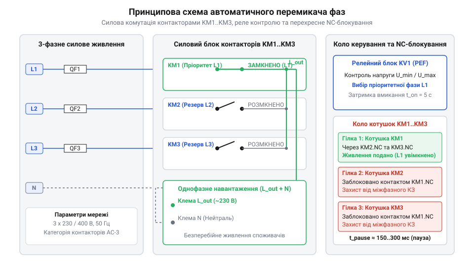
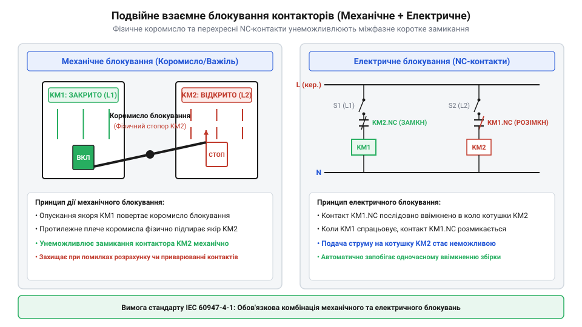

# Про проєктування та збирання 3-фазного автоматичного перемикача живлення з блокуваннями

<preknowlist>
- [Кулачкові перемикачі (Cam Switches) та пакетні вимикачі](root:cat-hw-controls/rotary-cam-switches) — Конструкція кулачкового вала, дугогасіння та ручна комутація фазних кіл
- [Багатопозиційні галетні перемикачі (Rotary Switches)](root:cat-hw-controls/rotary-selector-switches) — Загальні принципи багатопозиційної комутації та організації вибору джерел живлення
</preknowlist>

## Технічні вимоги та ризики міжфазного КЗ

У трифазних електричних мережах живлення однофазних відповідальних споживачів — таких як сервери, контролери автоматики та системи опалення — супроводжується ризиком аварійного знеструмлення через просідання або обрив однієї з фаз. На відміну від ручних пристроїв, де застосовуються [кулачкові перемикачі](root:cat-hw-controls/rotary-cam-switches) або [багатопозиційні галетні перемикачі](root:cat-hw-controls/rotary-selector-switches), автоматичні системи вибору фази мають самостійно моніторити рівні напруги та перемикати навантаження на резервну лінію без участі оператора. Критичною умовою такої комутації є розрахунок допустимого часу безнапругової паузи (@@en|dead-time@@, від англ. @@en|dead time@@ — «мертвий час», або режим @@en|break-before-make@@, від англ. @@en|break before make@@ — «розмикання перед замиканням»), який унеможливлює перекриття контактів різних фаз. Під час розмикання силових контактів під навантаженням виникає електрична дуга (@@en|electric arc@@), тривалість якої безпосередньо залежить від величини струму та характеру навантаження. Для слабоіндуктивних кіл категорії @@en|AC-1@@ при струмах до 10 А дуга згасає при першому переході синусоїди через нуль за 5–10 мс. Проте при важких комутаціях реактивних струмів категорії @@en|AC-3@@ (40–100 А) хмара іонізованого газу утримує провідність до 50–80 мс. Мінімально допустимий інтервал між сигналами керування `t_dead` визначається як сума часу механічного розмикання контактора `t_off` (15–30 мс), тривалості дугогасіння `t_arc` та безпекового запасу `t_safety` (20–40 мс): `t_dead = t_off + t_arc + t_safety`. Якщо запрограмований час безнапругової паузи буде меншим за сумарний час `t_off + t_arc`, увімкнення контактора резервної фази відбудеться до загасання дуги попереднього контактора, що призведе до міжфазного короткого замикання через плазмовий шлейф.

Найголовнішою небезпекою при проектуванні автоматичного перемикача є виникнення міжфазного короткого замикання (міжфазне КЗ). Якщо контактор резервної фази увімкнеться до того, як повністю розімкнеться контактор попередньої фази, або якщо між контактами збережеться електрична дуга (@@en|electric arc@@), напруга між двома фазами величиною 400 В припаде на коротке коло. Це призводить до вибухового руйнування комутаційних апаратів та пожежі у щиті.

Щоб усунути цей ризик, до автоматичного перемикача фаз висувають жорсткі технічні вимоги до алгоритму контролю напруги та комутації:
- Пріоритетність та затримка повернення: при відновленні якості первинної фази L1 система повинна повертатися на неї з нормованим часом витримки (@@en|Return Delay@@, зазвичай 2000–5000 мс) для відфільтровування короткочасних хибних сплесків.
- Гістерезис відновлення: для запобігання частим перемиканням при коливанні напруги навколо граничних уставок (наприклад, нижньої межі 180 В чи верхньої 250 В) застосовують гістерезис величиною 5 В. Це означає, що після відключення фази при 180 В її відновлення вважається дійсним лише при підйомі напруги до 185 В.
- Безнапругова пауза (@@en|dead-time@@ або @@en|Break-Before-Make@@): гарантована часова затримка між відключенням одного контактора й увімкненням іншого має перевищувати час гасіння електричної дуги (зазвичай 30–100 мс для силових контакторів).
- Подвійне взаємне блокування: одночасне увімкнення контакторів має бути унеможливлене як апаратно-електрично (через перехресні нормально замкнені контакти @@en|NC@@), так і механічно (за допомогою коромисел блокування між корпусами).

## Принципова силова та сигнальна схема

Схема автоматичного вибору фази будується на трьох силових контакторах (`KM1`, `KM2`, `KM3`) та блоці моніторингу напруги. Вхідні фазні лінії `L1`, `L2`, `L3` підключаються до верхніх силових клем відповідних контакторів, а їхні вихідні клеми об'єднуються на спільну фазну шину навантаження `L_out`. Нейтральний провідник `N` проходить до навантаження напряму. Для розв'язки низьковольтних сигнальних виходів контролера від високих індуктивних струмів котушок у кола керування вмикають проміжні реле (`K1`, `K2`, `K3`). Вони виконують роль гальванічного буфера, перемикаючи сухі нормально розімкнені контакти в ланцюзі живлення котушок 230 В змінного струму. Кола світлодіодної індикації розділяють на фазні та сигнальні: індикатори наявності мережі (`HL1`, `HL2`, `HL3`) підключають між вхідними фазами й нейтраллю через слаботочні запобіжники, а світлодіоди активного стану (`HL_KM1`, `HL_KM2`, `HL_KM3`) живляться через додаткові нормально розімкнені допоміжні контакти контакторів, що дає однозначну візуальну інформацію про поточне джерело на `L_out`.


*Принципова електрична схема силової частини та кіл керування 3-фазного перемикача фаз з автоматичним контролем напруги.*

Керування котушками контакторів здійснюється через перехресний ланцюжок нормально замкнених допоміжних контактів (@@en|interlock auxiliary contacts@@). Котушка контактора KM1 живиться через послідовно з'єднані NC-контакти KM2 та KM3. Аналогічно, котушки KM2 і KM3 живляться через NC-контакти своїх сусідів. Якщо контактор KM1 замкнено, його допоміжний NC-контакт розмикає кола котушок KM2 і KM3, роблячи їх подачу живлення фізично неможливою навіть при хибному командному сигналі з контролера.


*Конструкція та електричне трасування перехресних нормально замкнених контактів NC для надійного блокування контакторів.*

Додатково між корпусами контакторів встановлюється механічне коромисло блокування. Воно фізично утримує якір контактора в розімкненому стані, якщо сусідній контактор притягнутий. Світлодіодні індикатори на лицьовій панелі відображають активну фазу та аварійний стан мережі.

## Вибір контакторів та розрахунок захисту

Вибір силових комутаційних апаратів залежить від характеру навантаження та категорії застосування за стандартом IEC 60947. Для омічних навантажень (обігрівачі, освітлення) застосовують категорію @@en|AC-31A@@ (або @@en|AC-1@@), де струм контактора дорівнює номінальному струму споживача I_load. Для електродвигунів та насосів використовують категорію @@en|AC-3@@, оскільки пусковий струм індуктивного навантаження перевищує робочий у 5–8 разів: Детальніше розбіжності між комутаційними режимами та [класифікацію комутаційних апаратів](root:cat-hw-controls/ac-application-categories) викладено в окремому довіднику.

```
I_inrush = (5 ... 8) · I_nominal
```

При виборі номіналу контактора для індуктивного навантаження його номінальний струм I_KM розраховують із запасом:

```
I_KM ≥ 1.25 · I_load
```

При щільному монтажі обладнання на DIN-рейку (@@en|DIN-rail@@) всередині закритого щита виникає взаємний тепловий нагрів. Розрахунковий струм контактора корегується коефіцієнтом зниження потужності (@@en|derating factor@@):

```
I_allowed = I_nominal · K_temp · K_density
```

де K_temp = 0.9 при температурі всередині щита +50°C, а K_density = 0.85 при відсутності зазорів між апаратами.

Силові кола кожної фази захищаються автоматичними вимикачами з характеристикою C або D, а кола керування та вимірювання АЦП — окремими плавкими запобіжниками або мікроавтоматами з номіналом 1–2 А.

Програмний алгоритм керування перемикачем гарантує витримку безнапругової паузи (@@en|dead-time@@) та затримку повернення на пріоритетну фазу L1, що реалізовано у скінченному автоматі (@@en|FSM@@):

:::tabs
:::code proj-automatic-phase-selector-panel/c/main/phase_selector.c 191-218
:::code proj-automatic-phase-selector-panel/cpp/PhaseSelector.cpp 84-144
:::

## Організація блокування та часових затримок

Надійність 3-фазного автоматичного перемикача фаз визначається неможливістю одночасного увімкнення двох контакторів. Якщо два силові контактори замкнуться паралельно, між фазами L1, L2 або L3 виникне міжфазне коротке замикання з дуговим спалахом та руйнуванням щитового обладнання. Для усунення цього ризику застосовують двобар'єрний захист: механічне та електричне блокування (від англ. @@en|interlocking@@ — взаємне замикання).

Механічне блокування реалізують за допомогою балансирного коромисла (від англ. @@en|mechanical interlock rocker@@), встановленого у проміжку між якорями сусідніх контакторів. Замикання якоря одного контактора фізично блокує хід якоря сусіднього апарата. Електричне блокування виконують послідовним вмиканням котушки керування кожного контактора через нормально замкнені допоміжні контакти NC (від англ. @@en|normally closed@@) двох інших контакторів.

Проте апаратних блокувань недостатньо під час швидкісного перемикання: електрична дуга, що виникає при розмиканні силових контактів під навантаженням, потрапляє в дугогасні камери й гасне не миттєво. Якщо подати напругу на котушку наступного контактора до повного деіонізаційного згасання дуги попереднього, виникне міжфазне КЗ через дуговий міст. Для безпечного гасіння застосовують алгоритмічний інтервал паузи — @@en|dead-time@@ (від англ. @@en|dead-time@@ — мертвий час), який виконується за принципом @@en|Break-Before-Make@@ (від англ. @@en|Break-Before-Make@@ — розмикання перед замиканням).

Окремою проблемою є короткочасні просідання напруги та перехідні процеси у мережі. Без витримки часу відновлення виникне явище брязкання контактів — @@en|chattering@@ (від англ. @@en|chattering@@ — брязкання), коли перемикач хаотично комутуватиме контактори при кожному сплеску напруги. Щоб запобігти цьому, скінченний автомат — @@en|finite-state machine@@ (від англ. @@en|finite-state machine@@, FSM) задіює таймер @@en|Return Delay@@ (від англ. @@en|Return Delay@@ — затримка повернення), який очікує стабільного утримання напруги пріоритетної фази L1 протягом заданого часу перед зворотним перемиканням.

:::tabs
@tab C (esp-idf)
:::code proj-automatic-phase-selector-panel/c/main/phase_selector.c 191-218
@tab C++ (arduino)
:::code proj-automatic-phase-selector-panel/cpp/main.cpp 15-31
:::

У наведеному програмному коді під час відновлення пріоритетної фази L1 FSM спочатку переходить у стан `FSM_STATE_RETURN_DELAY`. Якщо протягом таймера відновлення напруга L1 знову виходить за межі норми, лічильник скидається, що відфільтровує хибні спрацьовування й продовжує ресурс силових контакторів.

## Щитовий монтаж та компоундування DIN-рейки

Фізичне збирання 3-фазного автоматичного перемикача фаз виконують у розподільчому щиті на стандартній DIN-рейці (від нім. @@de|Deutsches Institut für Normung@@, DIN — Німецький інститут стандартизації). При компонуванні модульного обладнання дотримуються вимог теплового розсіювання: між силовими контакторами категорій AC-31A та AC-3 залишають повітряні теплові зазори за допомогою вентиляційних розпірок завширшки 0.5 модульного кроку. Це запобігає взаємному перегріву електромагнітних котушок під час тривалого утримання.

Силову комутацію виконують гнучким мідним проводом відповідного перерізу. Для надійного електричного контакту та запобігання перетисканню окремих жил у гвинтових затискачах контакторів усі кінці багатожильних провідників обов'язково обтискають втулковими наконечниками НШВІ (абревіатура від «наконечник штирьовий втулковий ізольований») за допомогою прес-кліщів.

Під час трасування суворо дотримуються колірного маркування силових та допоміжних кіл:
- Фаза L1 — коричневий або чорний колір;
- Фаза L2 — чорний або сірий колір;
- Фаза L3 — сірий або червоний колір;
- Нейтральний провідник N — синій колір;
- Захисний провідник PE — жовто-зелений колір.

Сигнальні провідники кіл керування реле та опторозв'язок прокладають у перфорованих кабель-каналах окремо від силових фазних шин для зменшення імпульсних завад. На відміну від ручних [кулачкових перемикачів](root:cat-hw-controls/rotary-cam-switches) чи [галетних перемикачів](root:cat-hw-controls/rotary-selector-switches), автоматична система вимагає чіткого розмежування силового щитового відсіку та низьковольтного блоку контролю.

## Пусконалагодження та випробування аварійних режимів

Пусконалагодження збираного щита перемикача фаз виконують за покроковим регламентом із дотриманням правил електробезпеки. На першому етапі проводять холодну перевірку без подачі силової напруги:
1. Перевіряють механічне блокування: при примусовому натисканні на штовхач одного контактора другий контактор мусить надійно блокуватися коромислом.
2. Прозвонюють мультиметром перехресні колу NC-контактів електричного блокування.
3. Перевіряють якість затискання всіх гвинтових та клемних з'єднань.

Другим етапом виконують перше подання живлення на реле контролю напруги та вимірювальні канали АЦП. За допомогою підлаштовувальних органів або програмного меню встановлюють базові уставки захисту:
- Нижній поріг напруги `U_min` = 185 В;
- Верхній поріг напруги `U_max` = 250 В;
- Гістерезис відновлення `U_hyst` = 5 В;
- Пауза перемикання `dead-time` = 100 мс;
- Затримка повернення `Return Delay` = 3000 мс.

Третім етапом здійснюють випробування в імітованих аварійних режимах за допомогою лабораторного автотрансформатора (ЛАФР) або тестового стенда. Послідовно імітують:
- **Обрив пріоритетної фази L1:** перемикач повинен безрозривно або з паузою dead-time перемкнути навантаження на резервну фазу L2.
- **Просідання напруги на L1 нижче 185 В:** перемикач фіксує аварію L1 і комутує L2. При відновленні L1 до 190 В (з урахуванням гістерезису 5 В) запускається таймер Return Delay (3000 мс), після чого навантаження повертається на L1.
- **Перенапругу понад 250 В:** при стрибку напруги реле миттєво відключає контактор L1 та здійснює перехід на стійку фазу.
- **Повний обрив усіх трьох фаз:** перемикач знеструмлює всі котушки контакторів, переходячи в безпечний аварійний стан `FSM_STATE_FAULT`.

Після успішного проходження всіх випробувань та підтвердження нульового розсуву фаз щит автоматичного вибору фази опломбовують та здають в експлуатацію.
