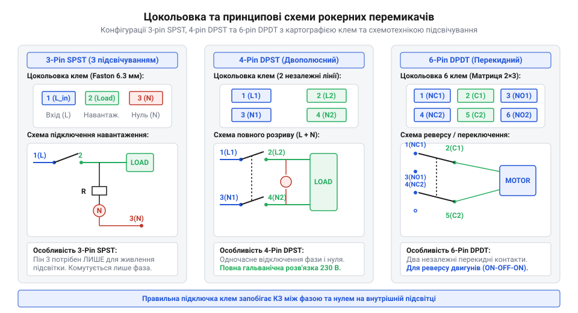
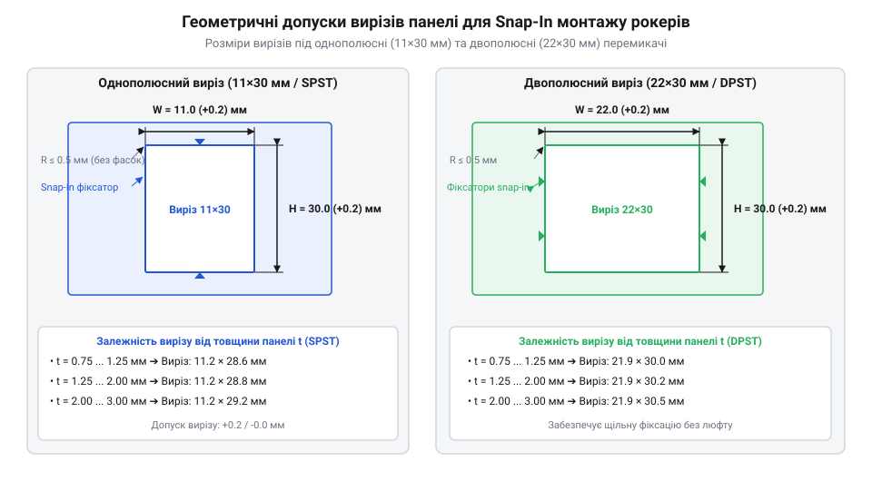

# Апаратний інтерфейс, цокольовка та посадочні розміри клавішних перемикачів

<preknowlist>
- [Тумблери, захисні ковпачки Mollie та блокування важелів (Switch Guards)](root:cat-hw-controls/toggle-switches-and-switch-guards) — Типи механічних клемників Faston та загальні принципи панельного кріплення.
</preknowlist>

## Проблема вибору інтерфейсу силової комутації

Проектування панелей живлення та силових щитів вимагає надійного розмикання кіл високої напруги AC 230 В або значних постійних струмів DC 10–16 А. Комутація таких потужностей безпосередньо на друкованій платі створює ризики перегріву та вимагає великих ізоляційних зазорів. Класичні [тумблери та захисні ковпачки](root:cat-hw-controls/toggle-switches-and-switch-guards) забезпечують міцне механічне розмикання, але їхні виступаючі важелі легко випадково зачепити, а гвинтовий монтаж вимагає додаткового кріпильного інструменту та гайок. При роботі на граничних струмах понад `15 А` вирішальним чинником надійності стає переходний опір ножових клем @@en|Faston@@ (`R_contact ≤ 5 мОм`), який визначає локальне виділення тепла за законом Джоуля-Ленца (`P_heat = I² · R_contact`). Якщо пружинна губка термінала втрачає механічну пружність або ніж окиснюється, перехідний опір різко зростає, спричиняючи небезпечне розігрівання клемного вузла до `85–105 °C`. Для запобігання термічному розплавленню основи перемикача при струмах понад `15 А` застосовують суцільнолатунні нікельовані термінали та термостійку силіконову чи нейлонову ізоляцію, розраховану на допустимий температурний режим не менше `105 °C` (клас негорючості @@en|UL 94 V-0@@).

Рішенням цієї проблеми став рокерний перемикач (від англійського *rocker* — гойдалка, @@en|rocker switch@@). Його плоский клавішний механізм утоплений у корпус, що унеможливлює випадкове перемикання ліктем чи кабелем. Для оперативної збірки обладнання рокери оснащують системою швидкого замикання (від англійського *snap-in* — замикання в пазу, @@en|snap-in@@), яка фіксує корпус у вирізі панелі без жодного гвинта.

Апаратний інтерфейс рокерного перемикача визначається типом клемних виводів. Для силової комутації застосовують плоскі ножові з'єднувачі (від англійського *Faston* — швидке кріплення, @@en|Faston@@) шириною 4.8 мм або 6.3 мм. Пряме паяння силових дротів до клем у високонавантажених приладах є неприпустимим: під дією високих струмів та вібрації припай деградує і розтріскується. Затискні гнізда Faston забезпечують пружний механічний контакт, здатний витримувати постійне термічне розширення без втрати електричної провідності.

## Схеми комутації та цокольовка виводів

Конструктивно клавішні перемикачі поділяються на однополюсні та двополюсні групи з можливістю індикації стану. Для правильного підключення ножових клем Faston необхідно точно орієнтуватися у картографії виводів на задній стінці корпусу, оскільки помилка в комутації силової лінії та нуля призводить до короткого замикання через внутрішні кола індикації. Особливої уваги вимагають 6-контактні рокери DPDT, які застосовують для реверсування полярності електродвигунів шляхом хрестоподібної комутації крайніх виводів. Для запобігання міжфазному короткому замиканню під час миттєвого перекидання клавіші внутрішній рокерний механізм має жорсткі діелектричні перегородки між каналами та працює за принципом примусового розмикання перед замиканням (англ. @@en|break-before-make@@). Поворотний коромисловий місток спочатку повністю розриває контакт з першою парою клем, переходить через ізоляційний зазор і лише потім торкається протилежної полярності, унеможливлюючи дуговий перекрив та міжфазне замикання між плюсовою і мінусовою шинами.

Найпростіший 3-контактний перемикач конфігурації SPST (від англійського *Single Pole Single Throw* — один полюс, один напрямок, @@en|SPST@@) має два силові комутовані контакти (фазовий вхід `1` та вихід на навантаження `2`), а також один додатковий контакт `3` для живлення вбудованого підсвічування. У 4-контактних вимикачах конфігурації DPST (від англійського *Double Pole Single Throw* — два полюси, один напрямок, @@en|DPST@@) силові лінії розділені на два незалежні канали (пара `1-2` та пара `3-4`). Це дозволяє одночасно розмикати і фазний `L`, і нульовий `N` провідники, що є обов'язковою вимогою стандартів електробезпеки для мережевих приладів AC 230 В.

Для складних режимів керування застосовують 6-контактні рокери конфігурації DPDT (від англійського *Double Pole Double Throw* — два полюси, два напрямки, @@en|DPDT@@), які дозволяють перемикати навантаження між двома джерелами живлення або реверсувати полярність у колі постійного струму.

*Схеми комутації рокерних перемикачів: розміщення силових клем та додаткових виводів підсвічування для конфігурацій SPST, DPST і DPDT.*

Маркування виводів зазвичай виштамповується безпосередньо на пластиковому корпусі. Для силових ножових з'єднувачів Faston використовують стандартну товщину металу 0.8 мм, що вимагає застосування відповідних ізольованих кабельних розеток. Для малопотужних кіл керування, де застосовують [DIP-перемикачі](root:cat-hw-controls/dip-switches-and-configuration-blocks) або [тактильні кнопки](root:cat-hw-controls/tactile-buttons), струми не перевищують сотень міліампер, проте рокерні контакти розраховані на пускові струми електродвигунів та імпульсних блоків живлення.

## Схеми підключення вбудованого підсвічування

Вбудований індикатор стану дозволяє оператору здалеку визначати, чи подано напругу на навантаження. Залежно від робочої напруги пристрою у клавішу рокера інтегрують неонову лампу для мережі AC 230 В або світлодіод для низьковольтних кіл DC 12/24 В. Для запобігання паразитній запитці навантаження витоком струму (від англійського *leakage* — витік, та *current* — струм; англійською @@en|leakage current@@) у вимкненому стані, схемотехніку індикатора реалізують із виведенням окремої клеми нейтралі (від латинського *neutralis* — нейтральний; англійською @@en|neutral wire@@, `N`). Індикаторну лампу вмикають між вихідним комутованим контактом та нейтраллю, тому при розмиканні фазного контакту коло живлення індикатора та навантаження повністю знеструмлюється, що виключає протікання навіть мікроамперних струмів через навантаження і усуває явище хибного жевріння або мерехтіння вимкнених світлодіодних приладів.

У мережевих перемикачах AC 230 В використовують мініатюрну неонову лампу (від грецького *neos* — новий, @@en|neon lamp@@). Вона увімкнена паралельно до вихідних клем навантаження і потребує обов'язкового послідовного баластного резистора (від англійського *ballast resistor* — обмежувальний опір, @@en|ballast resistor@@) номіналом 100–220 кОм. Цей резистор обмежує струм газового розряду на рівні до 1 мА, запобігаючи переходу дуги у критичне коротке замикання. Баласт зазвичай впаяний всередині корпусу вимикача виробником, а для роботи індикатора достатньо підключити нейтральний провідник `N` до додаткової клеми `3`.

У низьковольтних рокерах DC 12/24 В застосовують напівпровідниковий світлодіод (від англійського *Light Emitting Diode* — світлодіод, @@en|LED@@). На відміну від неонової лампи, світлодіод чутливий до полярності підключення: клема анода має з'єднуватися з позитивним потенціалом, а катод — з землею. Розрахунок номіналу зовнішнього баластного резистора `R_bal` для світлодіода під напругу DC 24 В виконують за законом Ома:

        R_bal
        = (U_in - U_led) ÷ I_led     [формула закону Ома для послідовного баластного резистора]
        = (24 - 2.1) ÷ 0.015         [підстановка напруги DC 24 В, спаду 2.1 В та струму 15 мА]
        = 21.9 ÷ 0.015               [обчислення різниці потенціалів]
        = 1460                       [Ом, мінімальний розрахунковий опір баласту]

За результатами розрахунку обирають стандартний номінал резистора 1.5 кОм потужністю 0.25 Вт. Типовою помилкою підключення є подача напруги AC 230 В на низьковольтний рокер зі світлодіодом, що призводить до миттєвого пробою напівпровідникового переходу та термічного руйнування клавіші.

## Панельний монтаж та посадочні розміри

Механічна фіксація рокерних перемикачів базується на пружних пластикових засувках корпусу snap-in (від англ. @@en|snap-in@@, від англ. *snap* — затискати, клацати зі клацанням), які розтискаються після проходження крізь отвір у панелі та притискають зовнішній рамковий буртик до лицевого боку щита. Величина допустимого зусилля випресовування (від англ. @@en|retention force@@, від англ. *retention* — утримання, та *force* — сила) прямо залежить від товщини стінки панелі `t_panel`: на тонких листах (`0.8..1.2 мм`) засувки розкриваються на повну глибину перекриття, забезпечуючи максимальний опір виштовхуванню `F_pushout = 150..200 Н`. На товстих стінках (`2.5..3.0 мм`) глибина зачеплення бічних зупців зменшується, через що зусилля утримання падає до `60..90 Н`, а при перевищенні порогу `3.0 мм` засувки взагалі не виходять за тильний край вирізу. Розрахунок виконують за згинальною жорсткістю консольної ламелі, гарантуючи, що робоче зусилля натискання на клавішу не перевищуватиме `30..40 %` від граничного зусилля випресовування для обраної товщини стінки.

Геометрія панельного вирізу має суворі допуски: занадто малий отвір спричиняє деформацію корпусу і заклинювання клавіші, а занадто великий — призводить до випадання вимикача під дією зусилля натискання. Для промислових рокерів основними є два стандарти посадочних прямокутників:
1. Однополюсний мініатюрний стандарт: розмір вирізу `11.2⁺⁰ˑ² × 30.2⁺⁰ˑ² мм` (для перемикачів із зовнішньою рамкою 15×32 мм).
2. Двополюсний повнорозмірний стандарт: розмір вирізу `22.0⁺⁰ˑ² × 30.0⁺⁰ˑ² мм` (для рокерів із рамкою 25×32 мм).

*Геометрія панельного вирізу snap-in: залежність зазорів від товщини стінки корпусу для стандартів 11×30 мм та 22×30 мм.*

Товщина стінки металевого або пластикового корпусу приладу повинна перебувати в межах від 0.75 мм до 3.0 мм. Якщо стінка тонша за 0.75 мм, вимикач люфтить у посадочному місці; якщо товща за 3.0 мм, бічні засувки не зможуть розкритися і зачепитися за зворотний край вирізу.

Під час вибору рокера для силових приладів необхідно враховувати тип навантаження: паспортний струм 16 А вказується для активного опору (cos φ = 1.0). Для індуктивних навантажень (електродвигуни, трансформатори) допустимий струм знижується до 6–10 А через виникнення екстраструмів розмикання. Для аварійних вимкнень високого ризику застосовують спеціалізовані органи, такі як [кнопка аварійного стопу](root:cat-hw-controls/estop-mushroom-button), проте рокерні панелі залишаються основним інтерфейсом загального відключення живлення обладнання.
