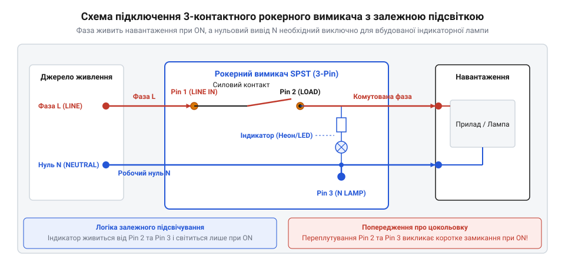
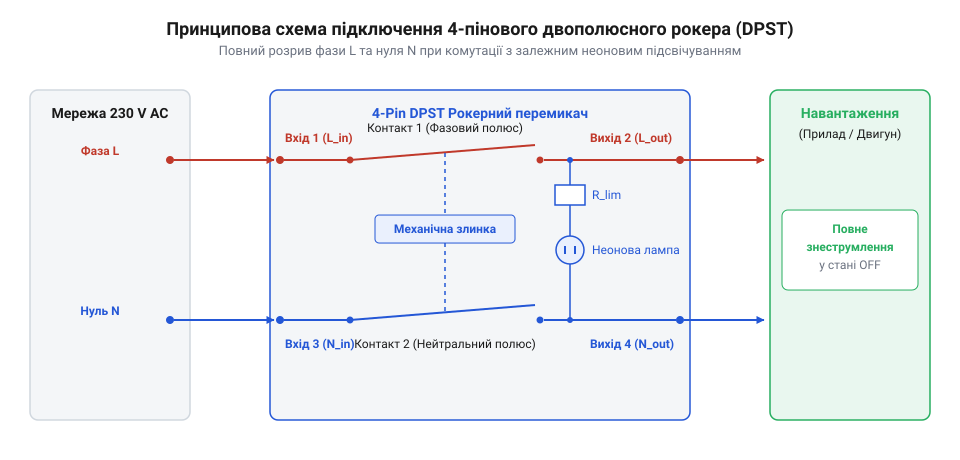

# Схеми розводки контактів, підключення індикації та посадові розміри рокерів

<preknowlist>
- [Тумблери, захисні ковпачки Mollie та блокування важелів (Switch Guards)](root:cat-hw-controls/toggle-switches-and-switch-guards) — принципи комутації сухих контактів та типи ножових клем Faston
</preknowlist>

## Типи виводів та силові клеми Faston

Подання високого струму через рокерний перемикач вимагає надійного контактного з'єднання, яке не розігріватиметься від перехідного опору й не розхитається від вібрації силового обладнання. Якщо в малопотужній електроніці провідники часто впаюють безпосередньо у друковану плату, то в побутовій техніці та промислових шафах комутації перемикач має залишатися ремонтопридатним вузлом, який можна швидко замінити без застосування паяльника. Типовий перехідний опір контактної пари ножового з'єднувача становить не більше `1–2 мОм`, що за робочого струму 16 А створює локальне тепловиділення менше `0.5 Вт`. Однак стабільність цього опору критично залежить від фізичного механізму обтискання кабелю кримпером (від англ. @@en|crimp tool@@, від @@en|crimp@@ — обтискати). Під дією високого механічного тиску матриці кримпера мідні жили провідника та латунні стінки клеми зазнають глибокої пластичної деформації, здираючи поверхневі оксидні плівки й утворюючи монолітну газонепроникну зону (від англ. @@en|gas-tight joint@@). Відсутність мікропорожнин у зоні контакту унеможливлює проникнення кисню та вологи, запобігаючи окисненню міді й підвищенню опору з'єднання протягом десятиліть експлуатації під вібраційними навантаженнями.

Для вирішення цього завдання застосовують ножові клемні з'єднувачі @@en|Faston@@ (від англ. *fast* — швидкий та *on* — надівати), також відомі під назвою @@en|Quick Connect@@. Вивід перемикача являє собою плаский металевий штир з отвором для фіксації пружинного затискача, а на кабель обтискається відповідна гніздова клема. Найпоширенішими є дві стандартизовані ширини виводів: 4.8 мм (товщина 0.5 мм або 0.8 мм) та 6.3 мм (товщина 0.8 мм). Клеми 4.8 мм розраховані на струми до 6–10 А і застосовуються у малогабаритних рокерах, тоді як клеми 6.3 мм є стандартом для силових ланцюгів 16–20 А при напрузі 250 В.

При виборі клем важливе значення має якість обтискання кабелю. Провідник обтискають спеціальним обтискним інструментом у двох зонах: передній посилений пелюсток створює газонепроникний електричний контакт із мідною жилою, а задній пелюсток охоплює ізоляцію для захисту від механічного зламу при вигинах. Використання звичайних пасатижів замість обтискного інструменту призводить до підвищення перехідного опору та небезпечного нагрівання контактної групи під навантаженням. Для запобігання випадковому короткому замиканню між сусідніми виводами рокера силові клеми обов'язково захищають термоусадковою трубкою або ізолювальними силіконовими чохлами.

Окрім ножових клем Faston, рокерні перемикачі випускаються з виводами під паяння (із закругленими отворами для фіксації жили) та під гвинтове кріплення. Виводи під паяння застосовують у компактній приладовій апаратурі, однак вони вимагають термостійкого корпусу, оскільки перегрів виводу паяльником понад 3 секунди може розплавити пластикове ложе й змістити внутрішній контактний місток. На відміну від рокерів, [тумблери та ножові клеми](root:cat-hw-controls/toggle-switches-and-switch-guards) частіше постачаються з гвинтовими затискачами для прямих кілець кабелю, тоді як рокерний перемикач оптимізований саме під швидкий монтаж Faston.

## Схеми підключення 2-пінових та 3-пінових рокерів

Однополюсна комутація силової лінії за допомогою 2-пінового рокера @@en|SPST@@ (від англ. *Single Pole, Single Throw* — один полюс, один напрямок; від лат. *singulus* — поодинокий, та *polus* — полюс) здійснюється в розрив фазного провідника. Один піновий вивід підключається до джерела живлення, а другий — до навантаження. За відсутності вбудованої індикації перемикач працює як простий механічний ключ, що розриває коло. Проте у силових приладах виникає потреба візуального контролю подачі напруги чи орієнтувального підсвічування в темряві, що реалізується додаванням у корпус неонової лампи або світлодіода. Якщо залежна схема живить індикатор лише при замиканні силових контактів, то незалежна схема підсвічування (англ. @@en|independent illumination circuit@@) забезпечує постійне світіння неонової лампи для орієнтування оператора у вимкненому стані приладу. Для цього слабкострумову неонову лампу з послідовним обмежувальним резистором `R_lim` опором `150–220 кОм` підключають паралельно розімкненим силовим контактам 3-пінового рокера між вхідною фазою L та контактом навантаження LOAD. Коли силовий контакт розімкнено, мікрострум індикації `I_ind` менше `1 мА` протікає крізь неонову лампу й холодну спіраль чи вимірювальне коло навантаження до нейтралі N, викликаючи стабільне гліове світіння неону без спрацьовування чи нагріву силового обладнання. При перемиканні рокера в стан «Увімкнено» силовий контакт шунтує неонову лампу з нульовим опором, потенціали її виводів зрівнюються, і лампа згасає, поступаючись місцем прямому живленню навантаження.

*Принципова схема 3-пінового рокерного перемикача із залежним підсвічуванням*

Для забезпечення роботи індикатора рокер обладнують третім виводом. Схема із залежним підсвічуванням передбачає, що неонова лампа із послідовним обмежувальним резистором підключена усередині корпусу між контактом навантаження та третім виводом. Щоб неонова лампа засвітилася при замиканні контактів, на третій вивід необхідно подати нейтральний провідник. При цьому струм індикатора становить частки міліампера і є абсолютно безпечним для мережі.

Поширеною критичною помилкою при монтажі 3-пінового рокера є переплутування фазного та нейтрального провідників на силових контактах. Якщо підключити фазу на вхідний піновий контакт, а нейтраль випадково подати на вихідний силовий контакт навантаження, при перемиканні важеля в положення «Увімкнено» відбудеться пряме міжфазне коротке замикання через замкнені контакти рокера. Щоб уникнути цього, третій вивід для нейтралі зазвичай маркують іншим кольором (позолочений або мідний замість сріблястого) або відокремлюють більшим інтервалом на корпусі. Порівняно з [DIP-перемикачами та блоками конфігурації](root:cat-hw-controls/dip-switches-and-configuration-blocks), які комутують лише слабкострумові сигнальні лінії, рокерний перемикач працює безпосередньо з мережевою напругою 230 В, тому суворе дотримання цокольовки є головною вимогою електробезпеки.

## Двополюсна комутація 4-пінових рокерів

Однополюсний розрив фази залишає навантаження під потенціалом мережі, якщо у розетці чи мережевій вилці переплутано фазу та нуль. Для повного знеструмлення приладу в побутовій та промисловій апаратурі використовують двополюсні 4-пінові рокери конфігурації @@en|DPST@@ (від англ. *Double Pole, Single Throw* — два полюси, один напрямок). Вони містять дві незалежні контактні групи, які механічно пов'язані єдиним клавішним важелем і одночасно розривають як фазний, так і нейтральний провідники.

*Електрична схема 4-пінового двополюсного рокера з повним розривом мережі 230 В*

У 4-пінових рокерах з підсвічуванням вбудований індикатор підключений між вихідними клемами двох силових полюсів. При такій залежній схемі неонова лампа живиться безпосередньо від напруги, що подається на навантаження: коли рокер вимкнений, обидва полюси розмикаються, і лампа згасає. Цокольовка зазвичай розбита на дві паралельні лінії: перша пара клем є вхідною та вихідною для фази, а друга пара — для нейтралі.

В окремих застосуваннях виникає потреба в незалежній схемі підсвічування, коли індикатор рокера має світитися постійно для орієнтації та пошуку вимикача в темряві. Для цього випускають 5-пінові або 6-пінові рокери, де виводи неонової лампи повністю виведені окремо від комутованих контактів і живляться від постійної вхідної лінії мережі. Застосування двополюсної комутації є обов'язковим стандартом безпеки для обладнання з високим споживанням струму та пристроїв, що експлуатуються у вологих приміщеннях або підключаються через неекрановані мережеві подовжувачі.

## Посадкові розміри вирізів та монтаж у панель

Механічна інтеграція рокерного перемикача в корпус приладу базується на схемі монтажу @@en|snap-in@@ (від англ. *snap* — клацати та *in* — всередину), яка не потребує гвинтового кріплення чи додаткового інструменту. Корпус рокера має бічні пружні засувки зі ступенчатим профілем, які стискаються під час проходження крізь прямокутний виріз у панелі й розтискаються після опускання фланця на лицьову поверхню, жорстко затискаючи стінку панелі.

Розміри монтажних вирізів під рокери є суворо стандартизованими у світовій індустрії. Найпоширенішими є три типорозміри:
- **Мікро-рокери**: виріз 13 × 19 мм (або 11 × 30 мм для вузьких панелей), розраховані на струми 6–10 А.
- **Стандартні силові однополюсні та двополюсні рокери**: виріз 21 × 27 мм (або 22 × 30 мм), розраховані на струми 16–20 А.
- **Круглі рокери**: отвір діаметром 20.2 мм, що спрощує виготовлення панелей методом свердління без фрезерування прямокутних отворів.

При розробці креслення панелі керування слід ураховувати товщину стінки корпуса. Стандартні бічні засувки рокерів розраховані на товщину панелі від 0.75 мм до 3.0 мм. Якщо стінка металевого або пластикового корпусу товща за 3.0 мм, засувки не зможуть розкритися до кінця й зафіксувати перемикач, що призведе до його випадання при натисканні. Якщо ж товщина менша за 0.75 мм, вимикач буде люфтити. Для герметичних приладів із підвищеним рівнем захисту від пилу та вологи (до @@en|IP65@@, від англ. *Ingress Protection* — захист від проникнення) на корпус рокера надягають силіконовий прозорий ковпачок-протектор, який затискається між фланцем вимикача та зовнішньою стінкою панелі під час клацання засувок.
