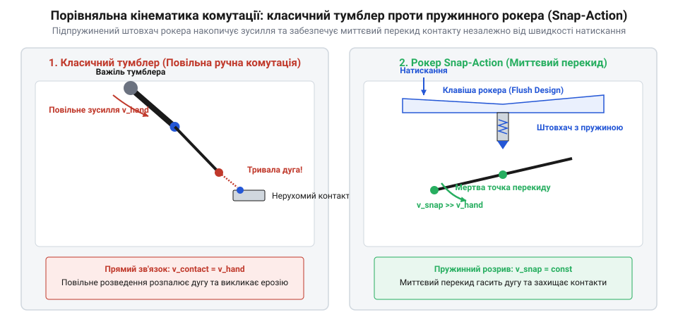

# Еволюція клавішних перемикачів та силових рокерних панелей

<preknowlist>
- [Тумблери, захисні ковпачки Mollie та блокування важелів (Switch Guards)](root:cat-hw-controls/toggle-switches-and-switch-guards) — Загальні принципи комутації дискретних контактних груп та особливості важелястих органів керування.
</preknowlist>

## Небезпека відкритих рубильників та виступаючих важелів

На зорі електрифікації наприкінці XIX століття основними пристроями силової комутації слугували відкриті ножові рубильники (англ. @@en|knife switch@@, від knife — ніж, через рухоме металеве лезо). Вони мали відкриті струмоведучі частини під високою напругою, що створювало смертельну небезпеку ураження струмом для операторів. Окрім відкритої конструкції, головною фізичною вадою була залежність швидкості розмикання контактів від спритності людини. Коли оператор повільно відтягував руків'я рубильника під навантаженням, між контактами спалахувала електрична дуга (англ. @@en|electric arc@@). Повітряний проміжок іонізувався, виникав високоерозійний розряд, який випалював мідні та латунні поверхні й міг призвести до короткого замикання та пожежі.

У 1910-х роках інженери створили закриті корпуси із важелястими перемикачами (англ. @@en|toggle switch@@, від toggle — коліно чи чекель). Тумблери сховали струмоведучі частини всередині ізольованого корпусу та зменшили габарити. Проте в промисловому обладнанні, транспорті та авіації виникла нова проблема: виступаючий важіль. Довгий шток тумблера був уразливим до випадкового зачіпання (англ. @@en|accidental actuation@@) рукавом одягу, інструментом або рухом оператора в тісному кабінному просторі. Навіть із застосуванням спеціальних рішень, таких як [важелясті тумблери та захисні ковпачки](root:cat-hw-controls/toggle-switches-and-switch-guards), виступаючі органи керування створювали ризик випадкового ввімкнення чи знеструмлення критичних вузлів. Потрібен був силовий комутатор із плоским профілем та механічним гарантуванням миттєвого розриву кола.

Механічна вразливість тумблера безпосередньо випливає із законів важеля: момент сили `M`, створений при випадковому дотику, дорівнює добутку прикладеного зусилля `F` на плече важеля `l` від осі обертання до точки зачіпання (`M = F · l`). Оскільки шток тумблера відчутно виступає над панеллю, навіть легкий дотичний удар рукавом одягу чи інструментом на кінчику важеля утворює значний обертальний момент. Цього моменту достатньо, щоб безперешкодно подолати опір внутрішнього фіксатора та перекинути контактну групу. Збільшення довжини важеля пропорційно зменшує зусилля `F`, необхідне для небажаного спрацьовування, тоді як плоский рокерний профіль зводить ефективне плече `l` майже до нуля, унеможливлюючи перемикання від ковзного зачіпання.

## Винахід snap-action механізмів та плоского коромисла

Розв'язанням проблеми тривалого дугоутворення та виступаючих важелів у середині XX століття стало створення підпружинених механізмів перекидання через мертву точку (англ. @@en|snap-action mechanism@@, від snap — клацати) та клавішного профілю (англ. @@en|rocker switch@@, від rock — гойдатися на осі).

Конструктивна суть snap-action полягає у відокремленні кінематики пальця оператора від швидкості руху контактної групи. Всередині корпусу встановлено пружинний штовхач або підпружинену пластину. Коли оператор тисне на одну з половин клавіші (англ. @@en|rocker key@@), штовхач стискає пружину, нагромаджуючи механічну енергію, поки механізм не досягне мертвої точки (англ. @@en|dead-center@@ або over-center). Щойно край мертвої точки подолано, пружина миттєво розпрямляється і розмикає або замикає рухомий місток із високою швидкістю — незалежно від того, наскільки повільно оператор натискав на клавішу.

*Кінематика механізму snap-action: при переході через мертву точку стиснута пружина миттєво долає опір і розмикає силову контактну групу, зводячи тривалість електричної дуги до мінімуму.*

Миттєве розмикання контактів скоротило час горіння електричної дуги з сотень мілісекунд до кількох мілісекунд, що зупинило виснажливу ерозію контактів (англ. @@en|arc erosion@@) та запобігло їхньому зварюванню під час перемикання потужних індуктивних і капацитивних навантажень. Поєднання snap-action з коромисловим профілем усунуло виступаючі важелі: поверхня клавіші розташована практично урівень із лицьовою панеллю. Для перемикання стану потрібне свідоме натискання на плече коромисла, що унеможливлює випадковий зсув від ковзного зачіпання. Перші рокерні перемикачі розроблялися перш за все для авіаційного приладобудування та промислових пультів, і лише згодом стали стандартом у побутовій електротехніці.

Фізичний механізм руйнування контактних поверхонь розгортається внаслідок виникнення зворотного сплеску електрорушійної сили самоіндукції при розмиканні індуктивного навантаження. Коли струм у колі миттєво обривається, накопичене магнітне поле індуктивності генерує високовольтний пік перенапруги, що перевищує пробійний поріг повітряного мікрозазору й утворює високотемпературну плазмову дугу. Під дією дугового розряду з температурою понад `5000 K` метал у контактній плямі миттєво розплавляється та випаровується. При постійному струмі виникає однопрямований перенос матеріалу (від англійського *material transfer* — перенос матеріалу; далі — @@en|material transfer@@), під час якого іонізовані атоми анода мігрують на катод, утворюючи на одній контактній накладці кратер, а на іншій — відповідний металевий виступ-пік. Внаслідок такого нарощування кратерів та піків ефективна площа дотику зменшується, зростає перехідний опір і виникає катастрофічне зварювання контактів. У ранніх [тумблерних вимикачах](root:cat-hw-controls/toggle-switches-and-switch-guards) без механізму миттєвого розмикання цей процес повністю виводив латунні контакти з ладу за кілька сотень циклів, що й змусило інженерів перейти до підпружинених snap-action механізмів.

## Еволюція контактних сплавів та вбудованого підсвічування

Зі зростанням електричних навантажень у побутовій та промисловій автоматиці середини XX століття звичайні латунні та мідні контакти клавішних перемикачів виявили свою повну непридатність для комутації реактивних навантажень. При розмиканні кіл зі струмами понад 5 А мідь швидко окислювалася, створюючи плівку з високим опором, а під дією електричної дуги контактні площадки легко плавилися й зварювалися між собою.

Рішенням став перехід у 1950–1960-х роках до контактних накладок зі спечених срібних сплавів. Першим масовим матеріалом став сплав срібло-нікель (англ. @@en|silver-nickel@@, AgNi), який забезпечував високу електропровідність та стійкість до зносу при струмах до 10 А. Проте для важких індуктивних кіл (електродвигунів, компресорів) потрібен був ще більш дугостійкий матеріал. У 1970-х роках у промислове виробництво впровадили спечений сплав срібло-оксид кадмію (AgCdO), де мікроскопічні частинки оксиду кадмію випаровувалися під дією дуги, охолоджуючи плазмовий шнур і придушуючи зварювання. Згодом, наприкінці 1990-х років, у зв'язку з екологічними обмеженнями директиви RoHS щодо токсичності кадмію, його замінили на спечений сплав срібло-оксид олова (англ. @@en|silver-tin oxide@@, AgSnO2), який продемонстрував виняткову стійкість до пускових струмів (inrush current) імпульсних блоків живлення. У малосигнальних колах, де напруга занадто мала для дугового самоочищення (менше 12 В), почали застосовувати тонке золочення контактних накладок для запобігання пасивації. На відміну від [DIP-перемикачів та джамперів](root:cat-hw-controls/dip-switches-and-configuration-blocks), призначених для слабострумових конфігурацій, силові рокери вимагали саме таких дугостійких сплавів.

Паралельно з металургією контактів еволюціонувала індикація стану перемикача. У 1960-х роках у прозорі кольорові клавіші рокерів почали вбудовувати мініатюрні неонові лампи (англ. @@en|neon lamp@@, від грецького *neos* — новий) з баластними резисторами, що дозволило операторам візуально контролювати наявність напруги на навантаженні без встановлення окремих сигнальних арматур. Це вимагало виведення додаткового третього контакту (нейтралі N) у 3-пінових вимикачах SPST або 4-пінових виводів у двополюсних DPST рокерах, створивши стандартизовану цокольовку залежного та незалежного живлення підсвічування, що використовується й досі. Наприкінці 1980-х років для низьковольтних бортових мереж автомобілів та спецтехніки (12/24 В) неонові лампи заступили напівпровідникові світлодіоди (англ. @@en|light-emitting diode@@, LED, від @@en|diode@@ — діод, двохелектродний елемент).

Конструктивні відмінності між 3-піновими та 4-піновими корпусами визначає спосіб живлення підсвічування та режим комутації. У мережах змінної напруги (англ. @@en|alternating current@@, AC) 230 В 3-піновий рокер комутує лише фазний провідник. Схема спрямовує вхідну фазу на перший вивід, а навантаження приєднує до другого виводу. Третій вивід з'єднує внутрішню неонову лампу з нейтральним провідником для замикання кола підсвічування. У 4-пінових перемикачах змінної напруги дві пари виводів одночасно розривають фазну та нейтральну лінії. Внутрішнє підсвічування у 4-піновому корпусі отримує живлення від вихідних силових контактів або від вхідної лінії. При комутації постійної напруги (англ. @@en|direct current@@, DC) 12 В схема виводів (англ. @@en|pinout@@, від англійського *pin* — штир та *out* — назовні) вимагає суворого дотримання полярності через застосування світлодіодів. У 3-піновому DC-рокері третій вивід веде до мінусової шини живлення (англ. @@en|ground@@, GND, від англійського *ground* — земля). Конструкція з'єднує анод внутрішнього світлодіода з контактом навантаження, а катод — із мінусовим виводом. Використання 4-пінових виводів у мережах 12 В дозволяє повністю відокремити коло живлення світлодіода від силової контактної групи. Така незалежна розводка забезпечує вмикання підсвічування клавіші від зовнішнього керуючого сигналу незалежно від стану силового ключа.

## Модульні рокерні панелі, герметизація та розвінчання міфу

З появою масового штампування корпусів із термопластів у 1970-х роках метод кріплення перемикачів гвинтами поступився місцем стандартизованій системі монтажу Snap-In (англ. @@en|snap-in@@, від @@en|to snap in@@ — замикатися з клацанням). Бічні пружні засувки дозволили втискати рокери в прямокутні вирізи лицьової панелі за частки секунди без використання інструменту. Для експлуатації в жорстких умовах (на морських катерах, у кабінах тракторів, медичному обладнанні) розробники створили двокомпонентні корпуси з інтегрованими силіконовими ущільнювальними мембранами та внутрішніми лабіринтовими водовідводами, що забезпечило рівень пиловологозахисту IP65 та IP67.

*Конструктивна еволюція монтажу Snap-In та подвійного силіконового контуру герметизації IP67 для модульних силових панелей.*

У популярній літературі існує поширений міф про те, що клавішні перемикачі були винайдені суто для побутової техніки — кухонних плит, пральних машин та кавоварок — задля естетичного дизайну. Проте архівні патенти та промислові хроніки свідчать, що перші двоплечі коромислові перемикачі створювалися наприкінці 1930-х та у 1940-х роках для авіабудування й важкої військової техніки. У вузьких кабінах літаків та на пультах суден класичні [важелясті тумблери](root:cat-hw-controls/toggle-switches-and-switch-guards) часто ламалися або випадково зачіпалися пілотами у стресових ситуаціях. Утоплена коромислова клавіша рокера повністю усувала цю небезпеку, забезпечуючи високу щільність компонування органів керування. Тільки після випробування у військовій та авіаційній галузях рокерні перемикачі наприкінці 1950-х років масово прийшли в побутову електроніку й промислові силові розподільні шафи, де й сьогодні залишаються основним стандартом ручної силової комутації.
