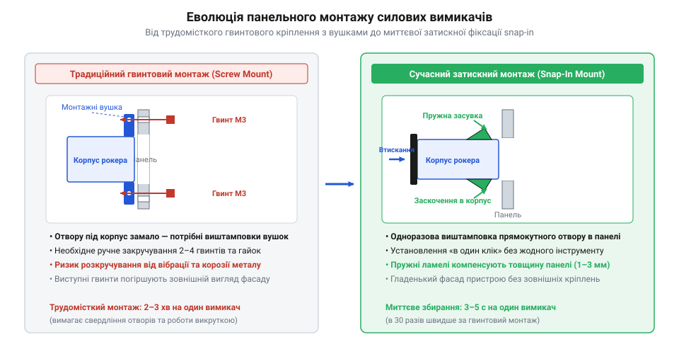

# Еволюція клавішних перемикачів та силових панелей комутації

<preknowlist>
- [Тумблери, захисні ковпачки Mollie та блокування важелів (Switch Guards)](root:cat-hw-controls/toggle-switches-and-switch-guards) — Устрій класичних важельних тумблерів та їхні механічні обмеження для порівняння з рокерними перемикачами.
</preknowlist>

## Небезпека ножових рубильників і тумблерів

На зорі масової електрифікації наприкінці XIX та на початку XX століття основним способом комутації силових кіл були відкриті ножові рубильники (@@en|knife switch@@). Вони мали примітивну будову: відкритий металевий ніж рухомо кріпився на осьовому шарнірі й під час опускання вручну заходив між двома пружними контактними губками. Така конструкція залишала всі струмопровідні частини абсолютно відкритими для випадкового дотику людини. Під час розмикання кола під навантаженням між контактами виникала потужна електрична дуга, яка руйнувала метал, створювала ризик пожежі й спричиняла тяжкі опіки операторів від розбризканого розплавленого мідного розпилу.

З появою закритих корпусів у перші десятиліття XX століття силові комутаційні пристрої почали оснащувати важільними механізмами — [тумблерами та захисними ковпачками](root:cat-hw-controls/toggle-switches-and-switch-guards) (від англ. @@en|toggle switch@@). На відміну від ножових рубильників із повільним ручним розмиканням контактів, де тривалість електричної дуги залежала від швидкості руху руки оператора, тумблери отримали пружинний механізм миттєвого спрацьовування (від англ. @@en|snap-action@@ — «миттєва дія»). Пружина накопичувала зусилля під час відведення важеля й різко розмикала або замикала контакти незалежно від плавності натиску, що кардинально скорочувало час горіння дуги й захищало контакти від вигорання. Однак цей механізм мав суттєві кінематичні обмеження: в міру зносу осьових шарнірів, стирання направляючих та накопичення механічної втоми пружини початкова точність перекидання втрачалася. Виникнення паразитного люфту у зношеному шарнірі призводило до падіння сили притиску контактів, а за тривалої експлуатації пружина втрачала пружність і не мала достатнього зусилля для підриву ламелей. Це спричиняло небезпечне зависання контактного рухомого елемента у проміжному незафіксованому стані, при якому між контактами спалахувала стійка дуга або виникав інтенсивний брязкіт (англ. @@en|bounce@@). @@en|contact bounce@@), що викликав мікрозварювання контактів. Крім того, хоч сам контактний вузол ховався всередині ізоляційного корпусу, виступаючий на кілька сантиметрів важіль створив нову проблему: його було легко зачепити рукавом, інструментом або одягом, що призводило до випадкового й небезпечного ввімкнення чи вимкнення обладнання. У промислових умовах або на транспорті такий випадковий натиск міг зупинити технологічний процес або запустити небезпечний механізм.

Потрібне було нове інженерне рішення, яке поєднало б повну закритість струмопровідних частин, відсутність виступаючих елементів на передній панелі та чітке зафіксоване двопозиційне перемикання з низьким зусиллям.

## Поява перших рокерів та ізоляція

Розв'язанням цієї задачі стало винайдення клавішного перемикача — рокера (від англ. @@en|rocker switch@@, рокер — гойдалка). Замість довгого важеля інженери застосували двоплечу клавішу-гойдалку, яка повертається навколо центральної осі всередині прямокутного гнізда. При натисканні на один край клавіші другий край піднімається вгору, запобігаючи випадковому зачіпання пальцем або одягом, оскільки профіль клавіші у будь-якому стані майже не виступає над панеллю.

Перші патенти на клавішні перемикачі з'явилися у 1920-х роках у США та Німеччині — зокрема в патентах US 1,664,547 та US 1,786,966 американської компанії Cutler-Hammer було зафіксовано конструкцію підпружиненого супорту (рухомої каретки) з ковзними контактними містками, який перекидав контактну групу під час натискання на клавішу. Важливим проривом стало впровадження нових ізоляційних матеріалів для корпусів — ебоніту (від грец. *ебенос* — чорне дерево, @@en|ebonite@@) та бакеліту (від імені винахідника Лео Бакеланда, @@en|bakelite@@). Бакелітовий корпус витримував високу температуру електричної дуги, не плавився і забезпечував надійну електричну ізоляцію до тисячі вольт. Усередині корпусу цей супорт реалізовував механізм миттєвого перемикання через подолання мертвої точки пружини (англ. @@en|over-center mechanism@@). @@en|dead center position@@): початковий рух клавіші стискає пружину й накопичує потенціальну енергію, поки вектор її дії перебуває з одного боку геометричної осі обертання. Перетин цієї осі вивільняє накопичену пружиною енергію, яка різко перекидає каретку з містками в протилежне положення незалежно від швидкості натискання пальцем оператора, що миттєво розриває контакти та зводить до мінімуму час горіння електричної дуги.

*Конструктивна еволюція силових перемикачів: перехід від небезпечного відкритого рубильника та виступаючого тумблера до закритого рокера з пласким профілем клавіші-гойдалки.*

Завдяки пласкому профілю та ізольованому корпусу рокерні вимикачі швидко завоювали ринок побутової електротехніки та транспортних засобів, де безпека непідготовленого користувача була головною вимогою.

## Вбудована неонова індикація та LED

Зі зростанням складності побутових приладів та промислових панелей комутації у середині XX століття виникла потреба у візуальній індикації стану кола. Користувач мусив здалеку бачити, чи подано напругу на прилад, без встановлення окремих громіздких сигнальних арматур з лампами розжарювання.

У 1950-х роках інженери створили рокерні перемикачі з прозорою або напівпрозорою пластиковою клавішею, всередину якої вбудували неонову лампу (від грец. неонову лампу з послідовним баластним резистором (англ. @@en|ballast resistor@@). Неонова лампочка підключалася паралельно вихідним контактам вимикача. Оскільки після запалювання газового розряду за напруги `60`–`90 В` лампочка має від'ємний диференціальний опір, без обмежувача розряд миттєво переріс би в дугове замикання. Для обмеження робочого струму на безпечному рівні `0.5`–`1.5 мА` у мережах із напругою `110 В` послідовно впаювали резистор номіналом `33`–`47 кОм`, а для мереж `220 В` номінал збільшували до `100`–`150 кОм`. Це дозволяло утримувати теплову потужність розсіювання на резисторі в межах `0.1`–`0.2 Вт` і монтувати його безпосередньо всередину компактної клавіші. Коли рокер перебував увімкненому стані, неоновий розряд світився м'яким помаранчево-червоним світлом прямо крізь матеріал клавіші. Для роботи неонової лампи потрібен був мікроамперний струм, тому вона практично не споживала енергії й працювала безпосередньо від мережі змінного струму 110/220 В без додаткових трансформаторів.

Наприкінці XX століття з розвитком напівпровідникової техніки неонові лампи в рокерах поступилися місцем світлодіодам (від англ. @@en|LED@@, light-emitting diode). Світлодіодні індикатори забезпечили вищу яскравість, різноманіття кольорів (зелений, синій, жовтий, червоний), наднизьке тепловиділення та механічну міцність, що дозволило використовувати їх у низьковольтній автотракторній та цифровій техніці.

## Стандартизація snap-in та модульні панелі

Тривалий час головним стримуючим фактором під час масового збирання електрообладнання залишався спосіб монтажу перемикачів на передню панель. Перші клавішні вимикачі кріпилися гвинтами через фланець або різними різьбовими втулками. Для встановлення одного рокера робітник мусив просвердлити отвір під корпус, два отвори під гвинти, вставити вимикач і затягнути гайки з протилежного боку панелі, що вимагало двостороннього доступу й значного часу.

У 1960–1970-х роках стався технологічний прорив: поява конструкції пружинних фіксаторів (від англ. @@en|snap-in@@ — заскочення). Інженери почали відливати корпус рокера з пружних термопластів (поліаміду чи полікарбонату) зі спеціальними бічними засувками-вусиками. Тепер монтаж став одностороннім: перемикач просто втискали з лицьового боку в штампований прямокутний або круглий виріз панелі. При проходженні крізь отвір пружинні вусики стискалися, а після проходу стінки панелі розправлялися й надійно затискали корпус між лицьовим рамковим буртиком і задніми засувками. Ключовий геометричний розрахунок полягав у забезпеченні точного розрахункового зазору засувки t_gap відносно товщини листового металу панелі S. Для поширених стандартів листової сталі товщиною від `S = 0.75 мм` до `1.25 мм` зазор формували зі ступенями компенсації: якщо метал виявлявся занадто товстим (`S > 1.5 мм`), засувка не могла повністю розкритися за задньою стінкою й деформувалася, а при занадто тонкому листі (`S < 0.75 мм`) виникав відчутний механічний люфт. Для подолання цього технологічного обмеження інженери розробили багаторівневі сходинки на пружинних вусиках та почали встановлювати периметральні силіконові ущільнювачі, які компенсували технологічний допуск товщини металу й одночасно герметизували з'єднання.

*Еволюція монтажу силових перемикачів: від гвинтового кріплення фланця до безінструментального безгвинтового фіксатора snap-in у штампованому вирізі панелі.*

Впровадження кріплення @@en|snap-in@@ дозволило уніфікувати посадові розміри панелей (наприклад, стандартні прямокутники 11×30 мм чи 22×30 мм та круглі отвори 20 мм). Це дало змогу створювати модульні силові панелі для автотракторної техніки, побутових приладів та кабін операторів, де в один посадовий ряд без інструментів встановлюють необхідну комбінацію вимикачів, рокерів та індикаторів. Аналогічні стандартизовані прямокутні вирізи згодом адаптували й для інших елементів керування, зокрема [DIP-перемикачів та джамперних блоків](root:cat-hw-controls/dip-switches-and-configuration-blocks).

## Хибні атрибуції та розвінчання міфів

Як і багато інших популярних винаходів, еволюція клавішних перемикачів та силових панелей обросла поширеними історичними міфами та помилковими атрибуціями.

Найпоширенішим міфом є приписування винайдення рокерного вимикача відомим промисловим дизайнерам побутової електроніки 1960-х років або комерційним брендам автопрому. У популярній літературі створення рокера часто пов'язують із німецькою школою дизайну Braun або особисто з Дітером Рамсом, який у 1960-х роках широко застосовував пласкі кольорові клавіші у побутових приладах. Проте історичні патенти свідчать, що поворотні двоплечі клавішні механізми перемикання були запатентовані електротехнічними компаніями в США (наприклад, Cutler-Hammer) та Німеччині ще у 1920-х роках — за десятиліття до розквіту хай-тек дизайну. Дизайнери другої половини XX століття лише надали рокеру сучасної естетичної форми, але не були авторами його механічної концепції.

Іншим хибним уявленням є думка, ніби безгвинтовий монтаж @@en|snap-in@@ був створений спеціально для автомобільної промисловості. Насправді затискні пружинні фіксатори розроблялися у 1940–1950-х роках згідно з патентами компаній @@en|General Electric@@ та @@en|Westinghouse@@ для масового виробництва побутових кухонних плит і пральних машин. Конструкція передбачала пружні сталеві або пластикові засувки на корпусі перемикача, які при продавлюванні крізь прямокутний отвір у металевій панелі стискалися, а потім розправлялися з тильного боку, надійно затискаючи стінку між фронтальною рамкою та фіксатором. Це усунуло потребу в задньому доступі для закручування гайок, що скоротило час монтажу на конвеєрі з десятків секунд до одного натискання й істотно знизило собівартість збирання. Лише згодом, переконавшись у стійкості пружинних фіксаторів до тривалих вібрацій під час віджимання у пральних машинах, авторинок масово перейняв технологію @@en|snap-in@@ для приладових панелей.
