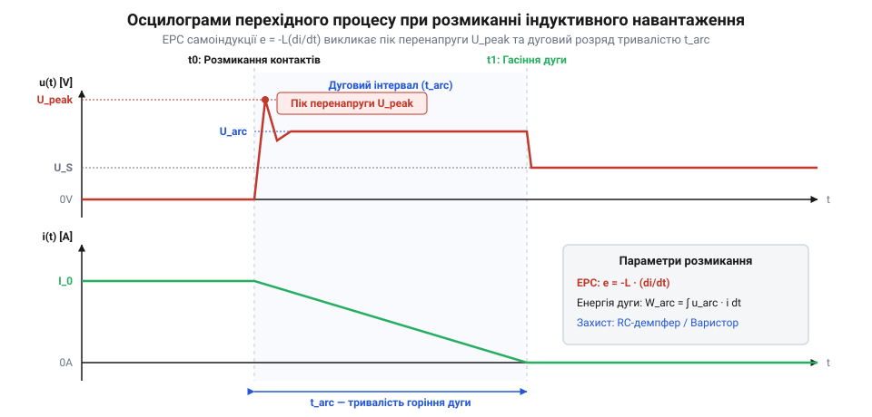

# Розрахунок дугогасіння, пускових струмів та дерейтингу контактора

<preknowlist>
- [Клавішні перемикачі (Rocker Switches) та силові панелі комутації](root:cat-hw-controls/rocker-switches-and-power-toggle-panels) — Розуміння загальної конструкції рокерних вимикачів, проблем брязкоту контактів та відмінностей між AC і DC комутацією.
- [Кнопка аварійного стопу грибок та органи безпечного відключення (IEC 60947-5-5)](root:cat-hw-controls/estop-mushroom-button) — Базові поняття категорій зупинення та примусового розмикання контактів.
</preknowlist>

## Математика дугоутворення та індуктивної перенапруги

Силова комутація індуктивних навантажень (електродвигунів, електромагнітів, соленоїдів та реле) супроводжується стрімким вивільненням енергії, накопиченої у магнітному полі. При миттєвому розмиканні контактних поверхонь струм прагне зберегти своє значення, що викликає виникнення електрорушійної сили (ЕРС) самоіндукції. Швидкість зміни струму `di / dt` сягає високих значень, а електрична напруженість у мікроскопічному міжконтактному зазорі підпорядковується закону Пашена (від німецького *Paschen-Gesetz* — закон Пашена; далі — @@en|Paschen's law@@). Згідно із цим законом, напруга електричного пробою газу `U_bd` є нелінійною функцією добутку тиску повітря `p` на міжконтактну відстань `d`: у початкові мікросекунди розмикання при мікромежових відстанях `d ≈ 1...5 мкм` добуток `p · d` наближається до мінімуму Пашена (`U_bd_min ≈ 327 В` для повітря за атмосферного тиску `p = 101.3 кПа`), де для виклику пробою достатньо напруги понад 300 В. Оскільки ЕРС самоіндукції миттєво перевищує цей поріг, локальна напруженість поля виходить за межі `E_breakdown ≈ 3 кВ/мм`, спричиняючи лавинну іонізацію газу й запалювання високотемпературної електричної дуги (від англійського *electric arc* — електрична дуга; далі — @@en|electric arc@@).

Математичний розрахунок амплітуди пікової перенапруги `u_peak` та її залежності від еквівалентної паразитної ємності монтажу `C_p` виконують на основі рівняння енергетичного балансу за параметрами: `U_0` — робоча напруга джерела живлення у вольтах (В); `L` — індуктивність комутованого кола в генрі (Гн); `I_0` — струм у колі перед розмиканням в амперах (А); `C_p` — сумарна паразитна ємність контактів та дротів у фарадах (Ф); `t_break` — часовий інтервал механічного розмикання в секундах (с).

```
u_peak
= U_0 + L · (I_0 / t_break)      [закон електромагнітної індукції Фарадея]
= U_0 + I_0 · √(L / C_p)         [баланс накопиченої магнітної та електричної енергії]
```

З одержаного співвідношення видно, що при робочій напрузі `U_0 = 24 В`, індуктивності `L = 100 мГн`, струмі `I_0 = 2 А` та паразитній ємності `C_p = 100 пФ` хвильовий імпеданс контуру `Z_w = √(L / C_p) = 31.62 кОм`, що викликає розрахунковий пік перенапруги `u_peak = 24 + 2 · 31622.77 ≈ 63.27 кВ`. За відсутності захисних елементів така перенапруга пробиває повітряний проміжок, утворюючи високотемпературний дуговий канал, аналогічно до процесів розмикання у [кнопках аварійного зупинення](root:cat-hw-controls/estop-mushroom-button).


*Графіки перехідного процесу напруги й струму при розмиканні індуктивності з демонстрацією амплітуди пікової перенапруги та дугового інтервалу.*

Повна енергія дугового розряду `E_arc` (у джоулях), яка витрачається на ерозію й випаровування металу контактних накладок, обчислюється як інтеграл добутку дугової напруги `u_arc` на струм `i_arc` протягом часу горіння `t_arc`:

```
E_arc
= ∫₀^(t_arc) u_arc(t) · i_arc(t) dt      [визначений інтеграл миттєвої потужності дуги]
= (1 / 2) · L · I_0²                      [повна магнітна енергія, що розсіюється в дузі]
```

Для наведеного прикладу повна енергія розряду становить `E_arc = 0.5 · 0.1 · 2² = 0.2 Дж`. Оскільки ця енергія розсіюється у мікроскопічному об'ємі плазмового стовпа, локальна температура на поверхні контактів сягає `10⁰⁰⁰ K`, спричиняючи інтенсивне вигорання матеріалу.

## Амплітуда та згасання ємнісних пускових струмів

Комутація ємнісних навантажень (вхідних фільтрів імпульсних джерел живлення, світлодіодних драйверів та конденсаторних батарей) створює протилежну розрахункову проблему — екстремальні амплітуди пускового струму (від англійського *inrush current* — пусковий струм; далі — @@en|inrush current@@) під час замикання контактів. У момент дотику розряджена ємність `C_load` має нульовий власний заряд, представляючи для джерела живлення еквівалентне коротке замикання.

Обчислення пікового пускового струму `I_peak` виконують з урахуванням реактивності підвідних ліній за параметрами: `U_m` — амплітудне значення напруги в момент замикання у вольтах (В); `R_loop` — сумарний активний опір кола (опір провідників, контактний опір та еквівалентний послідовний опір ESR) в омах (Ом); `L_loop` — паразитна індуктивність підвідних провідників у генрі (Гн); `C_load` — ємність навантаження у фарадах (Ф).

```
I_peak
= U_m / R_loop                        [гранична амплітуда для суто активного кола]
= U_m / √(R_loop² + (L_loop / C_load)) [зведення з урахуванням хвильового опору паразитних ліній]
```

Згасання зарядного імпульсу відбувається за експоненційним законом із часовою постійною `τ_charge = R_loop · C_load`. Якщо при напрузі `U_m = 325 В` (пік мережі `230 В_AC`) сумарний опір становить `R_loop = 1.5 Ом`, то піковий струм сягає `I_peak = 325 / 1.5 ≈ 216.7 А`, що у `20...50` разів перевищує номінальний робочий струм вимикача.

Особлива небезпека виникає під час механічного брязкоту контактів (від англійського *contact bounce* — брязкіт контактів; далі — @@en|contact bounce@@), коли контакти повторно розмикаються й замикаються протягом `t_bounce ≈ 1...5 мс`. У моменти мікророзмикань пусковий струм утворює локальні дугові мікромістки. Локальне джоулеве тепло випаровує срібний сплав контактних накладок:

```
Q_heat
= I_peak² · R_contact · t_bounce      [закон Джоуля-Ленца для енергії розігріву контактної плями]
```

При наступному стисканні під дією пружини розплавлений метал кристалізується, утворюючи зварювання контактів (від англійського *contact welding* — зварювання контактів; далі — @@en|contact welding@@), через що важіль вимикача втрачає здатність до розмикання.

Ефективним розрахунковим розв'язком для пригнічення ємнісного кидка струму є послідовне ввімкнення термістора з негативним температурним коефіцієнтом опору (@@en|NTC thermistor@@, від грецького *therme* — тепло, *histor* — той, що регулює). Необхідне значення холодного опору термістора `R_NTC` при початковій температурі `25 °C` обчислюють із заданої гранично допустимої амплітуди струму `I_max_allowed` та амплітуди напруги мережі `U_m`:

```
R_NTC
= (U_m / I_max_allowed) - R_loop     [розрахунок мінімального холодного опору]
```

Отриманий опір `R_NTC` додається до активного опору кола `R_loop`, обмежуючи початковий кидок струму до безпечної величини `I_max_allowed`. Під час протікання робочого струму термістор розігрівається джоулевим теплом, і його опір падає у сотні разів до гарячого значення `R_hot`, що мінімізує втрати потужності в стаціонарному режимі за аналогією до захисту кіл у [тумблерах та захисних ковпачках](root:cat-hw-controls/toggle-switches-and-switch-guards).

## Розрахунок демпферних ланцюгів та дугогасіння

Для ефективного приглушення комутаційних перенапруг і запобігання дугоутворенню застосовують демпферні RC-ланцюги (від англійського *RC snubber* — демпферний RC-ланцюг; далі — @@en|RC snubber@@) та металооксидні варистори (від англійського *varistor* — варистор; далі — @@en|varistor@@), які підключають паралельно контактній групі або індуктивному навантаженню. 

Розрахунок ємності конденсатора демпфера `C_s` базується на повній передачі накопиченої в індуктивності магнітної енергії в електричну ємність без перевищення допустимої напруги пробою контактного зазору `U_max`. Для забезпечення аперіодичного згасання коливального контуру без високочастотних резонансних сплесків розраховують демпферний опір `R_s` за умовами критичного затухання:

```
C_s
= (L · I_0²) / (U_max² - U_0²)          [баланс енергії між індуктивністю та конденсатором]

R_s
= 2 · √(L / C_s)                        [умова критичного затухання аперіодичного розряду]
```

Якщо індуктивність навантаження становить `L = 50 мГн`, робочий струм `I_0 = 3 А`, напруга живлення `U_0 = 24 В`, а гранично припустима напруга на контактах обмежена значенням `U_max = 100 В`, розрахункові параметри елементів демпфера становлять:

**Розрахунок демпферного ланцюга:**

```
C_s
= (0.05 · 3²) / (100² - 24²)
= 0.45 / 9424                            [обчислення знаменника]
≈ 47.75 нФ                               [необхідна ємність конденсатора]

R_s
= 2 · √(0.05 / (47.75 · 10⁻⁹))
= 2 · √(1047120.4)                       [обчислення підкореневого виразу]
≈ 2046.5 Ом                              [критичний опір демпфера]
```

Одержаний опір `R_s ≈ 2.0 кОм` та ємність `C_s ≈ 47 нФ` ґарантують критичне згасання перехідного процесу. Проте під час вибору резистора `R_s` необхідно враховувати його теплову потужність розсіювання `P_R`, яка різко зростає із збільшенням частоти комутації `f_sw`. Під час кожного циклу замикання й розмикання контакту нагромаджена в конденсаторі енергія повністю розсіюється на резисторі у вигляді тепла, тому середня розсіювана теплова потужність обчислюється як `P_R = C_s · U_0² · f_sw`. При високій частоті перемикань (наприклад, `f_sw = 10 Гц` при `U_0 = 24 В` розсіювання становить `P_R ≈ 47 · 10⁻⁹ · 24² · 10 ≈ 0.27 Вт`), що вимагає вибору резистора з номіналом за потужністю `P_rated ≥ 2 · P_R` для запобігання його перегріву й деградації. При застосуванні варисторів класифікаційну напругу `U_var` вибирають на `15...20%` вищою за амплітуду робочої напруги `U_m`, а максимальну допустиму енергію поглинання `E_var` розраховують із запасом `E_var ≥ 1.5 · E_arc`, що виключає термічний деструктивний пробій напівпровідникової кераміки.

## Термічний розгін та розрахунок дерейтингу

Тривала експлуатація силових контактних груп під навантаженням супроводжується виділенням тепла на перехідному опорі контактів (від англійського *contact resistance* — перехідний опір контактів; далі — @@en|contact resistance@@) `R_contact`. У початковому стані опір чистої контактної поверхні становить `R_contact0 ≈ 5...15 мОм`. Проте під дією мікроерозії та окислення опір зростає, створюючи ризик виникнення явища термічного розгону (від англійського *thermal runaway* — термічний розгін; далі — @@en|thermal runaway@@).

Теплова потужність `P_heat`, що виділяється у контактній зоні, викликає перевищення температури вузла `T_j` над температурою довкілля `T_amb` відповідно до теплового опору конструкції `R_th`:

```
P_heat
= I_RMS² · R_contact                    [виділення джоулевого тепла на перехідному опорі]

T_j
= T_amb + P_heat · R_th                 [температура контактної зони у стаціонарному режимі]
```

Зростання температури `T_j` прискорює окислення мідних та срібних сплавів, що викликає подальше зростання `R_contact`, утворюючи позитивний зворотний зв'язок. Якщо температура сягає `T_j > 120°C`, матеріал корпусних ізоляторів втрачає механічну жорсткість, пружини відпускаються, і контактний вузол повністю руйнується.

Для запобігання перегріву розраховують коефіцієнт дерейтингу (від англійського *derating factor* — коефіцієнт дерейтингу; далі — @@en|derating factor@@). При переході від комутації змінного струму (AC) до постійного (DC) відсутність природного переходу напруги через нуль (який у мережах 50 Гц відбувається кожні 10 мс) суттєво ускладнює гасіння дуги. Розрахунок допустимого струму постійної напруги `I_DC_max` та струму при підвищеній температурі довкілля виконують за формулою:

```
I_DC_max
= I_AC_max · k_DC · √((T_max - T_amb) / (T_max - 25°C))  [коефіцієнт електричного та температурного дерейтингу]
```

Де `k_DC ≈ 0.3...0.5` — коефіцієнт зниження навантаження при постійній напрузі `U_DC ≥ 30 В`, `T_max` — гранична робоча температура вимикача (зазвичай `85°C`). Для номіналу `I_AC_max = 16 А` при `U_DC = 48 В` (`k_DC = 0.4`) та `T_amb = 55°C` розрахунковий допустимий струм становить `I_DC_max = 16 · 0.4 · √((85 - 55) / (85 - 25)) = 6.4 · √(0.5) ≈ 4.52 А`. Нехтування цим розрахунком призводить до термічного розплавлення рокерних блоків у силових розподільних щитах. Конструкцію та правила монтажу таких вузлів описують [клавішні перемикачі та силові панелі комутації](root:cat-hw-controls/rocker-switches-and-power-toggle-panels), де наведено технічні характеристики корпусів.
