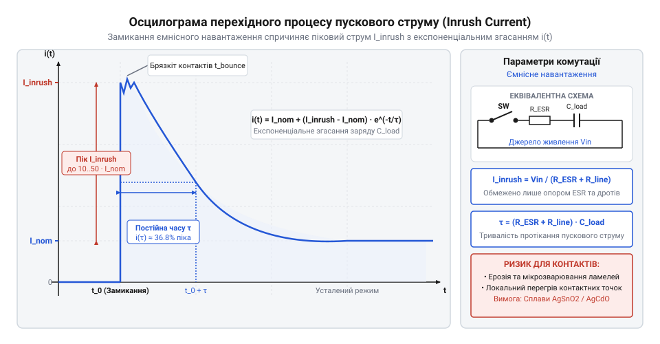
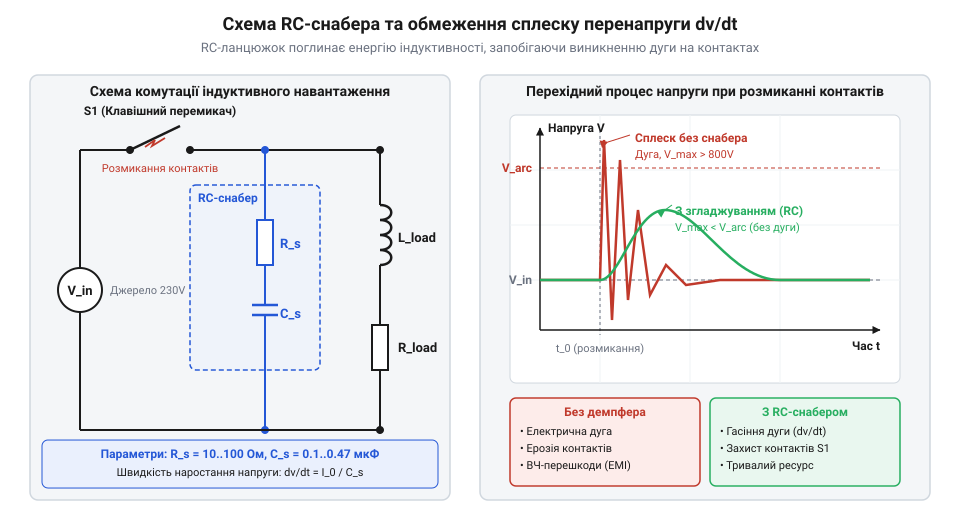

# Розрахунок дугогасіння, пускових струмів та снаберних ланцюжків у рокерних перемикачах

<preknowlist>
- [Тумблери, захисні ковпачки Mollie та блокування важелів (Switch Guards)](root:cat-hw-controls/toggle-switches-and-switch-guards) — Закони Кольрауша та геометрія контактного розмикання під навантаженням.
</preknowlist>

## Фізика перехідних процесів силових навантажень

У момент замикання або розмикання металевих ламелей силового рокерного перемикача струм у колі не змінюється миттєво від нуля до стаціонарного значення. Фізико-хімічні властивості комутованого кола обумовлюють перехідні процеси (англ. @@en|transient process@@, від лат. *transitus* — перехід), під час яких струм і напруга на контактах зазнають короткочасних сплесків, що суттєво перевищують паспортні номінали. На графіку часових осцилограм ця відмінність проявляється у взаємному фазовому зсуві φ між миттєвою напругою `v(t)` та струмом `i(t)`: для чисто активного навантаження криві струму й напруги збігаються за фазою (зсув φ = 0°), тому комутація відбувається без імпульсних надструмів; при ємнісному навантаженні струм випереджає напругу на кут φ = +90° (струм досягає максимуму в момент подачі напруги при `v(0) = 0`, утворюючи піковий пусковий кидок), а при індуктивному навантаженні струм відстає від напруги на φ = -90°, викликаючи під час розмикання ламелей спайковий імпульс перенапруги високої амплітуди. Крім того, на часову форму комутаційного сплеску вирішальним чином впливають розподілені паразитні індуктивності `L_cable` та паразитні ємності `C_cable` підключних кабелів живлення: вони утворюють вторинний коливальний контур, який перетворює аперіодичний стрибок у високочастотне дзвінкове коливання (англ. @@en|ringing voltage oscillation@@, від англ. *ringing* — дзвін, та *oscillation* — коливання) із власною резонансною частотою `f_ring = 1 ÷ (2 · π · √(L_cable · C_cable))`. Амплітуда та демпфування цього згасаючого дзвону визначаються хвильовим опором лінії `Z_0 = √(L_cable ÷ C_cable)`: при занадто малому активному опорі дротів паразитний сплеск формує зсув напруги з піковим амплітудним викидом, який перевищує робочу напругу живлення в 2–3 рази і провокує вторинні пробої повітряного проміжку. Відсутність урахування цих часових, фазових та паразитних осциляційних розсувів призводить до зварювання контактних подушок або руйнування ізоляційного зазору внаслідок електричної дуги, що наочно видно під час експлуатації механізмів [тумблерів та розмикальних контактів](root:cat-hw-controls/toggle-switches-and-switch-guards).

Характер перехідного процесу повністю визначається фізичною природою підключеного споживача. За впливом на комутаційні ламелі всі силові навантаження поділяють на три основні класи:
1. Активне навантаження (англ. @@en|resistive load@@): нагрівачі, де струм збігається за фазою з напругою, а перехідні сплески відсутні.
2. Ємнісне навантаження (англ. @@en|capacitive load@@): вхідні згладжувальні конденсатори імпульсних джерел живлення та частотних перетворювачів. У момент подачі напруги розряджений конденсатор має нульовий опір, викликаючи піковий пусковий струм (англ. @@en|inrush current@@, від англ. *inrush* — раптовий кидок), який у 20–100 разів перевищує робочий струм.
3. Індуктивне навантаження (англ. @@en|inductive load@@): обмотки електродвигунів, трансформаторів та електромагнітних реле. При розмиканні контактів запасена енергія магнітного поля протидіє зникненню струму, викликаючи індуктивний сплеск перенапруги (англ. @@en|inductive flyback@@) з утворенням високотемпературного дугового розряду.

## Розрахунок пускових струмів ємнісних навантажень

Під час комутації мережевої напруги 230 В на ємнісне навантаження найгірший випадок настає при замиканні клем у момент амплітудного піка фазної синусоїди. Максимальне значення амплітудної напруги `V_peak` обчислюють через діючу напругу мережі `V_rms = 230 В`:

V_peak
= V_rms · √2                              [перехід від діючого до амплітудного значення]
= 230 · 1.414                             [підстановка мережевої напруги]
= 325.2 В                                 [пікова фазна напруга]

Оскільки незаряджений конденсатор ємністю `C` у початковий момент часу `t = 0` поводиться як коротке замикання, піковий пусковий струм `I_inrush` обмежується лише сумарним опором кола `R_total`. Цей опір складається з опору мережевих дротів, еквівалентного послідовного опору конденсатора (англ. @@en|ESR@@, equivalent series resistance; від англ. *equivalent* — рівноцінний, та *series* — послідовний) та опору контактних ламелей. Суттєвий вплив на величину `R_total` має температура навколишнього середовища: при підвищенні робочої температури в шафі автоматики в'язкість електроліту в конденсаторах падає, а його провідність зростає, що призводить до падіння значення `ESR` у 2–3 рази порівняно з номіналом при +20 °C. Одночасно мідні провідники та срібні контакти збільшують свій опір згідно з позитивним температурним коефіцієнтом (від англійського *temperature coefficient of resistance* — температурний коефіцієнт опору, @@en|temperature coefficient of resistance@@, `TCR`), проте загальне зменшення `ESR` переважає, викликаючи зменшення `R_total` до критичного мінімуму. У результаті піковий струм `I_inrush` різко зростає, створюючи потужний тепловий сплеск (@@en|thermal surge@@) і Джоулеве нагрівання (від англійського *Joule heating* — Джоулеве нагрівання, @@en|Joule heating@@) у точках мікроконтакту ламелей рокера, що прискорює ерозію та збільшує ймовірність контактного зварювання. Детальніший розрахунок параметрів конденсаторів викладено у статті про [паразитичні параметри та ESR](root:ph-electromagnetism/esr-and-capacitor-parasitics).

I_inrush
= V_peak / R_total                        [закон Ома для незарядженої ємності у початковий момент]


*Осцилограма показує початковий кидок пускового струму I_inrush у момент торкання ламелей та його експоненційне спадання з постійною часу τ.*

Згасання пускового струму відбувається за експоненційним законом із постійною часу заряджання `τ`:

Для запобігання деструктивному пусковому надструму `I_inrush` у силових колах застосовують схемотехнічні методи пасивного та активного обмеження. Найпростішим пасивним розв'язком є послідовне ввімкнення термістора з негативним температурним коефіцієнтом опору (англ. @@en|NTC thermistor@@; від англ. *Negative Temperature Coefficient* — негативний температурний коефіцієнт): у холодному стані при `t = 0` він має високий початковий опір `R_NTC`, який додається до `R_total` і знижує амплітуду струму до безпечних значень. Під час проходження пускового імпульсу термістор самонагрівається, його опір експоненціально падає в десятки разів, мінімізуючи втрати в робочому режимі. Для високопотужних систем застосовують активну схему з реле шунтування (англ. @@en|bypass relay@@ або @@en|shunting relay@@; від англ. *bypass* — обхід, та *relay* — реле): після завершення інтервалу заряджання `t_charge ≈ (3..5) · τ` контакт електромеханічного реле замикається паралельно до термістора чи обмежувального резистора, повністю виключаючи його з кола струму й запобігаючи постійному тепловому розсіюванню.

τ
= R_total · C                             [обчислення постійної часу RC-кола]

Повна енергія `E_cap`, яка передається в коло за час заряджання конденсатора та частково розсіюється на контактних ламелях у вигляді мікродугового спалаху, обчислюється за формулою:

E_cap
= (1 / 2) · C · V_peak²                   [енергія електростатичного поля накопичувальної ємності]

При значеннях `C = 470 мкФ` та `R_total = 1.5 Ом` піковий струм `I_inrush` сягає `216.8 А`, що викликає локальне розплавлення срібних накладок рокерного перемикача через динамічне контактне зварювання.

## Енергія дуги та розмикання індуктивності

При розмиканні клем рокерного перемикача під індуктивним навантаженням `L` струм `I_0`, що протікає через обмотку, не може припинитися миттєво. Швидке зменшення струму викликає ЕРС самоіндукції, яка створює високовольтний індуктивний сплеск `V_flyback`:

V_flyback
= L · (di / dt)                           [закон електромагнітної індукції Фарадея]

Якщо напруга `V_flyback` перевищує порогову напругу іонізації повітряного проміжку (зазвичай `12..20 В`), між розмикальними контактами виникає плазмовий канал — електрична дуга (англ. @@en|electric arc@@, від лат. *arcus* — дуга). У момент розходження контактних ламелей площа їхнього механічного дотику зменшується до мікроскопічного контактного містка, через який протікає весь силовий струм. Надвисока густина струму спричиняє локальне випаровування металу та викликає термоелектронну емісію (від грец. *therme* — тепло та лат. *emissio* — випускання) катодної плями. Випущені електрони прискорюються високоінтенсивним електричним полем у зазорі `d` та здійснюють ударну іонізацію молекул повітря й металевої пари, утворюючи високотемпературний плазмовий шнур (`4000..8000 K`) із низьким опором. Повна енергія магнітного поля `E_ind`, накопичена в індуктивності, перетворюється на теплову енергію дугового розряду `E_arc`:

E_ind
= (1 / 2) · L · I₀²                       [енергія магнітного поля індуктивного елемента]

E_arc
= ∫ (V_arc · i(t)) dt                     [інтеграл потужності дугового розряду за час горіння]
= (1 / 2) · L · I₀²                       [баланс розсіювання магнітної енергії в плазмі]


*Принципова схема RC-снабера та часова діаграма обмеження амплітуди перенапруги dv/dt при розмиканні індуктивності.*

Для гасіння електричної дуги та обмеження швидкості наростання перенапруги `dv/dt` паралельно індуктивному навантаженню або контактам перемикача підключають демпферний RC-снабер (англ. @@en|RC snubber@@, від англ. *snub* — гасити, зупиняти). Ємність демпферного конденсатора `C_snubber` обчислюють із умови повного поглинання магнітної енергії без перевищення максимально допустимої напруги `V_max`:

C_snubber
= (L · I₀²) / V_max²                      [розрахунок ємності з балансу енергії]

Для забезпечення характеристичного демпфування й запобігання коливальному резонансу опір демпферного резистора `R_snubber` розраховують за хвильовим опором кола:

R_snubber
= √(L / C_snubber)                        [умова критичного затухання коливального контуру]

Застосування розрахованого RC-снабера знижує енергію дуги у 10–50 разів, захищаючи контактні поверхні від ерозійного зносу.

## Розрахунок демпферних RC-снаберних ланцюжків

Для захисту контактних ламелей від руйнівного впливу високочастотних індуктивних сплесків перенапруги паралельно комутованому навантаженню або контактам перемикача підключають демпферний ланцюжок (від англ. *snub* — гасити, зрізати; англ. @@en|RC snubber@@). Його основними елементами є послідовно з'єднані конденсатор `C_snub` та демпферний резистор (від нім. *dämpfen* — глушити, гасити; англ. @@en|damping resistor@@) `R_snub`.

Основна задача конденсатора `C_snub` полягає у поглинанні енергії магнітного поля `E_ind`, накопиченої в індуктивності навантаження `L` при проходженні струму `I_0`. Швидкість наростання напруги на контактах (англ. @@en|rate of voltage rise@@) `dv/dt` обмежується ємністю `C_snub`, запобігаючи повторному пробою повітряного проміжку. Щоб амплітуда перенапруги не перевищувала допустиме пікове значення `V_peak`, ємність розраховують з балансу енергії:

`C_snub = (L · I_0²) / (V_peak² - V_supply²)`

де `L` — індуктивність навантаження в генрі, `I_0` — струм у момент розмикання в амперах, `V_supply` — робоча напруга живлення у вольтах, а `V_peak` — гранично допустима напруга на контактах у вольтах.

Роль резистора `R_snub` двояка: він демпфує резонансні коливання `LC`-контуру та обмежує розрядний струм конденсатора крізь контакти при їхньому наступному замиканні. Оптимальне значення опору дорівнює хвильовому опору контуру:

        R_snub = √(L / C_snub)

Математичний вивід потужності втрат `P_loss` спирається на аналіз енергетичного балансу циклічного перезаряду ємності `C_snub`. При кожному розмиканні контактів конденсатор заряджається від джерела живлення до напруги `V_supply`, накопичуючи енергію електричного поля `E_charge = 0.5 · C_snub · V_supply²`. Під час наступного замикання накопичений заряд повністю розряджається крізь демпферний резистор `R_snub`, перетворюючи на тепло таку ж за величиною енергію розряду `E_discharge = 0.5 · C_snub · V_supply²`. Сумарна енергія `E_cycle`, що незворотно розсіюється на резисторі за один повний цикл комутації, виводиться покроковим додаванням:

        E_cycle
        = E_charge + E_discharge  [сума енергій заряду та розряду]
        = 0.5 · C_snub · V_supply² + 0.5 · C_snub · V_supply²  [підстановка формул накопиченої енергії]
        = C_snub · V_supply²       [зведення подібних доданків]

Потужність теплових втрат `P_loss` на демпферному резисторі дорівнює добутку енергії одного циклу `E_cycle` на частоту комутацій `f_sw` (кількість циклів за секунду):

        P_loss
        = E_cycle · f_sw           [добуток енергії циклу на частоту комутацій]
        = C_snub · V_supply² · f_sw [підстановка виведеної енергії циклу]

Цей математичний вивід доводить, що втрати потужності в демпферному резисторі зростають лінійно з підвищенням частоти комутації та ємності снабера, але квадратично залежать від робочої напруги живлення.

`R_snub = √(L / C_snub)`

При повторній комутації енергія, накопичена у конденсаторі `C_snub`, повністю розсіюється на резисторі `R_snub` у вигляді тепла. Потужність втрат `P_loss` при частоті перемикання `f_sw` розраховується за формулою:

`P_loss = C_snub · V_supply² · f_sw`

**Розрахунок снабера для соленоїда.** Необхідно розрахувати RC-снабер для захисту перемикача при комутації соленоїда з індуктивністю `L = 0.5 Гн` та струмом `I_0 = 2 А` в мережі `V_supply = 220 В`. Допустима пікова напруга `V_peak = 400 В`, частота комутації `f_sw = 0.5 Гц`.

```
C_snub = (0.5 · 2²) / (400² - 220²)
= 2 / (160000 - 48400)    [підстановка квадратів напруг]
= 2 / 111600              [обчислення знаменника]
= 1.79 · 10⁻⁵ Ф ≈ 18 мкФ  [ділення та округлення]
```

```
R_snub = √(0.5 / (1.79 · 10⁻⁵))
= √(27933)                [обчислення підкореневого виразу]
≈ 167 Ом                  [добування квадратного кореня]
```

```
P_loss = 1.79 · 10⁻⁵ · 220² · 0.5
= 1.79 · 10⁻⁵ · 48400 · 0.5 [квадрат робочої напруги]
≈ 0.43 Вт                 [остаточна потужність розсіювання]
```

Таким чином, для демпфування обирають конденсатор ємністю `18 мкФ` з робочою напругою не менше `400 В` та керамічний резистор опором `160 Ом` потужністю `1 Вт`. Подібні схеми демпфування застосовують не лише у клавішних перемикачах, а й при комутації кіл [тумблерами та блокуваннями](root:cat-hw-controls/toggle-switches-and-switch-guards) для підвищення їхньої надійності.

## Оцінка ресурсу та зносу контактів

Тривалість експлуатації силових рокерних перемикачів визначається ерозією контактів (від лат. *erosio* — роз'їдання; англ. @@en|contact erosion@@) — винесенням і випаровуванням металу під дією високої температури електричної дуги. Об'єм зенісного зносу матеріалу ламелей `V_ero` пропорційний сумарній енергії дугових розрядів `E_arc`, накопиченій за всі цикли комутації:

`V_ero = K_ero · E_arc · N_cycles`

де `K_ero` — питомий коефіцієнт ерозійної руйнівності матеріалу в м³/Дж, `E_arc` — енергія одного дугового розряду в джоулях, а `N_cycles` — кількість циклів перемикання.

Для виготовлення силових контактних накладок застосовують металокерамічні сплави (англ. @@en|sintered contact material@@), такі як срібло-оксид олова AgSnO₂ (англ. @@en|silver-tin oxide@@) або срібло-оксид кадмію AgCdO. Сплав AgSnO₂ має високу термостійкість і знижений коефіцієнт ерозії `K_ero ≈ 1.2 · 10⁻¹¹ м³/Дж`, що робить його стійким до дугового зварювання при пускових струмах. Перевага AgSnO₂ полягає в його дрібнодисперсній мікроструктурі: тверді частки диоксиду олова SnO₂ рівномірно розподілені у срібній матриці, що утворює тугоплавкий каркас і стримує міграцію рідкої фази срібла під час дугового розряду. На відміну від класичного сплаву AgCdO, який має менший перехідний опір, але виділяє токсичні пара кадмію і вигорає швидше при високих пускових струмах, матеріал AgSnO₂ забезпечує вищу термомеханічну міцність накладки, значно менше зварюється при важких ємнісних та індуктивних навантаженнях і повністю відповідає екологічним вимогам щодо обмеження небезпечних речовин.

Максимально допустимий об'єм зносу накладки `V_max` визначається її геометричними розмірами:

`V_max = A_contact · d_allow`

де `A_contact` — площа контактної накладки в мм², а `d_allow` — допустима товщина зношуваного шару в мм (зазвичай `d_allow ≈ 0.3..0.5 мм`). Прирівнюючи граничний об'єм зносу `V_max` до сумарної ерозії `V_ero`, дістаємо формулу для розрахунку граничного ресурсу комутацій:

`N_cycles = (A_contact · d_allow) / (K_ero · E_arc)`

**Обчислення електричного ресурсу.** Контакти зі сплаву AgSnO₂ мають площу `A_contact = 12 мм²` та допустимий знос `d_allow = 0.4 мм` (`V_max = 4.8 мм³ = 4.8 · 10⁻⁹ м³`). При комутації індуктивного навантаження енергія дуги становить `E_arc = 0.08 Дж`, а коефіцієнт ерозії `K_ero = 1.2 · 10⁻¹¹ м³/Дж`.

```
N_cycles = (4.8 · 10⁻⁹) / (1.2 · 10⁻¹¹ · 0.08)
= (4.8 · 10⁻⁹) / (9.6 · 10⁻¹³) [обчислення ерозії за один цикл]
= 5000 cycles                   [ділення та визначення ресурсу]
```

Отже, розрахований електричний ресурс становить `5000` циклів комутації під повним навантаженням. Застосування RC-снабера зменшує енергію дуги `E_arc` у `5`–`10` разів, що пропорційно продовжує ресурс перемикача до `25000`–`50000` циклів. Аналогічні розрахунки втомного зносу також виконують для ланок безпеки в [кнопках аварійного стопу](root:cat-hw-controls/estop-mushroom-button) при аналізі їхньої довговічності.
