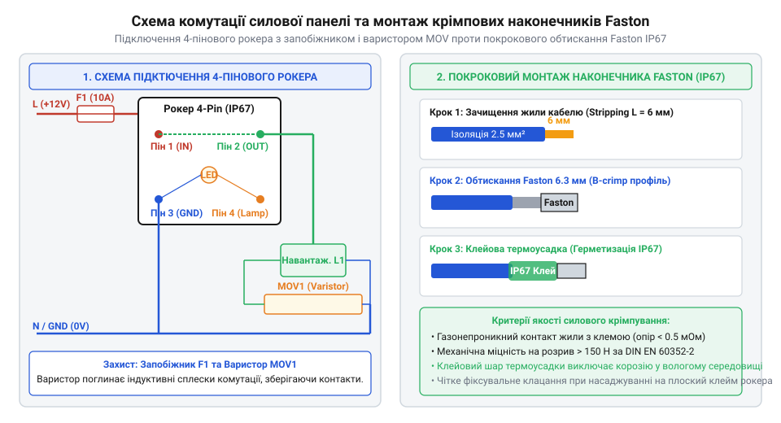

# Проєктування та збирання захищеної силової рокерної панелі комутації

<preknowlist>
- [Клавішні перемикачі (Rocker Switches) та силові панелі комутації](root:cat-hw-controls/rocker-switches-and-power-toggle-panels) — базові типи контактних груп та конструктивні варіанти рокерних перемикачів
</preknowlist>

## Розрахунок та схемотехніка силового блоку

Проєктування силових комутаційних панелей вимагає узгодження струмових навантажень, перерізів провідників та кіл захисту від індуктивних завад. На відміну від простих слабострумових комутаторів, рокерний перемикач (англ. @@en|rocker switch@@) у силових кола комутує струми до 16–20 А за напруги 230 В змінного струму або 24 В постійного струму.

Класичний чотирипіновий рокерний перемикач містить дві незалежні паралельні групи контактів або одну комутаційну пару з окремою лінією підсвічування. Виводи `1` та `2` слугують силовим ключем, а виводи `3` та `4` підключають неонову лампу (грец. @@el|neon@@) або світлодіод (англ. @@en|LED@@) внутрішньої індикації. Для забезпечення незалежного світіння індикатора лише під час увімкненого стану навантаження, вивід `3` підключають до виходу комутованого контакту `2`, а вивід `4` з'єднують із спільним нульовим або мінусовим провідником.

Розрахунок перерізу силового провідника виконують за допустимою густиною струму та лінійним спадом напруги. Для мідних провідників у закритих панелях гранична густина струму не повинна перевищувати `5.0 A/мм²`. При цьому під час тривалого нагрівання силової лінії понад 50 °C опір жили обчислюють з урахуванням температурного коефіцієнта міді α ≈ 0.00393 K⁻¹ за формулою ρ(T) = ρ₂₀ · [1 + α · (T - 20)]: нагрів провідника до 60 °C збільшує його питомий опір від базового `0.0175 Ом·мм²/м` (за 20 °C) до `0.0175 · [1 + 0.00393 · (60 - 20)] = 0.02025 Ом·мм²/м`, що пропорційно підвищує джоулеві втрати та підсумковий спад напруги. Електричний опір жили обчислюють за формулою:

R_wire = (rho · L) ÷ S
       = (0.0175 · 10) ÷ 1.5           [обчислення опору 10 м мідної жили перерізом 1.5 мм²]
       = 0.1167 Ом                     [підсумковий електричний опір силової лінії]

При робочому струмі `12 A` падіння напруги на такій лінії становить `U_drop = 12 A · 0.1167 Ом = 1.40 В`, що відповідає `0.61%` від номіналу 230 В і є цілком безпечним значенням.

Для захисту від короткого замикання в кожне плече панелі встановлюють плавкий запобіжник (англ. @@en|fuse@@), розрахований на номінал `I_fuse = 1.25 · I_load`. Під час комутації індуктивних навантажень (електродвигунів, контакторів, реле) на контактах виникає високовольтний дуговий розряд. Для його гасіння паралельно контактам або навантаженню підключають оксидно-металевий варистор (англ. @@en|varistor@@, MOV — @@en|Metal Oxide Varistor@@), який зрізає пікові імпульси напруги. На відміну від механізмів, де застосовують [тумблери із блокуванням](root:cat-hw-controls/toggle-switches-and-switch-guards), рокерна панель забезпечує швидке перемикання з візуальним контролем стану кожної лінії. Принципи вибору варисторів та розрахунку енергії поглинання описано у матеріалі про [варисторний захист контактів](root:cat-hw-power/varistor-surge-suppression).

*Принципова схема підключення чотирипінового рокерного перемикача з варисторним захистом та плавким запобіжником.*

Для програмного розрахунку електричних режимів та перевірки допустимих падінь напруги використовують математичні моделі силового кола:

:::tabs
@tab C
:::code proj-industrial-power-panel-assembly/c/include/rocker_panel.h 64-105
:::code proj-industrial-power-panel-assembly/c/src/rocker_panel.c 5-36
@tab C++
:::code proj-industrial-power-panel-assembly/cpp/include/power_panel_calculator.hpp 31-61
:::code proj-industrial-power-panel-assembly/cpp/src/power_panel_calculator.cpp 19-43
:::

## Монтаж, крімпування та герметизація IP67

Надійність силової панелі в умовах підвищеної вологості та пилу визначається дотриманням технології герметизації за стандартом IP67 (англ. @@en|IP67@@). Монтаж рокерних перемикачів здійснюють у вирізи прямокутного профілю з ущільнювальною силіконовою манжетою, яка компенсує нерівності поверхні корпусу.

Для електричного з'єднання застосовують ізольовані плоскі наконечники Faston (англ. @@en|Faston@@) типорозміру 6.3 мм або 4.8 мм. Якісне крімпування (англ. @@en|crimping@@) виконують спеціалізованими кліщами-крімперами з храповим механізмом (англ. @@en|ratchet crimper@@). Храповий механізм не розмикає губки інструмента до досягнення повного профільного стискання, що гарантує газощільний контакт між мідною жилою та хвостовиком наконечника без окиснення міді. Геометрію F-крімпу та інструменти обтискання розглянуто в статті про [ізольовані наконечники Faston](root:cat-hw-parts/faston-crimp-terminals).

Маркування ізоляційних манжет наконечників Faston підбирають із чітким дотриманням колірного коду відповідно до перерізу силових жил та їхньої електричної ролі в колі. Для фазних провідників L і нульових провідників N обирають клеми з відповідним кодом манжети: червона ізоляція призначена для перерізів `0.5–1.5 мм²`, синя — для `1.5–2.5 мм²`, а жовта — для потужних ліній `4.0–6.0 мм²`. Одночасне використання стандартного колірного маркування манжет та кольорів самої ізоляції жил (коричневий або чорний для фази, синій для нуля) гарантує візуальну ідентифікацію силових кіл та унеможливлює помилкове переплутування виводів комутації `1-2` з лінією підсвічування `3-4` під час збирання й обслуговування панелі.

Вибір наконечників Faston вимагає суворого дотримання стандартизованого кольорового маркування ізоляційних манжет залежно від перерізу жили: червона ізоляція розрахована на переріз `0.5–1.5 мм²`, синя — на `1.5–2.5 мм²`, а жовта застосовується для силових ліній `4.0–6.0 мм²`. Використання клем із невідповідним кольоровим кодом призводить або до недотискання тонких жил у занадто просторому хвостовику з утворенням повітряних зазорів, або до підрізання й перетискання мідних ниток у вузькому хвостовику. Це порушує геометрію F-крімпу, підвищує перехідний опір з'єднання та спричиняє локальне перегрівання під час тривалої експлуатації.

Під час збирання силових шин живлення дотримуються правил розведення провідників:
1. Провідники не повинні мати натягу та гострих вигинів із радіусом менше п'яти зовнішніх діаметрів кабелю.
2. Лінії фази (або позитивного полюса) та нуля розводять окремими джгутами для запобігання міжфазним коротким замиканням при механічному пошкодженні ізоляції.
3. Кожен клемний контакт додатково захищають термоусаджувальною трубкою з клейовим шаром, що перешкоджає проникненню капілярної вологи всередину з'єднання.

На відміну від ситуацій, коли монтуються [промислові кнопки аварійного зупинення](root:cat-hw-controls/estop-mushroom-button) у масивних силових шафах, рокерна панель вимагає компактного розміщення провідників усередині герметичного боксу.

Нижче наведено приклад реалізації розрахунку номінальних параметрів силової панелі змінного струму:

:::code proj-industrial-power-panel-assembly/c/src/main.c 10-40

## Перевірка теплового режиму та випробування

Після фізичного збирання силової панелі виконують серію контрольно-діагностичних випробувань під номінальним та максимальним струмовим навантаженням. Перехідний опір контактної групи перемикача `R_contact` викликає джоулеві втрати потужності:

P_loss = I² · R_contact
       = 18² · 0.030                  [обчислення втрат при струмі 18 А та опорі контактів 30 мОм]
       = 9.72 Вт                       [теплова потужність, що виділяється на контактах]

Стаціонарний перегрів корпусу перемикача відносно довкілля обчислюють за допомогою теплового опору `R_th`:

Delta_T = P_loss · R_th
        = 9.72 · 25                    [розрахунок перегріву при тепловому опорі 25 °C/Вт]
        = 243.0 °C                     [теоретичний перегрів корпусу]

Таке значення значно перевищує гранично допустиму температуру корпусу `85 °C` і призведе до термічного руйнування та оплавлення пластику.

Верифікацію теплового режиму зібраного блоку проводять за допомогою інфрачервоного тепловізора після 30 хвилин роботи під повним навантаженням. Тепловізійний контроль дозволяє негайно виявити критичні точки локального нагріву («гарячі плями»), які виникають через недотиснуті наконечники Faston або деградацію внутрішніх контактних містків. Для інструментальної перевірки якості кожного крімпування застосовують методику вимірювання спаду напруги мілівольтметром безпосередньо між металевим штирком виводу перемикача та хвостовиком клейми Faston: гострі щупи приладу притискають до площини плоского ножового контакту та місця обтискання жили під час проходження фіксованого номінального струму навантаження. Таке локальне вимірювання дозволяє відокремити опір самого крімпу від опору провідника та виявити приховані дефекти контактного переходу. В ідеально виконаному газощільному крімпі спад напруги не перевищує `5...10 мВ` (що відповідає опору контакту `R_crimp ≤ 0.5 мОм`), тоді як значення понад `15...20 мВ` свідчить про наявність оксидної плівки, послаблення жилок або слабкого механічного обтискання, що вимагає негайної заміни наконечника.

Герметичність корпусу IP67 перевіряють методом тестового створення надлишкового тиску повітря `20 кПа` або зануренням випробувального боксу в дистильовану воду на глибину 1 метр протягом 30 хвилин з наступним контролем опору ізоляції (не менше `100 МОм`). На відміну від ситуацій, де використовують [конфігураційні DIP-перемикачі](root:cat-hw-controls/dip-switches-and-configuration-blocks) для слабострумових налаштувань, силова рокерна панель перебуває під постійним високим струмовим навантаженням, тому теплова й гідроізоляційна діагностика є обов'язковою.

:::tabs
@tab C
:::code proj-industrial-power-panel-assembly/c/src/main.c 45-78
@tab C++
:::code proj-industrial-power-panel-assembly/cpp/src/main.cpp 35-63
:::
