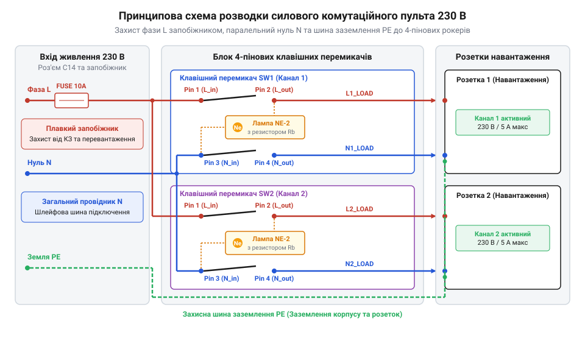

# Проєктування та монтаж силового розподільного щита на клавішних перемикачах

<preknowlist>
- [Клавішні перемикачі (Rocker Switches) та силові панелі комутації](root:cat-hw-controls/rocker-switches-and-power-toggle-panels) — Конструкція рокерних перемикачів, розпинівка 4-пінових контактних груп та принципи індикації
</preknowlist>

## Потреба безпечної комутації силових ліній

У лабораторних та майстерних умовах одночасне підключення десятка силових приладів (паяльних станцій, лабораторних джерел живлення, осцилографів, витяжок) до звичайних подовжувачів створює хаос із кабелів і підвищує ризик пожежі. Швидке знеструмлення конкретного несправного блоку вимагає висмикування вилки з розетки під напругою, що супроводжується електричною дугою й прискореним зношуванням контактів. Без централізованої системи з візуальною індикацією оператор не здатний миттєво оцінити, які саме лінії перебувають під небезпечною мережевою напругою `230 В`. Для розв'язання цієї проблеми розробляють силові розподільні щити на клавішних перемикачах (від англійського @@en|rocker switch@@, де @@en|rocker@@ — качалка, гойдалка).

Застосування індивідуальних рокерів із підсвіткою дозволяє незалежно комутувати кожне навантаження та одразу бачити наявність напруги на виході. На відміну від ситуацій, коли для швидкого вимкнення всього обладнання застосовують [організовані органи аварійного стопу](root:cat-hw-controls/estop-mushroom-button), силовий щит забезпечує селективне керування окремими споживачами. Проєктування модуля починається з обчислення сумарного струмового навантаження `I_total`, яке визначають як суму максимальних робочих струмів усіх одночасно підключених приладів `I_1, I_2, ..., I_n`:

I_total
= I_1 + I_2 + ... + I_n                 [сумування струмів усіх силових ліній]

Отримане значення `I_total` слугує основою для розрахунку перерізу вхідних провідників та вибору головного вимикача щита. Його номінальний струм `I_main` обирають із коефіцієнтом запасу не менше `1.25` від сумарного навантаження (`I_main ≥ 1.25 · I_total`), що запобігає перегріву контактних груп під час тривалої роботи. Ключовими критеріями вибору головного вимикача є двополюсна комутація (одночасне розмикання фази `L` та нейтралі `N` для повного знеструмлення кола) і комутаційна зносостійкість контактів не менше `10 000` циклів під навантаженням. Головними вимогами до такого силового модуля є міцний ізольований або заземлений металевий корпус, наявність загального двополюсного головного вимикача, плавкого запобіжника для захисту від перевантаження за струмом та надійні комутаційні вузли.

## Схемотехніка розводки фазних і нульових ліній

Електрична схема силового щита базується на паралельному підключенні споживачів до вхідної мережевої розетки стандарта IEC C14. Фазний провідник `L` (від англійського @@en|line@@ — лінія) від вхідного роз'єму подається безпосередньо на тримач плавкого запобіжника, після чого розгалужується на вхідні контакти клавішних перемикачів. Нульовий провідник `N` (від англійського @@en|neutral@@ — нейтраль) підключається до загальної ізольованої клемної колодки, звідки розводиться до додаткових виводів індикації кожного рокера. Захисний провідник заземлення `PE` (від англійського @@en|protective earth@@ — захисне заземлення) з'єднується з металевим корпусом щита та клемними колодками заземлення всіх вихідних розеток.

*Електрична схема силового розподільного щита з дубльованим захистом фази та комутацією 4-пінових рокерів з неоновою індикацією.*

У чотирипінових клавішних перемикачах контактні групи розділені на дві незалежні лінії: фазну комутаційну пару та лінію живлення вбудованої неонової лампи або світлодіодного індикатора. Фазний провід від запобіжника підключається до вхідного контакту `1`, а силовий провідник до навантаження — до вихідного контакту `2`. Вбудована неонова лампа підключена всередині корпусу перемикача між вихідним контактом `2` та індикаторним виводом `3`, який з'єднують із нульовою шиною `N`. Завдяки такій схемі неонова лампа засвічується лише тоді, коли клавіша перебуває в положенні «Увімкнено», а на вихідному терміналі присутня напруга `230 В`.

Переріз провідників обирають залежно від сумарної потужності споживачів. Для сумарного струму навантаження до `10 А` застосовують мідний багатожильний провід перерізом не менше `1.5 мм²` із термостійкою ізоляцією ПВХ чи силікону. Номінал плавкого запобіжника `I_fuse` розраховують із запасом `20 %` від максимального розрахункового струму споживання `I_max`:

I_fuse
= 1.2 · I_max                           [розрахунок номіналу запобіжника]

При роботі з індуктивним навантаженням (трансформатори, електродвигуни витяжок) у момент розмикання контактів виникає самоіндукція, що створює дуговий розряд. Для захисту контактів рокерів паралельно клемам навантаження рекомендується встановлювати варистори або RC-ланцюги придушення дуги.

## Механічний монтаж та обтиск фастон-терміналів

Механічна збірка починається з підготовки прямокутних посадкових отворів у лицьовій панелі корпусу. Більшість силових клавішних перемикачів виготовляються за затискним стандартом монтажу (від англійського @@en|snap-in@@, де @@en|snap@@ — затискати, клацати зі клацанням). Корпус перемикача має бічні пружні засувки, які фіксують його в панелі завтовшки від `1.0` до `3.0 мм` без використання гвинтів. При розмітці отворів витримують допуски в межах `±0.2 мм`, оскільки занадто малий отвір спричинить деформацію корпусу рокера та заклинювання клавіші, а надто великий — випадання пристрою під час натискання. Для експлуатації у вологих чи запилених приміщеннях на корпус перемикача перед установкою надягають силіконову герметичну манжету зі ступенем захисту @@en|IP65@@.

Для електричного з'єднання силових провідників із клемами перемикачів не варто застосовувати пряме паяння, оскільки постійне нагрівання під силовим струмом та механічні вібрації призводять до деградації паяного з'єднання та розплавлення пластмасової основи рокера. Стандартом для комутації є використання плоских пружинних фастон-терміналів (від англійського @@en|faston connector@@, @@en|faston@@). Для рокерів номіналом `10–16 А` застосовують термінали шириною `6.3 мм` (стандарт `0.250 дюйма`).

Монтаж провідника у фастон-термінал виконують спеціальними обтискними кліщами (кримпером). Багатожильний мідний провід зачищають на довжину `5–6 мм`, вставляють у металеву хвостову частину коннектора й обтискають двома обтискними губками: перша губка обтискає оголені жили для створення газонепроникного електричного контакту, а друга — зовнішню ізоляцію для захисту від зламу при вібрації. Після обтиску на кожен термінал надягають термоусаджувальну трубку чи захисний ізолювальний силіконовий чохол для усунення ризику випадкового доторку до оголеного струмопровідного контакту.

## Покрокова збірка та електрична перевірка

Збірка силового щита виконується суворо за покроковим алгоритмом з обов'язковим проміжним контролем електричних кіл. На першому кроці монтують вхідну розетку C14, тримач запобіжника та вихідні розетки на панелях корпусу. На другому кроці встановлюють заземлювальний шинопровід і підключають захисний провідник `PE` від вхідного заземлювального контакту безпосередньо до металевої шасі корпусу за допомогою гвинтового з'єднання з пружинною шайбою Гровера.

На третьому кроці виконують розводку фазних провідників `L` від запобіжника до вхідних клем рокерних перемикачів та нульових провідників `N` від ізольованої колодки до терміналів підсвічування. Кожен фастон-коннектор насаджують на ножевий контакт перемикача з відчутним зусиллям фіксації до повного замикання пружинного засува.

Перед закриттям корпусу й подачею напруги обов'язково виконують перевірку цілісності кіл та опору ізоляції цифровим мультиметром у режимі вимірювання опору:

1. **Перевірка заземлення:** вимірюють опір між заземлювальним контактом вхідного вилки C14 та будь-якою відкритою металевою частиною корпусу. Опір не повинен перевищувати `0.1 Ом`.
2. **Перевірка відсутності короткого замикання:** вимірюють опір між вхідними штирями `L` та `N` при всіх положеннях вимикачів. При вимкнених рокерах опір має дорівнювати безкінечності (`∞`), а при увімкнених — відповідати опору паралельно підключених неонових індикаторів (понад `100 кОм`).
3. **Перевірка ізоляції:** вимірюють опір між об'єднаними фазним і нульовим провідниками та заземленим корпусом. Опір ізоляції повинен становити не менше `5 МОм`.

## Введення в експлуатацію під навантаженням

Після успішного завершення холодного тестування вимірювальними приладами щит збирають у корпус і переходять до процедури введення в експлуатацію під робочою напругою. Перше ввімкнення здійснюють без підключених споживачів. Силовий кабель підключають до мережі `230 В`, після чого по черзі переводять клавіші рокерів у положення «Увімкнено». При цьому спостерігають за чітким і рівномірним свіченням неонових або світлодіодних індикаторів у кожній клавіші без тріску чи миготіння.

На другому етапі виконують тестове випробування під номінальним електричним навантаженням. До вихідних розеток підключають тестові споживачі (наприклад, електричні обігрівачі або потужні резистивні навантаження), які створюють струм, близький до розрахункового `I_max` (наприклад, `8–10 А`). Щит залишають працювати під навантаженням протягом `30 хвилин`.

Після завершення 30-хвилинного тесту щит негайно відключають від мережі та виконують тепловий контроль перехідних контактів (за допомогою інфрачервоного пірометра або тепловізора). Нагрівання клемних з'єднань фастон-терміналів та корпусів рокерів не повинно перевищувати `45 °C` (або `20 °C` вище температури навколишнього середовища). Підвищена температура на окремому контакті свідчить про слабкий обтиск фастон-термінала чи окиснення поверхні, що вимагає негайної заміни коннектора. Лише після успішного проходження теплового тесту силовий комутаційний щит вважається готовим до постійної безпечної експлуатації.
