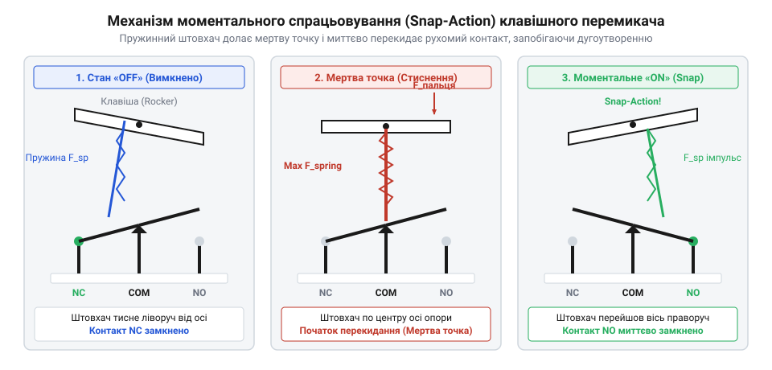
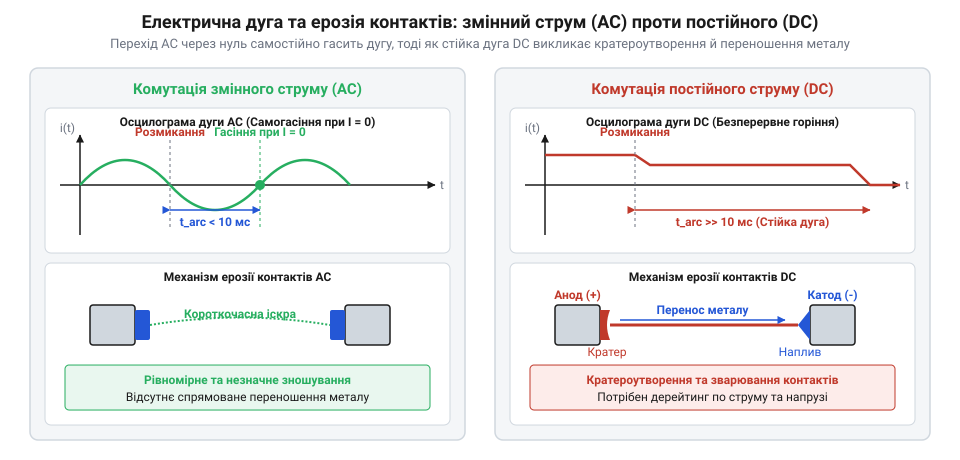
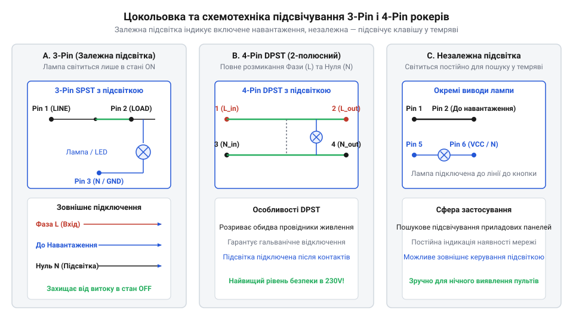
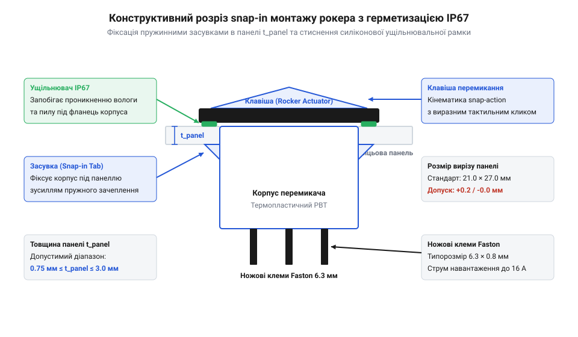

# Клавішні перемикачі (Rocker Switches) та силові панелі комутації

<preknowlist>
- [Тумблери, захисні ковпачки Mollie та блокування важелів (Switch Guards)](root:cat-hw-controls/toggle-switches-and-switch-guards) — Принципи роботи дискретних контактних груп, сухі та силові контакти, брязкіт контактів
- [DIP-перемикачі та джамперні блоки конфігурації](root:cat-hw-controls/dip-switches-and-configuration-blocks) — Конструктивні варіанти рокерних та ковзних механізмів малої потужності
</preknowlist>

## Проблема безпечної силової комутації під навантаженням

Ввімкнення та вимкнення електричних кіл високої потужності в промисловому обладнанні та транспортних засобах пов'язане з ризиком випадкових аварійних вимкнень та пожежонебезпечних аварій. Традиційні комутаційні елементи, зокрема класичні [тумблери із захисними ковпачками](root:cat-hw-controls/toggle-switches-and-switch-guards), мають довгі важелі, які відчутно виступають за площину передньої панелі. У тісному просторі кабіни спецтехніки або на операторському пульті оператор чи рухомі предмети можуть випадково зачепити важіль, що спричиняє раптове знеструмлення критичного обладнання або несанкціонований запуск силового приводу. Особливості захисту виступаючих органів керування описують [тумблерні перемикачі та кришки](root:cat-hw-controls/toggle-switches-and-switch-guards).

Для усунення механічної вразливості без ускладнення конструкції додатковими відкидними кришками вимикач повинен мати плаский зовнішній профіль, який збігається з поверхнею панелі. Цю задачу вирішує клавішний перемикач (від англ. @@en|rocker switch@@; від англійського *rock* — гойдатися), у якому важіль замінено на двоплечу коромислову клавішу. Одне плече клавіші утоплене в корпус майже врівень із захисним бортиком рамки, а інше підняте під малим кутом нахилу (зазвичай 10°–20°). Завдяки такій геометрії та похилому профілю плечей дотичний або ковзний удар вздовж панелі лише ковзає по гладкому скосу клавіші без зміни стану контактів, оскільки утоплена сторона фізично спирається на корпус і не може опуститися нижче. Для спрацьовування вимикача вектор сили мусить бути спрямований перпендикулярно до піднятого плеча, що унеможливлює випадкове перемикання ліктями або одягом. Перехід від відкритих рубильників до плоских рокерних модулів детально описує [історична еволюція клавішних перемикачів](root:cat-hw-controls/rocker-switches-and-power-toggle-panels/hist-rocker-switch-evolution.md).

Проте безпечна геометрична форма клавіші розв'язує лише проблему захисту від випадкового механічного зачіпання. У момент розмикання силових контактів, які пропускають струми у десятки ампер, виникає високовольтна електрична дуга (від англ. @@en|electric arc@@). Якщо оператор плавно та повільно натискає на клавішу, звичайні рухомі контакти розходяться з низькою швидкістю, унаслідок чого іонізований повітряний проміжок тривалий час розжарює та плавить метал контактних подушечок. Сформована дуга здатна призвести до зварювання контактів або вигорання ізоляційного корпусу, тому силова комутація вимагає механізму, який розмикає контакти моментально незалежно від швидкості руху пальця оператора.

Окрім геометрії профілю, захист від ненавмисного спрацьовування забезпечується чітким розрахунком кута нахилу плечей коромисла та необхідного зусилля перемикання (від англ. *actuate* — приводити в дію; англ. @@en|actuation force@@). Кут нахилу піднятого плеча (зазвичай 10°–20°) визначає не лише висоту виступання клавіші над рокерною рамкою, а й плече моменту сили відносно центральної осі обертання. При прикладанні нормального зусилля `F_act` на відстані `L_a` від осі обертання клавіші, нахиленої під кутом `α`, ефективне плече моменту обчислюється як `L_eff = L_a · cos(α)`. Для подолання опору внутрішньої пружини штовхача з натягом `F_spring` на кулачку радіуса `r_cam` створюваний крутний момент мусить перевищити мертву точку:

```
M_act = F_act · L_eff                          [момент прикладеної сили відносно осі]
L_eff = L_a · cos(α)                           [ефективне плече моменту під кутом α]
F_act = (F_spring · r_cam) ÷ (L_a · cos(α))    [необхідне порогове зусилля перемикання]
```

За занадто малого кута нахилу `α` пальцю важко передати перпендикулярний імпульс, а за великого — зростає ризик бокового зачіпання. Внутрішня пружина штовхача створює початковий механічний натяг, тому для подолання мертвої точки та перекидання коромисла оператор має прикласти цілеспрямоване зусилля у 5–15 ньютонів. Незначні дотики, вібрація обладнання чи випадкове спирання інструменту не здатні подолати цей поріг статичного опору, що гарантує надійне утримання вимикача у вибраному стані.

## Внутрішня кінематика та механізм моментального спрацьовування

Миттєве розмикання силового кола забезпечує внутрішня кінематика (від грецького *kinema* — рух) рокерного вимикача, побудована на накопиченні механічної енергії пружини. Під зовнішньою клавішею, що обертається на центральній осі, розташований підпружинений штовхач із загостреним або кулеподібним наконечником. Цей штовхач спирається на рухоме металеве коромисло (від англ. @@en|rocker bridge@@), закріплене на центральному опорному контакті.

Під час натискання на підняте плече клавіші штовхач починає ковзати по верхній грані коромисла (від англ. @@en|rocker bridge@@), стискаючи внутрішню пружину. Доки наконечник штовхача не перетнув поворотну вісь коромисла, тангенціальна складова сили пружини утримує контакти замкненими, а пружина накопичує потенціальну енергію. Геометричне положення мертвої точки визначається умовою колінеарності вектора сили пружини та нормалі до точки контакту наконечника з коромислом: мертва точка настає в момент, коли кут відхилення штовхача від вертикальної осі симетрії досягає критичного значення θ_dead = arctan(d ÷ h), де d — горизонтальне зміщення точки опору наконечника від відносної осі хитання, а h — вертикальна відстань від осі обертання коромисла до лінії ковзання штовхача. У цій точці вектор стискання проходить точно через вісь обертання, створюючи плече моменту L_arm = 0 та максимальне зусилля механічного опору оператору. Щойно наконечник перетинає осьову лінію на мікроскопічну відстань Δx, виникає перекидний момент M_snap = F_spring · Δx, тангенціальний момент миттєво змінює напрямок, і стиснута пружина лавиноподібно випрямляється, штовхаючи коромисло у протилежне положення. Жорсткість пружини штовхача k розраховують так, щоб при комфортному зусиллі натискання пальцем (5–15 Н) забезпечити притискання контактів із силою, достатньою для опору вібраціям та запобігання підгоранню. Такий механізм називають механізмом моментального спрацьовування (від англ. @@en|snap-action mechanism@@), оскільки швидкість розриву контактів становить від 0.5 до 1.0 м/с і повністю визначається жорсткістю пружини, а не силою чи швидкістю натискання клавіші оператором.


*Кінематика моментального спрацьовування: стиснення пружини під час нахилу клавіші та лавиноподібне перекидання коромисла після проходження мертвої точки.*

Висока швидкість удару рухомого коромисла про нерухомий контакт спричиняє супутнє негативне явище — брязкіт контактів (від англ. @@en|contact bounce@@). Під час соударіння кінетична енергія коромисла `E_k = 0.5 · m_b · v_0²` викликає декілька мікроскопічних відскоків контактних поверхонь тривалістю від 1 до 5 мілісекунд до моменту остаточного замикання. Фізика згасання цих механічних коливань описується моделлю згасаючого гармонічного осцилятора, де коефіцієнт відновлення `e = √(h_1 ÷ h_0)` (порядок `0.3–0.5` для срібних сплавів) визначає залишок енергії після першого удару, а притискна пружина з жорсткістю `k` та коефіцієнтом в'язкого демпфування `γ` забезпечує експоненційне згасання амплітуди:

```
E_k = 0.5 · m_b · v_0²                         [кінетична енергія коромисла в момент удару]
x(t) = A_0 · exp(-ζ · ω_n · t) · cos(ω_d · t) [згасання амплітуди відскоку контактів]
ζ = γ ÷ (2 · √(m_b · k))                      [коефіцієнт демпфування контактної пружини]
```

де `ω_n = √(k ÷ m_b)` — власна частота пружинної системи, а `ζ` — відносне демпфування. У кожен момент мікровідскоку під силовим навантаженням виникає локальний дуговий розряд, що спричиняє точкове плавлення та ерозію (від латинського *erosio* — розїдання) срібного покриття. Зменшення брязкоту досягають оптимізацією маси коромисла `m_b` та збільшенням зусилля притискання пружини. Математичні моделі виникнення дуги та розрахунки зниження навантаження детально висвітлені в [матеріалах із дугогасіння та дерейтингу](root:cat-hw-controls/rocker-switches-and-power-toggle-panels/math-contact-arcing-and-derating-calc.md).

## Дугогасіння, контактні матеріали та комутація AC і DC

Під час розмикання силового кола струм не зникає миттєво. На початковій стадії розмикання реальна площа дотику звужується до кількох мікроскопічних плям, крізь які протікає весь струм навантаження. Це викликає колосальне локальне джоулеве розігрівання катодної плями, внаслідок чого виникає термоелектронна емісія — вилітання вільних електронів із розпеченого металу катода. Коли контакти вимикача починають розходитися, електричне поле в мікроскопічному зазорі досягає критичної напруженості, прискорює емітовані електрони і змушує їх розщеплювати молекули газів шляхом ударної іонізації, через що відбувається пробій повітряного проміжку. Внаслідок суцільної іонізації газового зазору утворюється високопровідний плазмовий шнур — електрична дуга @@en|electric arc@@. Тривале горіння дуги супроводжується виділенням колосальної температури, яка розплавляє та випаровує метал контактних накладок.

Характер дугогасіння докорінно відрізняється залежно від роду струму:

* **Комутація змінного струму (AC)**: напруга та струм мережі проходять через нульове значення 100 або 120 разів на секунду (при частоті 50 або 60 Гц). У момент переходу струму через нуль дуга природно гасне, а здатність повітряного зазору відновлювати електричну міцність запобігає її повторному запалюванню.
* **Комутація постійного струму (DC)**: постійний струм не має природних переходів через нуль. Дуга палає безперервно доти, доки контакти не розійдуться на відстань, достатню для її механічного розтягування та охолодження. Це викликає тривалу термічну ерозію й направлений перенос металу з анода на катод.


*Порівняльне горіння дуги при комутації змінних і постійних струмів та характер матеріального переносу між контактами.*

Складність комутації додатково зростає під час роботи з реактивними навантаженнями. При розмиканні індуктивного кола (електродвигуни, трансформатори, електромагніти) виникає висока електрорушійна сила самоіндукції (від англ. @@en|back electromotive force@@, зворотна ЕРС), яка підтримує дугу навіть при значному розведенні контактів. Механізм генерування перенапруги базується на законі електромагнітної індукції Фарадея: при стрімкому розриві контакту за час `Δt` спад струму від початкового значення `I_0` до нуля викликає ЕРС самоіндукції `V_L = -L · (di ÷ dt)`. Магнітна енергія `E_m = (L · I_0²) ÷ 2`, накопичена в індуктивності `L`, при розмиканні перезаряджає паразитну ємність монтажу та мікроконтактного зазору `C_p`, перетворюючись на високовольтний сплеск напруги. Амплітуда пікової перенапруги `V_peak` обчислюється через характеристичний імпеданс індуктивно-ємнісного контуру `Z_0 = √(L ÷ C_p)` та джерело живлення `V_supply`:

```
V_peak = V_supply + I_0 · √(L ÷ C_p)     [амплітудне значення перенапруги самоіндукції]
```

Для котушки індуктивністю `L = 0.5 Гн` при струмі `I_0 = 4 А` та ємності монтажу `C_p = 200 пФ` розрахована пікова перенапруга `V_peak` досягає понад `60 кВ`, що перевищує електричну міцність повітря у сотні разів і спричиняє неминучий пробій зазору. При замиканні ємнісного кола (імпульсні блоки живлення з вхідними конденсаторами) виникає колосальний пусковий струм (англ. *inrush current*, від *inrush* — наплив, уривання) @@en|inrush current@@, який перевищує номінальний у 10–100 разів і спричиняє мікрозварювання контактних поверхонь під час брязкоту. Математичні деталі та [розрахунок дугогасіння й дерейтингу](root:cat-hw-controls/rocker-switches-and-power-toggle-panels/math-contact-arcing-and-derating-calc.md) дозволяють обчислити зниження припустимого струму для індуктивних та постійних кіл.

Для стійкості до ерозії та протидії дуговому зварюванню контактні накладки силових рокерів виготовляють зі спечених срібних композитів методом порошкової металургії. У найбільш стійких матеріалах серії AgSnO2 дрібнодисперсні частинки оксиду олова рівномірно розподіляють у матриці чистого срібла під високим тиском і температурою. Під дією дуги високої потужності або сильних пускових струмів поверхневий шар срібла підплавляється, проте частинки оксиду олова зберігають тверду фазу й не дозволяють рідкому металу утворити суцільне мікрозварне з'єднання. Оксидні включення механічно розщеплюють дугову пляму на безліч дрібних каналів, знижуючи локальну температуру та запобігаючи прилипанню контактів. Окрім спеченого срібло-оксиду олова (AgSnO2), для помірних навантажень змінного струму до 10 А застосовують сплав срібло-нікель (AgNi), а в важких індуктивних колах — срібло-оксид кадмію (AgCdO), який демонструє високу дугостійкість, але обмежується через токсичність.

* **Срібло-нікель (AgNi)**: володіє високою електропровідністю й зносостійкістю, підходить для помірних силових навантажень змінного струму до 10 А.
* **Срібло-оксид кадмію (AgCdO)**: демонструє високу дугостійкість і запобігає зварюванню під час важких індуктивних пусків, але обмежується екологічними директивами.
* **Срібло-оксид олова (AgSnO2)**: екологічно безпечна альтернатива, яка стійка до мікрозварювання під час сильних ємнісних пускових струмів.

У низьковольтних сигнальних колах із напругою до 12 В і струмами менше 100 мА дуга не виникає, тому оксидна плівка на сріблі не вигорає і створює високий опір. У таких сухих контактах (англ. *dry contact*, від *dry* — сухий, бездуговий) @@en|dry contact@@ використовують золочення накладок, яке запобігає окисненню.

Через різницю в дугогасінні рокерні перемикачі потребують зниження номіналів (дерейтингу) при переході на постійний струм: вимикач на 16 А 250 VAC на постійній напрузі 30 VDC витримує лише 6–10 А. Нехтування цим запасом призводить до перегріву й розплавлення корпусу. Як описує [еволюція рокерних механізмів](root:cat-hw-controls/rocker-switches-and-power-toggle-panels/hist-rocker-switch-evolution.md), саме матеріалознавство контактів та оптимізація дугогасіння уможливили створення компактних силових рокерів.

## Схемотехнічні конфігурації виводів та вбудоване підсвічування

Силові рокерні перемикачі виготовляють у різноманітних схемотехнічних виконаннях контактних груп, які визначають кількість комутованих кіл та їхні внутрішні зв'язки:

* **SPST (Single Pole, Single Throw)** @@en|SPST@@: найпростіший однополюсний вимикач на два виводи, який розмикає або замикає один силовий провід (фазу).
* **SPDT (Single Pole, Double Throw)** @@en|SPDT@@: однополюсний перемикач на три виводи, який перемикає один спільний контакт між двома навантаженнями.
* **DPST (Double Pole, Single Throw)** @@en|DPST@@: двополюсний вимикач на чотири виводи, який одночасно комутує два незалежні проводи (фазу й нуль), забезпечуючи повне гальванічне розв'язування обладнання від мережі 230 В.
* **DPDT (Double Pole, Double Throw)** @@en|DPDT@@: двополюсний перемикач на шість виводів для перемикання двох ліній на два напрямки, який застосовують у схемах реверсування напрямку обертання двигунів постійного струму.

Кінематика конфігурації DPDT базується на двох паралельних рухомих перемикальних містках @@en|rocker bridge@@, які синхронно повертаються навколо своїх опор під дією спільної коромислової клавіші та подвійного пружинного штовхача. У схемах реверсування двигунів постійного струму до двох центральних виводів підключають джерело живлення, а крайові контакти з'єднують хрестоподібною перемичкою для зміни полярності на обмотці якоря. Під час повертання клавіші на кут `θ` пружина штовхача стискається до мертвої точки @@en|dead center@@ (`θ = 0`), накопичуючи потенціальну енергію, яка після проходження порогу миттєво вивільняється у вигляді механізму швидкого клацання @@en|snap-action mechanism@@:

E_p = 0.5 · k_s · (Δs)²            [потенціальна енергія стиснутої пружини штовхача]
  ω = √( (k_s · (Δs)²) / I_b )     [кутова швидкість синхронного перекидання містків]
v_c = ω · L_a                     [лінійна швидкість розмикання контактних поверхонь]

де `k_s` — жорсткість пружини штовхача, `Δs` — величина стискання пружини до мертвої точки, `I_b` — сумарний момент інерції двох контактних містків, а `L_a` — плече важеля від осі гойдання до контактного майданчика. Завдяки високій лінійній швидкості `v_c` дуга при розриві швидко розтягується й гасне, що на відміну від [важелястих кулачкових перемикачів](root:cat-hw-controls/rotary-cam-switches) дозволяє виконувати реверс у компактному корпусі. Однак при механічній асиметрії виготовлення містків виникає часовий розкид перемикання `Δt = Δθ / ω`, під час якого один полюс вже зімкнувся, а інший ще розмикає індуктивний струм. Це створює короткочасне термічне навантаження від імпульсу зворотної електрорушійної сили (з англ. back-EMF, від back — зворотний та electromotive force — електрорушійна сила) @@en|back-EMF@@ з енергією `Q_arc = U_arc · I_L · Δt`, що вимагає застосування дугостійких срібних сплавів для запобігання зварюванню контактів.

Окрім двопозиційних фіксованих станів ON-OFF, рокери виконують трьохпозиційними (ON-OFF-ON) та з моментумними (нефіксованими) станами. У моментумних вимикачах внутрішній пружний штовхач повертає клавішу у вихідне положення після зняття зусилля оператора, що позначають дужками, наприклад OFF-(ON) або (ON)-OFF-(ON).

Для візуальної індикації стану в корпус рокера вбудовують неонові лампи або світлодіоди:

* **Неонові лампи**: застосовують для мереж змінного струму 110–250 В. Вони підключаються послідовно з внутрішнім баластним резистором опором 100–220 кОм і споживають мізерний струм.
* **Світлодіоди (LED)**: використовують у низьковольтних колах постійного струму (12 В або 24 В) із послідовним обмежувальним резистором.


*Схеми підключення залежного й незалежного підсвічування для триконтактних і чотириконтактних рокерних перемикачів.*

Цокольовка індикаторних рокерів залежить від схеми включення підсвічування:

У 3-контактному вимикачі типу SPST два контакти відповідають за розрив силової фази, а третій контакт (зазвичай латунний або з маркуванням N) підключається до нульового провідника для живлення індикатора. Усередині корпусу неонова лампа з'єднана послідовно з баластним резистором опором 100–220 кОм: один кінець цього ланцюжка припаяний до вихідного комутованого контакту (фаза навантаження), а другий — до ізольованого виводу N. При залежному підключенні індикатор засвічується лише у положенні ON, оскільки при замиканні коромисла мережева напруга 230 В одночасно поступає на навантаження й на внутрішню лампу, струм крізь яку обмежується резистором до мізерного 1 мА. На часовій діаграмі напруги у стані OFF напруга на лампі дорівнює нулю, а в стані ON миттєва напруга синусоїди змінюється пофазно: при зростанні амплітуди від 0 В до напруги запалювання 70–90 В струм відсутній; у момент досягнення порогу іонізації неон пробивається й напруга на лампі фіксується на рівні горіння тліючого розряду 60–70 В, а лишок напруги (до амплітудних 325 В) спадає на баластному резисторі; при спаді синусоїди нижче 50 В розряд згасає до наступного півперіоду. У 4-контактному DPST рокері дві пари контактів одночасно комутують фазу й нуль мережі, а лампа з резистором розпаяна безпосередньо між вихідними клемами. При незалежному підсвічуванні світлодіод із резистором виводиться на окремі клеми, що дозволяє підсвічувати клавішу постійно (наприклад, у темряві) незалежно від стану силових контактів.

Правильну цокольовку та схемотехніку описує детальна [цокольовка рокерів та підключення](root:cat-hw-controls/rocker-switches-and-power-toggle-panels/api-rocker-switch-wiring-and-pinouts.md) індикаторного підсвічування. Помилка в підключенні триконтактного рокера (наприклад, подача фази й нуля на силові контакти) призводить до короткого замикання під час перемикання.


*Конструкція монтажу рокерної панелі у виріз корпусу з ущільнювальним силіконовим контуром класу IP67.*

При компонуванні модульних рокерних панелей вимикачі втискають у прямокутні вирізи рамки Snap-In. У жорстких умовах експлуатації застосовують герметичні рокери з силіконовими ущільнювальними мембранами класу IP65/IP67. На відміну від ситуацій, де використовують [важелясті тумблери](root:cat-hw-controls/toggle-switches-and-switch-guards) або [промислові грибкові кнопки](root:cat-hw-controls/estop-mushroom-button) для екстреного відключення, рокерні панелі забезпечують високу щільність комутації. Покрокові етапи обтискання та [проєктування рокерної панелі](root:cat-hw-controls/rocker-switches-and-power-toggle-panels/proj-industrial-power-panel-assembly.md) розбирають практичне збирання захищених комутаційних вузлів.

## Проектування силових рокерних панелей та захист від довкілля

У промисловому обладнанні, транспортних засобах та суднових системах рокерні перемикачі рідко встановлюють поодинці. Їх об'єднують у модульні силові панелі комутації, де кожна комутована лінія має власну індикацію та захист. Поруч із вимикачем у щит монтують тепловий автоматичний вимикач (англ. *circuit breaker*, від *breaker* — розмикач) @@en|circuit breaker@@ або плавкий запобіжник, який розмикає коло при струмовому перевантаженні або короткому замиканні. Покроковий процес вибору компонентів та [проєктування рокерної панелі](root:cat-hw-controls/rocker-switches-and-power-toggle-panels/proj-industrial-power-panel-assembly.md) описує створення компактних силіконових блоків розподілу живлення.

Монтаж рокерів у панель базується на стандартизованих прямокутних вирізах (рамках Snap-In @@en|Snap-In@@). Механізм пружного зачеплення працює за рахунок бічних пластикових або металевих засувок зі ступінчастими зубцями: під час проходження крізь виріз засувки працюють як консольні пружні елементи і згинаються всередину корпусу, а після подолання товщини стінки розпрямляються й впираються в тильний бік панелі, затискаючи листовий матеріал між засувкою та зовнішнім лицьовим фланцем. Характер механічного викривлення та ступінь розтискання засувок напряму залежать від товщини листового металу: на тонких пластинах пружний консольний важіль повністю розправляється до глибокого ступеня зубця з максимальним кутом зачеплення, тоді як на товстих стінках засувка залишається в стані часткового вигину, фіксуючись лише першим, мілкішим ступенем. Завдяки цим бічним пружним засувкам вимикач втискають у панель з лицьового боку до клацання фіксаторів без використання гвинтів. Для надійної фіксації товщина стінки панелі має перебувати в діапазоні від 0,75 мм до 3,0 мм. За занадто малої товщини панелі засувки не забезпечують достатнього попереднього натягу, що спричиняє люфт і розгойдування корпуса, тоді як за надмірної товщини зубці фіксатора не можуть повністю вийти з вирізу й розкритися через залишковий стиск усередині стінок, внаслідок чого вимикач виштовхується назад під час перемикання. Найпоширеніші стандарти посадових отворів становлять 11×30 мм для однополюсних вимикачів та 22×30 мм для двополюсних. Точні геометричні креслення та [цокольовка рокерів](root:cat-hw-controls/rocker-switches-and-power-toggle-panels/api-rocker-switch-wiring-and-pinouts.md) дозволяють розраховувати кроки між отворами у багатомодульних рамкових вимикачах.

Для роботи у складних умовах довкілля (пил, бризки води, миючі засоби) стандартне виконання IP40 виявиться недостатнім. Для підвищення захисту застосовують два основні конструктивні методи:

У корпусах рокерів високого класу захисту @@en|IP67@@ водовідведення працює за лабіринтовим принципом, що запобігає проникненню рідини до контактної групи навіть під тиском. Оскільки рухома клавіша не може бути жорстко герметизована в точках обертання, волога проникає в зазор між клавішею й лицьовою рамкою. Щоб рідина не дісталася електричних контактів, внутрішній простір корпусу розділяють на дві ізольовані зони: підняту герметичну камеру комутації та зовнішній периметричний лоток із дренажними каналами (від англійського @@en|drainage channel@@). Вода, що потрапляє під клавішу, під дією сили тяжіння та поверхневого натягу стікає похилими жолобами вбік від центрального штовхача й виводиться назовні через нижні скидні отвори (від англійського @@en|weep holes@@) у лицьовому фланці поза межами монтажної панелі. Сама ж контактна група з коромислом розміщена у верхньому ізольованому відсіку, куди штовхач передає рух через ущільнений силіконовим мембранним кільцем плунжер. На відміну від [герметизованих тумблерних перемикачів](root:cat-hw-controls/toggle-switches-and-switch-guards), таке розділення шляхів водовідведення та сухої контактної зони дозволяє рокеру зберігати повну герметичність електричної частини навіть у разі тривалого затоплення клавіші або миття обладнання струменем води під тиском.

* **Прозорі силіконові ковпачки**: герметичні еластичні чохли, які надягають поверх клавіші й затискають по периметру посадового отвору.
* **Інтегровані рамки IP65/IP67**: корпус перемикача виготовляють методом двокомпонентного лиття з силіконовим ущільнювачем під зовнішнім фланцем, а внутрішній механізм оснащують водовідвідними каналами.

Ергономіка силової панелі вимагає суворого кольорового кодування та маркування клавіш. Червоний колір призначений для головного живлення або аварійних кіл, зелений — для підтвердження нормального робочого стану, жовтий або оранжевий — для допоміжних кіл чи обігріву. На поверхню клавіш наносять стандартизовані символи IEC 60417: символ `I` означає замикання кола (ON), а символ `O` — його розмикання (OFF). Як аналізує [еволюція рокерних механізмів](root:cat-hw-controls/rocker-switches-and-power-toggle-panels/hist-rocker-switch-evolution.md), перехід до модульних панелей із чітким маркуванням суттєво підвищив безпеку експлуатації складних операторських пультів.

## Деградація контактів, перегрів та усунення несправностей

Тривала експлуатація силових рокерних перемикачів супроводжується фізичним зносом контактних груп та механічних елементів. Головною причиною несправностей є деградація контактних поверхонь під дією електричної дуги та нагару. З кожним розмиканням під навантаженням на контактах утворюються мікроскопічні кратери, оксидні плівки та вуглецевий нагар. У результаті перехідний опір контактів `R_ct` зростає від початкових одиниць міліом до декількох ом.

Збільшення перехідного опору викликає небезпечне явище — термічний розгін (англ. *thermal runaway*, від *runaway* — неконтрольований біг) @@en|thermal runaway@@. Згідно із законом Джоуля-Ленца, виділення тепла на контактах пропорційне квадрату струму й перехідному опору. Перегрів контактів `ΔT` понад температуру довкілля визначається з теплового балансу між згенерованою потужністю тепла та її відведенням через металеві виводи й корпус із тепловим опором `R_th`:

    ΔT = P_gen · R_th          [тепловий баланс розсіювання тепла в стаціонарному режимі]
       = I² · R_ct · R_th      [підстановка потужності Джоуля-Ленца для струму I та опору R_ct]

У цій формулі струм `I` піднесено до квадрата, а опір `R_ct` та тепловий опір `R_th` визначають швидкість акумуляції тепла. Нагрівання контактів прискорює їх окислення, що ще більше збільшує опір. Термодинамічний потік тепла передається від розпечених контактних площадок через металеві стійки безпосередньо до пластикового моста коромисла (англ. *rocker bridge*, від *bridge* — міст) @@en|rocker bridge@@. Коли температура всередині вимикача перевищує 120 °C, термопласт корпусу досягає точки розм'якшення, а постійний тиск стиснутої пружини продавлює деформовані напрямні, спричиняючи геометричний перекіс, розплавлення пластикового корпусу, деформацію підпружиненого штовхача та втрату пружності механічних пружин.

Іншим поширеним видом аварії є зварювання контактів (англ. @@en|contact welding@@, від англ. *welding* — зварювання). При замиканні ємнісних або моторних навантажень із високими пусковими струмами через мікроскопічні виступи контактних площадок проходить струм із критичною піковою густиною, викликаючи миттєвий джоулів розігрів вище температури плавлення металу (понад 960 °C для срібних сплавів). Під дією поверхневого натягу в зазорі контактування утворюється рідкометалевий місток (англ. @@en|liquid metal bridge@@). Під час контактного брязкоту цей рідкий місток розривається й знову кристалізується, утворюючи мікроскопічний зварний шовчик площею `A_weld`. Зусилля, необхідне для механічного розриву цього зварного точкового з'єднання, обчислюється за формулою:

```
F_weld = σ_tensile · A_weld      [зусилля розриву мікрозварного шва контактів]
```

де `σ_tensile` — межа міцності матеріалу контакту на розрив (для срібла `140–200 МПа`). Якщо площа зварної плями `A_weld` досягає лише `0.05 мм²`, необхідне зусилля розриву `F_weld` становить від `7` до `10 Н`. Оскільки стандартна поворотна пружина рокерного механізму створює зворотне відривне зусилля не більше `1–3 Н`, кінематика вимикача виявляється безпорадною перед утвореним швом: клавіша рокера міцно заклинює у положенні ON, й оператор принципово не може розімкнути коло вручну.

Діагностику стану силового рокера виконують шляхом вимірювання падіння напруги (англ. *voltage drop*, від *drop* — падіння) @@en|voltage drop@@ на вимикачі під номінальним навантаженням:

* **Справний вимикач**: падіння напруги між вхідним і вихідним виводом не перевищує 10–30 мВ.
* **Зношений вимикач**: падіння напруги понад 100–200 мВ свідчить про значне окислення чи ерозію контактів і вимагає заміни компонента.

Для запобігання дуговому руйнуванню індуктивні навантаження шунтують RC-ланцюгами або варисторами, а в ємнісні кола послідовно вмикають обмежники пускових струмів. Точні математичні критерії зносу та [розрахунок дугогасіння й дерейтингу](root:cat-hw-controls/rocker-switches-and-power-toggle-panels/math-contact-arcing-and-derating-calc.md) дозволяють заздалегідь оцінити ресурс контактів. Там, де зварювання контактів неприпустиме з міркувань безпеки, замість рокерів застосовують [промислові грибкові кнопки](root:cat-hw-controls/estop-mushroom-button) або [важелясті тумблери](root:cat-hw-controls/toggle-switches-and-switch-guards) з примусовим механічним розривом контактної групи.
