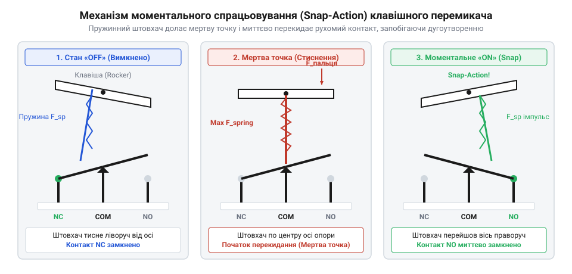
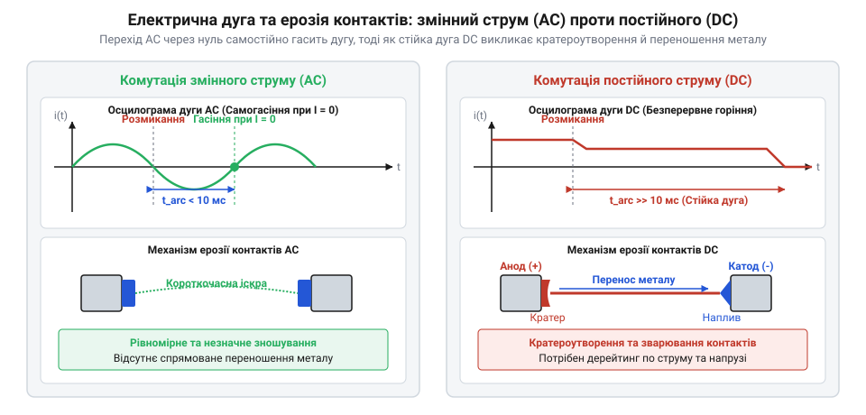
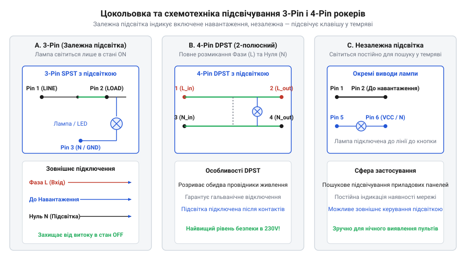
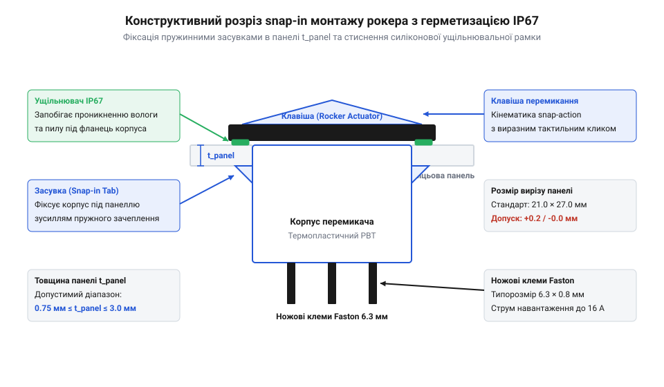

# Клавішні перемикачі (Rocker Switches) та силові панелі комутації

<preknowlist>
- [Тумблери, захисні ковпачки Mollie та блокування важелів (Switch Guards)](root:cat-hw-controls/toggle-switches-and-switch-guards) — Принципи роботи дискретних контактних груп, сухі та силові контакти, брязкіт контактів
- [DIP-перемикачі та джамперні блоки конфігурації](root:cat-hw-controls/dip-switches-and-configuration-blocks) — Конструктивні варіанти рокерних механізмів малої потужності
</preknowlist>

## Проблема захисту силових важелів комутації

Ввімкнення силових кіл обладнання пов'язане з ризиком випадкових зачіпань та електричної дуги (англ. @@en|electric arc@@). Класичні [тумблери із захисними ковпачками](root:cat-hw-controls/toggle-switches-and-switch-guards) мають виступаючі важелі, які легко ненавмисно зсунути.

Для захисту застосовують клавішний перемикач (від англ. @@en|rocker switch@@, де *rock* — гойдатися) з двоплечою коромисловою клавішею, утопленого в корпус. Дотичний удар лише ковзає по скосу клавіші, оскільки утоплена сторона спирається на корпус. Зусилля перемикання (англ. @@en|actuation force@@) має бути спрямоване суворо перпендикулярно до піднятого плеча, що відвертає випадкове спрацьовування одягом.

## Механізм моментального спрацьовування та брязкіт

Повільне розходження контактів під час силової комутації викликає тривалу руйнівну електричну дугу. Щоб запобігти оплавленню металу, металеве коромисло (англ. @@en|rocker bridge@@) та підпружинений штовхач розмикають коло миттєво.

При нахилі клавіші штовхач стискає пружину. Після проходження мертвої точки пружина випрямляється, перекидаючи коромисло зі швидкістю 0.5–1.0 м/с незалежно від руху пальця. Цей механізм моментального спрацьовування (англ. @@en|snap-action mechanism@@) гасить дугу, але спричиняє брязкіт контактів (англ. @@en|contact bounce@@) тривалістю 1–5 мс і мікроерозію площадок.

*Кінематика моментального спрацьовування: стиснення пружини під час нахилу клавіші та лавиноподібне перекидання коромисла після проходження мертвої точки.*

## Особливості комутації струмів та матеріали

У колах змінного струму (AC) дуга природно гасне при переході синусоїди через нуль, тоді як у колах постійного струму (DC) вона палає безперервно, спричиняючи інтенсивне зношення контактів. Комутація індуктивних навантажень викликає зворотну ЕРС (англ. @@en|back-EMF@@) та сплески напруги в кіловольти, а ємнісні кола утворюють колосальний пусковий струм (англ. @@en|inrush current@@).

Для захисту від дугового зварювання контактні накладки силових рокерів виготовляють зі спечених срібних композитів, таких як срібло-оксид олова (AgSnO2) та срібло-нікель (AgNi). Частинки оксиду олова не дозволяють рідкому металу утворити суцільний зварний шов при високих струмах. У слабострумових сигнальних сухих контактах (англ. @@en|dry contact@@) застосовують золочення. Порівняно з сигнальними [DIP-перемикачами](root:cat-hw-controls/dip-switches-and-configuration-blocks), рокери вимагають обов'язкового зниження номінального струму (дерейтингу) при переході з AC на DC напругу.

*Порівняльне горіння дуги при комутації змінних і постійних струмів та характер матеріального переносу між контактами.*

## Конфігурації контактів та підключення підсвічування

За залежною схемою індикації неонова лампа чи світлодіод з обмежувальним резистором підключаються між контактом навантаження та робочим нулем N, засвічуючись лише у стані ON. Своєю чергою, незалежна схема живить індикатор постійно через окремі клеми для орієнтування у темряві.

Найпростіший однополюсний вимикач SPST (англ. @@en|SPST@@) має 2 або 3 виводи (із нулем для індикатора) і розриває лише фазу. Двополюсний вимикач DPST (англ. @@en|DPST@@) на 4 виводи одночасно розмикає фазу й нуль, забезпечуючи повне гальванічне розв'язування мережі 230 В. Двополюсні перемикачі DPDT (англ. @@en|DPDT@@) застосовують для реверсу двигунів. Переплутування фази й нуля на 3-піновому рокері призводить до міжфазного короткого замикання при ввімкненні.

*Схеми підключення залежного й незалежного підсвічування для триконтактних і чотириконтактних рокерних перемикачів.*

## Монтаж панелей Snap-In та деградація

Безгвинтовий монтаж рокерів у прямокутні вирізи панелей виконують втисканням завдяки бічним пружним засувкам Snap-In (англ. @@en|snap-in@@) за товщини стінки від 0.75 до 3.0 мм. Для захисту від пилу та вологи до класу @@en|IP67@@ застосовують силіконові ковпачки або корпус із водовідвідними каналами.

Зношення контактів підвищує перехідний опір, викликаючи термічний розгін (англ. @@en|thermal runaway@@) і розплавлення пластикового корпусу під дією струму. При сильних пускових струмах можливе зварювання контактів (англ. @@en|contact welding@@), коли зворотна пружина не здатна відірвати спечений місток, заклинюючи рокер. Знос виявляють вимірюванням падіння напруги на контактах під навантаженням (понад 100 мВ свідчить про деградацію). У критичних кола захисту замість рокерів встановлюють [грибкові кнопки](root:cat-hw-controls/estop-mushroom-button) з примусовим розмиканням.

*Конструкція монтажу рокерної панелі у виріз корпусу з ущільнювальним силіконовим контуром класу IP67.*
