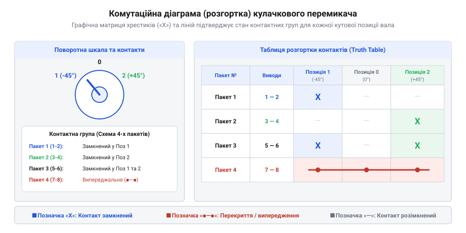
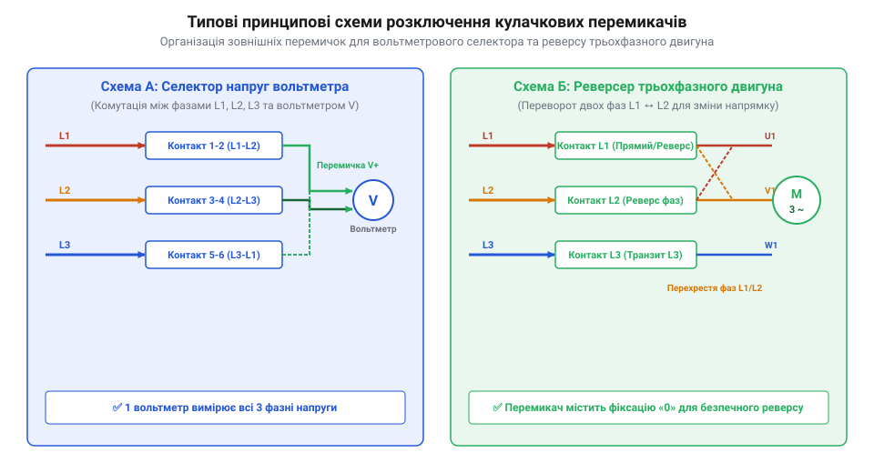

# Довідник комутаційних таблиць та принципових схем кулачкових перемикачів

<preknowlist>
- [Багатопозиційні галетні перемикачі (Rotary Switches)](root:cat-hw-controls/rotary-selector-switches) — поняття багатопозиційної комутації та дискретних контактних груп
</preknowlist>

## Структура комутаційних діаграм і таблиць контактів

Спроба підключити кулачковий перемикач @@en|cam switch@@ (від англ. @@en|cam@@ — кулачок, та @@en|switch@@ — перемикач) «наосліп» за номерами клем у силовій шафі неминуче призводить до коротких замикань або неправильного розподілу фаз. На відміну від простих тумблерів, багатопакетний кулачковий селектор складається з кількох ізольованих контактних пакетів @@en|contact deck@@ (від лат. @@la|contingere@@ — торкатися, та англ. @@en|deck@@ — ярус, настил), розміщених один за одним на спільному приводному валу. Кожен пакет містить власну контактну групу з рухомими містками, які розмикаються й замикаються під дією фігурних кулачкових шайб.

Основним технічним документом для монтажу та перевірки таких пристроїв є комутаційна діаграма розгортки @@en|switching diagram@@ (від англ. @@en|switching@@ — комутація, та грец. @@el|діаграмма@@ — креслення), або таблиця замкнення контактів.

*Графічна діаграма розгортки вала кулачкового перемикача з підключеннями термінальних пар для кожної кутової позиції.*

У цій таблиці вертикальні стовпчики відповідають фіксованим кутовим положенням рукоятки перемикача (наприклад, `-45°`, `0°`, `+45°` або `1`, `0`, `2`). Горизонтальні рядки позначають пари виводів окремих контактних пакетів. Наявність хрестика `✕` або зафарбованої цятки `●` у комірці означає, що у цьому положенні вала відповідна пара клем електрично замкнена. Для безпомилкового монтажу фахівець покроково співвідносить таблицю з корпусом: спершу визначає номер контактного пакета, рахуючи яруси уздовж вала від лицьової панелі до задньої кришки. Далі зіставляє цифрове маркування рядка (наприклад, клемну пару `1-2` для першого пакета чи `3-4` для другого) із фізичними виводами на пристрої, де непарні номери затискачів `1`, `3`, `5`, `7` розташовані на одному боці корпусу, а парні `2`, `4`, `6`, `8` — прямо навпроти на протилежному боці відповідного ярусу. Наостанок за таблицею перевіряють стан замкнення конкретної пари клем при повороті рукоятки у потрібний кутовий стовпчик, що усуває ризик помилкового трасування внутрішніх провідників.

Особливе місце на діаграмах розгортки посідають графічні позначення самоповернення та імпульсних контактних груп. Позиції рукоятки з пружинним поверненням (без механічної фіксації) позначають зігнутими стрілками `↷` або дугами над номером положення, які вказують напрямок автоматичного відскоку в нейтральний стан після зняття зусилля оператора. Спеціальні імпульсні контакти, які замикаються лише на короткочасний момент повороту вала або утримуються лише при примусовому тиску, позначають трикутними символами `▲` або дужками `(✕)` навколо позначки замкнення. Водночас для демонстрації кінематичної єдності кількох контактних пакетів використовують штрихові чи пунктирні лінії механічного зв'язку (англ. @@en|mechanical linkage line@@), які з'єднують центри рухомих містків на схемі, показуючи їхню одночасну синхронну дію від спільного кулачкового вала.

## Типи контактних груп і затримки переключення

При підключенні індуктивних навантажень або комутації вимірювальних кіл порядок спрацьовування контактних груп під час повороту вала стає критичним для безпеки. На відміну від малопотужних органів керування, таких як [багатопозиційні галетні перемикачі](root:cat-hw-controls/rotary-selector-switches) або [ротаційні кодові DIP-перемикачі](root:cat-hw-controls/rotary-dip-switches), кулачкові перемикачі безпосередньо керують струмами силових кіл величиною в десятки ампер.

За часовою послідовністю спрацьовування контакти поділяють на дві основні категорії:

1. Стандартні контакти розмикання-перед-замиканням @@en|break-before-make@@ (від англ. @@en|break@@ — розмикати, та @@en|make@@ — замикати), у яких попередня пара повністю розмикається до того, як замкнеться наступна. Це запобігає міжфазному короткому замиканню при переключенні ліній живлення.
2. Спеціальні перекривні контакти замикання-перед-розмиканням @@en|make-before-break@@, у яких наступний контакт замикається раніше, ніж розімкнеться попередній.

Застосування перекривних контактів є обов'язковим у вторинних колах трансформаторів струму, де розмикання кола під навантаженням викликає смертельну небезпеку. При розриві вторинного кола струм первинної обмотки примусово заганяє феромагнітний сердечник у глибоке насичення, викликаючи надвисоку швидкість зміни магнітного потоку `dФ/dt`. Згідно з законом індукції, це генерує на відкритих затискачах імпульсні сплески напруги в кілька кіловольт, що призводить до дугового пробою міжконтактного ізоляційного зазору, вибухового руйнування вимірювальних приладів та ураження оператора. Перекривні контакти `make-before-break` підключають шунтувальну лінію до моменту розриву попереднього з'єднання, підтримуючи коло безперервно замкненим. Кулачки асиметричного профілю також формують випереджальні @@en|early-make@@ та запізнілі @@en|late-break@@ контактні групи для подачі допоміжної напруги керування до ввімкнення основних силових полюсів.

Яскравим прикладом застосування випереджальних контактів є перемикачі запусків асинхронних електродвигунів за схемою зірка-трикутник (англ. @@en|star-delta starter@@). Під час повороту ручки у позицію «Зірка» допоміжний випереджальний контакт `early-make` замикається першим, подаючи живлення на котушку головного контактора до моменту з'єднання силових обмоток перемикачем. Завдяки цьому саме силовий контактор сприймає первинний пусковий струм і дуговий удар, розвантажуючи механічні губки кулачкового перемикача та запобігаючи руйнуванню його контактних поверхонь.

## Принципові схеми розключення типових перемикачів

Для виконання складних функцій переключення окремі контактні пакети об'єднують зовні за допомогою дротяних перемичок @@en|jumper link@@ (від англ. @@en|jumper@@ — перемичка, та @@en|link@@ — ланка). Таке з'єднання перетворює дискретні пари контактів на фазові селектори або реверсивні перемикачі.

*Принципова схема з'єднань зовнішніх перемичок та підключення фаз у вольтметровому селекторі та реверсивному перемикачі.*

У трифазному вольтметровому перемикачі @@en|voltmeter selector switch@@ (від фр. @@fr|volt@@ — вольт, та англ. @@en|selector@@ — вибирач) кулачковий механізм почергово комутує один щитовий прилад між фазними провідниками `L1`, `L2`, `L3` та нейтраллю `N`. Це дозволяє вимірювати три лінійні напруги `L1-L2`, `L2-L3`, `L3-L1` та три фазні напруги `L1-N`, `L2-N`, `L3-N` за допомогою одного аналогового або цифрового вольтметра.

Для реверсу трифазних асинхронних двигунів перемикач змінює місцями дві фази живлення `L1` та `L2` при переході з позиції `1` у позицію `2`, залишаючи фазу `L3` незмінною. Нульове положення `0` забезпечує повний розрив усіх трьох силових фаз для безпечної зупинки приводу.

Для двошвидкісних трифазних двигунів застосовують кулачкове розключення за схемою Даландера (від прізвища винахідника Роберта Даландера — швед. @@sv|Dahlander@@), яка перемикає обмотки статора між з'єднанням трикутником (низька швидкість) та подвійною зіркою (висока швидкість, англ. @@en|double star connection@@). У першій позиції ручки селектор подає мережеві фази на три основні виводи обмоток, у той час як три проміжні виводи лишаються розімкненими. При повороті у другу позицію кінематика кулачкового вала забезпечує сувору часову послідовність: фасонні виступи кулачків спочатку скидають штовхачі трьох основних силових контактів, примусово розмикаючи коло трикутника, а при подальшому обертанні кулачки наступного ярусу одночасно замикають закорочувальний місток нульової точки та подають живлення на проміжні виводи. Така кутова геометрія кулачкового профілю унеможливлює перекриття станів, що змінює кількість полюсів статора у співвідношенні 2:1 і подвоює частоту обертання ротора без ризику міжфазного короткого замикання. На відміну від слабких кіл керування, якими оперують [галетні перемикачі](root:cat-hw-controls/rotary-selector-switches), багатопакетне кулачкове розключення за цією схемою вимагає синхронної магістральної комутації шести незалежних силових контактних груп у межах одного пристрою.

## Діагностика та усунення помилок комутації

У разі виникнення збоїв в автоматиці або невірного відображення напруг першим кроком є перевірка цілісності контактних груп за допомогою прозвонки @@en|continuity test@@ (від лат. @@la|continuus@@ — безперервний, та англ. @@en|test@@ — перевірка). Перевірку виконують лише при повністю знеструмленому щиті.

Перевірка проводиться за таким алгоритмом:

1. Рукоятку перемикача встановлюють у перевіряєму фіксовану позицію `k`.
2. Мультиметром у режимі вимірювання опору перевіряють стан кожної пари клем за комутаційною таблицею: для замкнених контактів опір `R_contact` не повинен перевищувати `0.5 Ω`.
3. Для розімкнених контактів опір ізоляції `R_iso` має прямувати до нескінченності (понад `1 MΩ`).

Найпоширенішими несправностями є помилкове встановлення зовнішніх перемичок між пакетами, ерозія контактів @@en|contact erosion@@ (від лат. @@la|erosio@@ — роз'їдання) через комутаційні дуги під навантаженням та механічний люфт приводного вала. Заміна зношеного контактного пакета або відновлення перемичок дозволяє повернути працездатність селектора без заміни всього апарата.

При незначному обвуглюванні контактних поверхонь усунути нагар дозволяє обробка спеціалізованим очищувальним спреєм (англ. @@en|contact cleaner spray@@, від @@en|cleaner@@ — очисник). Фізико-хімічний механізм дії засобу спирається на високу капілярну проникність легких розчинників та відновних компонентів: хімікат розщеплює органічні вуглецеві зв'язки нагару й розчиняє оксидні та сульфідні плівки на робочих плямах. На відміну від абразивного зачищення наждачним папером, яке здирає тонкий мікронний шар сріблення й оголює латунь для швидкої повторної корозії, спрей діє селективно й випаровується без залишку, повністю відновлюючи низький перехідний опір `R_contact` без механічного пошкодження срібного покриття накладок. Якщо ж комутаційні дуги утворили глибокі ерозійні раковини або термічно деформували пружини, хімічна обробка є неефективною: пошкоджений контактний пакет @@en|contact deck@@ демонтують зі стяжних шпильок і замінюють окремим новим модулем.
