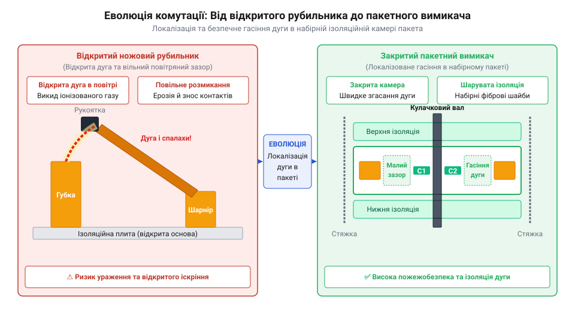
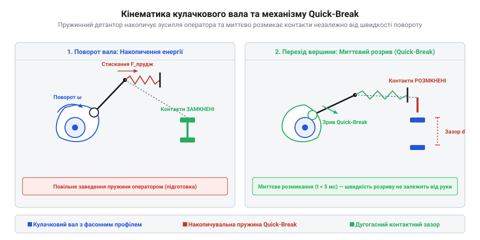

# Еволюція кулачкових та пакетних перемикачів

<preknowlist>
- [Кулачкові перемикачі (Cam Switches) та пакетні вимикачі](root:cat-hw-controls/rotary-cam-switches) — сучасна конструкція та принципові схеми кулачкових перемикачів
- [Багатопозиційні галетні перемикачі (Rotary Switches)](root:cat-hw-controls/rotary-selector-switches) — відмінності між слабострумовою галетною комутацією та силовими пакетними вимикачами
</preknowlist>

## Проблема відкритих дуг ножових рубильників

На початку XX століття промислова електрифікація спиралася на прості відкриті ножові рубильники (англ. @@en|knife switch@@, від @@en|knife@@ — ніж). Пристрої у вигляді відкритих мідних лез на мармурових чи гетинаксових щитах забезпечували прямий контакт, проте комутація силових кіл під навантаженням створювала смертельну небезпеку для оператора та обладнання. Під час розмикання ножів під струмом між контактами виникав високовольтний дуговий розряд (англ. @@en|electric arc@@, від @@en|arc@@ — дуга): іонізований повітряний проміжок перетворювався на плазмовий шнур з температурою в кілька тисяч градусів. Конструктивні основи таких пристроїв заклали перші патентні заявки американського винахідника Томаса Едісона (англ. @@en|Thomas Edison@@) у 1880-х роках та інженера Артура Істмана (англ. @@en|Arthur C. Eastman@@) у 1891 році, однак первинна відкрита концепція не мала розрахунку на гасіння високоенергетичної дуги в промислових мережах. Eastman@@) у 1891 році (патент США № 456,801), однак первинна відкрита концепція не мала розрахунку на гасіння високоенергетичної дуги в промислових мережах.

Головною вадою ножових рубильників була залежність тривалості горіння дуги від швидкості руху руки оператора. При нерішучому або повільному повертанні рукоятки електрична дуга палала тривалий час, викликаючи інтенсивну термічну ерозію контактів, випаровування металу та ризик виникнення міжфазного короткого замикання через розплавлені бризки міді. Відкрита конструкція не мала засобів примусового гасіння дуги, тому вимикання високих струмів супроводжувалося потужними вибухоподібними спалахами та виділенням токсичних газів. Фізичний механізм гасіння вимагав розтягування дугового каналу при розведенні лез: напруга падіння на плазмовому шнурі зростала пропорційно його довжині `l_arc`, і самогасіння відбувалося лише тоді, коли спад напруги на дузі перевищував напругу джерела живлення. Для промислових мереж 220–380 В критична величина повітряного відриву `d_crit` для природного розриву неухолодженої дуги досягала 15–30 см, тому при повільному відводі ножа міжконтактний проміжок тривалий час залишався меншим за критичну межу `d(t) < d_crit`. Необхідність безпечного розтягування та ізоляції відкритого дугового спалаху вимагала гігантських міжфазних відстаней, що робило розподільчі щити надзвичайно громіздкими.

При повільному відводі леза площа контактного дотику зменшується до мікроскопічних виступів, через що щільність струму в них різко зростає. Струм розігріває ці точкові перемички за законом Джоуля — Ленца аж до розплавлення й кипіння міді, а під час їхнього розриву відбувається мікровибух рідкого металу. Поки рукоятка рухається мляво, міжконтактний повітряний проміжок лишається занадто малим для самогасіння, тому розсіювана плазмою теплова потужність випалює робочі поверхні. Така ерозія спотворює геометрію ножів та вкриває їх плівкою оксидів з високим опором, що під час наступних комутацій спричиняє критичний розігрів і призводить до зварювання контактів (англ. @@en|contact welding@@, від @@en|weld@@ — зварювати).

## Винайдення пакетного ізольованого секціонування

Поштовхом до створення компактної та безпечної силової апаратури на початку 1920-х років стало винайдення пакетної конструкції перемикачів (англ. @@en|packet switch@@, від @@en|packet@@ — пакунок). Інженери відмовилися від відкритих плоских панелей на користь модульного набору закритих ізоляційних секцій-пакетів. Перші конструкції 1910-х років виготовлялися з пресованого фібрового картону та вулканізованої гуми, проте вони швидко обвуглювалися під дією електричної дуги. Справжній технологічний зсув відбувся після масового освоєння гарячого пресування термореактивних фенолформальдегідних смол, запатентованих Лео Бакеландом у 1907 році. У середині 1920-х років промислове впровадження бакеліту (англ. @@en|bakelite@@, від прізвища винахідника Лео Бакеланда) дозволило штампувати термостійкі та вологонепроникні ізоляційні шайби складної форми з високою механічною міцністю. Усередині кожного бакелітового пакета розміщувалася окрема контактна пара, а через центр усієї стопки проходив спільний поворотний вал.

*Еволюційна трансформація відкритих контактів рубильника у закриту набірну камеру пакетного перемикача.*

Замикання контактного вузла всередині вузької закритої камери кардинально змінило фізику дугогасіння та геометричні масштаби пристрою. Розрахункове порівняння засвідчує цей конструктивний стрибок: відкритий трифазний ножовий рубильник вимагав безпечної міжосьової відстані між ножами не менше 100–150 мм для запобігання перекриттю плазмовою дугою, що розросталася у відкритому повітрі на довжину до 80 мм і потребувала робочої площі щита понад 1000 см². У закритому бакелітовому пакеті контактний вузол ізольовано в камері об'ємом усього 15–20 см³ з міжкамерною стінкою 2–3 мм, а розмикання контактів відбувається на відстані лише 4–6 мм. При розмиканні контактів електрична дуга опиняється в обмеженому об'ємі між стінками пакета, де охолоджується від контакту з диелектриком та швидше гасне за рахунок стрімкого зростання тиску газів. Порівняно з пристроями слабострумової комутації, такими як [багатопозиційні галетні перемикачі (Rotary Switches)](root:cat-hw-controls/rotary-selector-switches), пакетна схема забезпечила високу електричну міцність між сусідніми полюсами, скоротила габаритну площу монтажу більш ніж на 85% та дозволила збирати багатоланцюгові силові селектори на єдиній осі у компактному об'ємі.

Фізичний механізм гасіння розгортався за рахунок автогенерації високого тиску: висока температура електричної дуги викликала локальне термічне розкладання внутрішніх стінок бакелітового пакета з виділенням охолоджувальних газів, що стрімко піднімало тиск у закритому об'ємі камери. Зростання тиску підвищувало інтенсивність деіонізації плазмового стовпа та електричну міцність міжконтактного проміжку, а обмежена геометрія пакета фізично стискала дугу й прискорювала відвід тепла до холодних стінок. Завдяки цьому горіння дуги припинялося за лічені мілісекунди після розходження контактних поверхонь, що усувало загрозу руйнівного міжфазного пробою та дозволяло створювати надійні силові селектори для індустріальних мереж високої потужності.

## Кулачковий вал та механізми миттєвого розмикання

Подальшим еволюційним кроком у середині XX століття стало впровадження кулачкового вала (англ. @@en|cam shaft@@, від @@en|cam@@ — кулачок). Замість обертальних контактних диво-пакетів інженери розробили центральний вал з фасонними виступами-кулачками, які при повороті примусово віджимали або звільняли пружні контактні містки. Першопрохідцями цього напряму виступили європейські компанії, зокрема австрійсько-німецька фірма @@en|Kraus & Naimer@@, яка інтегрувала пружинні акумулятори ходу у приводні механізми прискорювачів @@en|Quick-break@@. Внутрішній спіральний акумулятор накопичував механічне зусилля руки оператора і розряджався при досягненні фіксованого кута, завдяки чому примусове розмикання контактів відбувалося з високою швидкістю навіть при повільному обертанні зовнішнього селектора. Це дозволило реалізувати довільні комбінації замикання й розмикання десятків незалежних електричних кіл в одному пристрої, формуючи складні діаграми комутації для запуску трифазних двигунів та перемикання обмоток трансформаторів так само, як і в сучасних [багатопозиційних галетних перемикачах (Rotary Switches)](root:cat-hw-controls/rotary-selector-switches).

*Принцип дії кулачкового штовхача та пружинного прискорювача миттєвого розмикання.*

Для повного усунення впливу людського чинника на швидкість комутації в конструкцію кулачкових перемикачів інтегрували механізм миттєвого спрацьовування (англ. @@en|quick-break mechanism@@, від @@en|quick-break@@ — миттєве розмикання). Обертання рукоятки оператором спочатку стискає внутрішню пружину-акумулятор енергії, а при досягненні критичного кута фіксатор звільняє вал, і пружина миттєво повертає кулачки. Швидкість розмикання контактів стала абсолютно незалежною від того, наскільки повільно оператор повертає зовнішню ручку, що звело час горіння дуги до кількох мілісекунд і суттєво підвищило механічний та електричний ресурс пристрою.

Кінематика цього прискорювача спиралася на мертву точку перевалистого важеля: під час обертання ручки повзун стискав кручену пружину, тоді як засувка утримувала кулачковий вал у нерухомому стані до проходження фіксованого кута розчеплення (зазвичай `15°–20°`). Щойно важіль доходив до геометричного порогу соскочування, засувка миттєво виходила з зачеплення, і накопичена пружна енергія вивільнялася за кілька мілісекунд, розганяючи кулачки до кутової швидкості понад `100` рад/с незалежно від повільного руху руки оператора.

## Сучасні кулачкові перемикачі та спростування міфів

З появою потужних напівпровідникових ключових елементів виник поширений міф про повне моральне старіння та витіснення механічної комутаційної апаратури. Проте в силовій електроенергетиці та промисловості [кулачкові перемикачі (Cam Switches) та пакетні вимикачі](root:cat-hw-controls/rotary-cam-switches) залишаються незамінними вузлами для байпасних кіл, аварійного вводу резерву та локальної ізоляції обладнання. Кількісне порівняння параметрів витримуваної напруги пояснює цей фундаментальний розрив: потужні напівпровідникові ключі (тиристори та IGBT-модулі) мають граничну пікову зворотно-заперту напругу в межах від 600 В до 1700 В, і будь-яка короткочасна перенапруга, що перевищує кристалічний поріг на 20–30%, викликає пробій та теплове руйнування P-N переходу. Натомість механічні контакти кулачкових перемикачів із повітряним зазором (англ. @@en|air gap@@) у 3–6 мм забезпечують витримувану імпульсну напругу (від англ. @@en|impulse withstand voltage@@, позначувану як `U_imp`) на рівні 6–8 кВ відповідно до стандарту IEC 60947-3, без жодного ризику хибного відкриття чи пошкодження елементів.

Головною перевагою механічного кулачкового розмикання над твердотільними ключами є забезпечення абсолютної гальванічної розв'язки з видимим або гарантованим повітряним проміжком. Напівпровідникові прилади піддаються витокам струму в закритому стані та вразливі до пробою імпульсними перенапругами, тоді як механічні контакти кулачкових селекторів витримують багатократні перенапруги та короткі замикання без хибних спрацьовувань. На відміну від малогабаритних шифрувальних елементів, таких як [ротаційні кодові DIP-перемикачі (Rotary DIP Switches)](root:cat-hw-controls/rotary-dip-switches), силові кулачкові вимикачі забезпечують надійне ручне керування у важких кліматичних умовах та при високих вібраціях.

Фізико-хімічна причина цієї стійкості полягає у відсутності носіїв заряду в розімкненому повітряному зазорі (@@en|air gap@@, від англійського *air gap* — повітряний проміжок). На відміну від напівпровідникових P-N переходів, де в закритому стані завжди протікає паразитний витік струму (@@en|leakage current@@, від англійського *leakage current* — струм витоку), фізично розімкнені срібні контакти забезпечують абсолютно нульовий витік. Електрична міцність сухого повітря становить близько 3 кВ на міліметр зазору, тому повітряний проміжок у кілька міліметрів разом із дугогасними перегородками створює непереборний бар'єр для високовольтних імпульсних сплесків та грозових перенапруг. Це унеможливлює самовільне пробивання кола чи хибне відкриття замукання, що робить механічний кулачковий селектор єдиним гарантом безпеки при аварійних збоях мережі.
