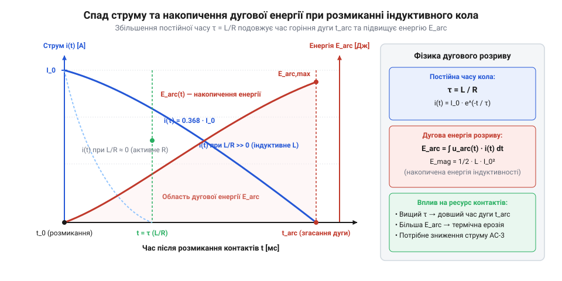
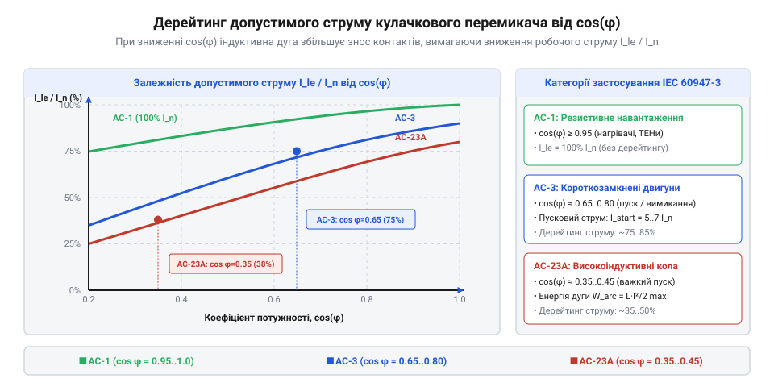

# Математичний розрахунок навантаження та електричної дуги кулачкового перемикача

<preknowlist>
- [Багатопозиційні галетні перемикачі (Rotary Switches)](root:cat-hw-controls/rotary-selector-switches) — фізичні принципи механічного комутування контактних груп
- [Оптичні та механічні інкрементальні енкодери](root:cat-hw-controls/rotary-encoders-quadrature) — поняття контактного брязкоту та перехідного опору контактів
</preknowlist>

## Джоулеве розсіювання на контактному опорі

Під час тривалого протікання електричного струму крізь замкнені контакти кулачкового перемикача фізична площа дійсного металевого дотику обмежена мікроскопічними виступами шорсткості поверхні — плямами стягування. Це звуження струмового потоку формує перехідний контактний опір `R_c` (англ. @@en|contact resistance@@). Оскільки струм локалізується у вузьких мікровиступах, джоулеве тепло розігріває безпосередньо зону дотику до локальної температури, що значно перевищує температуру масивних контактних тримачів. Срібні металокерамічні сплави контактів мають позитивний температурний коефіцієнт питомого опору `α` (англ. @@en|temperature coefficient of resistance@@, від @@en|coefficient@@ — сумісний чинник). Через це із підвищенням температури плями стягування питомий опір матеріалу `ρ(T)` зростає за залежністю `ρ(T) = ρ_0 · (1 + α · ΔT)`. Внаслідок цього контактний опір `R_c` додатково збільшується при нагріві, формуючи позитивний тепловий зворотний зв'язок: вища температура підвищує `R_c`, що збільшує локальне тепловиділення й прискорює термічну деформацію плями дотику. Динаміка цього процесу істотно залежить від складу контактного покриття: у чистому сріблі при досягненні температури розм'якшення `T_soft` матеріал під дією притискного зусилля пластично сплющується, розширюючи площу плями стягування й тимчасово знижуючи `R_c`, тоді як у композитах із домішками оксидів олова чи нікелю (AgSnO₂ / AgNi) тугоплавкий каркас перешкоджає плинності металу. Це зберігає геометрію контакту при вищих температурах, захищаючи поверхню від мікрозварювання під час кидків струму.

Відповідно до закону Джоуля — Ленца (англ. @@en|Joule heating@@), електрична потужність `P_c`, що перетворюється на теплову енергію безпосередньо у зоні контактної плями, визначається квадратом діючого струму `I_rms`:

    P_c = I_rms² · R_c                         [потужність джоулевого розсіювання]

Для багатополюсного перемикача з кількістю послідовних контактних пар `n` сумарне тепловиділення контактного блоку обчислюється як:

    P_total = n · I_rms² · R_c                 [сумарні джоулеві втрати блоку]

Усталена температура контактного вузла `T_c` перевищує температуру навколишнього середовища `T_amb` на величину температурного зростання `ΔT_c`, яке залежить від еквівалентного теплового опору `R_th` конструктивних елементів полюса до повітря:

    ΔT_c = P_c · R_th                          [температурне зростання контакту]
    = I_rms² · R_c · R_th                      [підстановка джоулевої потужності]

Якщо температура `T_c = T_amb + ΔT_c` досягає порогу розм'якшення або плавлення срібного металокерамічного сплаву контактів (наприклад, AgNi або AgCdO), виникає пластична деформація плями стягування та сварка контактних поверхневих містків. Щоб запобігти термічній руйнації, граничний тривалий струм `I_th` (усталений термічний струм) не повинен перевищувати розрахункової межі:

    I_th = √((T_max - T_amb) ÷ (R_c · R_th))    [гранично допустимий термічний струм]

тут `T_max` — максимально припустима температура контакту. Отримане значення `I_th` визначає межу термічної стійкості перемикача при статичному протіканні струму, на відміну від низькоамперного контактного брязкоту в [поворотному енкодері KY-040](root:cat-hw-controls/ky-040-encoder) чи [ротаційних кодових перемикачах](root:cat-hw-controls/rotary-dip-switches).

## Індуктивна енергія та електрична дуга розмикання

При комутації індуктивних навантажень (обмоток електродвигунів, соленоїдів, трансформаторів) процес розмикання супроводжується виділенням накопиченої магнітної енергії `E_mag`, що перешкоджає швидкому спаду струму. Під час раптового згасання або обриву дугового шнура стрімка зміна струму в часі `di/dt` генерує пікову відновлювану перенапругу самоіндукції `u_peak` (англ. @@en|transient recovery voltage@@, від @@en|transient@@ — перехідний), яка прикладається до міжконтактного зазору. Тривалість існування дугового каналу безпосередньо визначається механічною швидкістю розходження контактів `v_sep = dx/dt`. Чим вища швидкість `v_sep`, тим швидше розтягується міжконтактний проміжок `x_arc(t) = v_sep · t`, що викликає стрімке зростання градієнта електричного опору плазми `R_arc(t)` та прискорене охолодження дуги довколишнім повітрям. Для забезпечення швидкого розриву плазмового шнура незалежно від швидкості обертання ручки оператором у кулачкових перемикачах застосовують пружинний прискорювальний механізм (англ. @@en|quick-break mechanism@@), що підтримує критичну швидкість розмикання `v_sep ≥ 0.5..1.0 м/с` та упереджує затяжне горіння дуги.

    u_peak = U_0 + L · |di / dt|                [пікова відновлювана перенапруга]

тут `U_0` — миттєве значення напруги джерела живлення, `L` — індуктивність комутованого кола, а `|di/dt|` — крутизна зрізу струму при розриві дуги. Оскільки величина `|di/dt|` при швидкому розмиканні контактів може досягати значних величин, імпульсний сплеск `u_peak` у кілька разів перевищує амплітуду мережевої напруги, створюючи ризик повторного електричного пробою ізоляційного проміжку.

    E_mag = (1 ÷ 2) · L · I₀²                   [накопичена магнітна енергія]

тут `L` — індуктивність кола, а `I₀` — струм у момент початку розходження контактних накладка. Під час механічного розмикання пружних контактних пелюсток при `t = 0` опір міжконтактного проміжку стрімко зростає. Спад струму `i(t)` в індуктивному колі описується експоненціальним законом (англ. @@en|exponential decay@@) з постійною часу `τ = L / R` (англ. @@en|time constant@@):

    i(t) = I₀ · e⁻ᵗ ⁽ᴿ ⁺ ᴿᵃʳᶜ⁾ ⁾ Ⓛ               [експоненціальний спад струму з урахуванням дуги]

Висока ЕРС самоіндукції `u_L(t) = -L · (di/dt)` викликає електричний пробій повітряного проміжку з утворенням високотемпературної плазмової ствола — електричної дуги (англ. @@en|electric arc@@).


*Експоненціальний спад струму та накопичення дугової енергії в L/R індуктивному колі.*

Повна енергія дуги `E_arc`, що виділяється у міжконтактному зазорі за час її горіння `t_arc`, обчислюється через інтеграл миттєвої дугової потужності `p_arc(t) = u_arc(t) · i(t)`:

    E_arc = ∫₀ᵗᵃʳᶜ u_arc(t) · i(t) dt           [інтеграл дугової енергії]
    = U_arc · I₀ · ∫₀ᵗᵃʳᶜ e⁻ᵗ ⁄ τ dt            [при сталій напрузі дуги U_arc]
    = U_arc · I₀ · τ · (1 - e⁻ᵗᵃʳᶜ ⁄ τ)         [виділена енергія дуги в L/R колі]

Зі зростанням постійної часу `τ = L / R` (від 1 мс у чисто активних колах до 15–50 мс в індуктивних промислових мережах) виділена дугова енергія `E_arc` пропорційно збільшується, викликаючи випаровування срібного матеріалу контактів та термічну ерозію.

## Коефіцієнт потужності cos(φ) та дугове зношування

У колах змінного струму тривалість горіння дуги визначається не лише індуктивністю, а й коефіцієнтом потужності `cos(φ)` (англ. @@en|power factor@@), який описує кут фазового зсуву `φ` між напругою `u(t) = U_peak · sin(ωt)` та струмом `i(t) = I_peak · sin(ωt - φ)`. Математична модель пробою міжконтактного проміжку після переходу струму через нуль розглядає два послідовні конкурентні механізми — тепловий та електричний пробій. Тепловий пробій (від грецького *therme* — тепло) визначається енергетичним балансом залишкового плазмового стовпа у перші мікросекунди після згасання: виділення джоулевої потужності `P_heat(t) = (u_recovery(t))² · G_post(t)` за рахунок залишкової провідності `G_post(t)` порівнюється з швидкістю охолодження й тепловідведення `P_cool(t)` у контактні електроди. Якщо джоулів нагрів перевищує тепловідведення (`P_heat(t) > P_cool(t)`), температура каналу стрімко зростає, підтримуючи термічну іонізацію. Математичний розрахунок процесів деіонізації (@@en|deionization@@, від французького *dés-* — вилучення та грецького *ion* — іон) та охолодження плазмового стовпа у момент нульового струму (`i(t) = 0`) спирається на рівняння балансу провідності Майра `dG_post / dt = (1 / τ_arc) · (P_heat / P_cool - 1) · G_post`, де `τ_arc` — постійна часу охолодження (англ. @@en|arc time constant@@). Оскільки при `i(t) = 0` миттєве виділення джоулевої потужності прямує до нуля (`P_heat = 0`), залишкова провідність плазми релаксує за експоненціальним законом `G_post(t) = G_0 · exp(-t / τ_arc)`, де `G_0` — провідність каналу на початку паузи струму. Якщо тепловий баланс залишається від'ємним і плазма охолоджується завдяки швидкій рекомбінації носіїв заряду, подальша доля дуги визначається електричним пробоєм: повторний спалах виникає у разі, коли швидкість наростання відновлюваної напруги `du_recovery / dt` перевищує швидкість відновлення електричної міцності газового проміжку `du_dielectric / dt`, а миттєва відновлювана напруга сягає порогу автоіонізації `u_recovery(t) ≥ U_breakdown(t)`.

Гасіння дуги змінного струму природним чином відбувається в момент переходу струму через нульове значення (`i(t) = 0`). Проте дуга здатна повторно спалахувати, якщо відновлювана напруга на контактах `u_rec(t)` зростає швидше за електричну міцність газового проміжку. У момент нульового струму `ωt = φ` миттєве значення відновлюваної напруги джерела становить:

    u_recovery = U_peak · sin(φ) = U_peak · √(1 - cos²(φ))    [відновлювана напруга на контактах]

Для чисто активного навантаження (`cos(φ) = 1`, `φ = 0`) відновлювана напруга у момент нульового струму дорівнює нулю (`u_recovery = 0`), що забезпечує легке згасання дуги. Для індуктивних навантажень (категорія `AC-3` для пуску двигунів із `cos(φ) = 0.35` або `AC-23` для перемикання високонавантажених кіл із `cos(φ) = 0.45`) кут `φ ≈ 70°`, тому відновлювана напруга досягає пікових значень `u_recovery ≈ 0.94 · U_peak`.

Це викликає повторні пробої дугового проміжку, подовжує час горіння дуги `t_arc` і стрімко збільшує об'єм ерозованого матеріалу контактів `V_erode`:

    V_erode = k_mat · ∫₀ᵗᵃʳᶜ i(t)¹.⁵ dt         [об'єм анодно-катодної ерозії контактів]

тут `k_mat` — коефіцієнт дугової стійкості матеріалу. Для збереження нормативного комутаційного ресурсу виробники застосовують коефіцієнт зниження номінального струму — дерейтинг (англ. @@en|derating@@, від @@en|de-@@ — зниження та @@en|rating@@ — номінал).


*Залежність допустимого комутаційного струму кулачкового перемикача від коефіцієнта потужності cos(φ) для категорій AC-3 і AC-23.*

Відповідно до стандарту IEC 60947-3, коефіцієнт зниження струму `k_derate` залежно від категорії застосування (англ. @@en|utilization category@@) обчислюється як:

    k_derate = cos(φ) ÷ cos(φ_nominal)          [коефіцієнт зниження струму]
    I_allowed = I_AC1 · k_derate               [допустимий робочий струм]

При роботі в категорії `AC-23` зниження `cos(φ)` до 0.45 зменшує допустимий струм `I_allowed` до 45–65% від номіналу активного навантаження `I_AC1`, що захищає контакти у потужних [багатопозиційних галетних перемикачах](root:cat-hw-controls/rotary-selector-switches) від передчасного виходу з ладу.

## Категорії застосування AC-3 та AC-23 і коефіцієнти зниження

У колах змінного струму комутація чисто активного навантаження (категорія AC-1, `cos(φ) ≥ 0.95`) не створює високих напруг відновлення. Проте підключення та вимкнення асинхронних електродвигунів або трансформаторів супроводжується багатократними пусковими кидками струму та виділенням значної дугової енергії. Для нормалізації умов експлуатації стандарти визначають категорії застосування (англ. @@en|utilization category@@), кожна з яких характеризується власним співвідношенням струму замикання `I_make` та розмикання `I_break` до номінального робочого струму `I_e`. У трансформаторних навантаженнях первинний намагнічувальний кидок `I_make` через насичення осердя може досягати `12..20 × I_e`, що вимагає додаткового зниження допустимого струму. Ще жорсткіші умови комутації виникають у колах постійного струму за категоріями DC-3 (перемикання та динамічне гальмування двигунів паралельного збудження, `L/R ≤ 2 мс`) та DC-5 (двигуни послідовного збудження, `L/R ≤ 7.5 мс`), де відсутнє природне періодичне переходження струму через нуль. У режимах DC-3/DC-5 сумарна виділена дугова енергія розмикання `E_arc_DC` розраховується через накопичену індуктивну енергію та співвідношення напруг: `E_arc_DC = (1 ÷ 2) · L · I_e² · (U_arc ÷ (U_arc - U_DC))`, де `U_DC` — напруга мережі, а `U_arc = n_s · U_pole` — загальна напруга дуги на `n_s` послідовних полюсах. Оскільки при `L/R` до 7.5–15 мс знаменник виразу вимагає перевищення `U_arc > U_DC`, підсумковий коефіцієнт зниження номіналу `k_DC` обчислюється як `k_DC = n_s ÷ (1 + (L/R) ÷ τ_ref)`, що робить послідовне зшивання полюсів єдиним способом запобігти термічному випаровуванню контактних губок.

Для активного навантаження AC-1 характерні співвідношення `I_make / I_e = 1.0` та `cos(φ) = 0.95`. Категорія AC-3 (пуск і вимкнення двигунів з короткозамкненим ротором під час руху) задає `I_make / I_e = 6.0`, `I_break / I_e = 1.0` та `cos(φ) = 0.35`. Найсуворіша категорія AC-23 (перемикання важких моторизованих та високоіндуктивних навантажень) вимагає комутації `I_make / I_e = 10.0` та `I_break / I_e = 10.0` при `cos(φ) = 0.35`.

Для забезпечення надійності застосовується розрахунковий коефіцієнт зниження номіналу або дерейтинг (англ. @@en|derating@@, від @@en|rate@@ — оцінювати). Допустимий робочий струм `I_allow` обчислюється через номінальний термічний струм `I_th` та коефіцієнт зниження `k_derate`:

```
k_derate = 1 / √(1 + (I_make / I_e - 1) × (1 - cos(φ)))
```
[Крок 1: обчислення відносного термічного та дугового навантаження контактів]

```
I_allow  = I_th × k_derate
```
[Крок 2: визначення максимального робочого струму для обраної категорії]

**Обчислення допустимого струму для категорії AC-23:**
```
I_th     = 25 A
I_make / I_e = 10.0
cos(φ)   = 0.35

k_derate = 1 / √(1 + (10 - 1) × (1 - 0.35))
         = 1 / √(1 + 9 × 0.65)
         = 1 / √(1 + 5.85)
         = 1 / √6.85
         ≈ 0.382

I_allow  = 25 × 0.382
         ≈ 9.55 A
```
Висновок: перемикач з номінальним термічним струмом 25 А в режимі важкої індуктивної комутації AC-23 спроможний безпечно комутувати струм не більше 9.55 А.

## Обґрунтування комутаційного ресурсу та вибір контактів

Підсумкова придатність кулачкового перемикача визначається розрахунком його довговічності. Загальний термін служби обмежений механічним зносом `N_mech` та електричною зносостійкістю (англ. @@en|electrical endurance@@, від @@en|endure@@ — витримувати). Електричний ресурс `N_elec` залежить від дугової ерозії (англ. @@en|arc erosion@@, від @@en|arc@@ — дуга та @@en|erode@@ — роз'їдати) матеріалу контактних містків і знижується за степеневим законом при зростанні робочого струму `I_op` відносно номінального `I_e`. При цьому нерівномірна частота перемикань (англ. @@en|switching frequency@@, від @@en|switch@@ — перемикати та @@en|frequency@@ — частота) викликає локальні термічні піки через недорозсіювання тепла дуги між близькими операціями. Імовірнісне відхилення ресурсу (англ. @@en|standard deviation@@, від @@en|standard@@ — стандартний та @@en|deviate@@ — відхилятися) в умовах стохастичного профілю підпорядковується розподілу Вейбулла (англ. @@en|Weibull distribution@@, на честь @@en|Waloddi Weibull@@ — Валодді Вейбулла) та розраховується за формулою `σ_N = N_elec · k_th · (σ_t ÷ t_avg)`, де `σ_t` — середньоквадратичне відхилення часового інтервалу між операціями, `t_avg` — середній період комутації, а `k_th` — коефіцієнт теплової пам'яті контактної маси, що при високій варіативності імпульсів знижує підсумковий ресурс пропорційно `(1 - σ_N ÷ N_elec)`.

```
N_elec = N_base × (I_e / I_op)ⁿ
```
[де N_base — паспортний ресурс при номінальному струмі, n — показник дугової ерозії в межах 1.5 ... 2.0]

Якщо перемикач працює у змішаному режимі (наприклад, комбінує легку комутацію AC-1 та важку AC-3), сумарний комутаційний ресурс `N_total` розраховується за лінійним правилом підсумовування пошкоджень Майнера:

```
1 / N_total = ∑ (α_i / N_i)
```
[де α_i — частка комутаційних циклів у режимі i, N_i — розрахунковий ресурс для даного режиму]

**Розрахунок зведеного комутаційного ресурсу при змішаному профілі:**
```
α_1 = 0.8  (режим AC-1, N_1 = 100000 циклів)
α_2 = 0.2  (режим AC-3, N_2 = 20000 циклів)

1 / N_total = 0.8 / 100000 + 0.2 / 20000
            = 0.000008 + 0.000010
            = 0.000018

N_total     = 1 / 0.000018
            ≈ 55555 циклів
```
Висновок: наявність лише 20% важких комутаційних циклів AC-3 скорочує загальний ресурс перемикача майже вдвічі порівняно з чисто активним навантаженням.

Матеріал контактних накладок обирають відповідно до розрахованого профілю: для важких індуктивних кіл AC-3/AC-23 застосовують метал-оксидні композити (AgSnO₂ або AgCdO), які запобігають зварюванню під час пускових струмів. На відміну від слабострумових вимикачів, таких як [ротаційні DIP-перемикачі](root:cat-hw-controls/rotary-dip-switches) або [галетні перемикачі](root:cat-hw-controls/rotary-selector-switches), де пріоритетом є мінімальний контактний опір, силові кулачкові перемикачі оптимізують перш за все на стійкість проти дугового розпилення металу.
