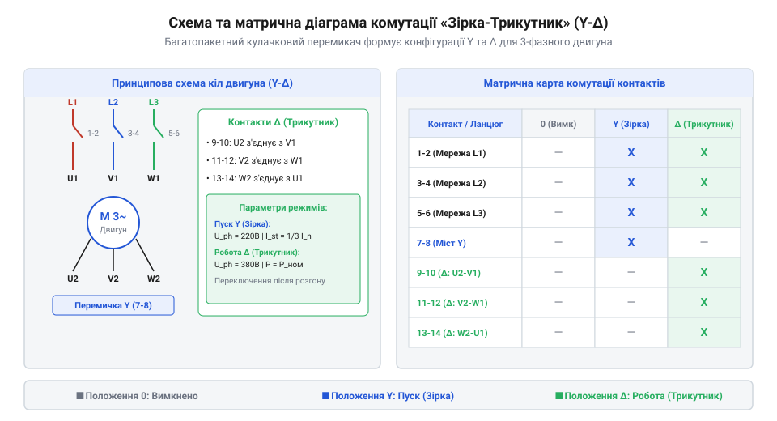
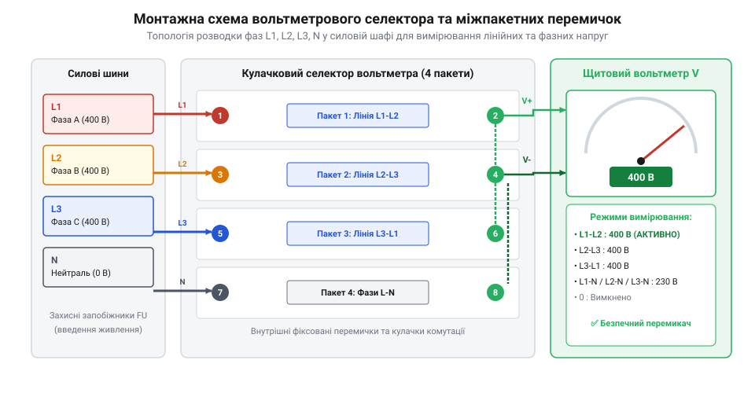

# Проєкт силового щита керування трьохфазним двигуном на кулачковому перемикачі

<preknowlist>
- [Багатопозиційні галетні перемикачі (Rotary Switches)](root:cat-hw-controls/rotary-selector-switches) — розуміння принципів дискретного кутового перемикання контактних груп
- [Ротаційні кодові DIP-перемикачі (Rotary DIP Switches)](root:cat-hw-controls/rotary-dip-switches) — базові уявлення про контактні матриці та кодові диски
</preknowlist>

## Вимоги до силового щита двигуна

При прямому пуску трьохфазного асинхронного двигуна шкідливим явищем є високий пусковий струм (@@en|inrush current@@, від англійського *inrush current* — пусковий кидок струму), який у 5–8 разів перевищує номінальне значення. Такий струмовий сплеск спричиняє просідання напруги в живильній мережі, викликає хибні спрацьовування автоматичних вимикачів та створює механічні й термічні перевантаження обмоток статора. Для пом'якшення пускового режиму застосовують двоступеневий пуск перемиканням обмоток за схемою «зірка-трикутник» (@@en|star-delta starter@@, від англійського *star-delta starter* — пускач зірка-трикутник).

На першому етапі обмотки статора з'єднуються в «зірку», що зменшує фазну напругу на кожній обмотці в `√3 ≈ 1.73` раза, а пусковий струм — у 3 рази. Після розгону ротора обмотки перемикаються у «трикутник» для виходу на повну номінальну потужність. У промислових умовах, де недоречно або занадто дорого встановлювати складні частотні перетворювачі чи мікроконтролерну автоматику, надійним розв'язком є силовий щит на основі трифазного кулачкового перемикача (@@en|cam switch@@, від англійського *cam switch* — кулачковий вимикач).

Вибір номіналу кулачкового перемикача базується на розрахунку номінального струму двигуна `I_n` за його номінальною електричною потужністю `P_n`, міжфазною напругою `U_L`, коефіцієнтом потужності `cos φ` та коефіцієнтом корисної дії `η`:

**Для двигуна потужністю `P_n = 5.5` кВт при міжфазній напрузі `U_L = 400` В, коефіцієнті потужності `cos φ = 0.85` та ККД `η = 0.86` обчислення струму має конкретний числовий вигляд.** Покрокове визначення номінального струму `I_n` та необхідного тривалого теплового струму `I_th` виконують наступним чином:

```
I_n = 5500 ÷ (1.732 · 400 · 0.85 · 0.86)    [підстановка параметрів у формулу]
    = 5500 ÷ 506.45                        [обчислення знаменника]
    = 10.86 A                               [номінальний струм двигуна]

I_th = 1.25 · 10.86                         [урахування 25% теплового запасу]
     = 13.58 A                              [мінімальний тривалий тепловий струм]
```

Отримане значення `I_th = 13.58` А визначає нижню межу термічної стійкості, тому з типового ряду кулачкових перемикачів обирають найближчий більший габарит з `I_th = 16` А, який за категорією `AC-3` гарантує надійне розмикання робочого струму 11 А при 400 В без перегріву пакетів.

```
I_n = P_n ÷ (√3 · U_L · cos φ · η)       [формула номінального струму двигуна]
```

Отримане значення струму визначає мінімально припустимий робочий струм контактних груп для категорії `AC-3`. Оскільки під час тривалої роботи перемикач зазнає постійного нагріву робочим струмом та короткочасних термічних сплесків при пуску, його номінальний тривалий тепловий струм `I_th` обирають із запасом не менше 25% відносно `I_n` (тобто `I_th ≥ 1.25 · I_n`). Це запобігає перегріву контактних пакетів у закритому щиті та сплавленню срібних напайок при частих повторних пусках.

Силовий щит керування мусить відповідати наступним технічним вимогам:
1. Забезпечувати чітку послідовність ручних переключень «Вимкнено» → «Зірка» → «Трикутник» із механічною фіксацією у кожному положенні.
2. Підтримувати функцію реверсування напрямку обертання вала шляхом зміни місцями двох фаз живлення.
3. Містити вузол контролю фазних напруг живильної мережі для запобігання роботі двигуна на двох фазах при обриві однієї з ліній.

## Принципова схема та карта комутації

Основою силового щита є принципова електрична схема, яка визначає порядок з'єднання фазних ліній `L1`, `L2`, `L3` та шести кінців обмоток статора `U1-V1-W1` (початок) і `U2-V2-W2` (кінець).


*Зв'язок кутового положення вала кулачкового перемикача із замиканням силових контактних груп.*

Для керування цими ланцюгами використовують кулачковий перемикач на 4 або 6 пакетів (секцій). Кожен пакет містить дві незалежні контактні групи з подвійним розривом. Обов'язковою конструктивною вимогою при перемиканні зі «зірки» на «трикутник» є розрахунок часової затримки безаварійного розмикання `t_delay`. Під час розриву контактів зіркової точки `U2-V2-W2` горіння електричної дуги триває `t_arc ≈ 5–12` мс (залежно від індуктивної постійної часу `L / R`), тому для запобігання міжфазному дуговому короткому замиканню геометрія кулачка гарантує перекривальну паузу розмикання `t_delay ≥ 30` мс перед замиканням груп трикутника. Підсумкова схема комутації описується матричною картою замикань, аналогічною до матриць у [ротаційних кодових DIP-перемикачах](root:cat-hw-controls/rotary-dip-switches):

Прикладом такої побудови є 6-пакетний селектор із 12 контактними групами (клеми 1–24), який поєднує функцію реверсу та двоступеневого пуску. У цій матриці комутації пакети 1–2 (контакти 1–4) відповідають за інверсію фаз `L1` та `L2` у положеннях «Реверс», пакети 3–4 (контакти 5–12) формують зіркову точку `U2-V2-W2`, а пакети 5–6 (контакти 13–24) замикають контур «трикутника». При переході вала у положення «Вперед-Зірка» замкненими є групи 1-2, 3-4, 5-6 (живлення `L1-L2-L3`) та 7-8, 9-10, 11-12 (об'єднання нейтралі). У положенні «Вперед-Трикутник» контакти 7-12 розмикаються, а замість них замикаються групи 13-14 (`U2-V1`), 15-16 (`V2-W1`) та 17-18 (`W2-U1`). При переключенні в сектор «Реверс» контактні групи 1-2 та 3-4 міняють місцями фази `L1` і `L2` на виводах статора, повторюючи аналогічну двокрокову послідовність «Зірка» → «Трикутник». Чітке графічне документування цієї матриці у технічному паспорті щита унеможливлює помилки під час монтажу силових перемичок.

- **Положення 0 (Вимкнено):** Усі контактні групи розімкнені, двигун повністю знеструмлений.
- **Положення 1 (Зірка):** Замикаються контактні групи, які підключають лінії `L1`, `L2`, `L3` до виводів `U1`, `V1`, `W1`, а кінці обмоток `U2`, `V2`, `W2` з'єднують у спільну нейтральну точку.
- **Положення 2 (Трикутник):** Контакти «зірки» розмикаються, і замикаються групи, що підключають `W2` до `U1`, `U2` до `V1` та `V2` до `W1`, прикладаючи до кожної обмотки повну міжфазну напругу 400 В.

Графічна карта замикань на принциповій схемі показує хрестиками або заповненими кружками, які саме номери контактів замкнені при кожному фіксованому куті повороту вала.

## Монтаж міжпакетних перемичок та вольтметра

Після розробки принципової схеми виконують фізичний монтаж електрообладнання всередині силової шафи. Для реалізації складних зв'язків між пакетами кулачкового перемикача застосовують мідні міжпакетні перемички або гнучкі силові провідники із обтиснутими кільцевими наконечниками (@@en|ring terminal@@, від англійського *ring terminal* — кільцевий наконечник).


*Розводка силових провідників між пакетами кулачкового перемикача та підключення вимірювального вольтметра.*

Для візуального контролю стану мережі на передній панелі щита встановлюють один щитовий вольтметр змінної напруги та окремий 7-позиційний вольтметровий кулачковий перемикач (@@en|voltmeter selector switch@@). Таке рішення дозволяє почергово вимірювати міжфазні напруги `L1-L2`, `L2-L3`, `L3-L1` та фазні напруги `L1-N`, `L2-N`, `L3-N` за допомогою одного приладу замість трьох окремих вольтметрів.

На відміну від малопотужних сигнальних органів вводу, таких як [ротаційні кодові DIP-перемикачі](root:cat-hw-controls/rotary-dip-switches) чи дрібні [галетні перемикачі](root:cat-hw-controls/rotary-selector-switches), міжпакетні перемички силового кулачкового вимикача розраховують на повний робочий струм двигуна, а монтаж виконують із дотриманням стандартного колірного маркування фаз (жовтий `L1`, зелений `L2`, червоний `L3`).

Вибір перерізу мідних провідників та силових шин (англ. @@en|busbar@@, від англ. *bus* — шина та *bar* — смуга) здійснюється за критерієм допустимого тривалого струмового навантаження та допустимого нагріву ізоляції. Для гнучких мідних проводів у силових щитах припустима густина струму (англ. @@en|current density@@) зазвичай становить від `4` до `6` А/мм², що вимагає перерізу провідника (англ. @@en|cross-sectional area@@) не менше `2.5` мм² для струмів до `25` А та `6.0` мм² для струмів до `40` А. При комутації двигунів високої потужності з номінальним струмом понад `63` А гнучкі міжпакетні перемички замінюють жорсткими профільованими мідними шинами. Зменшення перерізу силового провідника нижче розрахованої норми призводить до підвищення перехідного опору в місцях кріплення до гвинтових клем кулачкового перемикача, що при багаторазових пускових кидках струму спричиняє термічну деградацію ізоляції, вигорання контактних затискачів та небезпеку виникнення пожежі.

Для забезпечення надійного електричного контакту та запобігання пошкодженню окремих жил багатожильних мідних проводів гвинтовими затискачами кулачкового перемикача кінці провідників обов'язково опресовують втулковими ізольованими наконечниками NSHVI (англ. @@en|ferrule terminal@@, від @@en|ferrule@@ — втулка, обтискне кільце). Без використання втулкових наконечників притискний гвинт клемника при затягуванні розплющує й підрізає точні мідні жили, що різко зменшує фактичну площу перерізу та створює осередки локального перегріву. Опресування здійснюють спеціальними прес-кліщами із храповим механізмом (англ. @@en|crimper@@, від @@en|crimp@@ — обтискати), який гарантує повне закриття матриці та формує суцільний газонепроникний моноліт без повітряних зазорів. Кольорова пластикова манжета наконечника NSHVI додатково ізолює місце входу провідника й запобігає випадковому короткому замиканню між сусідніми полюсами перемикача через випнуті нитки міді.

## Розрахунок категорій AC-3 та блокування

Під час вибору силового кулачкового перемикача недостатньо спиратися лише на його номінальний тепловий струм `I_th` (наприклад, 16 А або 32 А). Електрична дуга при розмиканні індуктивного навантаження зношує контакти набагато швидше, ніж омічне навантаження. За стандартом `IEC 60947-3` комутаційна здатність визначається за категоріями застосування (@@en|utilization category@@, від англійського *utilization category* — категорія застосування).

Для пуску трьохфазних асинхронних двигунів із короткозамкненим ротором використовують категорію AC-3 (прямий пуск та вимкнення двигунів на ходу). У цьому режимі контакти перемикача мусять витримувати 6-кратний пусковий струм при замиканні та номінальний струм I_n при розмиканні. Якщо ж передбачається повторно-короткочасний режим із гальмуванням протиструмом або реверсом на ходу, обирають важчу категорію AC-4. Розрахунок габариту перемикача виконують за умовою I_AC3 ≥ I_n двигуна з урахуванням пускового перевантаження. Проте підбір за струмом гарантує лише разову комутаційну здатність, тоді як реальний строк служби контактів визначається комутаційним ресурсом або електричною зносостійкістю (@@en|electrical endurance@@, від латинського *dura* — тривалий). На відміну від механічної зносостійкості (@@en|mechanical endurance@@), яка сягає мільйона операцій без напруги, електричний ресурс залежить від частоти ввімкнень на годину z (@@en|switching frequency@@). При високій частоті перемикання електрична дуга при розмиканні локально нагріває контактні площадки, через що дугогасні срібні наплавки еродують значно швидше. Гранично допустимий комутаційний ресурс N_el обчислюють із базового ресурсу N₀ при номінальному струмі з урахуванням коефіцієнта зниження k_z (@@en|derating factor@@):

``nN_el = N₀ × (I_AC3 / I_n)¹·⁵ × k_z      [обчислення комутаційного ресурсу контактів]
``n
Базовий ресурс N₀ становить кількість циклів ввімкнення-вимкнення за нормованої частоти, I_AC3 означає допустимий струм перемикача для категорії AC-3, I_n є номінальним струмом двигуна, а коефіцієнт зниження k_z зменшується від 1.0 при рідкісних ввімкненнях (z ≤ 60 год⁻¹) до 0.5–0.6 при частій комутації (z ≥ 300 год⁻¹). Якщо розрахований ресурс N_el виявляється недостатнім для запланованого терміну експлуатації щита, обирають перемикач більшого габариту або знижують частоту ввімкнень на годину.

Найважливішою перевагою кулачкового механізму є апаратне блокування (@@en|interlocking@@, від англійського *interlock* — взаємне блокування). Профіль внутрішніх кулачків сформовано так, що міжфазне коротке замикання через одночасне ввімкнення схем «зірка» та «трикутник» або двох протилежних фаз реверсу механічно унеможливлюється. Вал перемикача фізично не дозволяє контактам замкнутися у забороненій комбінації.

## Прозвонювання, пусконалагодження та діагностика

Перед подачею силової напруги 400 В на збираний щит обов'язковим етапом є холодна перевірка неперервності (@@en|continuity testing@@, від англійського *continuity test* — перевірка неперервності кола) за допомогою мультиметра у режимі прозвонювання або вимірювання опору.

Методика перевірки комутаційного щита охоплює три кроки:
1. **Положення 0 (Вимкнено):** Перевіряють опір між вхідними клемами `L1`, `L2`, `L3` та вихідними виводами двигуна `U1`, `V1`, `W1`. Опір має дорівнювати безкінечності `∞` (повна ізоляція).
2. **Положення 1 (Зірка):** Прозвонюють наявність короткого замикання між виводами `U2-V2-W2` (формування нейтральної точки) та надійний контакт між `L1->U1`, `L2->V1`, `L3->W1`.
3. **Положення 2 (Трикутник):** Перевіряють розмикання нейтральної точки `U2-V2-W2` та замикання паралельних пар `L1->U1->W2`, `L2->V1->U2`, `L3->W1->V2`.

Після успішного прозвонювання подають напругу та виконують пробний пуск. При виявленні обертання двигуна у зворотний бік напругу вимикають та міняють місцями дві живильні фази на вхідних клемах. Полна діагностика гарантує безпечну експлуатацію силового щита без ризику апаратних відмов та аварійних відключень.

Для систем із можливістю реверсу покроковий алгоритм діагностики помилок чергування фаз розпочинається з вимірювання приладом контролю послідовності фаз (англ. @@en|phase sequence tester@@) на вхідних клемниках щита. Якщо при встановленні перемикача у позицію `1` ротор обертається у напрямку, протилежному маркуванню механічного приводу, систему знеструмлюють, знімають за залишковим зарядом напругу та міняють місцями фазні провідники `L1` і `L2` безпосередньо на вхідному ввідному автоматі. У разі, коли напрямок у позиції `1` коректний, але у позиції `2` замість реверсування відбувається міжфазне коротке замикання (англ. @@en|phase-to-phase short circuit@@), усувають помилку переплутування міжпакетних містків: перевіряють діаграму спрацьовування контактів, де перехресне перемикання силових ліній має виконуватися виключно після повного розмикання нульового положення. На відміну від слабострумових панелей, де використовують [галетні перемикачі](root:cat-hw-controls/rotary-selector-switches), помилки чергування фаз у силових кулачкових щитах вимагають повторного контрольного прозвонювання кожного пакета перед остаточним введенням установки в експлуатацію.

Завершальним етапом пусконалагоджувальних випробувань під навантаженням є тепловізійна перевірка (англ. @@en|thermal imaging@@, від грецького *therme* — тепло та латинського *visio* — бачення) усіх силових з'єднань щита. Під час тривалої роботи двигуна за допомогою портативного тепловізора контролюють температурне поле контактних пакетів кулачкового перемикача та гвинтових клемних колодок. Недостатній момент затягування гвинтів або ослаблення перемичок викликає локальне зростання перехідного опору, що призводить до небезпечного точкового перегріву («гарячих точок»). Якщо температурний контраст будь-якої клеми перевищує допустиму норму (наприклад, температура клеми сягає понад 70 °C або перевищує сусідні фази більше ніж на 15 °C), щит негайно знеструмлюють та виконують контрольне підтягування гвинтових затискачів динамометричним інструментом із нормованим зусиллям.
