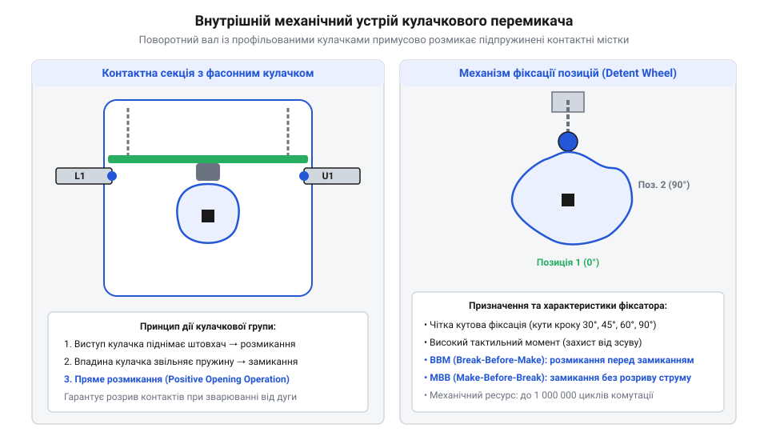
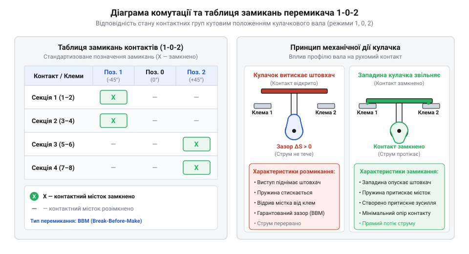
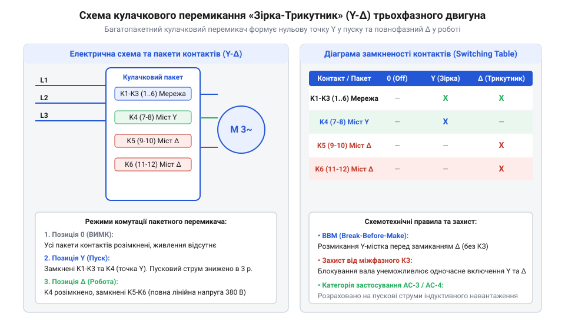

# Кулачкові перемикачі (Cam Switches) та пакетні вимикачі

<preknowlist>
- [Поворотний потенціометр](root:cat-hw-controls/rotary-potentiometer) — пристрій резистивного дільника напруги та принципи механічного зносу контактної групи
- [Багатопозиційні галетні перемикачі (Rotary Switches)](root:cat-hw-controls/rotary-selector-switches) — принцип багатопозиційного вибору малострумних сигнальних кіл
</preknowlist>

## Проблема багатопозиційної комутації силових кіл

Ручне керування потужним електрообладнанням у промислових щитах вимагає одночасної перекомутації багатьох незалежних ліній. При запуску, реверсі чи зміні швидкості трьохфазних двигунів необхідно синхронно перемикати кілька фазних провідників. Звичайні малострумні [сигнальні галетні вузли](root:cat-hw-controls/rotary-selector-switches) розраховані лише на граничні струми до `0.5 A` при напрузі до `48 V`. Спроба комутації силового струму понад `5 A` при робочій напрузі `380 V` створює екстремальну щільність струму в точках торкання. Справжній механічний контакт відбувається лише у мікроскопічних виступах поверхонь — плямах стягування (від англійського *A-spot* — пляма стягування; @@en|A-spot@@). Звуження ліній струму крізь мікронерівності створює опір стягування (від англійського *constriction resistance* — опір стягування; @@en|constriction resistance@@). Інтенсивний омічний нагрів (від прізвища німецького фізика *Ohm* — Ом; @@en|ohmic heating@@) у мікрооб'ємі плями виділяє потужні імпульси тепла. Швидкість внутрішнього тепловиділення перевищує швидкість відведення тепла у масив металу. Цей термодинамічний дисбаланс миттєво розігріває плями контакту до температури понад `1000 °C`. Висока температура перевищує точку плавлення латуні та срібних наплавок. Рідка фаза металу під притискним зусиллям викликає незворотне приварювання контактних поверхонь (від англійського *contact welding* — зварювання контактів; @@en|contact welding@@). Зварені контакти повністю блокують механізм та унеможливлюють розмикання кола. При примусовому розмиканні контактів під навантаженням рідкі містки металу вибухово випаровуються з утворенням плазмового каналу. Стрімке зростання температури плазми викликає газодинамічне розширення дугового шнура (від грецького *gas* — газ та *dynamis* — сила; @@en|gas-dynamic arc expansion@@). Високий тиск гарячого газу роздуває дуговий стовп у радіальному напрямку та виштовхує іонізований плазмовий потік у міжкулачковий простір.

Під час розмикання силового кола під навантаженням виникає спалах електричної дуги (від латинського *arcus* — дуга; @@en|electric arc@@). Кінематика відкритих ножових контактів (від давньоанглійського *cnīf* — ніж; @@en|knife switch@@) повністю залежить від швидкості руху руки оператора. Повільне мануальне розведення пластин створює низьку лінійну швидкість розходження (від грецького *kinesi* — рух; @@en|contact kinematics@@). Вольт-амперна характеристика електричної дуги постійного струму має падаючий характер через нелінійне зростання провідності плазми зі зростанням струму. Розрахунок напруги дуги постійного струму описує сума електродних падінь напруги та лінійного падіння у довжині дугового стовпа `U_arc = A + B · l_arc + (C + D · l_arc) / I_arc`. Електродне падіння напруги на аноді й катоді створює постійну складову в межах від `15 V` до `20 V`. У колах змінного струму вольт-амперна характеристика утворює динамічну петлю через теплову інерційність плазми. Струм змінного струму щонапівперіоду проходить крізь нульове значення `I_arc = 0`. При переході через нуль відбувається інтенсивне охолодження й деіонізація розрядного зазору. Для повторного запалювання дуги в наступному півперіоді напруга мережі має перевищити пікову напругу повторного запалювання `U_reign`. Через це повітряний зазор при недостатньому розведенні контактів не встигає миттєво відновити діелектричну міцність. Термічна іонізація повітря та випарів металу підтримує провідний плазмовий канал між контактами. З підвищенням температури в осередку розряду виникає газодинамічне розширення дугового шнура (від грецького *gas* — газ та *dynamis* — сила; @@en|gas-dynamic arc expansion@@). Стрімкий ріст тиску гарячої плазми роздуває дуговий стовп у радіальному напрямку, витісняючи іонізовані гази в міжкулачковий простір та створюючи вибуховий ефект. Тривале горіння дуги викликає фатальне теплове руйнування контактних наплавок: випромінювання та ударне бомбардування електронами випаровують срібло й мідь, утворюючи глибокі ерозійні кратери та бризки рідкого металу, які осідають на стінках корпусу. Нестабільне розтягування дугового шнура спричиняє хаотичні сплески струму та інтенсивне розплавлення латуні. Тривалий дуговий розряд обвуглює ізоляційні деталі та створює міжфазне коротке замикання (від англійського *short circuit* — коротке замикання; @@en|phase-to-phase short circuit@@). Для виключення аварійних режимів розроблені спеціальні силові багатопозиційні вимикачі. Вони вимагають механізму миттєвого стрибкоподібного перемикання незалежно від швидкості повороту рукоятки оператором.

Простежити перехід від відкритих рубильників до закритих поворотних конструкцій можна у [історичному огляді розвитку](root:cat-hw-controls/rotary-cam-switches/hist-rotary-cam-switch-evolution.md) силових вимикачів. Для безпечного вибору режимів силове коло мусить мати чітко фіксовані кутові положення з гарантованим тактильним відгуком. Математичні формули розрахунку енергії дуги та контактного нагріву подано у [математичному розрахунку навантаження](root:cat-hw-controls/rotary-cam-switches/math-cam-switch-contact-and-load-calculations.md) контактних груп.

## Конструкція кулачкового механізму та пакетів

Вирішенням проблеми надійної силової комутації став кулачковий перемикач (від англ. @@en|rotary cam switch@@). Конструкція пристрою будується на пакетній структурі (від англ. @@en|switch pack@@) із суцільного ряду ізольованих секцій. Через усі секції проходить спільний чотиригранний або шестигранний металевий вал (від англ. @@en|cam shaft@@). Всередині кожного пакета на валу жорстко закріплено фасонні кулачкові шайби (від англ. @@en|profiled cam@@).

При обертанні вала профіль кулачка тисне на пластиковий штовхач (від англійського *cam follower* — відстежувач кулачка; @@en|cam follower@@) рухомого контакту. Кожна контактна секція містить подвійний контактний місток (від англійського *bridge* — місток; @@en|double-break contact bridge@@) із наплавками зі срібно-нікелевого сплаву. Радіальний профіль кулачкової шайби визначає величину зсуву штовхача та геометричне стиснення контактної пружини. Геометричне виправлення кінематичного профілю кулачка поєднує циклоїдні ділянки розгону та сповільнення із прямолінійним робочим схилом. Ця корекція профілю забезпечує постійну лінійну швидкість переміщення штовхача протягом всього ходу відведення контакту. Постійна швидкість руху штовхача повністю усуває механічні удари та упереджує виникнення резонансних коливань контактної пружини. Сила притиску містка прямо пропорційна коефіцієнту жорсткості пружини та величині її деформації (від латинського *premo* — тиснути; @@en|contact pressure@@). У закритому положенні западина кулачка створює максимальне зусилля притиску до нерухомих терміналів. Висока сила притиску мінімізує перехідний опір контактів та знижує теплові втрати при проходженні силового струму. Виступ кулачка долає пружинне зусилля та примусово відводить штовхач для розмикання кола. Подвійне розмикання кола у кожному пакеті подвоює повітряний проміжок і прискорює гасіння дуги. Для забезпечення високої швидкості перемикання у головній секції встановлено клацальний фіксатор положень (від латинського *detentus* — утримання; @@en|detent mechanism@@).

Фіксатор містить зірчасту пластину (від латинського *stella* — зірка; @@en|detent star plate@@) та підпружинені сталеві ролики. Профіль кожного зуба пластини має V-подібну форму з симетричними похилими гранями. У стаціонарному положенні ролик щільно сидить у закругленій западині між зубами. Оператор повертає рукоятку та змушує ролик котитися вгору по похилій грані зуба. Цей рух стискає силові пружини фіксатора та накопичує потенціальну енергію. Механічне зусилля пружини розраховується на основі коефіцієнта жорсткості та початкового стиснення. Кут нахилу грані зуба визначає векторний розклад сил та піковий опір на рукоятці. Ролик піднімається до вершини зуба в точку максимального деформування пружини. При оптимальному куті грані від `30°` до `45°` нормальне зусилля пружини розкладається на радіальну та тангенціальну складові. Тангенціальна сила створює обертальний момент на радіусі зірчастої пластини. Розрахунковий момент тангенціальної сили перевищує сумарне тертя штовхачів та контактних містків усіх секцій. Занадто малий кут грані менше `20°` викликає ризик зависання вала на вершині зуба. Занадто крутий кут грані понад `60°` створює надмірний опір для руки оператора. Після проходження вершини зуба пружина миттєво вивільняє накопичену енергію. Силова пружина з високим прискоренням штовхає ролик уперед по спадному схилу та довертає вал у наступне фіксоване положення. Розрахункове механічне зусилля пружини створює високий обертальний момент утримання (від латинського *torquere* — крутити; @@en|detent torque@@). Цей кінематичний розрахунок профілю повністю запобігає зависанню вала та зупинці ролика у нестійкому проміжному положенні. Удар ролика об дно наступної западини створює виразний клацальний відгук (від нідерландського *snappen* — хапати; @@en|snap action@@). Завдяки цьому швидкість розмикання контактів повністю не залежить від плавності руху руки людини.

*Схема внутрішнього устрою кулачкового перемикача та взаємодія шайб із контактними містками.*

Модульний принцип дозволяє збирати в одному корпусі до дванадцяти контактних пакетів. Такий вимикач одночасно керує силовими фазами та допоміжними сигнальними кола. Графічні символи та карти замикань наведено у [довіднику комутаційних таблиць](root:cat-hw-controls/rotary-cam-switches/api-cam-switch-wiring-and-truth-table-interface.md) кулачкових апаратів. Практичне використання таких вимикачів у шафах керування показано у [проєкті силового щита](root:cat-hw-controls/rotary-cam-switches/proj-cam-switch-motor-control-panel.md) реверсування двигунів. Для автоматичного дистанційного перемикання силових кіл замість ручних апаратів застосовують [контактори та магнітні пускачі](root:cat-hw-drivers/contactors-and-magnetic-starters).

## Діаграми комутації та розгортки контактів

Для опису роботи багатосекційного кулачкового перемикача використовують графічні та табличні методи представлення станів контактів. Складність внутрішньої комутації кількох пак контактів робить неможливим її сприйняття за принциповою схемою без візуальної розгортки. Стандартним інструментом документування є розгортка контактів, представлена у вигляді діаграми комутації (від англ. @@en|switching diagram@@). Вона складається з сітки, де по горизонталі вказано фіксовані кутові положення ручки перемикача (наприклад, `0°`, `45°`, `90°` або маркування `1-0-2`), а по вертикалі — номери контактних пар кожного пакета.

Замикання контактної пари в конкретному положенні позначається хрестиком `X` або заштрихованим прямокутником на перетині строчки й стовпчика. При збереженні замкненого стану контакту між суміжними положеннями вала хрестики з'єднуються суцільною лінією. Наочним прикладом слугує контактна розгортка для ступенчатого перемикача обмоток трансформатора (від англійського *tap changer* — перемикач відпайок; @@en|transformer tap changer@@). У цій діаграмі вертикальні стовпчики відповідають ступеням напруги. Горизонтальні рядки показують контактні пари окремих відпайок. Послідовне перемикання ступенів відображається діагональним зсувом позначок `X` по сітці таблиці. У першому положенні хрестик стоїть лише на контактах першої відпайки. Поворот вала у друге положення розмикає першу пару та замикає лінію другої відпайки. Суцільна лінія між хрестиками показує безперервність з'єднання під час обертання вала між сусідніми позиціями. Для закритих багатошляхових вимірювальних кіл застосовують розширене кодування матриці замикань із суміщеними лінійними індексами. У таких діаграмах одночасні замикання кількох незалежних пар кодують парними позначками з указанням номерів зовнішніх місткових перемичок. Це графічне кодування дозволяє однозначно простежити замкнені струмові контури для кожного кутового положення вала. На відміну від сигнальних пристроїв з [багатопозиційними галетними перемикачами](root:cat-hw-controls/rotary-selector-switches), у силових кулачкових системах критичне значення має часове співвідношення моменту розмикання одного контакту та замикання іншого. За цим принципом контактні групи поділяються на два класи: BBM та MBB.

*Відповідність кутових положень вала замиканню контактних містків.*

Контакти типу BBM (від англійського *break before make* — розмикання перед замиканням; @@en|break-before-make@@) повністю розмикають попереднє коло до моменту замикання наступної групи. Це гарантовано запобігає міжфазним коротким замиканням при переключенні незалежних ліній живлення. Натомість контакти типу MBB (від англійського *make before break* — замикання перед розмиканням; @@en|make-before-break@@) створюють тимчасовий паралельний місток між суміжними колами. Замикання наступного контакту відбувається раніше за розмикання попереднього. При комутації силових фаз із різними потенціалами тимчасове перекриття MBB викликає важке міжфазне коротке замикання (від англійського *short circuit* — коротке замикання; @@en|phase-to-phase short circuit@@). Струм короткого замикання під час розмикання контакту викликає спалах потужної міжфазної дуги (від латинського *arcus* — дуга; @@en|interphase arc flash@@). Термічна іонізація повітря спричиняє пробій міжконтактного зазору та вибухове руйнування ізольованого пакета. Через таку небезпеку режим MBB суворо заборонений для силових перемикачів фаз. Проте режим MBB є критично обов'язковим у колах вимірювальних трансформаторів струму (від англійського *current transformer* — трансформатор струму; @@en|current transformer@@). Розмикання вторинного кола вимірювального трансформатора струму під навантаженням викликає миттєве насичення магнітопроводу. Стрімке падіння магнітного потоку індукує небезпечний високовольтний індуктивний пік напруги величиною в кілька кіловольт. Цей високовольтний сплеск руйнує міжвиткову ізоляцію обмотки та створює смертельну загрозу ураження електричним струмом для обслуговуючого персоналу. Фізико-технічні вимоги до кулачкових шайб MBB нормують гарантований час фазового перекриття контактів (від англійського *overlap time* — час перекриття; @@en|contact overlap time@@) у межах від `2 ms` до `5 ms`. Нижня межа тривалості перекриття перевищує тривалість механічного відскоку контактів (від англійського *contact bounce* — дребезг контактів; @@en|contact bounce@@). Це повністю виключає випадковий короткочасний розрив кола при будь-якій швидкості повороту рукоятки. Верхня межа тривалості обмежує час паралельного шунтування для запобігання похибкам вимірювальних приладів. Геометричний профіль кулачка та кутова ширина його виступу розраховуються у суворій відповідності з кутовою швидкістю фіксатора. Неперервне шунтування вторинної обмотки під час перемикання повністю ліквідує ризик виникнення високовольтного піку.

## Схемотехнічні застосування в силових колах

Завдяки можливості довільного профілювання кулачкових шайб та встановленню зовнішніх жорстких перемичок між терміналами, кулачкові перемикачі виконують складні алгоритми реконфігурації силових кіл. Найпоширенішим застосуванням у промисловості є реверсування трьохфазних асинхронних двигунів. Для зміни напрямку обертання ротора необхідно поміняти місцями будь-які дві фази живлення (наприклад, `L1` та `L2`), залишивши третю (`L3`) незмінною. Кулачковий перемикач на три положення (`1-0-2`) реалізує це перехресним з'єднанням контактних містків, забезпечуючи гарантовану паузу в середньому положенні `0` для гасіння дуги.

Широко застосовується також схема пуску двигунів «зірка-трикутник» (від англійського *star delta starter* — пускач зірка-трикутник; @@en|star-delta starter@@). При старті перемикач з'єднує кінці обмоток у спільну точку за схемою «зірка». Розрахунок фазної напруги у схемах «зірка» дає значення `U_ph = U_line / √3`. Зменшення напруги знижує фазний струм у `√3` разів порівняно з робочим режимом. У конфігурації «зірка» лінійний струм дорівнює фазному та становить лише третину від лінійного струму «трикутника» `I_line_Y = I_line_Δ / 3`. Двигун розганяється на схемі «зірка» протягом трьох-десяти секунд до досягнення 80% номінальної швидкості. Перехід на робочу схему «трикутник» вимагає обов'язкової паузи розмикання тривалістю від `30 ms` до `50 ms` (від англійського *dead time* — мертвий час; @@en|switching dead time@@). Ця затримка потрібна для повного гасіння дуги на розімкнених контактах «зірки». Під час паузи відбувається експоненціальне згасання залишкової електрорушійної сили ротора (від англійського *back EMF* — зворотна ЕРС; @@en|back-EMF decay@@). Магнітний потік ротора спадає за експоненційним законом з часовою константою від `20 ms` до `40 ms`. Індукована напруга ротора пропорційна залишковому магнітному потоку. Витримка мертвого часу від `30 ms` до `50 ms` знижує амплітуду згасаючої ЕРС ротора до безпечного рівня менше `20%` мережевої напруги. Миттєве переключення без цієї паузи спричиняє протифазне додавання векторів напруги мережі та залишкового поля ротора. Сумарна різниця потенціалів досягає `1.8` від номінальної напруги та викликає критичні пікові кидки струму (від англійського *inrush current* — пусковий кидок струму; @@en|inrush current peak@@) з амплітудою до `15 · I_e`. Величезні струмові кидки приварюють контакти та спричиняють хибні спрацьовування захисних автоматів. Після витримки необхідної паузи перемикач переводять у конфігурацію «трикутник», де фазна напруга дорівнює лінійній `U_ph = U_line`, а лінійний струм зростає у `√3` разів щодо фазного струму `I_line_Δ = √3 · I_ph_Δ`.

*Монтажні перемички та послідовність перемикання обмоток трьохфазного двигуна.*

Окрім силового керування двигунами, кулачкові перемикачі застосовують у розподільчих щитах як вольтметрові селектори (від англійського *voltmeter selector* — вибір вольтметра; @@en|voltmeter selector switch@@). Семипозиційний перемикач дає змогу вимірювати три міжфазні напруги (`L1-L2`, `L2-L3`, `L3-L1`) та три фазні напруги (`L1-N`, `L2-N`, `L3-N`) за допомогою одного щитового приладу. Сьоме нейтральне положення `0` повністю відключає вимірювальні клеми приладу від усіх силових ліній. Схема містить секції з контактними містками між лініями `L1`, `L2`, `L3`, нейтраллю `N` та двома клемами вольтметра. Для трансформаторних підстанцій із глухозаземленою нейтраллю схемотехніка задіює чотирипровідне розключення з виводом спільної нейтралі. Розрахункові фазні напруги `U_ph = U_line / √3` вимірюють відносно заземленого провідника `N`. У кожному робочому положенні кулачкові шайби одночасно замикають рівно два контактні містки. Один місток підключає першу вимірювану фазу до першого входу вольтметра. Другий місток з'єднує другу фазу або нейтральний провідник із другим входом приладу. Окрема геометрія кулачків гарантує послідовне розмикання та запобігає міжфазним коротким замиканням під час перемикання. У потужних електроустановках кулачкові вимикачі працюють у зв'язці з силовими [контакторами та магнітними пускачами](root:cat-hw-drivers/contactors-and-magnetic-starters) або застосовуються в [перемикачах фаз і резерву](root:cat-hw-controls/phase-selector-switches) для вводу АВР. Математичний аналіз зношування та розрахунок електричної стійкості контактів викладено окремо. Практична збірка силового щита керування двигуном розібрана в навчальному проєкті.

## Дугогасіння та засоби безпечного обслуговування

Комутація силових електричних кіл супроводжується утворенням високотемпературної електричної дуги при розмиканні контактів. Особливо важкий режим виникає при відключенні індуктивних навантажень категорії AC-23A. Для швидкого гасіння розряду в корпусі силового кулачкового перемикача встановлюють дугогасні камери (від німецького *Lichtbogenlöschkammer* — камера гасіння дуги; @@en|arc chute@@). Кожна дугогасна камера складається з набору паралельних ізольованих сталевих пластин. Власне магнітне поле електричної дуги втягує дуговий шнур углиб пакету пластин. Металеві пластини інтенсивно охолоджують дугу та розбивають її на серію коротких послідовних дуг. Це миттєво збільшує загальне падіння напруги й гасить плазмовий канал до перегріву контактних містків. Точний математичний розрахунок процесів комутації розгортають [обчислення комутаційних перевантажень](root:cat-hw-controls/rotary-cam-switches/math-cam-switch-contact-and-load-calculations.md) у відповідному розділі.

При струмах короткого замикання або комутаційних перевантаженнях виникає ризик приварювання контактних поверхонь. Звичайна зворотно-натискна пружина не має достатньої сили для роз'єднання зварених контактних містків. Для запобігання небезпечним відмовам застосовують механізм примусового розмикання (від англійського *positive opening operation* — гарантоване розмикання; @@en|positive opening operation@@). У такій конструкції профільований кулачок центрального вала передає зусилля на штовхач контактного містка через жорсткий механічний зв'язок. Клиновий профіль кулачка має геометричний кут нахилу робочої грані в межах від `15°` до `25°`. Кут грані менше `15°` створює ризик механічного заклинювання клина через тертя. Кут грані понад `25°` надмірно знижує передавальний коефіцієнт клинового механізму. При куті грані `15°` та моменті на рукоятці `2 N·m` коловозильне зусилля вала перетворюється на лінійну зрізну силу понад `120 N`. Ця сила прикладається безпосередньо до контактної наплавки зі срібного сплаву площею близько `1 mm²`. Створюване в зоні контакту механічне напруження зсуву перевищує `100 MPa`. Концентроване напруження зсуву перевищує межу міцності срібного зварного шва та фізично зрізає мікрозварні точки без участі пружини. При перевищенні міцності зварного шва понад граничне зусилля рукоятки жорсткий механічний упор повністю блокує подальший поворот вала. Це блокування не дозволяє перевести рукоятку в позицію «Вимкнено» та чітко сигналізує оператору про апаратну аварію. Прямий кулачковий привід повністю унеможливлює залипання контактів у замкненому стані під час переведення рукоятки у вимкнене положення.

Безпечне сервісне обслуговування обладнання вимагає надійної фіксації вимикача у знеструмленому стані. Рукоятки силових перемикачів оснащують поворотним кільцем під навісний замок (від давньоанглійського *paddel* — засувка; @@en|padlockable handle@@). Спеціальний механічний блокіратор дозволяє висунути захисне вушко лише в положенні «Вимкнено». Сервісний технік встановлює особистий навісний замок у відкритий отвір рукоятки. Таке блокування робить неможливим випадкове або несанкціоноване ввімкнення живлення іншим персоналом.

Невід'ємною умовою надійності є правильний вибір комутаційної здатності контактів за категоріями застосування (від грецького *kategoria* — ознака; @@en|utilization category@@). Категорія AC-1 регламентує комутацію малоіндуктивних резистивних навантажень та нагрівальних елементів. Категорія AC-21A застосовується для активних навантажень із помірними перевантаженнями, тоді як AC-22A регламентує комутацію змішаних активних й індуктивних кіл. Для цих категорій вирішальним є тепловий розрахунок струмів короткого замикання за джоулевим інтегралом `I² · t`. Теплова стійкість контактного містка повинна перевищувати пропущену енергію захисного автомата для запобігання розплавленню контактних наплавок до вимкнення аварійного струму. Категорія AC-3 призначена для прямих пусків і зупинок асинхронних двигунів із короткозамкненим ротором. Категорія AC-23A охоплює комутацію високоіндуктивних силових кіл із регулярними пусковими перевантаженнями та заклинюванням ротора. Вибір вимикача категорії AC-23A вимагає розрахунку нормативних коефіцієнтів запасу (від латинського *coefficiens* — той, що сприяє; @@en|safety factor@@). Нормативна вмикальна здатність контактів (від англійського *making capacity* — здатність вмикання; @@en|making capacity@@) повинна перекривати десятикратний номінальний струм `10 · Iₑ`. Вимикальна здатність апарата (від англійського *breaking capacity* — здатність вимикання; @@en|breaking capacity@@) має гарантувати безаварійний розрив восьмикратного струму `8 · Iₑ` при коефіцієнті потужності `cos φ = 0.35`. Напруговий коефіцієнт запасу становить не менше 1.2 для компенсації комутаційних сплесків самоіндукції. Для проективання складних комутаційних схем використовують [типові контактні розгортання](root:cat-hw-controls/rotary-cam-switches/api-cam-switch-wiring-and-truth-table-interface.md) керуючих кіл. У силових шафах кулачкові перемикачі працюють спільно із пристроями типу [автоматизовані силові контактори](root:cat-hw-drivers/contactors-and-magnetic-starters) для побудови автоматизованих ліній. Для вибору джерел живлення застосовують [автоматичні вибирачі ліній](root:cat-hw-controls/phase-selector-switches) у розподільчих мережах. На відміну від малострумних вузлів типу [сигнальні галетні вузли](root:cat-hw-controls/rotary-selector-switches), кулачкові апарати комутують струми силового рівня. Конструктивний розвиток цих пристроїв описують [ранні ручні рубильники](root:cat-hw-controls/rotary-cam-switches/hist-rotary-cam-switch-evolution.md) у відповідному огляді. Практичне компонування силового щита висвітлює [практичне компонування шафи](root:cat-hw-controls/rotary-cam-switches/proj-cam-switch-motor-control-panel.md) у кінцевому розділі.
