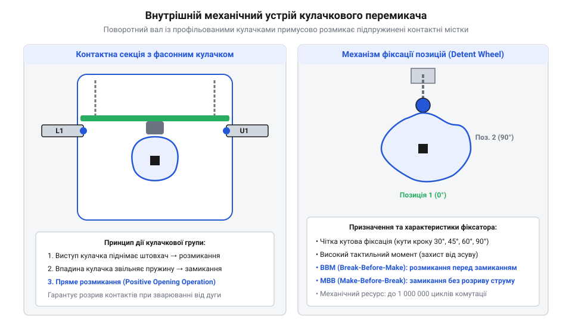
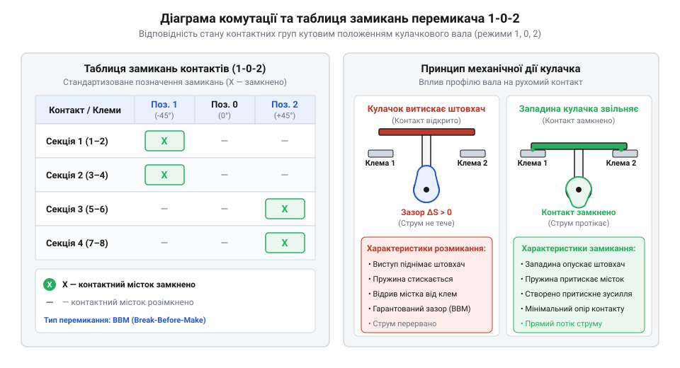
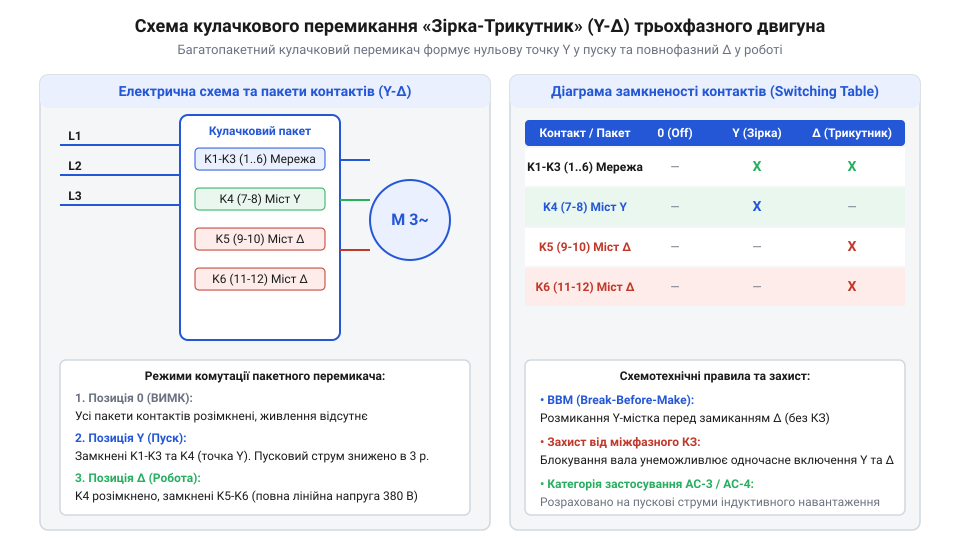

# Кулачкові перемикачі (Cam Switches) та пакетні вимикачі

<preknowlist>
- [Поворотний потенціометр](root:cat-hw-controls/rotary-potentiometer) — Принципи механічного зносу й подряпування контактної групи під час фрикційного тертя.
- [Багатопозиційні галетні перемикачі (Rotary Switches)](root:cat-hw-controls/rotary-selector-switches) — Конструкція багатопозиційної комутації малострумних сигнальних кіл.
</preknowlist>

## Проблема комутації силових кіл

Під час комутації високовольтних та високострумових силових кіл змінною або постійною напругою (нагрівачі, електродвигуни) розмикання контактів супроводжується виникненням електричної дуги. Малопотужні органи керування, такі як [багатопозиційні галетні перемикачі](root:cat-hw-controls/rotary-selector-switches) чи [поворотні потенціометри](root:cat-hw-controls/rotary-potentiometer), миттєво виходять з ладу в силових мережах. У колах з індуктивним навантаженням часова константа `L / R` визначає тривалість горіння дуги, оскільки енергія накопиченого магнітного поля `E = L · I² / 2` підтримує протікання струму під час розсування контактних поверхонь та протидіє спаду напруги. При розмиканні індуктивна ЕРС самоіндукції `U_ind = L · (dI / dt)` створює високовольтний сплеск, тому для гарантованого гасіння дуги необхідна мінімальна швидкість розходження контактів `v = d / t_arc`, яка забезпечує зростання електричної міцності повітряного проміжку швидше за наростання відновлюваної напруги. Повільний рух руки оператора розтягує час існування дугового розряду, викликаючи перегрів, приварювання контактних накладок та газодинамічний вибух ізоляційного корпусу. Для надійної комутації силових навантажень потрібні спеціальні вимикачі з подвійним розривом кола та механізмами, що розганяють контакти незалежно від швидкості обертання ручки.

## Конструкція кулачкового механізму та фіксатора

Кулачковий перемикач складається з набору секцій (пакетів), зібраних на спільному центральному валу. Кожен пакет містить подвійні контактні містки та профільовану кулачкову шайбу з ізоляційного матеріалу. Для усунення залежності часу розмикання від дій оператора використовується зірчастий фіксатор із підпружиненими роликами, що реалізує механізм миттєвого спрацьовування (від англ. @@en|snap action@@ — миттєва дія). Під час повороту рукоятки оператор стискає внутрішню пружину до моменту, поки ролик не перескочить через вершину зубця зірчастої шайби. Після цього накопичена енергія пружини миттєво повертає вал, розмикаючи контакти за лічені мілісекунди й розриваючи електричну дугу.

*Конструкція кулачкового секційного вимикача з фіксатором миттєвої дії та кулачковою шайбою розмикання.*

## Діаграми комутації та типи BBM й MBB

Послідовність комутації контактів у різних кутових положеннях вала зображується за допомогою діаграми комутації (розгортки контактів). У залежності від профілю кулачка контактні групи працюють у двох часових режимах:
- Розмикання перед замиканням (від англ. @@en|break-before-make@@ — BBM): старе коло повністю розмикається до того, як замкнеться нове. Це стандартний режим для силових мереж і переключення ліній, що виключає міжфазні короткі замикання ([перемикачі фаз](root:cat-hw-controls/phase-selector-switches)).
- Замикання перед розмиканням (від англ. @@en|make-before-break@@ — MBB): нове коло замикається до розмикання попереднього. Режим MBB суворо заборонений для силових фаз, але є обов'язковим для вторинних кіл трансформаторів струму для запобігання небезпечному зростанню напруги при обриві.

*Графічна розгортка контактів кулачкового вимикача з позначанням точок замикання на різних кутах повороту.*

## Схемотехнічні застосування та засоби безпеки

Кулачкові перемикачі застосовують для ручного реверсування трифазних двигунів, перемикання обмоток «зірка-трикутник» та в семипозиційних вольтметрових селекторах. Для забезпечення безпеки пристрій оснащують дугогасними камерами та механізмом примусового розмикання (від англ. @@en|positive opening operation@@ — примусова механічна дія): при поверхневому приварюванні контактів кулачок фізично зрізає точковий метал зварювання при повороті ручки. На передній панелі передбачено можливість блокування рукоятки навісним замком у вимкненому стані, а вибір вимикача здійснюється за категоріями IEC: AC-1 (активне навантаження), AC-3 (пуск двигунів) та AC-23A (важка комутація двигунів під навантаженням).

*Схема силової комутації обмоток трифазного двигуна для перемикання режимів «зірка-трикутник».*
