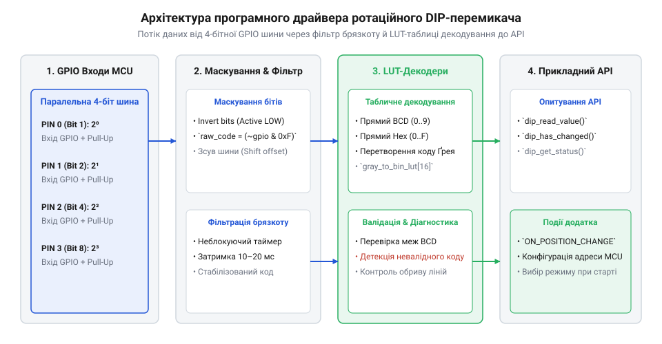
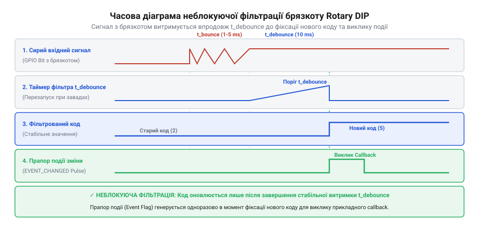

# Програмний інтерфейс драйвера зчитування ротаційних кодових перемикачів

<preknowlist>
- [Оптичні та механічні інкрементальні енкодери](root:cat-hw-controls/rotary-encoders-quadrature) — поняття контактного брязкоту та коду Ґрея
</preknowlist>

## Архітектура драйвера та бітові маски

Пряме читання паралельних ліній ротаційного кодового перемикача через регістри GPIO створює жорстку залежність програми від конкретного розв'язання друкованої плати. Ротаційні кодові DIP-перемикачі подають стан через 4-бітну або 5-бітну шину, де кожна позиція ротора формує унікальну комбінацію замкнених контактів. Програмний інтерфейс (англ. application programming interface — програмований інтерфейс застосунків; @@en|API@@) виступає шаром абстракції, який перетворює фізичні сигнали дискретних вхідних ліній у цілочисельний індекс позиції.

Драйвер ізолює прикладний код від топології розведення виводів за допомогою конфігураційної структури та маски бітів (англ. @@en|bit mask@@). При сполученні перемикача з зовнішніми розширювачами портів по шинах I2C або SPI (наприклад, MCP23017 чи PCF8574) драйвер реалізує механізм динамічної переконфігурації масок (англ. @@en|dynamic bitmask reconfiguration@@). Якщо всі лінії перемикача розведені підряд на одному розрядному порті, конфігураційна структура приймає маску `mask_pattern` та зсув `bit_shift`, виділяючи 4-бітний або 5-бітний вектор позиції з одного прочитаного байта за допомогою побітового виразу `(bus_byte & mask_pattern) >> bit_shift`. Проте в реальних розводках друкованих плат лінії ротора нерідко розкидані між різними фізичними портами GPIO (наприклад, біти 0 та 1 підключені до порту GPIOA, а біти 2 та 3 — до порту GPIOB). Для обробки такої топології драйвер застосовує механізм програмного відображення виводів (англ. @@en|pin mapping@@, від англ. *pin* — вивід та *mapping* — відображення), використовуючи таблицю відповідності (англ. @@en|look-up table@@, скорочено @@en|LUT@@). Драйвер послідовно зчитує індивідуальні рівні з кожного призначеного GPIO-піна та збирає їх у єдиний послідовний двійковий вектор за допомогою суми побітових зсувів:

При розширенні кодової шини до 8 біт (наприклад, при каскадуванні двох шістнадцятиричних селекторів Hex або використанні декількох контактних груп) мануальне складання статичних LUT-таблиць на 256 елементів стає громіздким та вразливим до помилок. Для автоматичного формування бітового вектора драйвер реалізує високопродуктивну `inline`-функцію генерації маски, яка динамічно упаковує довільно розсереджені активні біти шини в суцільний 8-бітний результат:

:::tabs
:::code api-rotary-dip-code-parsing-driver/c/esp-idf/rotary-dip-generate-lut-mask.c
:::code api-rotary-dip-code-parsing-driver/cpp/arduino/snippet-2.cpp
:::

Такий динамічний обчислювач дозволяє за один прохід циклу упакувати небезперервні розряди розширювачів портів без виділення додаткової Flash-пам'яті під статичні таблиці переходів.

```
raw_vector = (gpio_read(pin[0]) << 0)
           | (gpio_read(pin[1]) << 1)
           | (gpio_read(pin[2]) << 2)
           | (gpio_read(pin[3]) << 3)
```
[Крок 1: зчитати фізичні GPIO-піни та зібрати суцільний двійковий вектор]

Такий двотригерний підхід дає гнучкість: однопортове маскування виконується за `O(1)` тактових операцій читання регістру, тоді як розсереджене програмне відображення вимагає `N` послідовних викликів зчитування пінів, повністю знімаючи обмеження на розводку друкованої плати. Завдяки цьому прикладний код отримує цілісний вектор позиції незалежно від того, чи підключено перемикач до суцільної шини, розсереджених GPIO або безпосередньо поруч із [інкрементальними енкодерами](root:cat-hw-controls/rotary-encoders-quadrature).


*Схема потоку даних програмного драйвера від паралельних GPIO входів через бітові маски та LUT-декодери до прикладного API.*

На відміну від неперервних пристроїв на кшталт [поворотного потенціометра](root:cat-hw-controls/rotary-potentiometer) або [інкрементальних енкодерів](root:cat-hw-controls/rotary-encoders-quadrature), ротаційний кодовий селектор встановлює абсолютну позицію одразу при подачі живлення. Драйвер підтримує підключення як з прямою (англ. @@en|direct output@@), так і з комплементарною інверсною логікою (англ. @@en|complementary output@@), а також автоматично враховує активний низький рівень при використанні внутрішніх підтягувальних резисторів (англ. @@en|pull-up@@). Для економії дискретних ліній позицію ротора можна зчитувати через один аналоговий вхід, розрахувавши [зважений резистивний дільник АЦП](root:cat-hw-controls/rotary-dip-switches/api-rotary-dip-switch-pinout-and-schematics.md).

## Декодування BCD, Hex та коду Ґрея

Після зчитування масиву ліній GPIO драйвер збирає отримані значення у двобітовий або чотирибітовий сирий вектор `raw_code = ∑ (bit_i << i)`. Залежно від типу перемикача ця комбінація декодується в числове значення позиції за допомогою бітових операцій або таблиць відповідності (англ. @@en|look-up table@@, LUT).

:::tabs
:::code api-rotary-dip-code-parsing-driver/c/esp-idf/rotary-dip-s.c
:::code api-rotary-dip-code-parsing-driver/cpp/arduino/rotarydiptype.cpp
:::

Для дешифрування коду Ґрея (англ. @@en|Gray code@@) застосовується послідовна операція побітового виключного «АБО» (XOR), а для інверсних селекторів сирий вектор попередньо інвертується та маскується виразом `raw_code = (~raw_code) & 0x0F`. Однак у випадках, коли використовуються нестандартні 5-бітні ротаційні перемикачі на 32 позиції із нелінійною або апаратно специфічною розводкою контактів, математичне розгортання операціями зсуву стає занадто громіздким. Для таких пристроїв драйвер застосовує константну таблицю підстановки (англ. @@en|LUT@@, від англ. Look-Up Table — таблиця пошуку), у якій елемент з індексом `raw_code` містить готовий цілочисельний номер позиції, наприклад, `static const uint8_t lut_5bit[32] = {0, 1, 3, 2, 7, 6, 4, 5, ...}`. Такий табличний метод гарантує миттєве виконання декодування за постійний час `O(1)` та легко адаптується під будь-які користувацькі комбінації виводів без зміни вихідного коду алгоритму. У сучасній розробці на C++ ручне рутинне заповнення таких масивів замінюють автоматичною генерацією таблиць підстановки на етапі компіляції (англ. @@en|compile-time@@) за допомогою обчислюваних виразів `constexpr`. Шляхом виклику `constexpr`-функцій генерації драйвер будує масив `std::array` під обрану схемну розводку чи розрядність безпосередньо під час компілювання проєкту, що повністю усуває витрати тактів мікроконтролера у процесі виконання (англ. @@en|runtime@@) та запобігає виникненню випадкових помилок при ручному розрахунку табличних значень.

Вибір оптимального методу декодування суттєво впливає на обчислювальні витрати мікроконтролера, особливо при частій обробці переривань на молодших архітектурах без апаратного зсувача. На базових ядрах @@en|ARM@@ @@en|Cortex-M0@@ обчислювальний алгоритм перетворення коду Ґрея через циклічний зсув `XOR` потребує до 16 тактів через відсутність однотактного зсуву, тоді як табличний метод @@en|LUT@@ знижує затримку до 2–3 тактів. У високопродуктивних ядрах @@en|Cortex-M4@@ наявність апаратного зсувача та інструкції `LDRB` зменшує виконання обчислювального алгоритму до 4–6 тактів, роблячи його конкурентним із табличним пошуком. Залежність часової складності (@@en|time complexity@@) та кількості тактів (@@en|clock cycle@@) для різних методів декодування наведено у таблиці:

| Тип декодування | Алгоритмічний підхід | Складність | Такти Cortex-M0 | Такти Cortex-M4 |
| :--- | :--- | :---: | :---: | :---: |
| BCD / Hex Прямий | Пряме маскування `& 0x0F` | `O(1)` | 2 | 1 |
| Код Ґрея (обчислювальний) | Послідовний зсув та `XOR` | `O(n)` | 14–16 | 4–6 |
| Код Ґрея (табличний LUT) | Пам'ять `lut[raw_code]` | `O(1)` | 3 | 2 |
| 5-бітний нестандартний (LUT) | Пам'ять `lut_5bit[raw_code]` | `O(1)` | 3 | 2 |

Завдяки використанню `constexpr`-генерації таблиць розробник отримує мінімальну затримку `O(1)` на будь-якому мікроконтролері без зростання обсягу оперативної пам'яті.

## Неблокуюча фільтрація та події зміни

Під час повороту ручки селектора між фіксованими позиціями механічні контакти перемикача проходять крізь проміжні стани та зазнають механічного брязкоту (англ. @@en|contact bounce@@). Для виключення зчитування некоректних переходів драйвер реалізує неблокуючу часову фільтрацію (англ. @@en|non-blocking debouncing@@).


*Часова діаграма неблокуючої фільтрації контактного брязкоту та формування прапора зміни положення ротора.*

Драйвер опитується в основному системному циклі за допомогою неблокуючої функції оновлення `rotary_dip_update`. Позиція вважається підтвердженою лише тоді, коли сирий кодовий вектор залишається незмінним протягом заданого інтервалу `debounce_ms`. Однак для автономних пристроїв безперервне опитування (англ. @@en|polling@@) створює надлишкове споживання енергії, тому драйвер надає можливість зареєструвати асинхронний зворотний виклик (англ. @@en|asynchronous callback@@) за апаратним перериванням (від лат. @@en|interruptus@@ — перерваний) ліній GPIO. Зміна стану будь-якого з контактів ротора генерує сигнал по фронту, що виступає джерелом пробудження процесора з режиму сну (англ. @@en|sleep mode@@) або глибокого енергозбереження (англ. @@en|low-power mode@@), подібного до того, як відстежують [інкрементальні енкодери](root:cat-hw-controls/rotary-encoders-quadrature) у малопотужних системах, після чого драйвер запускає таймер неблокуючої валідації нового положення. Для запобігання втраті проміжних станів при швидкому клацанні ротора через декілька позицій поспіль драйвер інтегрує буферизацію подій у потокобезпечну чергу RTOS (англ. @@en|queue@@, від французького *queue* — хвіст). Кожна підтверджена зміна адреси у формі структури події `rotary_dip_event_t` з часовою міткою автоматично поміщається в чергу операційної системи реального часу, що дозволяє фоновій прикладній задачі розбирати повну історію транзитних переключень навіть тоді, коли обробник був тимчасово витіснений більш пріоритетними потоками.

:::tabs
```c|esp-idf
// Зчитування підтвердженої позиції ротора (повертає true при зміні стану)
bool rotary_dip_update(rotary_dip_handle_t handle, uint8_t *out_position);

// Отримання поточної стабільної позиції
uint8_t rotary_dip_get_position(rotary_dip_handle_t handle);
```
```cpp|arduino
// Оновлення стану в основному циклі виконання
if (dipDriver.update()) {
    uint8_t newPosition = dipDriver.getPosition();
    // Обробка події зміни адреси пристрою
}
```
:::

Використання опитувальної моделі без затримок очікування (англ. @@en|polling@@) гарантує стабільний період оновлення циклу керування без блокування виконання інших задач RTOS.

## Старт-діагностика та обробка помилок

Під час старанного запуску мікроконтролера ротаційний кодовий перемикач часто задає мережеву адресу пристрою чи режим роботи. Драйвер надає функції самодіагностики для верифікації валідності зчитаного коду до запуску основних мережевих служб.

:::tabs
```c|esp-idf
typedef enum {
    ROTARY_DIP_OK = 0,
    ROTARY_DIP_ERR_INVALID_CODE = -1,
    ROTARY_DIP_ERR_BUS_STUCK = -2
} rotary_dip_err_t;

// Перевірка коректності коду (наприклад, перевірка BCD коду > 9)
rotary_dip_err_t rotary_dip_validate(rotary_dip_handle_t handle);
```
```cpp|arduino
bool isValid = dipDriver.validate();
if (!isValid) {
    // Реакція на аномальний стан шини (обрив або невалідний BCD-код)
}
```
:::

У разі виявлення забороненої комбінації в десяткових BCD-перемикачах (значення від 10 до 15) або при виявленні обриву спільного виводу `Common` драйвер генерує код помилки `ROTARY_DIP_ERR_INVALID_CODE`, що запобігає старту системи з помилковою конфігурацією та полегшує відлагодження апаратного монтажу. Крім того, алгоритм самодіагностики розпізнає апаратні замикання ліній на землю (англ. @@en|short circuit@@) через математичну перевірку стану шини. Коли активовано підтягувальні резистори (англ. @@en|pull-up resistor@@), у нормі хоча б одна лінія ротора повинна залишатися під високим потенціалом для більшості кодових позицій. Якщо побітове порівняння зчитуваного регістру із задіяною маскою шини `M_bus` дає тотожний нуль `(V_pins ∧ M_bus) = 0`, це свідчить про постійний низький рівень на всіх виводах, спричинений замиканням доріжок друкованої плати на земляний полігон або пробоєм захисних діодів. У цьому разі драйвер реєструє код помилки `ROTARY_DIP_ERR_BUS_STUCK`, упереджуючи хибне декодування позиції та фіксуючи локалізацію несправності завадостійкої шини вводу. Якщо апаратний збій шини є непереборним і самодіагностика підтверджує невалідність даних, драйвер автоматично активує аварійний режим (англ. @@en|fail-safe mode@@) та завантажує заздалегідь визначену резервну безпечну конфігурацію зі стабільного енергонезалежного сховища (або констант прошивки). Це гарантує, що пристрій не залишиться в невизначеному стані й не спричинить колізій у мережі, а підключиться за дефолтною адресою із передачею телеметрії про несправність органу керування.
