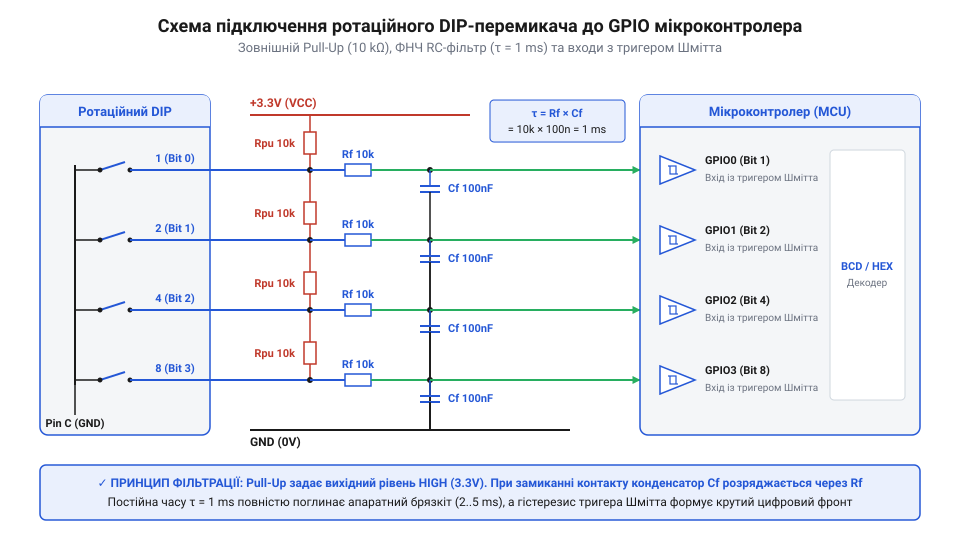
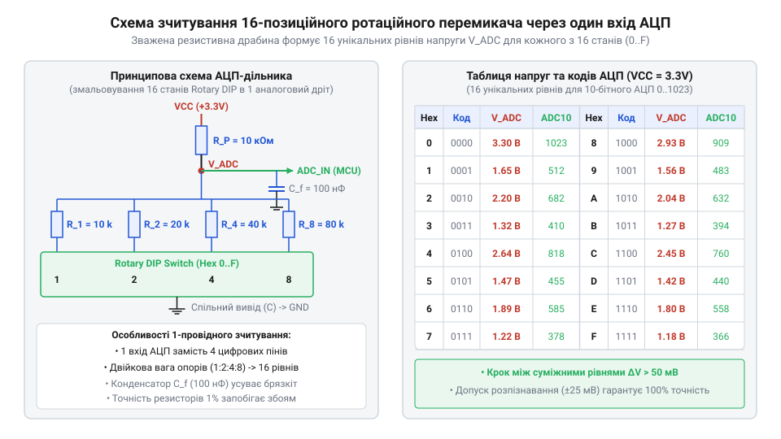

# Електричний інтерфейс ротаційних кодових перемикачів: цокольовка, підтяжки та підключення до АЦП/GPIO

<preknowlist>
- [Поворотний потенціометр](root:cat-hw-controls/rotary-potentiometer) — принцип резистивного дільника напруги для аналогового зчитування
- [Оптичні та механічні інкрементальні енкодери](root:cat-hw-controls/rotary-encoders-quadrature) — поняття контактного брязкоту та дискретних станів
</preknowlist>

## Цокольовка та кодові типи виходів

Підключення @@en|ротаційних@@ (від лат. rotatio — обертання) @@en|DIP-перемикачів@@ (від англ. Dual In-line Package — дворядний корпус) до цифрових систем починається з аналізу конфігурації виводів корпусу та логіки кодових виходів. Без чіткого розуміння @@en|цокольовки@@ (від італ. zoccolo — цоколь, основа) існує ризик короткого замикання лінії живлення або неправильного зчитування коду ротора. Стандартний 4-бітовий селектор має п'ять активних виводів: один спільний контакт @@en|Common@@ (позначається як `C` або `COM`) та чотири паралельні кодові лінії з ваговими коефіцієнтами `1`, `2`, `4`, `8`, що відповідають розрядам `2⁰`, `2¹`, `2²` та `2³`. За будовою контактних груп ці пристрої нагадують компактні [галетні перемикачі](root:cat-hw-controls/rotary-selector-switches), але замість почергового комутування одного виводу створюють комбінацію замикань на спільний контакт.

За способом формування вихідного сигналу ротаційні кодові пристрої поділяють на дві класичні групи: з прямим (@@en|Direct@@) та @@en|комплементарним@@ (від лат. complementum — доповнення, @@en|Complementary@@) виходом. У перемикачах із прямим виходом логічній одиниці `1` відповідає замкнений контакт між спільним виводом `C` та відповідною кодовою лінією. У комплементарних перемикачах замикання відбувається для логічного нуля `0`, що створює інверсну логіку. З точки зору енергоспоживання шини це створює суттєву відмінність при застосуванні підтягувальних резисторів @@en|Pull-up@@ до лінії живлення `V_CC`. Якщо у системних налаштуваннях переважають нульові стани (наприклад, початкова адреса `0000₂`), перемикач із прямим виходом утримує всі чотири контакти розімкненими, забезпечуючи нульовий статичний струм витоку. Натомість комплементарний ротор у цій же позиції `0000₂` замикає всі чотири лінії на спільний контакт `COM` (GND), створюючи постійне струмове навантаження `I_stat = 4 × (V_CC / R_pull)` (наприклад, близько `1.33` мА при `V_CC = 3.3` В та `R_pull = 10` кОм), що критично для автономних пристроїв із батарейним живленням так само, як і під час зчитування дискретних ліній у [багатопозиційних галетних перемикачах](root:cat-hw-controls/rotary-selector-switches).

Вихідний цифровий код залежить від внутрішнього диска перемикача. Для 10-позиційних роторів застосовують двоічно-десятковий код @@en|BCD@@, де комбінації обмежені діапазоном від `0000` (позиція 0) до `1001` (позиція 9). 16-позиційні селектори видають повну шістнадцяткову сітку @@en|Hex@@ від `0` (`0000`) до `F` (`1111`). У спеціалізованих застосуваннях використовують код @@en|Gray code@@, у якому при переході між сусідніми позиціями змінюється стан лише одного контакту, що виключає появу проміжних кодових голок.

Для розуміння механічного формування коду варто розглянути взаємодію внутрішнього провідного кодового диска ротора із нерухомими пружними контактами виводів `1`, `2`, `4`, `8`. При повертанні вала струмопровідні сектори диска замикають відповідні виводи на спільний контакт `COM`. У 10-позиційних роторах @@en|BCD@@ комбінація замикань строго відповідає бінарній вазі розрядів: наприклад, для позиції `0` усі контакти `1`, `2`, `4`, `8` розімкнені, для позиції `5` (`0101₂`) замкнено лінії `1` та `4`, а на граничній позиції `9` (`1001₂`) — лінії `1` та `8`. У 16-позиційних селекторах @@en|Hex@@ таблиця істинності продовжується до позиції `F` (`1111₂`), де замкнено всі чотири лінії одночасно. Механічний фіксатор (клацач) утримує диск точно по центру контактних майданчиків, запобігаючи зупинці у нестійких проміжних станах між позиціями.

## Схематотехніка підтяжок та RC-фільтрації

Механічний контакт ротаційного перемикача є пасивним ключем, який у розімкненому стані залишає вхідну лінію мікроконтролера у високоімпедансному @@en|Z-стані@@ (від англ. high impedance — високий імпеданс). Без зовнішнього визначення потенціалу електромагнітні наведення спричиняють довільне зчитування логічних рівнів. Для фіксації стабільного сигналу застосовують схеми з підтягувальними резисторами @@en|Pull-up@@ або @@en|Pull-down@@.

Якщо спільний вивід `COM` підключено до заземлення `GND`, кожні з чотирьох кодових ліній `1`, `2`, `4`, `8` потребують резистора @@en|Pull-up@@ до лінії живлення `VCC`. При розімкненому контакті резистор утримує на вході мікроконтролера високий логічний рівень `1`. При замиканні контакту струм витікає на землю, і потенціал виводу знижується до логічного нуля `0`. Розрахунок номіналу підтягувального резистора `R_pullup` базується на компромісі між енергоспоживанням та завадостійкістю:

```
I_closed = VCC / R_pullup
```

При `VCC = 3.3 V` та `R_pullup = 10 kΩ` струм через замкнений контакт становить `0.33 mA`, що гарантує надійне пробивання оксидних плівок на контактах без надмірного нагріву. 

Спрощення схеми шляхом відмови від зовнішніх елементів на користь внутрішніх підтягувальних резисторів мікроконтролера `R_internal` номіналом від `30 kΩ` до `50 kΩ` зменшує струм через замкнений контакт, але створює динамічну затримку наростання напруги. Після розмикання ключа слабкий струм внутрішньої підтяжки заряджає паразитну ємність @@en|parasitic capacitance@@ (від грец. @@el|параситос@@ — нахлібник, та лат. @@la|capacitas@@ — місткість) друкованої траси та вхідного виводу @@en|GPIO@@, яка зазвичай становить від `15 pF` до `30 pF`. Динамічну затримку `t_delay`, необхідну для досягнення порогу високого логічного рівня `V_IH = 0.7 × VCC`, обчислюють за формулою наростання напруги на ємності з підстановкою середнього номіналу `R_internal = 40 kΩ` та ємності `C_parasitic = 25 pF`:

```
t_delay = R_internal × C_parasitic × ln(VCC / (VCC - V_IH))
= R_internal × C_parasitic × ln(1 / (1 - 0.7))    [підстановка відношення порогу V_IH / VCC = 0.7]
= R_internal × C_parasitic × ln(3.33)             [обчислення логарифма ln(3.33) ≈ 1.204]
= 1.204 × (40 × 10³ Ω) × (25 × 10⁻¹² F)           [підстановка номіналів 40 kΩ та 25 pF]
= 1.204 × 10⁻⁶ s                                  [обчислення результату в секундах]
≈ 1.2 μs                                          [округлення та переведення у мікросекунди]
```

Отримане значення в `1.2 μs` показує, що при використанні високоомних внутрішніх підтяжок швидкі процедури опитування або матричні сканери ризикують зчитати застарілий логічний нуль `0`, що вимагає програмної затримки встановлення @@en|setup time@@ (від англ. @@en|setup@@ — налаштування, та @@en|time@@ — час) перед фіксацією стану ліній.

Для приглушення [контактного брязкоту](root:cat-hw-controls/rotary-encoders-quadrature), що виникає під час клацання ротора, кожну кодову лінію доповнюють аналоговим @@en|RC-фільтром@@.


*Схема паралельного зчитування виходів 1, 2, 4, 8 із зовнішніми підтягувальними резисторами та низхідними RC-фільтрами брязкоту.*

Стала часу RC-ланцюга `τ = R_series × C_filter` обирається у межах від `1 ms` до `5 ms`. Наприклад, послідовний резистор `R_series = 1 kΩ` та конденсатор `C_filter = 100 nF` дають сталу часу `τ = 100 μs`, яка повністю згладжує високочастотні імпульси брязкоту. Для формування чітких фронтів цифрового сигналу виходи фільтра підключають до ліній @@en|GPIO@@ (від англ. General-Purpose Input/Output) із вбудованими тригерами Шмітта.

## Діодна розв'язка для матричного сканування

Коли у приладі використовується декілька ротаційних перемикачів, пряме паралельне підключення кожного селектора вимагає `4 × N` виводів мікроконтролера. Для зменшення кількості задіяних ліній застосовують матричне опитування, де спільні виводи `COM` підключають до вихідних скануючих рядків, а кодові лінії `1`, `2`, `4`, `8` об'єднують у спільні шини стовпчиків. Алгоритм циклічного сканування послідовно активує один рядок за іншим, переводячи активну лінію `COM` у стан логічного нуля, тоді як інші рядки залишаються у високоімпедансному режимі відкритого колектора чи стоку (англ. @@en|Open-Collector@@ / @@en|Open-Drain@@, від англ. *collector* — колектор, *drain* — стік). Для надійного зчитання стану стовпчиків після переключення рядка витримують часовий інтервал затримки у кілька мікросекунд (зазвичай `2–5` мкс), необхідний для перезаряджання паразитної ємності шини через підтягувальні резистори, що запобігає викривленню кодових комбінацій при високих частотах опитування так само, як і в [багатопозиційних галетних перемикачах](root:cat-hw-controls/rotary-selector-switches).

При одночасному замиканні контактів на кількох перемикачах виникає ефект паразитних зворотних струмів. Якщо на один із рядків подається низький рівень сканування `0`, струм від сусідніх рядків з високим рівнем `1` може протікати через замкнені контакти сусідніх перемикачів, викликаючи хибне зчитування кодових комбінацій.

Для запобігання паразитному протіканню струму у послідовність кожного кодового виводу або спільного контакту `COM` впаюють розділювальні діоди Шотткі. Діод пропускає струм лише в одному напрямку під час подачі активного низького рівня на лінію сканування:

```
V_pin = V_OL + V_D
```

Де `V_OL` — напруга низького рівня виходу мікроконтролера, а `V_D ≈ 0.3 V` — пряме падіння напруги на діоді Шотткі. Діодна розв'язка дозволяє опитувати `N` 16-позиційних селекторів за допомогою лише `N + 4` виводів @@en|GPIO@@, повністю блокуючи паразитні зв'язками між роторами.

## Однопінове підключення через дільник АЦП

У компактних пристроях з обмеженою кількістю виводів мікроконтролера 10- або 16-позиційний ротаційний перемикач можна підключити всього до одного аналогового входу. Для цього використовують зважений резистивний дільник напруги за принципом [поворотного потенціометра](root:cat-hw-controls/rotary-potentiometer).

Резистивний ланцюг складається з послідовно з'єднаних прецизійних резисторів однаковими номіналами `R`. Контакти перемикача комутують відповідну точку дільника на вхід @@en|АЦП@@ (від англ. Analog-to-Digital Converter).


*Схематичне розведення зваженого резистивного ланцюжка та відповідна таблиця вхідних напруг АЦП для 16 дискретних позицій.*

Для 16-позиційного селектора напруга на вході АЦП для позиції `k` (де `k ∈ [0, 15]`) розраховується за формулою:

```
V_adc(k) = V_ref × (k / 15)
```

При опорній напрузі `V_ref = 3.3 V` крок напруги між сусідніми позиціями становить:

```
ΔV = 3.3 V / 15
   = 0.22 V            [крок ступеня дільника]
```

У програмному забезпеченні мікроконтролера визначають гістерезисні інтервали допуску для кожного позиційного коду. Верхня та нижня межі для позиції `k` розраховуються з урахуванням розкиду опорів 1% резисторів та температурного дрейфу:

Для приглушення високочастотних завад живлення та виключення хибних спрацьовувань під час повороту ротора сирі значення з входу @@en|АЦП@@ піддають медіанній фільтрації @@en|median filtering@@ (від лат. @@la|medianus@@ — середній). Програма накопичує непарну кількість послідовних вибірок (наприклад, 5 відліків) і вибирає з них центральне значення `V_sample`. Такий вибір повністю відсікає поодинокі імпульсні сплески без згладжування меж при перемиканні контактів. Отриманий відфільтрований сигнал зіставляють із масивом порогових напруг `V_max` за допомогою бінарного пошуку @@en|binary search@@ (від лат. @@la|binarius@@ — подвійний, та англ. @@en|search@@ — пошук). Оскільки межі `V_max` утворюють строго зростаючу послідовність, бінарний пошук знаходить потрібну позицію `k` всього за `O(log₂ N)` порівнянь, що для 16-позиційного селектора потребує не більше ніж 4 ітерації.

:::tabs
@tab C
:::code api-rotary-dip-switch-pinout-and-schematics/c/decode-rotary-position.c
@tab C++
```cpp
#include <cstdint>
#include <array>
#include <algorithm>

uint8_t decode_rotary_position(std::array<uint16_t, 5> adc_samples, const std::array<uint16_t, 16>& thresholds) {
    std::nth_element(adc_samples.begin(), adc_samples.begin() + 2, adc_samples.end());
    uint16_t v_sample = adc_samples[2];

    auto it = std::lower_bound(thresholds.begin(), thresholds.end(), v_sample);
    return static_cast<uint8_t>(std::distance(thresholds.begin(), it));
}
```
:::

```
V_min(k) = V_adc(k) - (ΔV / 2)
V_max(k) = V_adc(k) + (ΔV / 2)
```

Такий підхід повністю звільняє цифрові лінії мікроконтролера, зводячи підключення складного 16-позиційного селектора до одного аналогового виводу.
