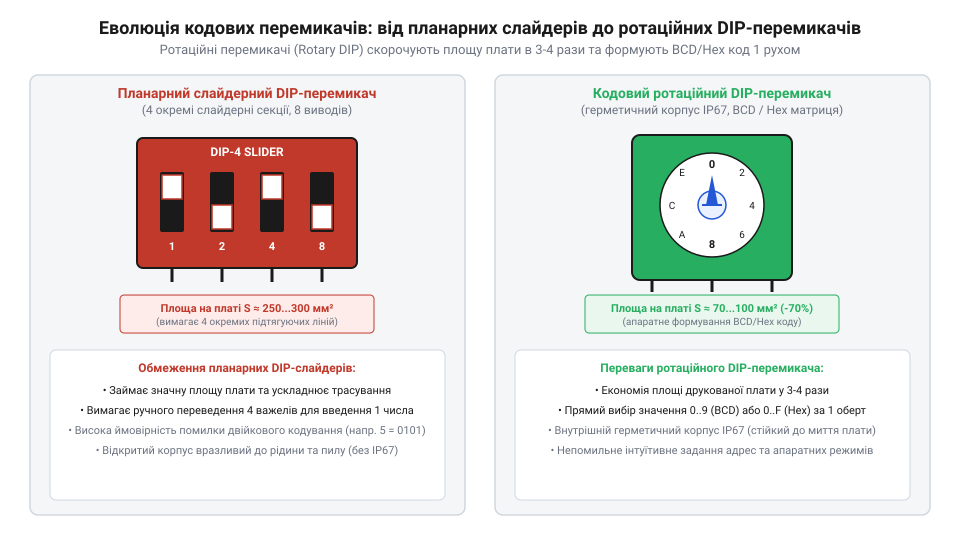
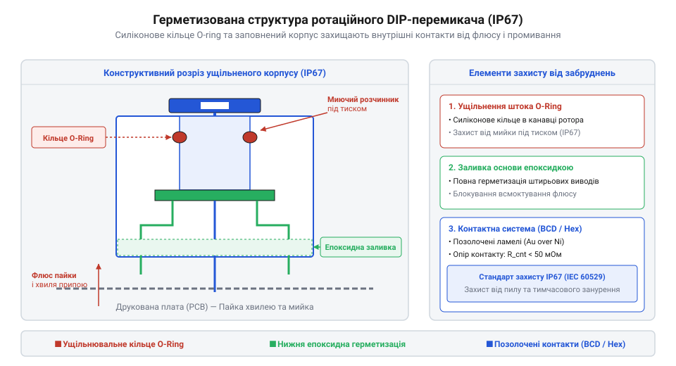

# Еволюція ротаційних кодових перемикачів: від джамперних масивів до мініатюрних BCD/HEX роторів

<preknowlist>
- [Багатопозиційні галетні перемикачі (Rotary Switches)](root:cat-hw-controls/rotary-selector-switches) — розуміння загальних принципів дискретного кутового перемикання контактних груп
- [Оптичні та індуктивні давачі положення органів вводу](root:cat-hw-controls/optical-and-inductive-position-encoders) — базові уявлення про двійкове та BCD кодування положення ротора
</preknowlist>

## Проблема джамперів та планарних DIP-вимикачів

У 1970-х роках бурхливий розвиток мікропроцесорних систем та обчислювальної техніки висунув вимогу регулярного конфігурування апаратних параметрів друкованих плат. Для вибору системних адрес пам'яті, частот тактування та режимів периферії інженери застосовували масиви перемичок — джамперів (англ. @@en|jumper@@, від @@en|jump@@ — стрибати, перескокувати). Перемичка являла собою знімний пластиковий місток із внутрішньою металевою пружинною клемою, яка вручну вдягалася на пару відкритих штирових виводів. Утім, налаштування систем за допомогою штирових масивів було вкрай містким до помилок: оператори губили дрібні перемички, плутали суміжні штирі, а волога й пил швидко окиснювали відкриті мідні контакти, спричиняючи апаратні збої та нестабільність системного шинного зв'язку. Зі зростанням оксидного шару опір контактів (англ. @@en|contact resistance@@) зростав від кількох міліом до одиниць ом, викликаючи нестабільні падіння напруги на логічних входах. Крім того, зі зростанням тактових частот шини довгі штирові масиви (англ. @@en|pin header array@@) створювали високу паразитну індуктивність (англ. @@en|parasitic inductance@@). На високочастотних фронтах ці відкриті штирі діяли як неузгоджені антени, викликаючи відбиття сигналів та міжжильні перехресні завади (англ. @@en|crosstalk@@) між сусідніми кодовими лініями.

Альтернативою джамперам стали згруповані у єдиний корпус прямолінійні клавішні та слайдерні вимикачі — перемикачі дворядного корпусування @@en|DIP switch@@ (від англ. @@en|Dual In-line Package switch@@). Вони об'єднували від 4 до 10 незалежних тумблерів на спільній пластиковій підкладці із дворядними виводами для монтажу у наскрізні отвори. Попри зручність порівняно з джамперами, лінійні DIP-перемикачі мали високу кутову складність зчитування: щоб виставити шістнадцяткову адресу або десяткове число, оператор мусив вручну переводити кожне значення у двійкову систему й послідовно перемикати кілька важелів (наприклад, стан `1001` для числа 9). Для виконання цієї операції сервісний персонал користувався паперовими таблицями, що створювало високу ймовірність помилки людського чинника.

Додатковим обмеженням планарних слайдерних вимикачів була значна площа, яку вони займали на друкованій платі. Лінійне розташування кількох повзунків вимагало розлогого прямокутного майданчика, що вступало в суперечність із тенденцією до мініатюризації електроніки. На відміну від потужних комутаційних вузлів, якими є [багатопозиційні галетні перемикачі](root:cat-hw-controls/rotary-selector-switches), або великогабаритні [кулачкові перемикачі](root:cat-hw-controls/rotary-cam-switches), слайдерні DIP-елементи були розраховані на слабкострумові сигнали, проте їхні відкриті щілини пропускали рідкий флюс і промивні розчинники під час автоматизованої збірки, призводячи до закорочення внутрішніх контактних груп.

## Прорив BCD та Hex ротаційних роторів

На початку 1980-х років конструктори розробили принципово новий тип конфігураційних елементів — ротаційні кодові перемикачі (англ. @@en|rotary DIP switch@@). Замість лінійного переміщення кількох окремих повзунків новий пристрій об'єднав дискретний поворотний ротор зі шліцом під викрутку чи пальцевий поворот і внутрішній струмопровідний кодовий диск із кутовою контактною матрицею.


*Еволюція від слайдерних DIP-перемикачів до роторного кодового диска BCD та Hex.*

Механічна суть ротаційного DIP-перемикача полягала у прямому перетворенні кутового положення ротора у двоічний вихідний код. На лицьовій поверхні ротора наносилися прямовидимі знаки від 0 до 9 для 10-позиційних двійково-десяткових селекторів @@en|BCD@@ (від англ. @@en|Binary-Coded Decimal@@ — двійково-десятковий код) або від 0 до F для 16-позиційних шістнадцяткових селекторів @@en|Hex switch@@. Внутрішній металевий ротор при обертанні замикав спільний вивід живлення чи землі `C` (@@en|common pin@@) із 4 розрядними виводами `1`, `2`, `4` та `8` у строго визначених кутових позиціях, видаючи паралельний 4-бітний код безпосередньо на вхідні лінії мікроконтролера.

Для запобігання зупинці вала у неокресленому проміжному стані, де контакти можуть застрягти між сусідніми позиціями, конструкція ротаційного перемикача містить апаратний тактильний фіксатор (@@en|detent mechanism@@, від французького *détente* — фіксатор). Механізм складається з підпружиненої кульки або профільованої пелюсткової пружини, які при обертанні ротора з виразним клацанням западають у западини фіксувальних зубців на внутрішній стінці корпусу. Це забезпечує чітке відчуття кожного дискретного кроку оператором та надійно утримує внутрішній кодовий диск у точній центрованій позиції над контактними майданчиками навіть за умов вібрації чи механічних поштовхів.


*Конструктивний розріз ротаційного DIP-перемикача з силіконовим кільцевим ущільнювачем O-ring.*

Паралельно з геометричним спрощенням інтерфейсу постало питання технологічної надійності при масовому монтажі. Під час пайки хвилею рідкий каніфольний або безвідмивний флюс проникав усередину корпусу крізь щілини ротора, а наступне ультразвукове промивання друкованих плат розчинниками вимивало внутрішнє консистентне мастило й залишало струмопровідний осад. Впровадження герметизованих корпусів стандарту `IP67` із внутрішнім силіконовим ущільнювальним кільцем (англ. @@en|O-ring@@) повністю ізолювало контактну групу. Це дозволило піддавати ротаційні вимикачі автоматичній мийці під високим тиском і реалізувати їх у компактних корпусах для поверхневого монтажу (@@en|SMD@@, від англ. @@en|Surface-Mount Device@@ — пристрій поверхневого монтажу).

## Впровадження коду Ґрея та протидія завадам

Попри зручність прямого BCD та Hex кодування, використання звичайного позиційного двійкового коду у ротаційних вимикачах виявило пастку фазових гонок при перемиканні селектора на ходу. Оскільки механічні контакти 4 розрядних ліній не замикаються строго одночасно через виготовлювальні допуски, під час транзитного повороту ротора між сусідніми позиціями (наприклад, при переході від позиції 7 із кодом `0111` до позиції 8 із кодом `1000`) виникає коротке замикання або розімкнення кількох контактних груп. Упродовж кількох мікросекунд на вихідних лініях формуються хибні проміжні кодові комбінації `0000` або `1111`. Для обробки сигналів перемикача з кодуванням Ґрея мікроконтролер або апаратний декодер перетворює прийнятий код назад у звичайний двійковий формат за допомогою таблиці пошуку (англ. @@en|look-up table@@, LUT) на 16 елементів у пам'яті чи послідовного порозрядного додавання за модулем 2 (англ. @@en|XOR@@), де старший розряд двійкового коду збігається зі старшим розрядом коду Ґрея, а кожен наступний обчислюється як сума поточного розряду Ґрея та попереднього двійкового.

Якщо мікроконтролер опитує вхідні лінії ротаційного DIP-перемикача в момент фізичного повороту ручки оператором, ці транзитні імпульси сприймаються як реальні значення адрес чи конфігурації. Для розв'язання цієї проблеми розробники впровадили модифікації ротаційних перемикачів із матричним диском на основі циклічного коду Ґрея (англ. @@en|Gray code@@). Ключова перевага коду Ґрея полягає в тому, що при переході між будь-якими двома сусідніми кутовими позиціями ротора змінює свій електричний стан лише одна контактна група:

```
d_H(G_k, G_k+1) = 1      [Властивість коду Ґрея для сусідніх позицій ротора]
```

Застосування коду Ґрея повністю усунуло апаратні збої та проміжні хибні коди на дискретних входах контролера. Такий підхід забезпечив високу завадостійкість апаратного задання конфігураційних параметрів, аналогічно до методів усунення неоднозначності в [оптичних та індуктивних давачах положення](root:cat-hw-controls/optical-and-inductive-position-encoders) і [оптичних квадратурних енкодерах](root:cat-hw-controls/rotary-encoders-quadrature).

## Перехід до SMD та герметизації IP67

Упродовж 1990-х років технологія виготовлення електроніки зазнала масштабної автоматизації через масове впровадження поверхневого монтажу (@@en|surface-mount technology@@, від англійського *surface-mount technology* — техніка монтажу на поверхню). Традиційний монтаж у отвори поступався місцем паянню оплавленням припаю (англ. @@en|reflow soldering@@, від англ. reflow — повторно розплавляти, soldering — паяння) та пайці хвилею. Проте перші ротаційні кодові вимикачі виявилися вразливими до автоматизованого виробничого циклу. Під час проходження через паяльну ванну та подальшого ультразвукового промивання плат від залишків флюсу миючі розчинники й рідкі хімічні компоненти вільно проникали всередину негерметичних корпусів. Це спричиняло корозію та забруднення тонких золочених контактних доріжок, що призводило до раптових відмов ще на стадії вихідного контролю залізообладнання. Окрім хімічного впливу розчинників, критичним викликом стала теплова тривкість матеріалів корпусу під час термопрофілю пайки оплавленням. Проходження крізь багатозонну піч вимагало витримування пікових температур у діапазоні 240–260 °C (особливо при переході на безсвинцеві припаї), через що традиційні термопластики на кшталт полібутилентерефталату зазнавали термічної деформації та короблення. Це спричиняло механічний перекіс поворотного ротора й втрату контактного тиску. Для збереження розмірної точності виробники перейшли на високотемпературні термопластики — рідкокристалічні полімери (англ. @@en|liquid-crystal polymer@@, LCP) та поліфеніленсульфід (PPS), які зберігають жорсткість і геометрію корпусу без розплавлення та температурного усадження.

Виходом із технологічного глухого кута стала розробка герметизованих корпусів із подвійним бар'єром захисту. Інженери застосували силіконовий ущільнювальний перстень (@@en|O-ring@@, від англійського *O-ring* — кільцевий ущільнювач) між поворотним ротором і корпусом, а нижній вивідний вузол заповнили епоксидним компаундом. Таке конструктивне рішення забезпечило клас захисту `IP67` (@@en|IP rating@@, від англійського *ingress protection rating* — ступінь захисту від проникнення). Впровадження герметизації дозволило монтувати ротаційні ротори на друковані плати разом із мікросхемами в єдиному автоматизованому циклі SMT без потреби у трудомісткому ручному допаюванні після промивання.

## Розвінчання міфу про витіснення механіки

На початку 2000-х років із бурхливим здешевленням мікроконтролерів та поширенням енергонезалежної пам'яті (@@en|non-volatile memory@@, від англійського *non-volatile memory* — енергонезалежна пам'ятка) у промисловості виник міф про швидку й невідворотну витісненість усіх механічних перемикачів цифровими меню. Стверджувалося, що зберігання апаратних налаштувань у пам'яті повністю усуне потребу в ротаційних селекторах. Однак практична експлуатація виявила суттєву слабкість суто програмного підходу: для зчитування конфігурації мікропроцесор мусить успішно завантажити прошивку, ініціалізувати шини живлення та мати працездатний інтерфейс відображення.

У критичних галузях, таких як автоматизація підстанцій та промислові мережі `RS-485` або `CAN`, апаратна адресація вузла повинна визначатися безумовно й миттєво ще до подачі живлення на обчислювальне ядро. На відміну від імпульсних пристроїв, як-от [поворотні енкодери](root:cat-hw-controls/ky-040-encoder) чи класичні [галетні перемикачі](root:cat-hw-controls/rotary-selector-switches), ротаційний кодовий DIP-перемикач зберігає фізичне положення ротора в знеструмленому стані необмежено довго без ризику збою вмісту Flash-пам'яті при стрибках напруги. Сервісний інженер може візуально визначити й змінити мережеву адресу пристрою за допомогою викрутки прямо на об'єкті без підключення сервісного ноутбука. Це зберегло за ротаційними кодерами статус базового інструменту для задання конфігурації у завадовразливих та автономних вбудованих системах.
