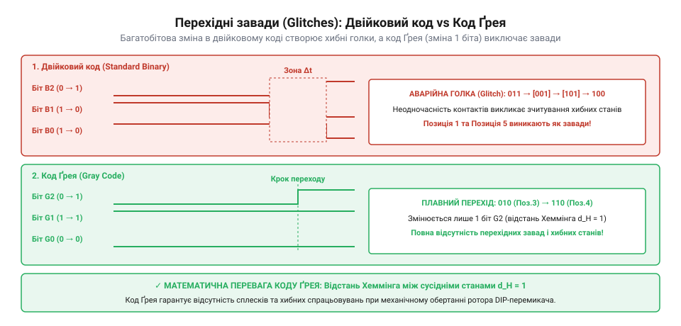
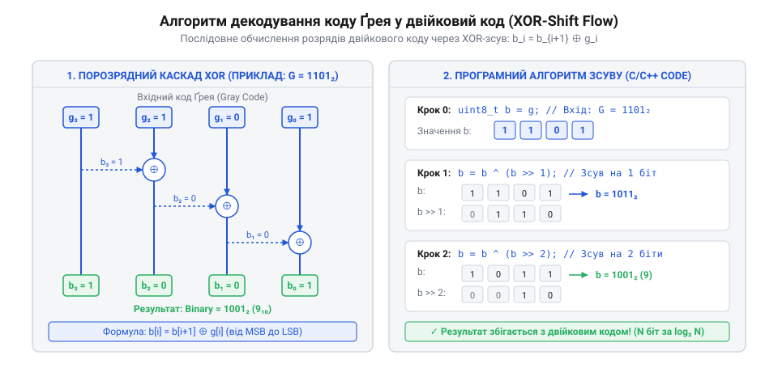

# Математика кодування роторних перемикачів: BCD, Hex, код Ґрея та двійковий розрядний маскувальник

<preknowlist>
- [Багатопозиційні галетні перемикачі (Rotary Switches)](root:cat-hw-controls/rotary-selector-switches) — Принцип механічного дискретного перемикання контактних груп та дискретизації кутового положення вала.
- [Оптичні та механічні інкрементальні енкодери](root:cat-hw-controls/rotary-encoders-quadrature) — Природа виникнення механічного брязкіту контактів та часові параметри перехідних процесів.
</preknowlist>

## Неодночасність контактів та завади декодування

Під час механічного повороту вала роторного DIP-перемикача між дискретними позиціями (наприклад, під час переходу з позиції 7 у позицію 8) декілька контактних груп мають одночасно змінити свій стан. У двійковій системі позиція 7 відповідає коду `0111₂`, а позиція 8 — коду `1000₂`. Тобто всі чотири виходи повинні миттєво інвертувати свої логічні рівні. Однак через конструктивні допуски виготовлення контактних пружинних пелюсток виникає кутова розсинхронізація `Δθ`, яка утворює часове вікно невизначеності (англ. @@en|uncertainty window@@) `Δt_skew`. Величина цього вікна обчислюється з кутової швидкості обертання вала `ω` та кутового розкиду спрацьовування контактів:

Δt_skew = Δθ ÷ ω         [обчислення тривалості вікна невизначеності]

При середній кутовій швидкості ручного повороту ротора `ω = 720°/с` (два оберти за секунду) та механічній похибці розташування пелюсток `Δθ = 0.5°`, часовий інтервал неедночасності становить:

Δt_skew = 0.5° ÷ 720°/с = 0.000694 с ≈ 694 мкс   [розрахунок часу розсинхронізації контактів]

Протягом цього інтервалу тривалістю близько 700 мкс виходи перемикача перебувають у непередбачуваному комбінаційному стані, через що будь-яке зчитування регістру вводу мікроконтролером фіксує хибні хаотичні коди.

Однак через механічні допуски виготовлення, знос пружинних пелюсток та нерівномірність тертя контакти ніколи не розмикаються й не замикаються в одну й ту саму мікросекунду. Виникає фізичний розкид часу спрацьовування — часовий неузгоджений зсув контактів (англ. @@en|contact skew@@). Якщо контакт 0 розімкнеться на 100 мкс раніше, ніж замкнеться контакт 3, то роторний перемикач короткочасно видасть у шину проміжний хибний стан `0110₂` (6) або `0000₂` (0).

Якщо мікроконтролер виконає зчитування порту вводу-виводу саме в цей мікросекундний інтервал переходу, система отримає спотворене значення позиції. Такі короткочасні хибні кодові значення називаються кодовими голками або перехідними завадами (англ. @@en|transient code glitches@@).

Ця проблема є принципово відмінною від звичайного механічного брязкіту контактів. Завади неодночасності виникають навіть тоді, коли кожен окремий контакт ідеально відфільтровано. Подібно до того, як розглядаються [багатопозиційні галетні перемикачі](root:cat-hw-controls/rotary-selector-switches), дискретизація кутового положення вимагає захисту від хибних спрацьовувань. Для глибшого розуміння фізики контактування варто переглянути [оптичні та механічні енкодери](root:cat-hw-controls/rotary-encoders-quadrature), де динамічні параметри контактних груп також обмежують граничну швидкість надійного зчитування.


*Виникнення хибних проміжних кодових станів через механічну неодночасність перемикання контактних груп при повороті двійкового ротора.*

Для аналізу ризиків декодування при несинхронному переключенні математична матриця перехідних станів `P(G | A → B)` визначає ймовірність зчитування будь-якого хибного коду `G` під час переходу між BCD-комбінаціями `A` та `B`. Якщо розрядна відстань Геммінга `d_H(A, B) > 1`, кількість можливих проміжних станів `G` становить `2ᵈ - 2` (де `d = d_H(A, B)`), а множина потенційних голок обмежена бітовим інтервалом `G ∈ [A ∧ B, A ∨ B]`. За припущення рівної ймовірності комбінаторних траєкторій розмикання контактних пелюсток, ймовірність появи конкретної кодової голки `G` виражається матричною формулою:

```
P(G | A → B) = 1 ÷ (2ᵈ - 2)      [для будь-якого G ∈ (A ∧ B, A ∨ B) \ {A, B}]
```
[де d = d_H(A, B) > 1 — кількість бітів, що одночасно змінюють стан при повороті]

Наприклад, при зміні BCD-позицій від 7 (`0111₂`) до 8 (`1000₂`) має місце `d = 4`, що утворює `2⁴ - 2 = 14` можливих проміжних станів `G ∈ {0000₂, 0001₂, ..., 0110₂}` із рівною ймовірністю зчитування `P = 1/14 ≈ 0.071` за відсутності часової фільтрації, що також справедливо під час аналізу перехідних процесів, якими володіють [інкрементальні енкодери](root:cat-hw-controls/rotary-encoders-quadrature).

## Двійкові та комплементарні роторні коди

Роторні DIP-перемикачі формують на своїх вихідних виводах цифровий код, що відповідає поточному кутовому положенню ручки. Найпоширенішими є 4-бітні прямі двійкові коди: двійково-десятковий @@en|BCD@@ (від англ. *Binary-Coded Decimal* — двійково-кодований десятковий, позиції 0–9) та шістнадцятковий @@en|Hex@@ (від англ. *Hexadecimal* — шістнадцятковий, позиції 0–F, тобто 0–15). У прямому двійковому кодуванні (англ. @@en|direct binary code@@) виводи `1, 2, 4, 8` безпосередньо відповідають вагам двійкових розрядів `2⁰, 2¹, 2², 2³`. На відміну від сухих контактів у [багатопозиційних галетних перемикачах](root:cat-hw-controls/rotary-selector-switches), де кожен стан вимагає окремого виводу, роторний DIP-перемикач упаковує `16` диверсифікованих кутових станів усередину `4` сигнальних ліній за допомогою внутрішньої кулачковой матриці. Відповідність між кутовим положенням ротора, прямим двійковим кодом та його інверсним комплементарним відображенням описується таблицею істинності:

| Позиція ротора | Прямий код BCD/Hex (`2³ 2² 2¹ 2⁰`) | Комплементарний код (`¬V_pins`) | Замкнені виводи на GND |
| :--- | :--- | :--- | :--- |
| **0** | `0000₂` (0x0) | `1111₂` (0xF) | Жодного |
| **1** | `0001₂` (0x1) | `1110₂` (0xE) | Pin 1 |
| **2** | `0010₂` (0x2) | `1101₂` (0xD) | Pin 2 |
| **3** | `0011₂` (0x3) | `1100₂` (0xC) | Pin 1, Pin 2 |
| **4** | `0100₂` (0x4) | `1011₂` (0xB) | Pin 4 |
| **5** | `0101₂` (0x5) | `1010₂` (0xA) | Pin 1, Pin 4 |
| **6** | `0110₂` (0x6) | `1001₂` (0x9) | Pin 2, Pin 4 |
| **7** | `0111₂` (0x7) | `1000₂` (0x8) | Pin 1, Pin 2, Pin 4 |
| **8** | `1000₂` (0x8) | `0111₂` (0x7) | Pin 8 |
| **9** | `1001₂` (0x9) | `0110₂` (0x6) | Pin 1, Pin 8 |
| **A (10)** | `1010₂` (0xA) | `0101₂` (0x5) | Pin 2, Pin 8 |
| **B (11)** | `1011₂` (0xB) | `0100₂` (0x4) | Pin 1, Pin 2, Pin 8 |
| **C (12)** | `1100₂` (0xC) | `0011₂` (0x3) | Pin 4, Pin 8 |
| **D (13)** | `1101₂` (0xD) | `0010₂` (0x2) | Pin 1, Pin 4, Pin 8 |
| **E (14)** | `1110₂` (0xE) | `0001₂` (0x1) | Pin 2, Pin 4, Pin 8 |
| **F (15)** | `1111₂` (0xF) | `0000₂` (0x0) | Усі (Pin 1, 2, 4, 8) |

Ця таблиця демонструє дуальність прямих та інверсних кодових комбінацій: для кожного значення позиції комплементарний код описує фізичний стан ліній з урахуванням підтягувальних резисторів, де розімкненому контакту відповідає логічна одиниця, а замкненому — нуль.

Проте реальне схемотехнічне підключення перемикача до портів мікроконтролера зазвичай працює в інверсній (активній низькій) логіці (англ. @@en|active-low logic@@). Замкнений механічний контакт з'єднує вивід мікроконтролера із землею (GND), створюючи електричний логічний `0`. Коли контакт розімкнений, підтягувальні резистори (англ. @@en|pull-up resistor@@) підтягують лінію до напруги живлення, формуючи логічну `1`.

Така електрична схема утворює так званий комплементарний код (англ. @@en|complementary code@@, від лат. @@en|complementum@@ — доповнення). При виставленні ротора в позицію 3 (`0011₂`) замкнутими виявляються контакти 0 і 1. У результаті зчитування регістру вводу-виводу мікроконтролер бачить байт `1100₂` (значення 12 або 0xC).

Для перетворення зчитаного стану виводів `V_pins` у дійсне числове значення позиції `V_code` застосовується алгебраїчне побітове заперечення (NOT, `¬`) та розрядна маска:

```
V_code = (¬ V_pins) ∧ 0x0F
```
[Крок 1: побітова інверсія відновлює прямі значення логічних рівнів]
[Крок 2: побітове «І» з маскою 0x0F ізолює 4 молодші біти ротора]

Приклад обчислення для шістнадцяткового комплементарного перемикача в позиції 5 (`0101₂`):

```
V_pins = 1010₂ (0xA)       [контакти 0 та 2 замкнені на GND, контакти 1 та 3 розімкнені]
V_code = (¬ 1010₂) ∧ 1111₂ [побітове заперечення та маскування]
       = 0101₂ ∧ 1111₂     [отримано прямий код]
       = 5                 [результат декодування]
```

Розробникові важливо перевіряти маркування перемикача: виробники випускають як прямі (Real), так і комплементарні (Complement) модифікації, що визначає вибір інверсії в програмному забезпеченні.

Для спеціалізованих моделей роторних перемикачів із вбудованим механічним зсувом фази на півкроку (від англійського @@en|half-step phase shift@@) кулачкова матриця зміщена відносно фіксатора положень. У таких пристроях перемикання контактів відбувається посередині між кутовими позиціями, що підвищує завадостійкість у стані спокою, але зсуває зчитаний комплементарний код на одиницю молодшого розряду. Для алгебраїчного відновлення точного номера позиції `V_code` після інверсії та маскування застосовують арифметичне додавання фазового зміщення (від англійського @@en|phase offset@@) за модулем `16`:

        V_raw = (¬ V_pins) ∧ 0x0F     [побітова інверсія та ізоляція бітів]
        V_code = (V_raw + 1) ∧ 0x0F   [компенсація фазового зсуву на півкроку за модулем 16]

Цей додатковий арифметичний крок гарантує правильну обробку як стандартних прямолінійних, так і фазозсунутих комплементарних матриць ротора.

## Код Ґрея та алгоритм XOR декодування

Щоб повністю усунути ризик виникнення кодових голок при механічних переходах, застосовують цифровий код Ґрея (англ. @@en|Gray code@@). Ключова математична властивість коду Ґрея полягає в тому, що кодові слова будь-яких двох сусідніх положень ротора мають одиничну кодову відстань Геммінга (англ. @@en|Hamming distance@@). Математичне виведення швидких алгоритмів зворотного декодування Ґрея у двійкову форму базується на властивості інволютивності (від латинського *involutio* — згортання, @@en|involutivity@@) побітової операції виключного «АБО» (XOR, `⊕`), згідно з якою подвійне застосування того самого операнда взаємно усуває його дію: `x ⊕ x = 0`. Оскільки при прямому кодуванні кожен біт Ґрея утворюється як `g_k = b_k ⊕ b_{k+1}`, то додавання за модулем 2 двох зсунутих векторів `G ⊕ (G >> 1)` дає на кожній позиції `k` значення `(b_k ⊕ b_{k+1}) ⊕ (b_{k+1} ⊕ b_{k+2})`. Завдяки асоціативності та інволютивності дубльовані терми `b_{k+1}` взаємно знищуються (`b_{k+1} ⊕ b_{k+1} = 0`), залишаючи лише `b_k ⊕ b_{k+2}`. Наступні каскадні побітові зсуви праворуч та послідовне накладання XOR усувають усі наступні парні складові `b_{k+2}`, `b_{k+3}`, що дає змогу відновити вихідний двійковий вектор `B` за мінімальну кількість процесорних інструкцій. Для сусідніх положень ротора ця властивість гарантує точну рівність:

```
d_H(G_k, G_{k+1}) = 1
```
[де d_H — кількість бітів, що змінюють значення при переході між сусідніми позиціями k та k+1]

Завдяки цьому при повороті вала ротора на один крок завжди змінюється стан лише одного механічного контакта. Принципово виключається виникнення проміжних хибних станів, а отже, і завади декодування.

Для використання зчитаного коду Ґрея `G` у математичних та логічних обчисленнях мікроконтролера його необхідно конвертувати у стандартний двійковий код `B`. Алгебраїчний метод відновлення двійкових розрядів `(b₃, b₂, b₁, b₀)` з розрядів Ґрея `(g₃, g₂, g₁, g₀)` спирається на послідовну операцію виключного «АБО» (XOR, `⊕`):

```
b₃ = g₃
b₂ = b₃ ⊕ g₂ = g₃ ⊕ g₂
b₁ = b₂ ⊕ g₁ = g₃ ⊕ g₂ ⊕ g₁
b₀ = b₁ ⊕ g₀ = g₃ ⊕ g₂ ⊕ g₁ ⊕ g₀
```
[кожен двійковий біт є сумою за модулем 2 відповідного біта Ґрея та всіх його старших розрядів]

Для швидкої програмної реалізації в регістрах процесора розрядне відновлення виконується шляхом каскадного побітового зсуву праворуч та операцій XOR. Для 4-бітного ротора вираз має вигляд:

```
B = G ⊕ (G >> 1) ⊕ (G >> 2) ⊕ (G >> 3)
```
[паралельне обчислення двійкового значення за 4 зсуви та додавання за модулем 2]


*Схема послідовного каскадного XOR-додавання зсунутих копій регістра для декодування коду Ґрея у двійкову форму.*

У програмах реалізацію декодування коду Ґрея подають у вигляді компактних функцій:

```c
#include <stdint.h>

// Декодування 4-бітного коду Ґрея у двійкове значення
uint8_t gray_to_binary4(uint8_t gray) {
    uint8_t b = gray;
    b ^= (b >> 1);
    b ^= (b >> 2);
    b ^= (b >> 3);
    return b & 0x0F;
}
```

```cpp
#include <cstdint>

// Універсальний шаблонований декодер коду Ґрея для довільних типів
template <typename T>
constexpr T gray_to_binary(T gray) noexcept {
    T mask = gray >> 1;
    while (mask != 0) {
        gray ^= mask;
        mask >>= 1;
    }
    return gray;
}
```

Алгоритм відновлення має обчислювальну складність `O(log₂ N)`, де `N` — кількість бітів, що дає змогу декодувати стан роторного перемикача безпосередньо під час переривання або в циклі опитування GPIO.

## Маскування та вирівнювання бітових полів

У реальних мікроконтролерних системах виводи роторного DIP-перемикача рідко підключають до молодших бітів `0..3` порту вводу-виводу в ізольованому вигляді. Зазвичай 4-бітна шина перемикача займає довільні суміжні розряди в спільному 32-бітному GPIO-регістрі (наприклад, виводи `PA12..PA15` або `PB4..PB7`), а в складних топологіях друкованих плат розрядні лінії взагалі рознесені по неразомкнутих (непослідовних) виводах у довільному порядку. Для алгебраїчного відновлення впорядкованого значення `V_raw` із неразомкнутої шини, де `i`-й розряд коду підключено до довільного виводу `p_i` регістру `R_gpio`, застосовується сумування за диз'юнкцією ізольованих бітів: `V_raw = ⋁_{i=0}^{3} (((R_gpio ∧ (1 << p_i)) >> p_i) << i)`. У цьому виразі кожен доданок виділяє одиночний розряд `p_i` побітовим «І», вирівнює його до нульового біта та переносить на належну вагову позицію `i`. Такий алгебраїчний розрахунок дає змогу програмно декодувати будь-який розсічений монтаж контактів без додаткових апаратних мультиплексорів.

Для виділення чистого коду позиції зі значення регістру `R_gpio` застосовують дві побітові математичні операції: маскування (англ. @@en|bitmasking@@) та логічний зсув (англ. @@en|bit shifting@@).

Нехай 4-бітний перемикач підключено до бітів від `k` до `k+3` регістру `R_gpio`.
Розрядна маска `M` будується шляхом зсуву базового 4-бітного значення `0x0F` (маска `1111₂`):

```
M = 0x0F << k
```
[Крок 1: зсув 4-бітної одиничної маски 0x0F на k позицій ліворуч]

Ізоляція цільових бітів ротора та обнулення всіх інших ліній регістру виконується побітовим «І» (`∧`):

```
R_masked = R_gpio ∧ M
```
[Крок 2: побітове «І» залишає лише значення виводів перемикача]

Далі, для вирівнювання виділеного бітового поля до молодшого значущого біта (LSB, біт 0), виконують логічний зсув праворуч на `k` розрядів:

```
V_raw = R_masked >> k
```
[Крок 3: зсув праворуч суває виділену групу бітів до молодших розрядів 0..3]

Якщо схемотехніка використовує активну низьку логіку з підтягувальними резисторами, підсумкова числова позиція `V_pos` обчислюється шляхом побітової інверсії з маскуванням:

```
V_pos = (¬ V_raw) ∧ 0x0F
```
[Крок 4: побітове заперечення відновлює прямий логічний рівень контактів]

Повна алгебраїчна формула обчислення позиції в один крок має вигляд:

```
V_pos = (¬ (R_gpio >> k)) ∧ 0x0F
```
[обчислення позиції шляхом попереднього зсуву та інверсії з маскуванням]

Приклад обчислення для перемикача на бітах `PA4..PA7` (`k = 4`) у позиції 6 (`0110₂`):

```
R_gpio = 1001 1101₂ (0x9D) [виводи PA4=1, PA5=0, PA6=0, PA7=1]
V_raw  = (0x9D >> 4) ∧ 0x0F 
       = 1001₂ ∧ 1111₂ = 1001₂
V_pos  = (¬ 1001₂) ∧ 1111₂
       = 0110₂ = 6          [підсумковий прямий код позиції]
```

Математичне вирівнювання та маскування бітових полів дозволяє повністю абстрагувати топологію плат від програмного алгоритму обробки органів вводу.

## Математичний аналіз надійності кодових переходів

Під час тривалої експлуатації механічні контакти ротора зазнають зносу, абразивного окислення та накопичення пилу. Це призводить до збільшення тривалості перехідного брязкіту та розширення часового інтервалу невизначеності (англ. @@en|uncertainty window@@) `Δt_skew` при перемиканні між сусідніми позиціями. З математичного боку часовий зсув розмикання окремих контактних груп — фазовий зсув (від англійського @@en|phase skew@@) — визначається геометричною похибкою виготовлення контактних доріжок `Δθ` та миттєвою кутовою швидкістю обертання вала `ω(t)`. При ручному повертанні або роботі фіксатора ротор рухається з кутовим прискоренням `ε = dω / dt` (від англійського @@en|angular acceleration@@), через що миттєва швидкість змінюється за законом `ω(t) = ω₀ + ε · t`. Оскільки механічні допуски розмикання пружних контактів підпорядковуються нормальному розподілу (від англійського @@en|normal distribution@@) `N(μ_θ, σ_θ²)`, часовий інтервал невизначеності між розмиканням першого й останнього біта є випадковою величиною із дисперсією `σ_t² ≈ σ_θ² / ω²`. Зростання кутового прискорення `ε` та швидкості `ω` збільшує статистичний розкид інтервалу `Δt_skew`, через що ймовірність збігу моменту опитування порту з перехідною кодовою голкою зростає. Якщо період опитування GPIO портів мікроконтролера `T_sample` є меншим за часове вікно невизначеності `Δt_skew`, імовірність `P_err` зчитати хибний кодовий стан під час повороту вала обчислюється як відношення:

Якщо період опитування GPIO портів мікроконтролера `T_sample` є меншим за часове вікно невизначеності `Δt_skew`, імовірність `P_err` зчитати хибний кодовий стан під час повороту вала обчислюється як відношення:

```
P_err = Δt_skew / T_sample
```
[імовірність зчитування перехідної кодової голки при одноразовому опитуванні]

Для забезпечення гарантованої надійності впроваджують математичний критерій часової стабілізації (англ. @@en|time debouncing criterion@@). Кодовий стан `V_pos` вважається дійсним (валідованим), якщо `N` послідовних зчитувань із періодом `T_sample` повертають тотожне значення:

```
∀ i ∈ {1, 2, ..., N} : V_pos(t_i) = V_const
```
[умова стабільності: рівність усіх N зразків у часовому вікні N × T_sample]

Мінімальна кількість послідовних зчитань `N` визначається з умови перевищення максимальної тривалості брязкіту й skew контактів `t_bounce_max`:

```
N > t_bounce_max / T_sample
```
[критерій вибору глибини масиву підтвердження станів]

У разі кодування Ґрея допустимо застосовувати додаткову перевірку валідності суміжного переходу: стан вважається коректним, якщо відстань Геммінга між новим значенням та попереднім підтвердженим значенням не перевищує 1:

```
d_H(V_new, V_last) ≤ 1
```
[якщо d_H > 1, новий стан ігнорується як перехідна завада розмикання]

Такий комбінований апаратно-програмний аналіз повністю усуває вплив неасинхронного розмикання контактних груп, що важливо для відповідальних панелей керування, подібних до тих, де застосовують [кулачкові перемикачі](root:cat-hw-controls/rotary-cam-switches) чи [багатопозиційні галетні перемикачі](root:cat-hw-controls/rotary-selector-switches).
