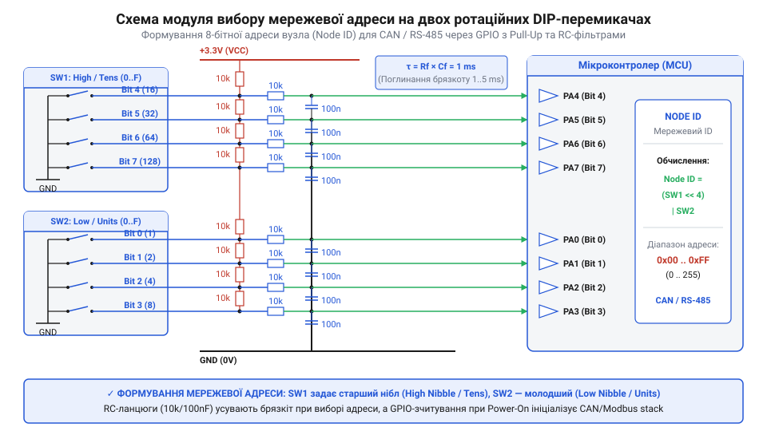

# Практичний проєкт: модуль апаратної конфігурації мережевої адреси та baudrate на ротаційних DIP-перемикачах

<preknowlist>
- [KY-040 — поворотний енкодер](root:cat-hw-controls/ky-040-encoder) — принципи формування прямокутних імпульсів на дискретних виходах
- [Багатопозиційні галетні перемикачі (Rotary Switches)](root:cat-hw-controls/rotary-selector-switches) — принципи комутації багатопозиційних контактних груп
- [Оптичні та механічні інкрементальні енкодери](root:cat-hw-controls/rotary-encoders-quadrature) — схемотехніка завадозахисту та підтяжки сигнальних ліній
</preknowlist>

## Проблема конфігурування мережевих вузлів в полі

Під час розгортання промислових мереж автоматизації на базі інтерфейсів RS-485 та CAN часто виникає проблема призначення унікальних мережевих адрес (від англ. Node ID; далі — @@en|Node ID@@) і узгодження швидкостей обміну даними (від англ. baudrate; далі — @@en|baudrate@@). Якщо всі контролери й датчики поставляються з однаковими закритими заводськими налаштуваннями (наприклад, за замовчуванням ID = 1 та @@en|baudrate@@ = 19200 біт/с), їх одночасне підключення до спільної фізичної шини призводить до важких апаратних і протокольних конфліктів. Зокрема, у мережі протоколу @@en|Modbus RTU@@ під час надсилання майстер-контролером запиту на адресу 1 усі підключені ведені пристрої одночасно сприймають кадр як адресований їм і синхронно активують свої передавачі. Внаслідок цього трансивери @@en|RS-485@@ намагаються подати різноспрямовані логічні рівні на спільні диференційні лінії A і B, виникає електрична колізія з токами короткого замикання між виходами драйверів, яка повністю спотворює форму вихідного сигналу, викликає помилки кадрування й контрольної суми @@en|CRC@@, спричиняє постійні тайм-аути та призводить до повної деградації зв'язку в сегменті. Програмне збереження налаштувань у пам'яті (від англ. Electrically Erasable Programmable Read-Only Memory; далі — @@en|EEPROM@@) здається зручним, але воно вразливе до спотворення даних при збоях живлення під час запису чи від промислових завад, що призводить до мовчазного скидання адреси. На противагу цьому, ротаційні @@en|DIP-перемикачі@@ забезпечують абсолютну апаратну надійність — фізичний стан їхніх дисків не залежить від цілісності прошивки чи перезапису пам'яті. До того ж налаштування через програмні утиліти вимагає наявності ноутбука, спеціалізованих адаптерів та індивідуального підключення кожного пристрою перед монтажем, що суттєво уповільнює пусконалагоджувальні роботи.

Рішенням цієї проблеми є використання компактних ротаційних кодових DIP-перемикачів (Rotary DIP Switches). Вони дозволяють технічному персоналу безпосередньо у польових умовах встановити мережевий ідентифікатор вузла та швидкість зв'язку за допомогою викрутки. Завдяки чіткій оцифровці корпусу у форматі BCD або Hex, налаштування залишається візуально зрозумілим і не потребує подачі живлення на пристрій для перевірки конфігурації.

Окрім візуальної верифікації без подачі живлення, ротаційні кодові перемикачі забезпечують високу механічну стійкість до вібрацій та випадкових зсувів у порівнянні з класичними повзунковими перемикачами. Пружинний механічний фіксатор чітко утримує обрану позицію контактного диска, а можливість вибору між двійково-десятковим (BCD) та шістнадцятковим (Hex) кодуванням дозволяє гнучко адаптувати модуль апаратної селекції під конкретну топологію та вимоги промислового протоколу.

## Схемотехніка підключення ротаційних DIP-перемикачів

Кожен 4-бітний ротаційний DIP-перемикач має один спільний вивід (Common) та чотири дискретні виходи із ваговими коефіцієнтами 1, 2, 4 та 8. При повороті ротора контактні диски замикають відповідні комбінації виводів на спільну лінію. Залежно від обраної схеми апаратної підтяжки, виводи підключаються до портів вводу-виводу (GPIO) мікроконтролера за схемою Pull-Up або Pull-Down.

Найпоширенішою є схема Pull-Up, де спільний вивід ротора підключається до лінії заземлення (GND), а чотири вихідні лінії зєднуються з входами мікроконтролера та підтягуються до напруги живлення +3.3 В або +5 В через резистори номіналом 10 кОм (або через внутрішні програмні резистори MCU). При цьому активний замкнений стан контакту відповідає низькому логічному рівню 0 (LOW), що вимагає програмної інверсії бітів при декодуванні. Для захисту від високочастотних завад і контактного брязкоту паралельно кожній лінії рекомендується встановлювати керамічні конденсатори ємністю 10..100 нФ, утворюючи апаратний RC-фільтр низьких частот.

При виносі ротаційних перемикачів на зовнішню панель керування довжина з'єднувальних провідників не повинна перевищувати 30–50 см, оскільки довший дріт працює як антена й наводжує на високоімпедансні входи мікроконтролера високовольтні імпульсні завади (від англ. Electrical Fast Transient; далі — @@en|EFT@@) від працюючих контакторів та частотних перетворювачів. Погонна паразитна ємність кабелю (порядку 50–100 пФ/м) разом із підтягувальним резистором `R_pull` утворює розсіяний ланцюг, здатний викликати хибні логічні переключення. Для виключення хибних спрацьовувань параметри апаратного @@en|RC-фільтра@@ розраховують за постійною часу `τ = R_pull · C_filt`. При виборі зовнішньої підтяжки `R_pull = 10 кОм` та згладжувального керамічного конденсатора `C_filt = 100 нФ` постійна часу становить `τ = 10000 Ом · 100·10⁻⁹ Ф = 1 мс`, що відповідає частоті зрізу `f_c = 1 / (2 · π · R_pull · C_filt) ≈ 1.6 кГц`. Така частотна характеристика повністю пригнічує високочастотний спектр контактного брязкоту та наведених імпульсних сплесків, але якщо довжина шлейфу перевищує 0.5 м, опір підтяжки слід зменшувати до 1..2.2 кОм для зниження імпедансу сигнальної лінії та підвищення завадостійкості @@en|GPIO@@.

## Програмне зчитування та обчислення параметрів

Зчитане з GPIO-портів значення є 4-бітним двійковим кодом. Залежно від конструкції контактного диска, кодування може бути прямому двійковим, BCD (0..9) або кодом Ґрея (Gray Code). Застосування коду Ґрея є найбільш переважним при позиціонуванні, оскільки при переході між сусідніми секторами змінюється стан лише одного контакту, що виключає виникнення хибних проміжних адрес під час повороту вала.

Програмне забезпечення зчитує стани портів, виконує маскування 4-бітної комбінації, усуває залишковий брязкот за допомогою часового інтервалу (від англ. debouncing; далі — @@en|debouncing@@) та здійснює декодування. Для двійково-десяткових ротаторів (від англ. Binary-Coded Decimal; далі — @@en|BCD@@) застосовують пряму перевірку умови `raw_code <= 9` або порозрядне перетворення через таблицю пошуку (від англ. Look-Up Table; далі — @@en|LUT@@). Оскільки 4-бітна шина фізично здатна передати 16 станів (0x0..0xF), кодові комбінації від 0xA до 0xF (десяткові 10..15) вважаються апаратним виходом за межі допустимого діапазону. При виявленні такого перевищення драйвер скидає прапорець валідності (`is_valid = false`), присвоює безпечне резервне значення та блокує передачу некоректних параметрів у системні стеки протоколів @@en|Modbus RTU@@ або @@en|CANopen@@. Якщо обидва розряди перебувають у допустимих межах, отримані нібли об'єднуються у підсумкове значення мережевої адреси (`node_id = (sw_high << 4) | sw_low`).

Нижче наведено повну реалізацію драйвера зчитування та конфігуратора вузла мовами C та C++:

:::tabs
@tab C
:::code proj-rotary-dip-network-address-selector/c/include/rotary_dip_types.h 1-53
:::code proj-rotary-dip-network-address-selector/c/include/rotary_dip_driver.h 1-63
:::code proj-rotary-dip-network-address-selector/c/src/rotary_dip_driver.c 1-132
:::code proj-rotary-dip-network-address-selector/c/main.c 1-87

@tab C++
:::code proj-rotary-dip-network-address-selector/cpp/include/rotary_dip_switch.hpp 1-74
:::code proj-rotary-dip-network-address-selector/cpp/include/node_configurator.hpp 1-57
:::code proj-rotary-dip-network-address-selector/cpp/src/rotary_dip_switch.cpp 1-60
:::code proj-rotary-dip-network-address-selector/cpp/src/node_configurator.cpp 1-45
:::code proj-rotary-dip-network-address-selector/cpp/src/main.cpp 1-82
:::

## Пусконалагодження та тестування модуля конфігурації

Під час пусконалагодження модуля апаратної селекції необхідно виконати верифікацію зчитування в усіх 16 позиціях ротора (0..F). Для перевірки стійкості до контактного брязкоту рекомендується проводити випробування зі швидким та повільним вращенням селектора під час опитування.

Основні діагностичні перевірки включають:
1. Перевірку діапазону BCD-коду: при встановленні ротора BCD-перемикача у позиції A..F драйвер має фіксувати прапорець помилки валідності (`is_valid = false`) та не допускати встановлення некоректної адреси.
2. Перевірку затримки стабілізації: зчитування параметрів має проводитися один раз під час ініціалізації при подачі живлення або з фіксованою затримкою (дебаунсинг 10..20 мс) після зміни стану ліній, щоб запобігти випадковому зміщенню адреси під час роботи пристрою.
3. Перевірку збігу адреси з вимогами протоколу: перевіряється, щоб обчислений `node_id` лежав у допустимому діапазоні (1..127 для CANopen та Modbus RTU).

Для апаратного контролю стабілізації напруги на лініях @@en|GPIO@@ використовують цифровий осцилограф. Щуп осцилографа у режимі ділення 10:1 підключають до одного із чотирьох бітових виводів перемикача, а затискач заземлення — до спільної шини @@en|GND@@ модуля, налаштовуючи синхронізацію за спадаючим фронтом сигнальної лінії. Під час поворотів ротора між сусідніми позиціями на екрані фіксують перехідний процес замикання й розмикання контактних пластин. Внаслідок механічного брязкоту напруга лінії може швидко коливатися між логічною 1 та 0 протягом кількох мілісекунд. Інженер перевіряє, щоб апаратний RC-ланцюг плавно згладжував імпульсні сплески, а залишкові амплітудні коливання повністю згасали до стабільного логічного рівня за час, що не перевищує встановлений інтервал програмного дебаунсингу (10..20 мс). Якщо перехідний процес триває довше 20 мс, це свідчить про недостатню ємність фільтра або механічний знос контактної групи.
