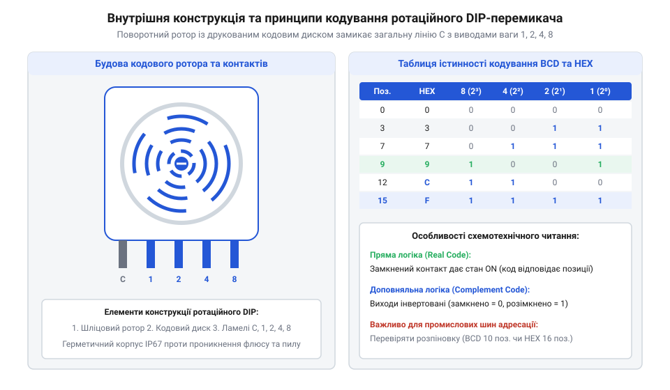
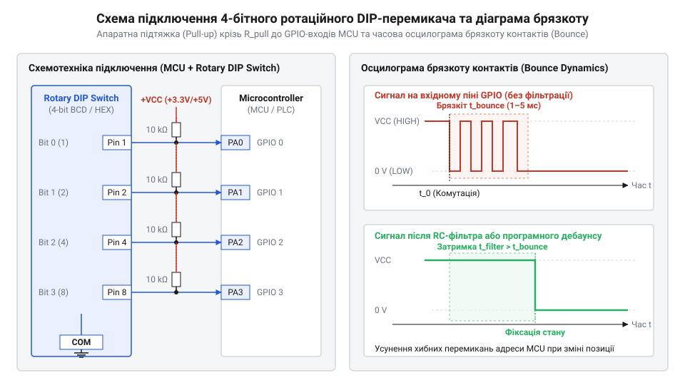

# Ротаційні кодові DIP-перемикачі (Rotary DIP Switches)

<preknowlist>
- [Багатопозиційні галетні перемикачі (Rotary Switches)](root:cat-hw-controls/rotary-selector-switches) — Принцип роботи багатопозиційних механічних комутаторів та поняття контактних груп.
</preknowlist>

## Проблема баготопозиційної конфігурації плати

У промисловій електроніці, вбудованих контролерах і мережевих давачах часто виникає потреба задати початкові параметри роботи пристрою безпосередньо на друкованій платі під час монтажу або обслуговування. Без підключення зовнішнього ПК оператор або сервісний інженер мусить налаштувати апаратну мережеву адресу вузла на шинах CAN або RS-485, встановити швидкість обміну (від @@en|baud rate@@) чи обрати режим роботи системи. Традиційні рішення на основі масивів джамперних перемичок вимагають фізичного переставляння пластикових шлунтів, що призводить до їх втрати в польових умовах та займає значну площу поверхні друкованої плати.

Альтернативою тривалий час слугували багатосекційні повзункові DIP-перемикачі з окремим механічним тумблером на кожну позицію. Проте налаштування адреси або режиму за допомогою повзункових блоків потребує від оператора ручного обчислення двійкового коду. Наприклад, для задання шістнадцяткової адреси `0xD` (десяткове `13`) необхідно подумки перевести число у 4-бітний двійковий код `1101`. Оператор мусить послідовно встановити перемикачі першого, другого та четвертого розрядів у положення «ввімкнено». Крім високої ймовірності людської помилки, повзункова конструкція схильна до прискореного лінійного механічного зносу: при кожному перемиканні ламель долає хід `s ≈ 1.5–2.0 мм`, і за серію з `N_cycles = 1000` переналаштувань сумарний шлях лінійного тертя `L_slide = N_cycles × 2s` сягає `3–4 м`. Такий лінійний зсув стирає захисне позолочення товщиною `0.2–0.5 мкм` до нікелевої основи, збільшуючи перехідний опір з початкових `50 мОм` до понад `10 Ом` і викликаючи розхитування пластикових направляючих. У реальних умовах це спричиняє масові помилки людського фактора та неконтрольовані відмови через хибне зчитування бітів на щільно змонтованих платах у шафах автоматики. Окрім ризику помилок, стандартний блоковий 4-позиційний повзунковий перемикач займає значну площу поверхні друкованої плати близько 120 мм². Компактний 4-бітний ротаційний DIP-перемикач має квадратний корпус із площею поверхні лише 49 мм². Це скорочення посадкового місця економить понад 50% корисної площі плати та спрощує трасування щільних електронних модулів. При масовому введенні об'єкта зі 100–200 мережевими вузлами на ручні обчислення та виставляння мікроскопічних повзунків інженер витрачає від 45 до 60 секунд на кожну плату. Цей процес забирає понад 2–3 години робочого часу лише на рутинні перетворення. Статистика помилок досягає 3–5% і вимагає додаткових годин на пошук дубльованих адрес та повторне переналаштування. Для панельного монтажу застосовують великі [багатопозиційні галетні перемикачі](root:cat-hw-controls/rotary-selector-switches) або [декадні барабанні перемикачі](root:cat-hw-controls/thumbwheel-switches). Проте такі пристрої є занадто громіздкими для монтажу на друковану плату (від англійського *printed circuit board* — друкована плата; @@en|PCB-mount@@). Для панельних систем високої потужності використовують класичні [багатопозиційні галетні перемикачі](root:cat-hw-controls/rotary-selector-switches).

Розв'язанням цієї проблеми стало створення компактних ротаційних кодових перемикачів (від @@en|rotary DIP switch@@). Вони об'єднують механіку поворотного ручного контролера із прямою видачею паралельного цифрового коду. Замість маніпуляцій з чотирма окремими ползунками оператор повертає єдиний ротор викруткою або пальцем у потрібне циферблатне положення від `0` до `9` або від `0` до `F`. Внутрішня контактна система перемикача миттєво перетворює кутове положення ротора у відповідну 4-бітну комбінацію на вихідних штирях. Детальніше [історію розвитку кодових перемикачів](root:cat-hw-controls/rotary-dip-switches/hist-evolution-of-rotary-dip-switches.md) висвітлено у відповідному матеріалі.

## Конструкція ротора та електричне кодування

Внутрішня механічна будова ротаційного кодового DIP-перемикача містить три ключові елементи: поворотний ротор із кодовим диском (від @@en|code disc@@), систему нерухомих контактних ламелей (від @@en|contact wiper@@) та кулачково-фіксаторний механізм (від @@en|detent mechanism@@). Ротор виготовляють із термостійкого диелектричного пластику, на нижньому боці якого запресовано або витравлено металевий диск із комбінацією струмопровідних радіальних доріжок. Під час повертання ротора ці доріжки почергово замикають пружні контактні ламелі, під'єднані до вихідних виводів компонента та спільного виводу (Common, `C`). Для забезпечення чіткого тактильного відгуку та точного позиціонування ротора над відповідною цифровою позначкою використовують підпружинений кулачковий фіксатор із кулькою або штифтом, який западає у V-подібний паз диска при кожному кроці. Геометричний розрахунок кутового кроку фіксатора `Δθ` жорстко прив'язаний до кількості позицій: для 10-позиційного BCD-перемикача кутовий крок становить `Δθ = 360° ÷ 10 = 36°`, а для 16-позиційного HEX-перемикача — `Δθ = 360° ÷ 16 = 22.5°`. Менший кутовий крок `22.5°` вимагає підвищеної точності штампування пазів із допуском `±0.5°`, оскільки найменша кутова похибка фіксації призводить до зміщення ламелі відносно центрів кодових доріжок диска й спричиняє неповне замикання контактів.

*Конструкція ротаційного кодового DIP-перемикача з кодовим диском, контактними ламелями та діаграмою замикання виходів у позиціях BCD та HEX.*

У ротаційному DIP-перемикачі формування цифрового коду відбувається геометричним розташуванням доріжок на кодовому диску. Залежно від конфігурації профілю доріжок випускають пристрої з різними типами вихідного кодування:
1. Двійково-десятковий код (від @@en|Binary-Coded Decimal@@, BCD): має 10 фіксованих положень (від `0` до `9`) і 4 вихідні лінії розрядів з вагами `1`, `2`, `4`, `8`.
2. Шістнадцятковий код (від @@en|Hexadecimal@@, HEX): містить 16 положень (від `0` до `F`), що охоплюють увесь діапазон комбінацій 4-бітного слова від `0000` до `1111`.
3. Код Ґрея (від @@en|Gray code@@): розроблений для систем, де критично усунути проміжні гонки станів при переході між сусідніми позиціями, оскільки при повороті на один крок змінюється стан лише одного біта. Наприклад, у класичному двійковому коді при переході від позиції `7` (`0111`) до позиції `8` (`1000`) змінюють свій стан одразу всі чотири розряди: три старші розмикаються, а перший замикається, що через найменшу розсинхронізацію механічних ламелей створює кодовий сплеск на кшталт `0000` або `1111`. Натомість у 4-бітному коді Ґрея позиції `7` відповідає комбінація `0100`, а позиції `8` — комбінація `1100`, завдяки чому при переході змінюється стан виключно одного найстаршого біта, повністю усуваючи ризик зчитування хибного проміжного числа. Крім того, відрізняється й сама комбінація замкнених ліній: для числа `9` у кодуванні BCD активними є лише розряди `1` та `8` (`1001`), тоді як у коді Ґрея числу `9` відповідає комбінація `1101`, де замкнено три розряди (`8`, `4` та `1`), що вимагає відповідного табличного перекодування в програмі мікроконтролера.

Для реалізації комплементарного (інверсного) кодування (від @@en|Complementary code@@) застосовують інверсну кодову шайбу з дзеркальним топографічним малюнком, де замість окремих провідних секторів витравлено суцільне металеве поле спільного виводу `C`, перерите ізоляційними виступами з диелектрика. Механізм формування інверсного сигналу полягає в тому, що при повороті ротора пружна контактна ламель активного розряду натрапляє на пластиковий острівець шайби та механічно віджимається від струмопровідного поля, розмикаючи коло зі спільним виводом. У цей момент вивід переходить у стан високого імпедансу, формуючи на лінії підтяжки логічний нуль або одиницю залежно від схеми, тоді як у неактивних позиціях ламель лишається притиснутою до суцільного металу шайби, подібна контактна будова застосовується також у пристроях типу [декадні барабанні перемикачі](root:cat-hw-controls/thumbwheel-switches).

Крім того, розрізняють пряму (від @@en|Direct logic@@) та комплементарну або інверсну (від @@en|Complementary logic@@) логіку контактів. У перемикачах із прямою логікою замкнений стан ламелі на спільний вивід відповідає логічній одиниці `1` відповідного розряду. У комплементарних перемикачах навпаки — активний біт розмикає контакт із лінією, формуючи логічний нуль `0`. Використання інверсної логіки дозволяє зменшити енергоспоживання в системах із внутрішніми підтяжками до живлення, адже більшість розрядів у вимкненому стані не споживають струм через розімкнені контакти. Глибоку [математичну модель мапування кодувань](root:cat-hw-controls/rotary-dip-switches/math-rotary-dip-code-conversion-and-bitmasking.md) деталізовано в окремій праці.

## Схемотехніка зчитування та придушення брязкоту

Для зчитування положення 4-бітного ротаційного кодового DIP-перемикача його виводи розрядів `1`, `2`, `4`, `8` під'єднують до дискретних входів (GPIO) мікроконтролера, а спільний вивід (Common, `C`) заземлюють на лінію `GND`. Оскільки контакти перемикача є механічними ключами, розімкнений стан виводу залишає вхід у плаваючому стані. Для формування чітких логічних рівнів застосовують резистори підтяжки (від англ. @@en|pull-up resistor@@) до лінії живлення `VCC` опором 10–47 кОм. Використання внутрішніх програмних підтяжок мікроконтролера спрощує трасування плати, але в умовах сильних промислових електромагнітних завад рекомендують встановлювати зовнішні дискретні резистори. Коли контакт розімкнений, на вході утримується логічна одиниця без струму споживання, проте при замкненні контакта вхід затягується на `GND`, формуючи активний логічний нуль. При цьому від лінії `VCC` через замкнений контакт на `GND` протікає постійний струм витоку. Підсумковий струм споживання вхідного каскаду `I_total` залежить від напруги живлення `VCC`, опору підтяжувального резистора `R_pull`, струму одного каналу `I_pull` та кількості одночасно активних логічних нулів `N_active`. У низьковольтних системах із живленням `VCC = 1.8 В` розрахунок опору підтяжки вимагає врахування нижчого порогу логічної одиниці `V_IH` та струму витоку входу `I_leak`: вибір занадто великого опору `R_pull` (понад 47 кОм) зменшує струм витоку, але створює ризик хибного спрацьовування через спад напруги на резисторі від витоку входу та підвищену чутливість до наводок. Для випадку 4 замкнених контактів (стан `0xF` у HEX) при `VCC = 3.3 В` та `R_pull = 10 кОм` покроковий розрахунок виглядає так:

        I_pull
        = VCC ÷ R_pull                                         [закон Ома для одного підтяжувального резистора]
        = 3.3 ÷ 10 000                                         [підстановка напруги 3.3 В та опору 10 кОм]
        = 0.00033 А                                            [значення струму в амперах]
        = 0.33 мА                                              [струм витоку одного активного логічного нуля]

        I_total
        = N_active × I_pull                                    [сумування струмів усіх замкнених ліній]
        = 4 × 0.33                                             [підстановка N_active = 4 для позиції 0xF]
        = 1.32 мА                                              [підсумковий струм споживання вхідного каскаду]

При живленні системи напругою `VCC = 1.8 В` аналогічний покроковий розрахунок із тим самим резистором `R_pull = 10 кОм` дає струм одного каналу `I_pull = 1.8 ÷ 10 000 = 0.18 мА` та підсумкове споживання `I_total = 4 × 0.18 = 0.72 мА`, що майже вдвічі менше за рівень 3.3 В, проте вимагає суворішого дотримання верхньої межі опору для збереження запасу завадостійкості.

Отримане значення `I_total = 1.32 мА` створює постійне навантаження на лінію живлення ввесь час, поки контакти знаходяться в замкненому стані, що є критичним для пристроїв із батарейним живленням. Збільшення опору `R_pull` до `47 кОм` зменшує струм одного каналу до `0.07 мА`, а підсумковий струм до `0.28 мА`, однак при цьому зростає вразливість вхідного каскаду до електромагнітних завад (від англ. @@en|electromagnetic interference@@).

I_pull = VCC ÷ R_pull
       = 3.3 ÷ 10 000                                          [законом Ома для одного резистора 10 кОм при 3.3 В]
       = 0.00033 А                                             [переведення в ампери]
       = 0.33 мА                                               [струм одного активного каналу]

I_total = N_active × I_pull
        = 4 × 0.33                                             [підстановка N_active = 4 для позиції 0xF]
        = 1.32 мА                                              [підсумковий струм споживання вузла]

Значення `I_total = 1.32 мА` є помітним для пристроїв із батарейним живленням. Збільшення опору `R_pull` до `47 кОм` знижує струм до `0.28 мА`, проте зростає чутливість кіл до електромагнітних завад (від @@en|electromagnetic interference@@). Детальний [електричний інтерфейс ротаційних перемикачів](root:cat-hw-controls/rotary-dip-switches/api-rotary-dip-switch-pinout-and-schematics.md) із варіантами підключення висвітлено в окремому довіднику.

Головною фізичною проблемою механічної комутації є брязкіт контактів (від @@en|contact bounce@@) — швидкі серії неконтрольованих розмикань і замикань тривалістю 1–5 ммс під час встановлення ламелі на доріжку. У ротаційних перемикачах брязкіт ускладнюється явищем гонок станів (від @@en|race condition@@), коли під час повертання ручки між сусідніми позиціями ламелі різних бітів розмикаються та замикаються несинхронно. Наприклад, при переході з числа `7` (`0111` у двійковому коді) до числа `8` (`1000`) можлива коротка проміжна комбінація `0000` або `1111`, якщо один контакт розімкнеться раніше, ніж замкнеться інший.

*Схемотехніка зчитування станів 4-бітного ротаційного DIP-перемикача GPIO-входами мікроконтролера з резисторами підтяжки та часова діаграма часового придушення брязкоту контактів.*

Для усунення збоїв зчитування застосовують програмне придушення брязкоту (від @@en|debouncing@@). Оскільки ротаційні DIP-перемикачі слугують органом статичної конфігурації, їхній стан зазвичай зчитують один раз при включенні живлення системи (під час ініціалізації після скидання RESET). Програму налаштовують на витримку паузи 20–50 ммс після подачі живлення перед фіксацією стану GPIO, або виконують багаторазове повторне зчитування з перевіркою збігу 3–5 послідовних вибірок. На відміну від інкрементальних органів керування, як-от [оптичними та механічними інкрементальними енкодерами](root:cat-hw-controls/rotary-encoders-quadrature), де потрібна безперервна обробка переривань, ротаційний DIP-перемикач не вимагає ресурсоємного опитування. Готовий [програмний інтерфейс драйвера зчитування](root:cat-hw-controls/rotary-dip-switches/api-rotary-dip-code-parsing-driver.md) наведено в спеціалізованій вставці.

## Герметичність IP67 та промислові помилки

Під час автоматизованого монтажу друкованих плат на лінії поверхневого (SMD) або наскрізного (THT) монтажу електронні компоненти піддаються пайці хвилею (від @@en|wave soldering@@) та подальшому ультразвуковому або хімічному миттю від залишків флюсу. Якщо корпус перемикача негерметичний, рідкий флюс або мийний розчин потрапляє всередину роторного вузла, залишаючи діелектричну плівку на кодовому диску або спричиняючи корозію ламелей. Для роботи в жорстких умовах розроблено герметичні ротаційні DIP-перемикачі зі ступенем захисту IP67. Вони містять внутрішнє кільцеве ущільнення ротора (від @@en|O-ring seal@@) та захисну плівку зверху (від @@en|top tape seal@@), яку знімають після завершення процесів миття плати.

Типовою інженерною помилкою при розробці пристроїв є неуважність до типу логіки контактів. Якщо в схемі закладено перемикач із комплементарною (інверсною) логікою, а мікроконтролерний драйвер інтерпретує замкнений контакт як логічний `1`, пристрій зчитає інвертований код адреси. Це призводить до дублювання мережевих адрес або збоїв зв'язку на шинах CAN, Modbus та RS-485 через конфлікти арбітражу. Практичну реалізацію такого вузла проілюстровано у матеріалі [апаратної конфігурації мережевої адреси](root:cat-hw-controls/rotary-dip-switches/proj-rotary-dip-network-address-selector.md).

Іншою прихованою проблемою є окиснення контактів при роботі в колах з мікрострумами (від англ. @@en|dry circuit@@), де електрична напруга розмикання нижча за `20 мВ` або струми не перевищують `1 мА`. За таких умов електрична дуга відсутня, і контакти позбавлені фізичної можливості випалювати поверхневі оксиди, через що контактний опір замкненого стану у сухому колі може зростати від номінальних `50 мОм` до сотень ом, викликаючи хибні логічні рівні. У перемикачах зі срібним покриттям (від англ. @@en|silver plating@@) атмосферне середовище утворює шар сульфіду срібла, для електричного пробою якого потрібен граничний струм змочування (від англ. @@en|wetting current@@) не менше 10–50 мА при напрузі вище 10 В. Оскільки підтяжувальний резистор 10 кОм при 3.3 В обмежує струм значенням лише 0.33 мА, цього потенціалу катастрофічно бракує для пробою оксиду, що призводить до спорадичних втрат контакту та хибного зчитування коду. Для надійного зчитування логічних рівнів у цифрових колах необхідно обирати перемикачі з золотим покриттям контактів (від англ. @@en|gold plating@@). Фізика захисту полягає в нанесенні шару зносостійкого твердого золота товщиною `0.2–0.5 мкм` поверх нікелевого підшару (від англ. @@en|nickel underplate@@) товщиною 1.5–3.0 мкм: нікель блокує міжкристалічну дифузію мідної основи ламелі на поверхню, а хімічно інертне золото товщиною від `0.2 мкм` запобігає утворенню оксидів і забезпечує стабільний опір контакту до `50 мОм` навіть після тисяч циклів тертя ротора. Конструктивно вибір виконання залежить від технологічного процесу паяння та доступу до плати: версії з верхнім регулюванням (Top Adjust) зручні для відкритих плат, тоді як бокові версії (Side Adjust, під кутом 90°) виводять ротор на передню панель корпусу. Крім того, вибір між поверхневим (SMD) та наскрізним (THT) монтажем вимагає суворого дотримання температурних профілів паяння, щоб уникнути деформації термопластикового корпусу та пошкодження внутрішнього O-подібного ущільнення.

| Тип монтажу | Технологічний процес | Температура попереднього нагріву | Максимальна пікова температура | Граничний час впливу |
| :--- | :--- | :--- | :--- | :--- |
| **THT** | Паяння хвилею припаю (Wave Soldering) | 100–120 °C (60 с) | 260 °C ± 5 °C | 5–10 с |
| **SMD** | Конвекційне паяння оплавленням (Reflow Soldering) | 150–200 °C (60–120 с) | 245–260 °C | 30–60 с (вище 217 °C) |

Недотримання вказаних температурних режимів призводить до розплавлення захисних мембран та розгерметизації роторного вузла, через що флюсові змивки потрапляють безпосередньо на контактну групу.
