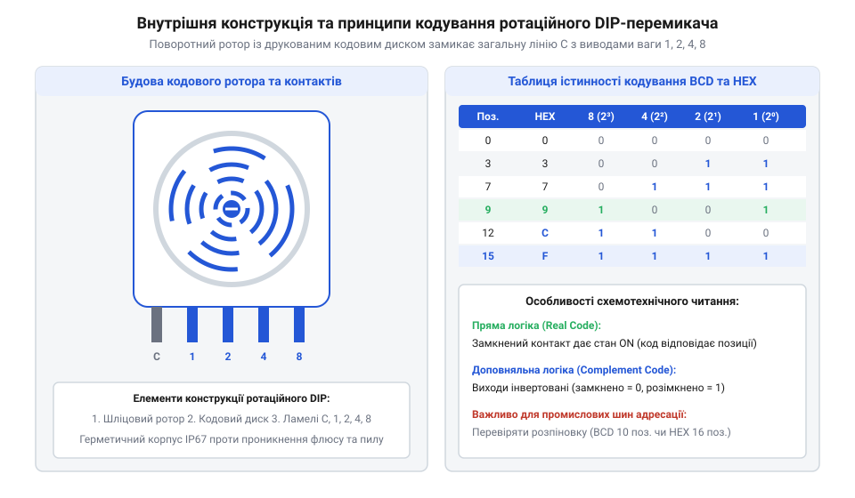
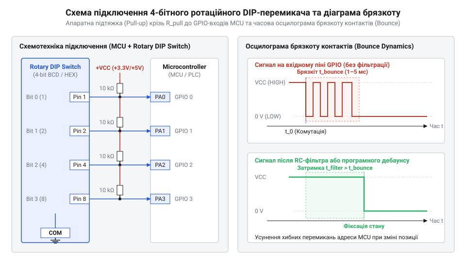

# Ротаційні кодові DIP-перемикачі (Rotary DIP Switches)

<preknowlist>
- [Багатопозиційні галетні перемикачі (Rotary Switches)](root:cat-hw-controls/rotary-selector-switches) — розуміння принципів роботи багатопозиційних механічних комутаторів та контактних груп
</preknowlist>

## Проблема багатопозиційної конфігурації плати

Апаратне налаштування режимів та мережевих адрес на друкованій платі вимагає компактних елементів. Джампери схильні до втрати перемичок, а повзункові блоки змушують вручну розраховувати двійковий код, що призводить до помилок персоналу.

Ротаційні кодові перемикачі (англ. @@en|rotary DIP switches@@) вирішують це, поєднуючи наочний циферблат із кодовим диском. Оператор обирає позицію поворотним шліцом, а виводи формують 4-бітну комбінацію. На відміну від громіздких [багатопозиційних галетних перемикачів](root:cat-hw-controls/rotary-selector-switches), ротаційний DIP-перемикач монтується на плату в SMD чи DIP-корпусі, заощаджуючи площу й усуваючи помилки конфігурування.

## Будова ротора та кодування виходів

Всередині ротаційного перемикача розташовано ротор із кодовим диском та кулачковий фіксатор (англ. @@en|detent mechanism@@), який утримує ротор проти контактів статора. При обертанні диск замикає вивід `COM` із комбінацією чотирьох кодових виходів.

*Конструкція поворотного ротора з кодовим диском, що ілюструє формування 4-бітного вихідного коду BCD, HEX та завадостійкого коду Ґрея.*

Залежно від завдань застосовують двійково-десятковий BCD (англ. @@en|binary-coded decimal@@, 10 положень `0...9`), шістнадцятковий HEX (англ. @@en|hexadecimal@@, 16 положень `0...F`) або код Ґрея (англ. @@en|Gray code@@). У коді Ґрея при переході між сусідніми позиціями змінюється лише один біт, що усуває гонки станів (англ. @@en|race conditions@@). Перемикачі виготовляють із прямою (англ. @@en|real code@@) або комплементарною логікою (англ. @@en|complementary code@@, інверсний вихід).

## Схемотехніка підключення та придушення брязкоту

Механічні виходи перемикача потребують підтяжувальних резисторів `R_pull` до лінії `V_CC`. При підключенні виводу `COM` до `GND` замкнений контакт дає низький рівень `0 V`, а розімкнений — високий `V_CC`.

*Принципова схема підключення кодових виходів до мікроконтролера та алгоритм фільтрації контактного брязкоту.*

Для батарейних пристроїв опір `R_pull = 100 кОм` знижує струм замкненого контакту до `33 мкА` (проти `0.33 мА` при `10 кОм`), заощаджуючи заряд.

При повороті ротора виникає контактний брязкіт (англ. @@en|contact bounce@@) тривалістю `1...5 мс`, тому драйвер виконує фільтрацію (англ. @@en|debouncing@@) із паузою `10...20 мс` або витримку під час включення (англ. @@en|power-on delay@@) для відсікання транзитних станів.

## Захист IP67 та промисловий монтаж

Під час монтажу на плату перемикачі піддаються впливу флюсу, припою та змивальних розчинів, проникання яких призводить до корозії контактів. Для захисту при паянні та відмивці корпуси виготовляють у герметичному виконанні за стандартом IP67 з ущільнювачами (англ. @@en|O-ring seal@@) або видалюваними плівками.

У сухих колах (англ. @@en|dry circuits@@) з мікрострумами (менше `5 V` та `1 мА`) дуговий розряд відсутній, і контакти не самоочищаються. Для надійної комутації їх покривають шаром золота за технологією ENIG (англ. @@en|Electroless Nickel Immersion Gold@@).

При паянні хвилею (англ. @@en|wave soldering@@) для THT або оплавленням (англ. @@en|reflow soldering@@) для SMD важливо дотримуватися температурного профілю: перегрів понад `260 °C` деформує пластик і руйнує ущільнювачі, порушуючи герметичність IP67.
