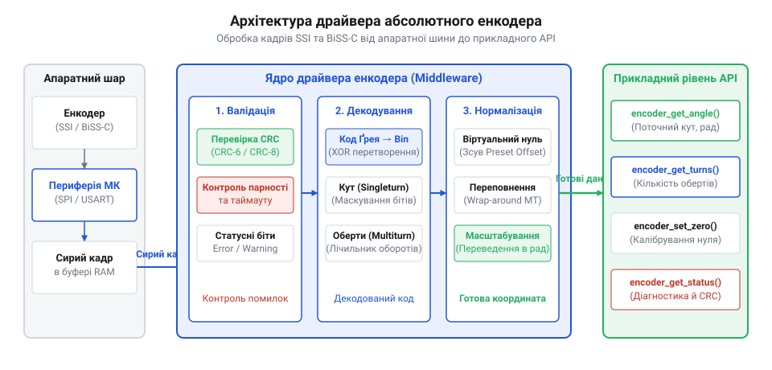
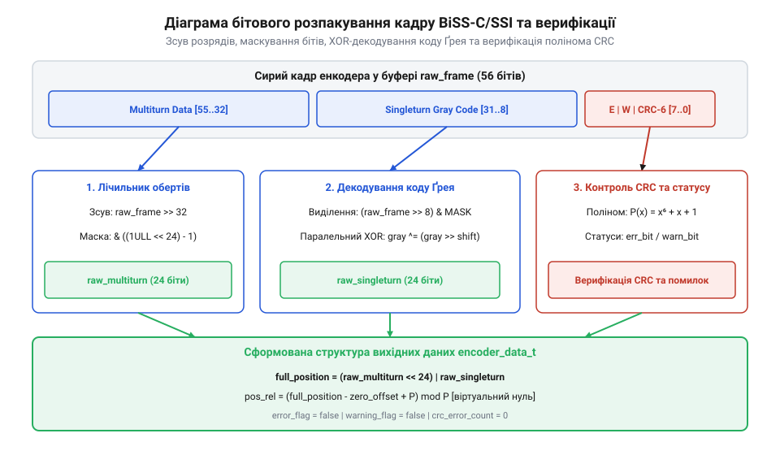

# Програмний інтерфейс драйвера зчитування абсолютних енкодерів

<preknowlist>
- [Оптичні та механічні інкрементальні енкодери](root:cat-hw-controls/rotary-encoders-quadrature) — Принцип формування імпульсів та відмінність від абсолютного відліку позиції.
- [Дрейф нуля та калібрування органів вводу](root:cat-hw-controls/stick-drift-mitigation) — Algorithmic methods of zero offset compensation and non-volatile parameter storage.
</preknowlist>

## Проблема зчитування позиції та архітектура драйвера

У високоточних системах керування рухом (наприклад, сервоприводах чи суглобах роботів) вичитання координати з абсолютного енкодера по цифрових шинах SSI чи BiSS-C супроводжується ризиками втрати синхронізації та зчитування некоректних даних. Через швидкісні перехідні процеси, завади у довгих кабелях чи тимчасове знеструмлення приймач може зафіксувати спотворений кадр. Щоб ізолювати прикладну програму від низькорівневих апаратних затримок та аномалій шини, створюють проміжний програмний драйвер (англ. @@en|firmware driver@@). Він реалізує буферизацію кадру, виділення розрядів координати, перевірку контрольних сум та первинну фільтрацію. При асинхронному опитуванні через прямий доступ до пам’яті (англ. @@en|DMA@@, від @@en|Direct Memory Access@@) периферія без участі процесора перезаписує кадри у кільцевий буфер з частотою дискретизації `f_sample`, утворюючи часову затримку буферизації `t_buf = N_buf ÷ f_sample`, яка для буфера глибиною `N_buf = 4` кадри при частоті `10 kHz` складає `400 μs`. Математичний вибір глибини кільцевого буфера `N_buf = 4` обґрунтований необхідністю запобігання перезапису незчитаних даних (англ. @@en|buffer overrun@@) при максимальному джитері обробки переривань (англ. @@en|interrupt jitter@@) `t_jitter_max`. Якщо центральний процесор затримує виклики обробника DMA через виконання критичних секцій із вимкненими перериваннями на час `t_jitter_max ≤ 250 μs`, а час виконання процедури розбору кадру становить `t_exec ≈ 100 μs`, мінімально припустима глибина буфера визначається нерівністю `N_buf ≥ (t_jitter_max + t_exec) × f_sample`. При `f_sample = 10 kHz` (період дискретизації `100 μs`) та сумарній затримці `250 μs + 100 μs = 350 μs` розрахункове значення `3.5` заокруглюється до найближчого більшого цілого `N_buf = 4`, що гарантує відсутність втрат кадрів під час пікових затримок операційної системи реального часу.

*Архітектура програмного інтерфейсу: апаратна периферія передає сирі кадри у буфер драйвера, де відбувається декодування коду Ґрея, верифікація CRC та розрахунок віртуального нуля.*

Драйвер будується за принципом чіткого розділення залізнично-залежного шару периферії (SPI чи точний таймер) та платформо-незалежної математичної логіки. Це дозволяє легко переношувати обробку даних між різними мікроконтролерами без зміни коду вищого рівня.

## Конфігурація периферії та структури даних

Для адаптації драйвера під конкретну модель енкодера та фізичні параметри ліній зв'язку використовують конфігураційну структуру. Вона містить частоту тактування шини f_clk, бітову довжину однооборотного диска N_single, кількість бітів обертів M_multi, тип інтерфейсу (SSI або BiSS-C) та формат кодування.

:::tabs
:::code api-absolute-encoder-firmware-driver/c/snippet-1.c
<!-- slide -->
:::code api-absolute-encoder-firmware-driver/cpp/encoderprotocol.cpp
:::

Конфігураційні структури дозволяють ініціалізувати драйвер єдиною функцією, перевіряючи коректність усіх системних уставок до запуску циклу опитування. Збіг параметрів важливий, коли сумарна довжина кадру (сума однооборотних розрядів `N_single`, багатооборотних `M_multi` та службових бітів стану або контрольної суми `N_service`) перевищує 32 біти. У цьому разі первинні бітові дані зчитуються у 64-розрядну змінну буфера `uint64_t`, а для виділення окремих полів застосовують програмне вирівнювання та маскування бітів (англ. @@en|bit masking@@, від @@en|mask@@). Наприклад, при сумарній розрядності кадру 56 бітів, де 24 біти відведено під лічильник обертів (`M_multi = 24`), 24 біти — під однооборотну кутову позицію (`N_single = 24`), а молодші 8 бітів містять статус і контрольну суму (`N_service = 8`), кадр займає розряди від `0` до `55` у буфері `raw_frame`. Виділення молодших службових бітів виконується операцією `raw_frame & ((1ULL << 8) - 1)`, що виділяє маскою `0xFFULL` 8 молодших розрядів. Для зчитування однооборотної координати драйвер виконує зсув бітів (англ. @@en|bit shift@@, від @@en|shift@@) праворуч `raw_frame >> 8` і накладає маску `(1ULL << 24) - 1` (значення `0xFFFFFFULL`), а для багатооборотного лічильника виконується зсув на `N_single + N_service = 32` біти: `(raw_frame >> 32) & ((1ULL << M_multi) - 1)`. Таке математичне вирівнювання з послідовним зсувом розрядів і маскуванням ізолює кожне поле кадру та запобігає спотворенню даних через зміщення розрядних меж при зчитуванні з двох послідовних 32-розрядних регістрів периферії.

## Декодування коду Ґрея та обчислення CRC

Сирі бітові кадри, зчитані з енкодера, часто представлені кодом Ґрея для запобігання міжкодовим помилкам при обертанні. Драйвер виконує швидке побітове декодування коду Ґрея у двійковий формат за допомогою паралельного XOR-зсуву, після чого перевіряє цілісність даних за допомогою контрольної суми CRC-6 чи CRC-8.

*Послідовність розпакування: виділення розрядів координати з кадру, XOR-перетворення коду Ґрея та перевірка залишку ділення полінома CRC.*

:::tabs
:::code api-absolute-encoder-firmware-driver/c/encoder-gray-to-binary.c
<!-- slide -->
:::code api-absolute-encoder-firmware-driver/cpp/snippet-4.cpp
:::

Використання вбудованих макросів та побітових зсувів гарантує виконання верифікації за лічені наносекунди без затримки основного процесорного потоку. Математичний вибір 6-бітного твірного полінома (англ. @@en|generator polynomial@@) `P(x) = x⁶ + x + 1` (маска `0x03`) у специфікації @@en|BiSS-C@@ обґрунтований забезпеченням кодової відстані Хеммінга (англ. @@en|Hamming distance@@) `d_min = 3` для кадрових послідовностей завдовжки до `63` бітів. На практиці для конкретного 24-бітного кадру @@en|BiSS-C@@ зі значенням коду `0xA5C012` (у двійковій формі `10100101 11000000 00010010₂`) розрахунок відбувається послідовним побітовим діленням за модулем 2 зліва направо: початкова 6-бітна регістрова змінна залишку ініціалізується нулем (`0x00`), при обробці старшого біта `1` виконується лівий зсув `000000₂ << 1` із побітовою операцією @@en|XOR@@ на маску `0x03` через розбіжність вхідного біта з вихідним старшим бітом @@en|MSB@@ залишку, переводячи стан у `0x03` (`000011₂`), на другому кроці для біта `0` зсув дає `0x06` (`000110₂`), а третій крок із бітом `1` змінює залишок на `0x0F` (`001111₂`). Коли у процесі зсуву старший розряд залишку @@en|MSB@@ стає рівним `1` (наприклад, на 18-му кроці при обробці біта `0`), алгоритм враховує переповнення та коректно модифікує зсунуте значення до `0x38`, а після обробки всіх 24 бітів проміжне значення залишку піддається фінальній інверсії `crc ^ 0x3F`, що дає підсумкову 6-бітну контрольно-поперечну суму для верифікації. Це математично забезпечує `100%` виявлення будь-яких поодиноких і подвійних бітових помилок, а також пакетних завад (англ. @@en|burst errors@@) довжиною до 6 бітів у диференційних лініях @@en|RS-422@@. Така верифікація запобігає прийняттю спотворених координатних даних у критичних циклах керування сервоприводами.

## Калібрування та програмний зсув нуля

При монтажі енкодера на вал електродвигуна чи механічного редуктора фізична нульова відмітка кодувального диска рідко збігається з механічним нулем робочого органу. Щоб уникнути трудомісткого фізичного розвертання корпусу енкодера, у драйвері реалізують функціонал програмного зміщення нуля (англ. @@en|software zero preset@@). Метод полягає у збереженні поточного абсолютного значення як оффсету `zero_offset` у нелеткій пам’яті EEPROM або Flash (див. [калібрування та дрейф нуля](root:cat-hw-controls/stick-drift-mitigation)). Щоб раптове знеструмлення під час запису не пошкодило калібрувальні дані, драйвер застосовує атомарний запис (англ. @@en|atomic write@@, від @@en|atom@@): значення `zero_offset` зберігається разом із магічним ключем та контрольною сумою у двобуферній конфігураційній структурі, а оновлення в оперативній пам'яті відбувається лише після успішної верифікації транзакції. Особливої уваги вимагає обчислення відносної координати `pos_rel`, коли поточна вичитана позиція `pos_abs` виявляється меншою за оффсет `zero_offset`. У беззнаковій арифметиці C/C++ пряме віднімання `pos_abs - zero_offset` викликає від'ємне переповнення (англ. @@en|underflow@@). Оскільки розрядність енкодера обмежена `N` бітами з кількістю відліків на оборот `P = 2ⁿ`, для обробки такого від'ємного відхилення до різниці додають модуль розрядності `P`, що у двійковій арифметиці доповняльного коду (англ. @@en|two's complement@@) еквівалентно накладанню бітової маски (англ. @@en|bitmask@@) `MASK = (1U << N) - 1`:

pos_rel = (pos_abs - zero_offset + P) mod P                       [визначення відносної координати для від'ємної різниці]
= (pos_abs + P - zero_offset) mod P                               [компенсація підмодульного відхилення при pos_abs < zero_offset]
= (pos_abs - zero_offset) & MASK                                  [еквівалентний розрахунок у беззнаковій арифметиці по масці MASK = 2ⁿ - 1]

Завдяки властивостям доповняльного коду, операція побітового `AND` з маскою `MASK` коректно повертає позитивне значення відносної координати `pos_rel` в інтервалі від `0` до `P - 1` незалежно від того, чи перетнув вал точку фізичного переповнення `0 / P`. Це дає змогу оператору безпечно зафіксувати новий віртуальний нуль у будь-якій точці діапазону.

Поточна відносна позиція pos_rel обчислюється як різниця між вичитаним абсолютним значенням pos_abs та збереженим оффсетом з урахуванням кільцевого переповнення розрядності P = 2ⁿ:

        pos_rel = (pos_abs - zero_offset + P) mod P    [розрахунок відносної координати з урахуванням модуля переповнення]

Завдяки цьому оператор може в будь-який момент зафіксувати новий віртуальний нуль єдиною командою encoder_set_zero().

## Обробка помилок та прапорців стану

Кадр даних BiSS-C та розширений кадр SSI містять системні прапорці діагностики. Найважливішими з них є біт помилки E (сигналізує про несправність випромінювача чи зсув диска) та біт попередження W (сигналізує про забруднення оптичної маски чи вихід температури за норму). Також для багатооборотних енкодерів перевіряється біт низького заряду резервної батареї (англ. @@en|low battery warning@@).

:::tabs
:::code api-absolute-encoder-firmware-driver/c/encoder-process-frame.c
<!-- slide -->
:::code api-absolute-encoder-firmware-driver/cpp/encoderstatus.cpp
:::

У разі виявлення системного аварійного прапорця чи збою CRC драйвер відкидає поточний кадр і запускає обробник повторних спроб (англ. @@en|retry@@ mechanism). Для відсікання короткочасних завад шини чи поодиноких тайм-аутів драйвер виконує до трьох послідовних спроб повторного опитування енкодера з мікросекундною затримкою між кадрами (`t_retry ≈ 20 мкс`). Якщо під час повторних спроб отримано валідний кадр з коректною контрольною сумою, драйвер поновлює нормальну видачу координат. Якщо ж усі спроби вичерпано або зафіксовано критичний апаратний збій (зокрема спрацювання біта @@en|low battery warning@@), драйвер остаточно відкидає кадр, фіксує помилку `ENCODER_ERR_TIMEOUT` або `ENCODER_ERR_CRC`, переходить до безпечного режиму утримання останньої достовірної позиції та надсилає аварійне сповіщення вищому контролеру руху, запобігаючи неконтрольованій зміні координати, коли виконується [калібрування дрейфу нуля](root:cat-hw-controls/stick-drift-mitigation).
