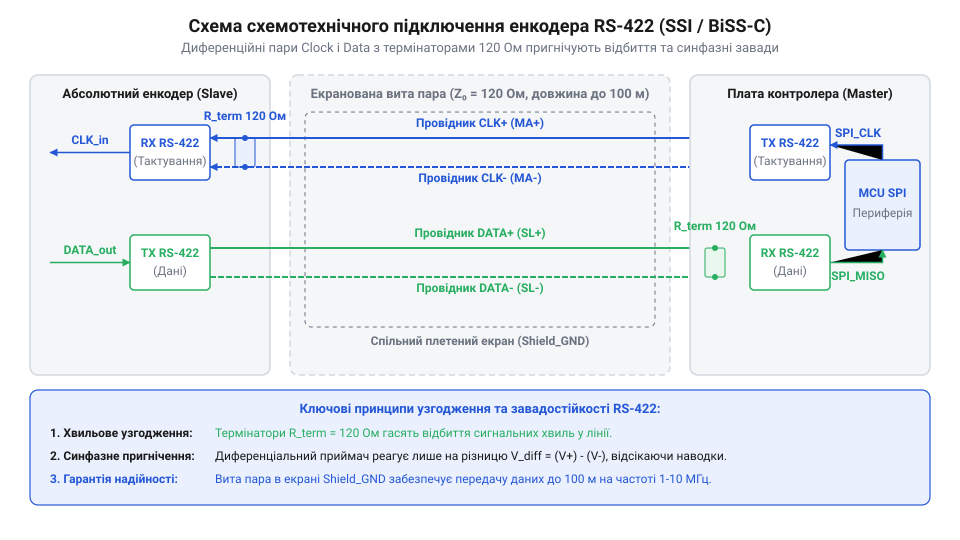
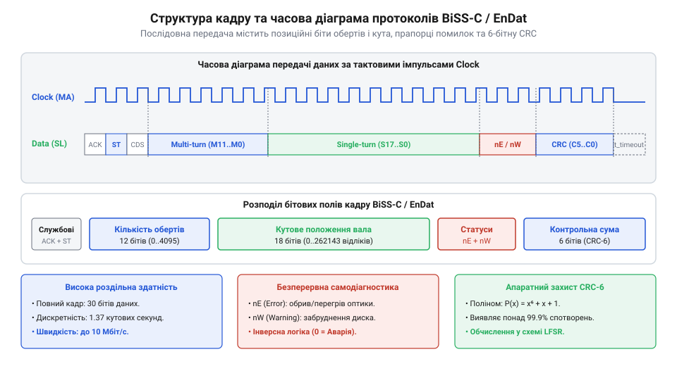

# Схемотехнічний та протокольний API промислових послідовних інтерфейсів абсолютних енкодерів: SSI, BiSS-C та EnDat 2.2

<preknowlist>
- [Оптичні та механічні інкрементальні енкодери](root:cat-hw-controls/rotary-encoders-quadrature) — Принципи формування сигналів тактування та кодування позиції.
- [Оптичні та індуктивні давачі положення органів вводу](root:cat-hw-controls/optical-and-inductive-position-encoders) — Фізичні принципи отримання первинних сигналів положення ротора.
</preknowlist>

## Фізичний рівень RS-422 та розводка ліній

У промислових системах автоматизації передача даних абсолютного положення від роторних енкодерів до керуючого мікроконтролера або сервоприводу відбувається в умовах потужних електромагнітних завад від частотних перетворювачів та силових кабелів електродвигунів. Використання класичних однополярних однопровідних ліній з логічними рівнями `TTL`/`CMOS` на відстанях понад 0.5 метра є неприпустимим через наведення імпульсних завад, падіння напруги на загальному провіднику живлення та високу сприйнятливість до синфазних шумів. Для забезпечення високої завадостійкості фізичний рівень усіх послідовних інтерфейсів абсолютних енкодерів — `SSI`, `BiSS-C` та `EnDat 2.2` — будується на базі диференційної передачі сигналів за стандартом `RS-422` (від латинського @@la|differentia@@ — різниця; @@en|differential signaling@@ — диференційна передача сигналів).

Організація зв'язку вимагає двох витих пар провідників: перша пара призначена для передачі тактового сигналу `Clock` від мікроконтролера до енкодера (`Clock+` / `Clock-`), а друга — для передачі зворотного потоку даних `Data` від енкодера до мікроконтролера (`Data+` / `Data-`). При диференційній передачі інформація кодується не абсолютним потенціалом відносно землі, а різницею напруг між двома провідниками витої пари `V_diff = V_+ - V_-`. Зовнішня електромагнітна завада наводить однакову напругу в обох близько розташованих провідниках пари, тому при відніманні сигналів на диференційній приймальній схемі синфазна завада повністю пригнічується (від англ. @@en|common-mode rejection@@, @@en|CMRR@@ — коефіцієнт пригнічення синфазного сигналу).

*Принципова схема диференційного підключення ліній Clock і Data RS-422 із узгоджувальними резисторами 120 Ом між енкодером та мікроконтролером.*

Для запобігання відбиттю високочастотних сигналів від кінців лінії (від англ. @@en|signal reflection@@ — відбиття сигналу) хвильовий імпеданс кабелю `Z₀` (зазвичай `100–120 Ом`) повинен бути узгоджений на приймальному кінці. На платі мікроконтролерного модуля між приймальними лініями `Data+` та `Data-` встановлюють паралельний термінуючий резистор `R_term = 120 Ом`. Для захисту вхідних каскадів від імпульсних перенапруг лінію доповнюють супресорами `TVS` та підтягуючими резисторами активного захисту `Fail-Safe` (від англ. @@en|fail-safe biasing@@). При обриві кабелю або відключенні енкодера диференційні входи приймача переходять у високоімпедансний стан плавання, де без підтяжки напруга `V_diff` коливається біля нуля, спричиняючи хибні спрацьовування та згенеровані шумами збої переривань. Схемотехнічний розрахунок завадостійкого дільника з верхнім резистором `R_pullup` на живильну шину `V_CC` і нижнім `R_pulldown` на `GND` спирається на забезпечення диференційного потенціалу у стані спокою `V_diff`, який перевищує поріг чутливості приймача `V_th = 200 мВ`. Для симетричної схеми з однаковими опорами підтяжки `R_pullup = R_pulldown = R_FS` мінімальний необхідний опір обчислюється виразом:

V_diff = V_CC · R_term ÷ (2 · R_FS + R_term)             [формула диференційної напруги у стані спокою]
       = 3.3 · 120 ÷ (2 · 930 + 120)                      [підстановка параметрів для V_CC = 3.3 V та R_term = 120 Ом]
       = 0.2 V                                            [розрахункове значення різниці потенціалів 200 мВ]

Значення `R_FS` близько `930 Ом` (на практиці беруть стандартні номінали `680–1000 Ом`) надійно утримує лінію в логічній одиниці при вимкненому чи обірваному енкодері без надмірного навантаження на вихідні драйвери `RS-422`. Порівняно з інкрементальними давачами, де використовують [інкрементальні енкодери](root:cat-hw-controls/rotary-encoders-quadrature), послідовні інтерфейси абсолютних пристроїв потребують значно меншої кількості провідників при високій розрядності позиції.

## Часові діаграми тактування та затримки

Послідовний зв'язок з абсолютним енкодером працює за принципом «ведучий-ведений» (від англ. @@en|master-slave@@). Мікроконтролер (Master) генерує пачку тактових імпульсів на лінії `Clock`, а енкодер (Slave) у відповідь висуває біти даних на лінію `Data` синхронно з фронтами тактового сигналу.

Основним часовим параметром класичного інтерфейсу `SSI` (від англ. @@en|Synchronous Serial Interface@@ — синхронний послідовний інтерфейс, @@en|SSI@@) є час моностабільного тайм-ауту `t_m` (Monoflop time, зазвичай `10–30 мкс`). У стані спокою лінія `Clock` утримується на високому логічному рівні `HIGH`. Перший спадний фронт `Clock` фіксує миттєве значення кутового положення у внутрішньому регістрі енкодера. З кожним наступним зростаючим фронтом тактового сигналу енкодер послідовно видає біти даних, починаючи з найстаршого розряду `MSB` (від англ. @@en|most significant bit@@ — найстарший значущий біт). Після передачі останнього наймолодшого біта `LSB` лінія `Data` опускається в `LOW`. Якщо мікроконтролер припиняє тактування і утримує `Clock` у стані `HIGH` довше за час `t_m`, внутрішній моностабільний таймер енкодера скидається, після чого пристрій готовий до нового циклу зчитування.

Затримка розповсюдження сигналу в кабелі `t_d` (приблизно `5–6 нс` на кожен метр довжини) накладає жорсткі обмеження на граничну частоту тактування `f_clk`. Загальна затримка сигналу по лінії «туди й назад» становить `2 · t_d`. Гранична частота тактування без втрати синхронізації обчислюється з умови, що повернутий біт даних має бути зафіксований до наступного тактового фронту:

f_clk_max = 1 ÷ (2 · t_d + t_encoder_delay)             [розрахунок граничної частоти тактування]

Для кабелю завдовжки `100 м` затримка `2 · t_d` сягає `1.1 мкс`, що обмежує максимальну частоту `SSI` до `400–500 кГц`. Сучасні протоколи `BiSS-C` (від англ. @@en|Bidirectional Synchronous Serial@@ — двонаправлений синхронний послідовний протокол, @@en|BiSS-C@@) та `EnDat 2.2` (від німецького @@de|EnDat@@ — @@en|Encoder Data@@) вирішують цю проблему за допомогою автоматичної компенсації затримки лінії (від англ. @@en|propagation delay compensation@@): контролер вимірює часовий зсув стартового біта відносно тактового імпульсу та коригує фазу стробування даних, що дозволяє працювати на частотах до `10–16 МГц`.

Схемотехнічний алгоритм компенсації базується на вимірюванні кругового часового інтервалу `t_loop = 2 · t_d + t_resp` за допомогою високочастотного лічильника апаратної периферії контролера. Під час випробовувального імпульсу на початку кадру контролер фіксує проміжок часу між генерацією спадного фронту `Clock` та фізичною появою стартового біта `START` на лінії `Data`. Отримане значення затримки `t_loop` заноситься у фазовий регістр стробування, що дозволяє апаратному фазовому автопідстроюванню (від англ. @@en|phase-locked loop@@, @@en|PLL@@) або цифровому затримувачу зсувати внутрішній момент фіксації біта `Data` рівно в центр його стабільного часового вікна. Завдяки цьому прийом даних залишається надійним навіть тоді, коли загальна затримка сигналу `t_loop` перевищує тривалість одного тактового періоду `T_clk`, усуваючи жорсткі довжинові обмеження, характерні для простих систем, де використовують [інкрементальні енкодери](root:cat-hw-controls/rotary-encoders-quadrature).

## Структура кадрів даних та контроль цілісності

Кадр даних абсолютного енкодера містить повну інформацію про поточне просторове положення вала, діагностичний стан сенсора та контрольний код цілісності.

Залежно від конструкції енкодера позиційне поле розбивається на дві складові:
1. **Однооборотна роздільна здатність (Singleturn):** `13–19 біт` (від `8192` до `524288` відліків на один оберт), що вимірюється первинними датчиками положення ротора, якими виступають [оптичні та індуктивні давачі](root:cat-hw-controls/optical-and-inductive-position-encoders).
2. **Багатооборотний лічильник (Multiturn):** `12–16 біт` (до `65536` повних обертів), що фіксується енергонезалежною механічною редукторною системою або лічильником на Wiegand-датчиках.

Протокол `SSI` передає дані у двійковому коді або коді Грея (від англ. @@en|Gray code@@ — код Грея), де кожні сусідні значення відрізняються лише одним бітом для відсутності збоїв при переході між розрядами. У стандартному кадрі `SSI` відсутні вбудовані поля перевірки помилок; статусними є лише останні біти `Error` та `Warning` у деяких розширених специфікаціях.

*Часова розкладка та структура бітових полів кадру даних із позиційними розрядами, бітами помилок та полем CRC.*

На відміну від `SSI`, протоколи `BiSS-C` та `EnDat 2.2` забезпечують апаратну гарантію цілісності даних у кожному кадрі. Кадр `BiSS-C` починається з бітів `ACK` та `START`, за якими іде біт керування `CDS`, багатооборотне поле, однооборотне поле, інверсний біт помилки `nE`, інверсний біт попередження `nW` та 6-бітовий циклічний контрольний код `CRC6` (від англ. @@en|Cyclic Redundancy Check@@ — циклічна перевірка надмірності, @@en|CRC@@). 

Поліном обчислення `CRC6` для `BiSS-C` визначається виразом:

P(x) = x⁶ + x¹ + 1                                     [твірний поліном CRC6 протоколу BiSS-C]

При отриманні пакета мікроконтролер обчислює `CRC` над усіма бітами даних та порівнює його з прийнятим значенням; у разі розбіжності кадри відкидаються як спотворені завадою. Крім перевірки контрольної суми, дешифратор кадрів у протоколах `BiSS-C` та `EnDat 2.2` обов'язково аналізує статусний біт помилки `nE` (від англ. @@en|active-low@@ error) та біт попередження `nW` (Warning), що передаються за інверсною логікою активного нуля. Логічний `0` у розряді `nE` сигналізує про критичну несправність давача (деградацію світлодіода оптичного зчитувача, деструкцію диска або апаратну відмову сенсорів, що вимірюють положення, подібних до тих, які описують [оптичні та індуктивні давачі](root:cat-hw-controls/optical-and-inductive-position-encoders)), що вимагає негайного зупинення сервоприводу. Низький рівень `nW = 0` інформує про наближення параметрів до граничних меж (просідання напруги живлення чи забруднення шкали) без зупинки обробки позиції. Використання активного нуля гарантує, що при розриві лінії даних чи збої живильної шини входи покажуть стан `0`, миттєво перевівши систему в аварійний захисний режим.

## Конфігурація периферії МК для зчитування

Для зчитування послідовних кадрів абсолютних енкодерів без використання програмного маніпулювання виводами (від англ. @@en|bit-banging@@) застосовують апаратний периферійний модуль `SPI` (від англ. @@en|Serial Peripheral Interface@@, @@en|SPI@@) у режимі Master Receive-Only або спеціалізовані апаратні таймери.

Оскільки лінія `Clock` у стані спокою утримується в `HIGH`, а вибірка бітів `Data` здійснюється за зростаючим фронтом тактового сигналу, модуль `SPI` конфігурують у режим `SPI Mode 3`:
- Полярність тактування `CPOL = 1` (Clock Polarity High).
- Фаза тактування `CPHA = 1` (Clock Phase 2nd Edge).

Якщо довжина кадру енкодера є нестандартною (наприклад, 25 біт у `SSI` або 34 біти в `BiSS-C`), периферію `SPI` налаштовують на прийом декількох 8-бітних або 16-бітних слів поспіль через прямий доступ до пам'яті (від англ. @@en|Direct Memory Access@@, @@en|DMA@@). Після завершення транзакції мікроконтролер виконує побітові зсуви для виділення масиву позиції та перевірки контрольної суми.

:::tabs
:::code api-absolute-encoder-serial-interfaces-ssi-biss-endat/c/stm32/gray-to-binary.c
:::code api-absolute-encoder-serial-interfaces-ssi-biss-endat/cpp/stm32/bissframeparser.cpp
:::

Використання апаратних модулів периферії дозволяє опитувати високоефективні системи позиціонування з частотою до `10–50 кГц` без завантаження процесорного ядра.
