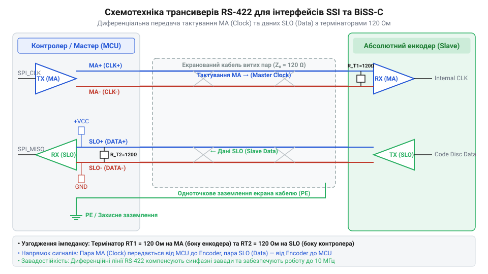
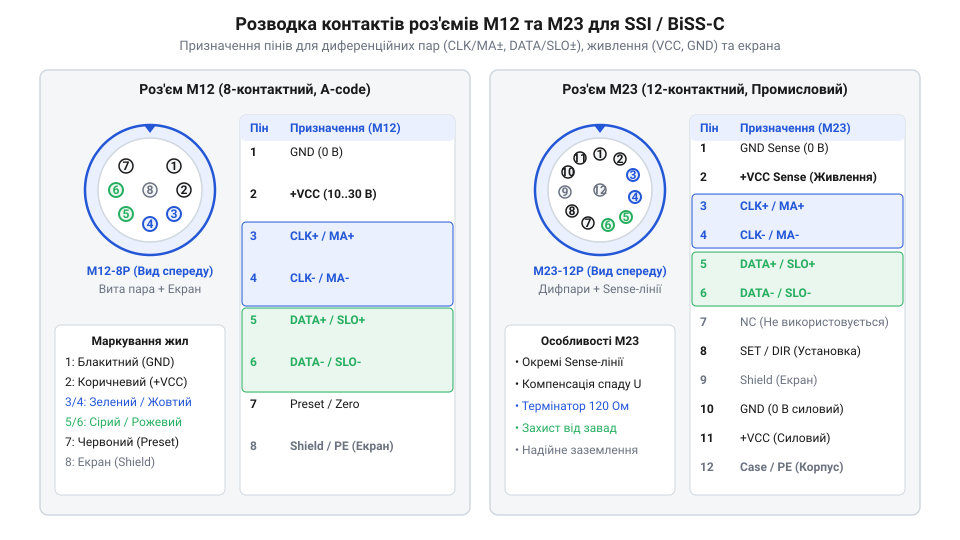
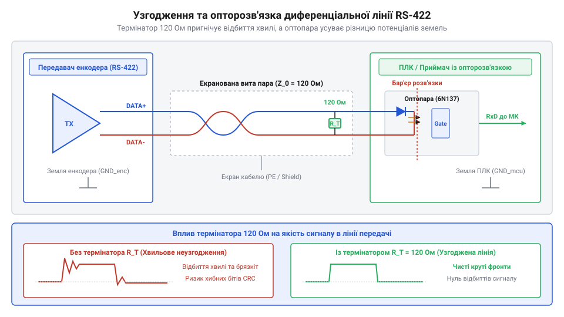
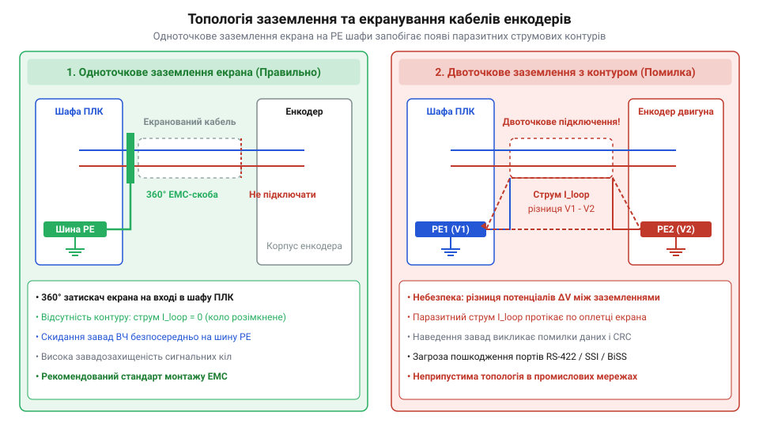
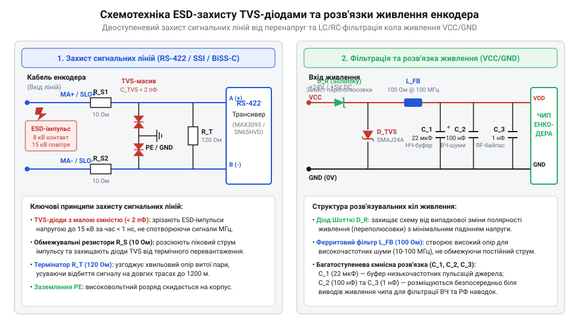

# Апаратний API-довідник підключення абсолютних енкодерів по диференціальних інтерфейсах SSI та BiSS-C

<preknowlist>
- [Оптичні та механічні інкрементальні енкодери](root:cat-hw-controls/rotary-encoders-quadrature) — загальні принципи оптичного та магнітного зчитування положення вала.
- [Ротаційні кодові DIP-перемикачі (Rotary DIP Switches)](root:cat-hw-controls/rotary-dip-switches) — розуміння абсолютного кодування кутового положення в двійковому коді та коді Ґрея.
</preknowlist>

## Призначення та принципи диференціальних інтерфейсів

В умовах промислового цеху однополярні електричні сигнали напруги ТТЛ (від англ. @@en|Transistor-Transistor Logic@@, TTL 0–5 В) зчитування кутового положення піддаються високому ризику спотворення електромагнітними завадами від потужних частотних перетворювачів, контакторів та зварювальних апаратів. На відміну від простих пристроїв, таких як [інкрементальні енкодери](root:cat-hw-controls/rotary-encoders-quadrature), де втрата окремого імпульсу призводить до нагромадження похибки позиціонування, абсолютні ротаційні давачі передають точне кодове слово кута при кожному опитуванні. Для надійної передачі цих цифрових даних на відстані до 100 метрів застосовують диференціальну передачу сигналів (від лат. @@en|differentia@@ — різниця) за стандартом RS-422 (@@en|Recommended Standard 422@@).

Фізичний принцип диференціальної лінії ґрунтується на одночасній передачі прямого та протилежного інвертованого сигналів по витій парі провідників. Коли на прямій лінії `MA+` (від англ. @@en|Master Clock Positive@@) діє високий потенціал `+3.3 В`, на інверсній лінії `MA-` (@@en|Master Clock Negative@@) встановлюється низький потенціал `+0.5 В`. Диференціальний приймач на боці енкодера вимірює не абсолютну напругу відносно землі, а різницю потенціалів `U_diff = V_+ - V_-`. Електромагнітна завада `V_noise`, наведена на симетричну виту пару, наводить однакову напругу в обох провідниках. При відніманні сигналів лінійна завада взаємно знищується за виразом:

```
U_in
= (V_+ + V_noise) - (V_- + V_noise)      [індукована синфазна завада на витій парі]
= V_+ - V_-                              [скасування синфазної завади за принципом дифкаскаду]
= U_diff                                 [чистий корисний диференціальний сигнал]
```

Поряд із завадостійкістю, вита пара RS-422 накладає фізичне обмеження на максимальну довжину кабельної траси `L_max` залежно від тактової частоти `f_MA`. Сигнал по мідній витій парі поширюється зі скінченною швидкістю із питомою затримкою `t_prop ≈ 5 нс/м`. У протоколах SSI та BiSS-C загальна затримка кругового проходження сигналу (від англ. @@en|round-trip delay@@) додається з подвійної довжини лінії `2 · L` та власного запізнення схеми енкодера `t_enc`:

```
t_round_trip = 2 · L · t_prop + t_enc           [загальна часова затримка кругового проходження]
```

Для надійного стробування біта даних `SLO` на боці майстра без компенсації затримки зсув фази не повинен перевищувати половини періоду тактування `T_CLK / 2 = 1 / (2 · f_MA)`. Звідси гранична довжина кабелю `L_max` для стандартного кабелю зв'язку обчислюється за виразом:

```
L_max
= ( (1 / (2 · f_MA)) - t_enc ) / (2 · t_prop)   [гранична довжина кабелю через затримку поширення]
≈ 100000000 / f_MA                              [практичне наближення граничної довжини у метрах]
```

Наприклад, при тактовій частоті `f_MA = 100 кГц` дозволена довжина траси досягає `L_max ≈ 400...1000 м` (де основним обмеженням стає згасання амплітуди на активному опорі), при `f_MA = 1 МГц` довжина обмежується `L_max ≈ 50 м`, а при `f_MA = 10 МГц` без компенсації фази — не більше `2...5 м`. У той час як стандартний інтерфейс SSI жорстко обмежений затримкою `t_round_trip`, сучасному протоколу BiSS-C доступна автоматична компенсація затримки лінії (від англ. @@en|propagation delay compensation@@), де майстер вимірює зміщення стартового біта `Start` і зміщує фазу зчитування, зберігаючи довжину кабелю до `100 м` на частотах `10 МГц`.

        U_in
        = (V_+ + V_noise) - (V_- + V_noise)      [індукована синфазна завада на витій парі]
        = V_+ - V_-                              [скасування синфазної завади за принципом дифкаскаду]
        = U_diff                                 [чистий корисний диференціальний сигнал]

У промислових системах абсолютного позиціонування застосовують два ключові інтерфейси: односпрямований шинний @@en|SSI@@ (від англ. @@en|Synchronous Serial Interface@@) та двоспрямований @@en|BiSS-C@@ (від англ. @@en|Bidirectional Synchronous Serial - Continuous Mode@@). Інтерфейс SSI є односпрямованим: майстер (ПЛК або мікроконтролер) генерує безперервну тактову послідовність по парах `MA+/MA-`, а енкодер виштовхує біти кутового положення (у коді Ґрея або двійковому коді) по лінії даних `SLO+/SLO-` (від англ. @@en|Slave Out@@). На відміну від нього, двоспрямований BiSS-C дозволяє не лише зчитувати кутове положення в реальному часі, але й записувати налаштування в внутрішній @@en|EEPROM@@ енкодера, обмінюватися коефіцієнтами калібрування та передавати біти попередження `nWARN` і помилки `nERROR`. Для розуміння дискретного задання параметрів застосовують [кодові DIP-перемикачі](root:cat-hw-controls/rotary-dip-switches). Відмінності у часових параметрах і швидкості обміну між SSI та BiSS-C зведені в порівняльній таблиці:

| Параметр | SSI | BiSS-C |
| :--- | :--- | :--- |
| Режим обміну | Односпрямований (Slave -> Master) | Двоспрямований (Point-to-Point / Bus) |
| Частота тактування `MA` | 100 кГц – 2 МГц | До 10 МГц (типово 2–10 МГц) |
| Тривалість кадру (24 біти) | ~12–25 мкс (залежно від `f_MA` та паузи `t_m`) | ~3–10 мкс |
| Службові біти кадру | Відсутні (лише біти давача) | Біти стану `nERROR`, `nWARN` та CRC-6 |
| Пауза між кадрами `t_m` | 10–20 мкс (моностабільний таймаут) | Необхідна лише для ресинхронізації |

Вища частота тактування лінії `MA` в BiSS-C дозволяє істотно скоротити тривалість оновлення кадру даних у контурах керування сервоприводами, забезпечуючи високу динаміку опитування порівняно з консервативним інтерфейсом SSI.


*Схемотехніка трансиверів RS-422 для формування й прийому диференціальних сигналів MA+/MA- та SLO+/SLO- між ведучим пристроєм та абсолютним енкодером.*

## Розпіновка роз'ємів та сигнальні призначення

Для забезпечення надійного підключення в умовах вібрацій та впливу мастильно-охолоджувальних рідин промислові абсолютні енкодери оснащують герметичними круглими роз'ємами M12 (на 8 або 12 контактів) або герметичними роз'ємами M23 (на 12 або 17 контактів). На платах керування та контролерах застосовують класичний субмініатюрний роз'єм DB9 (від англ. @@en|D-subminiature 9-pin@@).

Сигнальні виводи роз'єму поділяються на чотири основні функціональні групи: лінії живлення, диференційна пара тактування `MA`, диференційна пара даних `SLO` та службові керовані входи. Кола живлення включають виводи `VCC` (подача напруги `+5 В` або широкого діапазону `+10...+30 В`) та заземлення `GND`. Вивід `DIR` (від англ. @@en|Direction Input@@) задає напрямок наростання коду кута (при підключенні до `GND` код зростає за годинниковою стрілкою, а при підключенні до `VCC` — проти). Вхід `SET` або `PRESET` призначений для апаратного скидання поточного положення вала на нуль шляхом подання короткого імпульсу напруги `VCC` тривалістю понад `100 мс`. Принципи механічної комутації силових кіл розгортають [кулачкові перемикачі](root:cat-hw-controls/rotary-cam-switches).

Канонічний розподіл контактів для 8-пінового роз'єму M12 A-coded та 12-пінового M23 наведено у стандартних картах розпіновки. На відміну від силових роз'ємів у [перемикачах фаз](root:cat-hw-controls/phase-selector-switches), де комутуються високі струми, виводи енкодера вимагають суворого дотримання парної зкрутки: провідники `MA+` та `MA-` обов'язково розводять в одній витій парі, а `SLO+` та `SLO-` — у другій. За стандартом @@en|DIN 47100@@ колірне маркування 8-жильного кабелю строго узгоджене з конструкцією витих пар: перша пара (білий — `GND`, коричневий — `VCC`) забезпечує живлення, друга пара (зелений — `MA+`, жовтий — `MA-`) передає такт, третя пара (сірий — `SLO+`, рожевий — `SLO-`) передає дані, а четверта пара (синій — `DIR`, червоний — `SET`) служить для службових сигналів. Нехтування колірним маркуванням пар (наприклад, випадкове підключення `MA+` із зеленого провідника та `SLO-` із рожевого в одну пару) руйнує геометричну симетрію кабелю, що призводить до втрати синфазного пригнічення завад та появи хибних зчитувань бітів. Крім електричної симетрії, промислова експлуатація вимагає дотримання суворих норм механічного монтажу роз'ємів. Металева нарізна муфта вимагає нормованого затягування динамометричним ключем із моментом `0.6...1.0 Н·м` для M12 та `1.5...2.0 Н·м` для M23, що рівномірно стискає внутрішнє ущільнювальне кільце (від англ. @@en|O-ring@@ — ущільнювальне кільце) без його розриву та запобігає розкручуванню від вібрації за допомогою протирозкручувального фіксувального механізму. Якісно затягнутий роз'єм забезпечує повний пило- та вологозахист за стандартом IP67, а у виконанні з нержавіючої сталі — ступінь захисту IP69K (від англ. @@en|IP69K rating@@ — ступінь захисту IP69K), що витримує високотискове обмивання струменем води з температурою `80 °C` під тиском `100 бар` у агресивних хімічних та харчових середовищах.


*Конфігурація контактних груп роз'ємів M12 та M23 із призначенням пін-ауту ліній живлення VCC/GND, дифпар MA/SLO та вхідних сигналів DIR/SET.*

## Схемотехніка трансиверів та хвильове узгодження

При передачі високочастотних прямокутних тактових імпульсів `MA` (до `10 МГц`) по довгій кабельній лінії довжиною `L` провідник поводиться як лінія передачі з розподіленими параметрами. Якщо хвильовий опір кабелю `Z_0` (зазвичай `120 Ом` для витої пари за стандартом RS-422) не узгоджений із вхідним опором приймача, на кінці лінії виникає відбиття хвилі напруги. Внаслідок інтерференції прямої та відбитої хвиль утворюються стоячі хвилі, перенапруги та дзвін (від англ. @@en|ringing@@), що призводить до хибного спрацьовування вхідного компаратора й втрати синфазного синхронізму.

Для повного поглинання падаючої хвилі сигналу на далеких кінцях дифпар `MA+/MA-` та `SLO+/SLO-` встановлюють паралельне хвильове узгодження — термінальний резистор `R_T = 120 Ом`. Значення термінального резистора розраховується з умови рівності хвильовому опору кабелю:

        R_T
        = Z_0                                    [умова відсутності відбиття хвилі в лінії передачі]
        = 120 Ом                                 [стандартний хвильовий опір витої пари RS-422]

Для узгодження рівнів напруги та захисту чутливого мікроконтролера застосовують трансивери RS-422/RS-485 (наприклад, MAX3485 або SN65HVD3082). У високонадійних промислових системах, де можлива різниця потенціалів між землею енкодера та плати керування (англ. *ground loop*, @@en|ground loop@@ — земляна петля), диференціальні лінії пропускають через швидкодіючі оптрони або магнітні ізолятори (наприклад, ADuM1401). Це створює гальванічну розв'язку з діелектричною міцністю до `2.5 кВ`. При робочих швидкостях передавання понад `2 Мбіт/с` стандартні транзисторні оптрони з затримкою понад `3–5 µs` стають непридатними через викривлення прямокутних фронтів. Критерієм вибору ізолятора є гранична частота зрізу (англ. *cutoff frequency*, @@en|cutoff frequency@@) не менше `10–20 МГц`, час затримки поширення `t_pd ≤ 15 ns` та викривлення ширини імпульсу (англ. *pulse width distortion*, @@en|pulse width distortion@@) до `2 ns`. Для цього використовують логічні оптрони з фотодіодом і тригером Шмітта (наприклад, 6N137 або HCPL-0600) чи цифрові ємнісні ізолятори (серії ISO7741), що забезпечують передавання тактів без спотворення форми бітів. З принципами захисту та комутації кіл можна ознайомитися у [перемикачах фаз](root:cat-hw-controls/phase-selector-switches). Для оптимізації енергоспоживання класичне паралельне термінування `R_T = 120 Ом`, яке безперервно розсіює статичну потужність при постійному логічному рівні, замінюють альтернативними схемотехнічними топологіями. Змінне AC-термінування (від англ. @@en|AC termination@@) вмикає послідовно з резистором `R_T = 120 Ом` конденсатор `C_T ≈ 100...470 пФ`, що повністю блокує постійний струм постійної напруги й пропускає лише високочастотні фронти сигналів, усуваючи статичні втрати. У свою чергу, розщеплене термінування (від англ. @@en|split termination@@) виконується двома послідовними резисторами по `60 Ом` із заземленням середньої точки через керамічний конденсатор `C_split = 47 нФ`, що забезпечує активну фільтрацію вищих високочастотних синфазних завад і підвищує електромагнітну сумісність без підвищення споживання струму в режимі спокою.


*Схема узгодження хвильового опору витих пар термінаторами R_T = 120 Ом та апаратне включення швидкодіючих оптронів для гальванічної ізоляції.*

## Вимоги до кабелів, заземлення та екранування

Для підключення абсолютних енкодерів SSI та BiSS-C дозволяється використовувати виключно спеціалізований симетричний кабель типу «вита пара» з загальним або подвійним екрануванням (S/FTP, від англ. @@en|Shielded Foiled Twisted Pair@@). Крок скрутки провідників у парі вибирають не більше `15 мм`, що забезпечує однакове наведення зовнішнього магнітного поля на обидва жили.

Поширеною апаратною помилкою є двоточкове заземлення екрана кабелю з обох боків до конструктивних шин `PE` (від англ. @@en|Protective Earth@@), що знаходяться під різними потенціалами. Утворювана земляна петля (від англ. @@en|ground loop@@ — земляна петля) викликає протікання вирівнювального струму промислової частоти `50 Гц` по плетеному екрану, який наводить потужні завади на індуктивності витих пар. Правильна топологія передбачає суворе одноточкове заземлення екрана на боці шафи керування ПЛК за допомогою заземлювального хомута (360-градусний обтиск @@en|EMC clamp@@), тоді як на боці енкодера екран ізолюють або підключають до корпусу через високочастотний керамічний конденсатор `10 нФ / 500 В`. Допустиму ємність розраховують за реактивним опором `X_C = 1 / (2π · f · C)`: на низькій промисловій частоті `f = 50 Гц` опір конденсатора `10 нФ` досягає `X_C ≈ 318 кОм`, що обмежує вирівнювальний струм земляної петлі до мікроамперних значень `I_loop = U_PE / X_C < 32 мкА` при потенціалі між землями `10 В`. Натомість для високочастотних імпульсних завад інверторів та комутаційних завад (`f = 10 МГц`) опір конденсатора знижується до `X_C ≈ 1.59 Ом`, створюючи короткий шлях для ефективного скидання радіозавад на корпус без ризику протікання сильних струмів `50 Гц`. Для верифікації якості змонтованого екранування вимірювання лише постійного опору звичайним мультиметром є недостатнім, оскільки низький опір `R_DC < 0.1 Ом` не виявляє індуктивних завад на високих частотах. Цілісність та якість екранування оцінюють методом вимірювання високочастотного імпедансу заземлення (від англ. @@en|grounding impedance@@) або передавального імпедансу екрана (від англ. @@en|transfer impedance@@) на частотах `1...10 МГц` за допомогою векторного аналізатора кіл (від англ. @@en|Vector Network Analyzer@@) чи ВЧ-міліометра. У якісно реалізованій системі з 360-градусним обтиском високочастотний імпеданс заземлення не повинен перевищувати `Z_HF ≤ 1 Ом` на частоті `10 МГц`. Якщо ж замість обтискного хомута застосовано скручені дрітні виводи екрана («косички», від англ. @@en|pigtail@@), їхня паразитна індуктивність `L ≈ 1 нГн/мм` створює на частоті `10 МГц` додатковий індуктивний опір `X_L = 2π · f · L ≈ 6.28 Ом` для `100 мм` провідника, що нівелює захисні властивості екрана на високих частотах і призводить до сбоїв передавання даних, попри ідеальні показники опору постійному струму.

Силові лінії живлення двигунів та кабель енкодера слід прокладати в окремих металевих лотках із відстані між ними не менше `200 мм`. Якщо перетин кабелів неминучий, його виконують строго під кутом `90°` для мінімізації взаємної індуктивності. Приклади побудови високоточних органов вводу наведено у [давачах RVDT](root:cat-hw-controls/rvdt-operating-principles).


*Схема одноточкового заземлення суцільного екрана кабелю енкодера за допомогою EMC-хомута на шину PE та розв'язка земляних петель.*

## Електричний захист та кола живлення

Промислове середовище піддає диференціальні лінії передачі даних енкодерів впливу потужних імпульсних завад та електростатичних розрядів (від англ. @@en|ESD@@, від @@en|Electrostatic Discharge@@). Без належного схемотехнічного захисту вхідні каскади диференціальних трансиверів роз'ємів M12 або DB9 виходять з ладу при пробої потенціалом понад граничні значення напівпровідникового кристала.

Для захисту сигнальних кіл `MA+/MA-` та `SLO+/SLO-` паралельно кожній витій парі встановлюють швидкодіючі двонапрямлені супресори (від англ. @@en|TVS diode@@, від @@en|Transient Voltage Suppressor@@). Ці прилади масивного поглинання енергії зрізають піки перенапруги, обмежуючи диференціальний і синфазний потенціал на безпечному рівні. Послідовно в лінії вмикають самовідновлювані запобіжники (від англ. @@en|PTC fuse@@, від @@en|Positive Temperature Coefficient@@), які обмежують струм при випадковому короткому замиканні сигнальних провідників на шину живлення.


*Схема вхідного захисту диференціальних шин та фільтрації напруги живлення.*

Вибір напруги живлення енкодера суттєво впливає на стійкість та теплове навантаження системи. Для коротких трас застосовують стандартне живлення 5 В. Проте на довгих лініях опір жильних провідників `R_cable` викликає спад напруги `V_drop = 2 · I_encoder · R_cable`, через що підсумкова напруга на енкодері `V_encoder = V_source - V_drop` просідає нижче допустимої межі. Тому в промислових мережах віддають перевагу живленню від 24 В DC. Оскільки внутрішній цифровий обчислювач та фотоприймачі енкодера працюють від низьковольтної напруги 3.3 В або 5 В, усередині корпусу встановлюють локальний @@en|DC-DC converter@@ (від англ. *Direct Current to Direct Current converter*). За використання лінійного регулятора теплова потужність розсіювання `P_diss = (V_in - V_out) · I_internal` при живильному потенціалі 24 В та внутрішньому струмі 80 мА досягала б `P_diss = (24 - 5) · 0.08 = 1.52 Вт`, що спричиняло б небезпечне перегрівання герметичного корпусу. Застосування високоефективних імпульсних понижувальних перетворювачів із коефіцієнтом корисної дії `η ≈ 85...92%` знижує втрати потужності `P_loss = V_out · I_out · (1 - η) / η` до менш ніж 0.05 Вт, захищаючи сенсорний вузол від температурного дрейфу нарівні з тим, як це реалізовано у промислових давачах, як-от [принцип роботи та конструкція давача RVDT](root:cat-hw-controls/rvdt-operating-principles).

        V_drop = 2 · I_encoder · R_cable            [падіння напруги в двох жилах живлення]
        V_encoder = V_source - V_drop               [підсумкова напруга на виводах енкодера]

**Приклад розрахунку падіння напруги для траси 50 м із жилами перетином 0.14 мм²:**

Розглянемо лінію завдовжки L = 50 м із мідними жилами перетином S = 0.14 мм² (погонний опір R_line ≈ 0.125 Ом/м) та енкодер зі струмом споживання I_encoder = 100 мА (0.1 А):

        R_cable = 50 м · 0.125 Ом/м
                = 6.25 Ом                            [опір однієї провідної жили завдовжки 50 м]
        V_drop  = 2 · 0.1 А · 6.25 Ом
                = 1.25 В                             [падіння напруги у двох жилах живлення]
        V_enc   = 5.0 В - 1.25 В
                = 3.75 В                             [фактична напруга на затискачах енкодера]

Отримані 3.75 В значно нижчі за мінімально допустимий поріг живлення більшості 5-вольтних енкодерів (4.5 В), що призводить до перезавантажень внутрішньої мікроконтролерної схеми та збоїв зчитування позиції.

        V_drop = 2 · I_encoder · R_cable            [падіння напруги в двох жилах живлення]
        V_encoder = V_source - V_drop               [підсумкова напруга на виводах енкодера]

При довготі кабелю понад 30 метрів струм споживання енкодера викликає просідання 5 В нижче порогу працездатності внутрішньої електроніки. Тому в промисловості віддають перевагу широкому діапазону живлення 10–30 В DC (зазвичай 24 В DC). Усередині енкодера або на приймальній платі застосовують локальний понижувальний регулятор. Це зменшує робочий струм лінії та робить систему нечутливою до падіння напруги на кабелі. Біля роз'єму енкодера обов'язково встановлюють фільтруючі блоки з керамічного MLCC та електролітичного конденсаторів.

## Діагностика ліній та типові апаратні збої

Під час монтажу та експлуатації абсолютних енкодерів виникають апаратні збої, пов'язані з фізичним рівнем передачі. На відміну від [інкрементальних енкодерів](root:cat-hw-controls/rotary-encoders-quadrature), де втрата імпульсів призводить до непомітного дрейфу відліку, збої диференціальних інтерфейсів руйнують цілісність цифрового кадру.

Найпоширенішою помилкою є переполюсовка провідників у витій парі (`MA+` переплутано з `MA-` або `SLO+` з `SLO-`). При інверсії сигналів приймач RS-422 формує постійний логічний нуль замість очікуваної послідовності бітів, що зупиняє зчитування. Обрив екранованого обплетення або утворення паразитних контурів заземлення призводить до проникнення наводки від силових перетворювачів.

Апаратна діагностика несправностей відрізняється залежно від протоколу:

1. У протоколі @@en|SSI@@ (від англ. @@en|Synchronous Serial Interface@@) синхронізація кадрів базується на таймауті моностабільного мультивібратора (від англ. @@en|monostable multivibrator@@) `t_m` (типово 12–20 мкс). Якщо через паразитну ємність кабелю або затримку зчитування пауза між тактовими імпульсами `MA` перевищує `t_m`, енкодер передчасно скидає внутрішній регістр розрядів, викривляючи кодове слово.
2. У протоколі @@en|BiSS-C@@ (від англ. @@en|Bidirectional Synchronous Serial@@) діагностика вбудована в апаратний кадр. Кожен пакет містить активні в низькому рівні біти `nERROR` та `nWARN`. Сигнал `nERROR` сповіщає про критичну несправність оптичного диска, просідання живлення або деградацію випромінювача, а `nWARN` попереджає про забруднення кодувальних доріжок чи температурний дрейф.

Основний інструмент діагностики якісних параметрів лінії — двоканальний осцилограф (від англ. @@en|oscilloscope@@). За допомогою диференціального заміру оцінюють «очну діаграму» (від англ. @@en|eye diagram@@), де широке відкриття «ока», відсутність дзвону фронтів та зворотних відбиттів свідчать про правильний вибір термінатора 120 Ом та цілісність екранування. Окремо аналізують фазове тремтіння (від англ. @@en|jitter@@ — джитер) тактового сигналу `MA`: часові девіації фронтів тактування, спричинені нестабільністю генератора МК або фазовими завадами каскадів розв'язки, призводять до горизонтального розмиття переходів очної діаграми. При підвищенні рівня джитера понад 5–10% від тривалості тактового біта звужується часовий інтервал стабільного стробування даних `SLO`, що суттєво підвищує ймовірність бітових помилок і вимагає зниження тактової частоти опитування.
