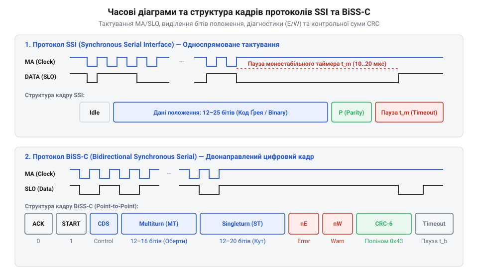
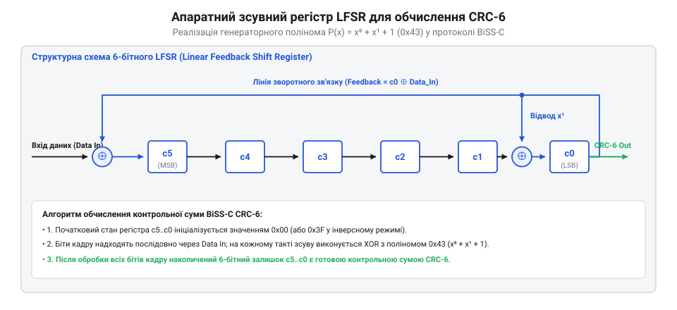

# Програмний API-довідник декодування протоколів SSI, BiSS-C та перетворення коду Грея

<preknowlist>
- [Оптичні та індуктивні давачі положення органів вводу](root:cat-hw-controls/optical-and-inductive-position-encoders) — фізичні принципи зчитування положення
- [Оптичні та механічні інкрементальні енкодери](root:cat-hw-controls/rotary-encoders-quadrature) — принципи підрахунку позиції та імпульсне форматування
</preknowlist>

## Структура кадрів протоколів SSI та BiSS-C

У високодинамічних системах керування рухом — від промислових роботів-маніпуляторів до верстатів із числовим програмним керуванням — для зчитування точного кутового положення вала застосовують абсолютні поворотні енкодери. На відміну від [інкрементальних енкодерів](root:cat-hw-controls/rotary-encoders-quadrature), що генерують послідовності квадратурних імпульсів і втрачають позицію при збоях живлення, абсолютні давачі видають сформований цифровий код повної кутової позиції за один запит. Для передачі цих даних у сервоконтролери розроблено вимірювальні протоколи синхронного послідовного інтерфейсу SSI (від англ. @@en|Synchronous Serial Interface@@) та двонапрямного послідовного протоколу BiSS-C (від англ. @@en|Bidirectional Synchronous Serial@@).


*Порівняння часових діаграм тактування кадру: монотонна передача коду Грея в SSI проти структурованого кадру BiSS-C із бітами Start/CDS, прапорцями E/W та контрольною сумою CRC-6.*

Інтерфейс SSI є однонапрямним точку-до-точки зв'язком, де майстер (від англ. @@en|Master Clock@@, MA) генерує послідовність тактових імпульсів з частотою від `100 кГц` до `2 МГц`, а енкодер (від англ. @@en|Slave Data Out@@, SLO) передає розряди позиції на спадаючих фронтах тактового сигналу. За першим фронтом `MA` ведений фіксує поточний стан фотодіодної матриці у зсувному регістрі та починає послідовну видачу бітів, починаючи від старшого розряду `MSB` до молодшого `LSB`. Типовий кадр SSI має довжину від `13` до `25` бітів, де перші `12` бітів описують кількість повних обертів (багатооборотне значення), а наступні `13` бітів — кут усередині одного оберту (однооборотне значення). Оскільки SSI не має апаратного арбітражу кадру та контрольних сум, інформація передається у коді Ґрея (від англ. @@en|Gray code@@) для відсутності збоїв при переході сусідніх значень. Після видачі останнього біта лінія `SLO` утримується в низькому рівні протягом часу паузи моностабільного мультивібратора `t_m ≈ 12...20 мкс`, що сигналізує про завершення кадру та готовність до наступного циклу опитування.

Натомість протокол BiSS-C розроблений як відкритий цифровий інтерфейс реального часу із вбудованими засобами діагностики та верифікації даних. Передача кадру починається з фази синхронізації: майстер подає тактові імпульси `MA`, а ведений відповідає бітом підтвердження `ACK = 0` та старт-бітом `START = 1`. Після цього слідує біт керування `CDS` (від англ. @@en|Control Data Slave@@), за яким передається інформаційне поле кутової позиції розрядністю до `32` бітів. На відміну від SSI, дані в BiSS-C передаються безпосередньо у двійковому коді, після чого слідують два статусних прапорці: біт помилки `E` (від англ. @@en|Error bit@@, активний низький рівень при апаратних збоях оптичної системи) та біт попередження `W` (від англ. @@en|Warning bit@@, активний низький рівень при деградації світлодіода чи перевищенні температури). Кадр завершується 6-бітовою контрольною сумою CRC (від англ. @@en|Cyclic Redundancy Check@@), що дозволяє апаратно виявляти поодинокі та групові спотворення бітів під час високошвидкісного обміну. Крім основного каналу позиції (від англ. @@en|Sensor Data@@), BiSS-C підтримує режим розширеної регістрової комунікації (від англ. @@en|Register Communication@@): через побітове мультиплексування сигнальних ліній `CDS` та `CDM` (від англ. @@en|Control Data Master@@) майстер може читати та записувати внутрішні регістри конфігурації енкодера (температуру осердя, електронний паспорт, параметри роздільної здатності та кастомні коефіцієнти калібрування) безперервно у фоновому режимі, не зупиняючи високошвидкісний контур зчитування позиції.

При об'єднанні декількох енкодерів у послідовну кільцеву топологію BiSS-C Ring (від англ. @@en|BiSS-C Ring topology@@, ланцюгове з'єднання @@en|daisy chain@@) розрахунок тривалості кадру вимагає врахування сумарних часових затримок очікування. Під час первинних тактових імпульсів `MA` кожен ведений давач фіксує поточний кут у внутрішньому регістрі протягом часу внутрішньої обробки `t_busy` (від англ. @@en|busy time@@, типово `0.5...1.5 мкс`). Загальна тривалість фази квитування `t_ack` (від англ. @@en|acknowledgement delay@@) на стороні майстра дорівнює сумі фізичних затримок поширення сигналу у кабелі (від англ. @@en|propagation delay@@, близько `5 нс/м`) та затримок реакції найповільнішого енкодера у ланцюгу. Майстер генерує тактову частоту `MA` доти, доки всі послідовно з'єднані давачі не завершать стан `ACK = 0` та не виставлять спільний старт-біт `START = 1`. Програмний драйвер розраховує граничний таймаут опитування за формулою `t_timeout = t_busy_max + N_slaves · t_prop_stage`, що запобігає передчасному розриву кадру та розсогласуванню бітових зсувів при опитуванні багатоосьових робототехнічних систем. При збільшенні довжини кабелю `L` понад `50` метрів фізична затримка подвійного проходу сигналу `t_loop` починає домінувати над тривалістю бітового інтервалу, спричиняючи фазовий зсув (від англ. @@en|phase shift delay@@) між випромінюваним тактом `MA` та повернутим бітом `SLO`. Сумарний час кругового проходу лінійного тракту обчислюють з урахуванням довжини кабелю та власного запізнення прийомопередавачів:

t_loop = 2 · L · t_prop_m + t_transceiver + t_slave

Без застосування апаратного компенсатора фази майстер повинен зчитати біт даних `SLO` в межах одного тактового періоду `T_MA = 1 / f_MA`. Для довжини кабелю `L = 50 м` при питомій затримці `t_prop_m = 5 нс/м` та сумарних апаратних затримках `t_transceiver + t_slave = 100 нс` розрахунок граничної частоти `f_MA_max` виконується покроково:

t_loop = 2 · 50 · 5 + 100 = 600 нс                     [загальний час затримки тракту]
f_MA_max = 1 / (600 · 10⁻⁹) = 1.66 МГц                 [гранична частота без фазового зсуву]

При збільшенні довжини кабелю до `L = 100 м` затримка зростає до `t_loop = 1100 нс`, знижуючи дозволену частоту `f_MA_max` до `909 кГц`, а за умови суворого вибіркового стробування в межах півперіоду (`T_MA / 2 ≥ t_loop`) частота обмежується рівнем `454 кГц`. Для подолання цього обмеження в апаратних контролерах застосовують фазову компенсацію (від англ. @@en|phase compensation@@): майстер затримує внутрішній строб зчитування на обчислений кут фазового зсуву `ϕ_shift = 360° · f_MA · t_loop`, що дозволяє зчитувати дані на високих частотах навіть при тривалостях проходу `t_loop`, що перевищують період тактування.

У програмному драйвері мікроконтролера сирий бітовий потік, прочитаний через периферійний модуль SPI або за допомогою прямого програмного тактування (від англ. @@en|bit-banging@@), упаковується у спеціалізовані C-структури для подальшого розбору:

:::tabs
:::code api-rotary-encoder-driver-software-interface/c/snippet-1.c
<!-- slide -->
:::code api-rotary-encoder-driver-software-interface/cpp/ssiframe.cpp
:::

## Алгоритми декодування коду Ґрея

Використання ззвичайного двійкового коду в енкодерах із послідовним виводом SSI створює ризик фатальних збоїв у контурі позиціонування. При переході між сусідніми позиціями у двійковій системі можуть одночасно змінюватися декілька розрядів: наприклад, при переході від значення `7` (`0111`) до `8` (`1000`) змінюють свій стан одразу 4 біти. Якщо зчитування кадру збігається з механічним проходженням через межу сектора, через неминучі мікроскопічні відхилення оптичних доріжок мікроконтролер може зчитати проміжний стан `15` (`1111`) або `0` (`0000`). Для усунення цієї неоднозначності відліки оптичного диска кодуються кодом Ґрея, у якому будь-які два сусідніх значення відрізняються станом лише одного біта (`ΔN = 1 біт`).

Перетворення отриманої від енкодера SSI бітової послідовності коду Ґрея `G` у двійкове значення `B` базується на операції додавання за модулем 2 (XOR, `⊕`). Старший біт двійкового числа завжди дорівнює старшому біту коду Ґрея `B_MSB = G_MSB`, а кожен наступний молодший біт обчислюється як сума поточного біта коду Ґрея та попередньо обчисленого двійкового біта: `B_i = B_(i+1) ⊕ G_i`. Однак у реальних промислових системах фізична розрядність енкодера `N_actual` (наприклад, 13 бітів) часто менша за фіксовану довжину передаваного кадру SSI `N_frame` (наприклад, 24 або 32 біти). Неактивні молодші біти, що залишаються в кадрі після корисного слова, містять сталі нулі, службові прапорці або високочастотні завади. Якщо виконати декодування коду Ґрея без попереднього вирівнювання та пригнічення неактивних бітів, каскадна операція XOR поширить сміттєві значення від молодших розрядів догори, спричиняючи хибні стрибки позиції. Щоб цього уникнути, зчитаний кадр вирівнюють праворуч зсувом на `N_unused = N_frame - N_actual` бітів, після чого застосовують маскування (англ. *bit masking*, @@en|bit masking@@) за допомогою побітового «І» з маскою активних бітів `mask_active = (1UL << N_actual) - 1` (або очищенням непотрібного хвоста маскою `mask_unused = (1UL << N_unused) - 1`). Неповна розрядність `N_actual` визначає межу дискретизації давача: проміжна кутова похибка (англ. *angular error*, @@en|angular error@@) обчислюється як кутовий крок наймолодшого значущого розряду `Δθ = 360° / 2ⁿ` (де `n = N_actual`), що задає дискретність квантування `Δθ_LSB`, тоді як відсутність маскування невикористаних бітів збільшує кутову невизначеність на величину `Δθ_err = Δθ · (2ᵐ - 1)` (де `m = N_unused`). Наприклад, для 13-бітного енкодера (`n = 13`, `Δθ ≈ 0.0439°`) у 24-бітному кадрі (`m = 11`) випадкова поява одиниць у невикористовуваному хвості дає помилковий зсув `2¹¹ - 1 = 2047` LSB-відліків, що призводить до кутового спотворення `Δθ_err ≈ 0.0439° × 2047 ≈ 89.86°`, практично зміщуючи розраховану позицію на цілий квадрант кола, що неприпустимо для систем, де критичні [індуктивні давачі положення](root:cat-hw-controls/optical-and-inductive-position-encoders).

```
B_MSB = G_MSB                                   [копіювання старшого розряду без змін]
B_i = B_(i+1) ⊕ G_i                             [послідовне додавання за модулем 2]
```

Для програмного виконання перетворення у мікроконтролері застосовують циклічний або паралельний бітовий алгоритм. У циклічному алгоритмі двійкове значення формується шляхом послідовного зсуву коду вправо та накопичувального XOR. Для 32-бітного значення паралельний безрозгалужений (від англ. *branchless*, @@en|branchless@@) алгоритм дозволяє обчислити результат всього за п'ять побітових операцій зсуву та XOR, оскільки кожен крок подвоює довжину зсуву (`1 → 2 → 4 → 8 → 16` бітів). Порівняння обчислювальної складності обох підходів для 32-бітного слова наведено в таблиці:

| Параметр алгоритму | Циклічний (універсальний) | Безрозгалужений (32-бітний) |
| :--- | :--- | :--- |
| Часова складність | `O(N)` (залежить від розрядності `N`) | `O(log₂ N)` (фіксована для `N=32`) |
| Кількість інструкцій CPU | ~96–128 інструкцій (32 ітерації) | 11 інструкцій (5 зсувів + 5 XOR + return) |
| Умовні розгалуження | 32 умовних переходи (ризик штрафу конвеєра) | 0 переходів (абсолютна детермінованість) |
| Такти процесора (ARM Cortex-M4) | ~60–120 тактів | 10–11 тактів |

Безрозгалужений підхід повністю усуває скидання конвеєра через помилки передбачення переходів (англ. *branch misprediction*, @@en|branch misprediction@@, від англійського *branch* — гілка та *misprediction* — хибне передбачення), що забезпечує стабільний детермінований час виконання функції в контурах керування реального часу. Однак висока швидкість безрозгалуженого перетворення вимагає суворого дотримання правил бітового вирівнювання: якщо передати у функцію декодування сирий кадр із некоректно вирівняною розрядністю, каскадна операція XOR спотворить увесь результат. Наприклад, коли 13-бітне значення коду Ґрея енкодера SSI зчитано у 24-бітний регістр буфера АЦП або SPI і залишено вирівняним по старшому краю, безрозгалужений алгоритм обробить невикористані молодші біти як значущі, спричиняючи катастрофічні стрибки позиції. Нижче наведено фрагмент коду мовою C, що демонструє проблему неекранованого декодування та коректний порядок вирівнювання й маскування корисних розрядів:

```c
// Некоректне декодування: пряма обробка невирівняного 24-бітного кадру з 13-бітними даними
uint32_t wrong_binary = gray_to_binary32(raw_ssi_frame); // ПОМИЛКА: XOR поширить зміщені біти

// Коректне вирівнювання розрядності перед декодуванням у драйвері:
uint8_t shift_right = frame_bit_width - actual_data_bits; // Наприклад: 24 - 13 = 11 бітів
uint32_t aligned_gray = (raw_ssi_frame >> shift_right) & ((1UL << actual_data_bits) - 1);
uint32_t valid_binary = gray_to_binary32(aligned_gray);   // Точний результат без зсувів
```

```
b = g ⊕ (g >> 1)                                [об'єднання сусідніх пар бітів]
b = b ⊕ (b >> 2)                                [поширення суми на групи по 4 біти]
b = b ⊕ (b >> 4)                                [поширення суми на байтові блоки]
b = b ⊕ (b >> 8)                                [обробка 16-бітових півслів]
b = b ⊕ (b >> 16)                               [фінальне декодування 32-бітного слова]
```

Нижче наведено ідіоматичну C та C++ реалізацію високоефективних функцій декодування коду Ґрея для драйверів енкодерів SSI:

:::tabs
:::code api-rotary-encoder-driver-software-interface/c/gray-to-binary32.c
<!-- slide -->
:::code api-rotary-encoder-driver-software-interface/cpp/graydecoder.cpp
:::

## Апаратний та програмний розрахунок CRC-6

Для гарантування цілісності інформаційного кадру BiSS-C у високочастотних сервоконтурах застосовують 6-бітне контрольне циклічне сумування (від англ. @@en|Cyclic Redundancy Check@@, @@en|CRC-6@@). Обчислення виконують над послідовністю інформаційних бітів кадру (позиція, біт помилки `E` та біт попередження `W`) за допомогою твірної нормованої формули з генераторним поліномом P(x) = x⁶ + x¹ + 1 (у шістнадцятковому поданні — `0x43`). Фізично в апаратних мостах або FPGA обчислювач будують на базі лінійного зсувного регістра з зворотним зв'язком (від англ. @@en|Linear Feedback Shift Register@@, @@en|LFSR@@).


*Принципова схема апаратного зсувного регістра LFSR з зворотними зв'язками для обчислення 6-бітної контрольної суми CRC-6 у протоколі BiSS-C.*

Під час надходження кожного біта зі зміщенням у регістр LFSR виконується операція виключного АБО (XOR) з відповідними відводами. Початковий стан регістра перед початком кадру ініціалізують значенням `0x00` (або `0x3F` в інверсних варіантах), а після зсуву всіх даних обчислену контрольну суму інвертують побітово. У порівнянні з простим контролем парності, який застосовують у [пристроях RVDT](root:cat-hw-controls/rvdt-operating-principles), CRC-6 виявляє будь-які поодинокі й подвійні збої тактування та пачки завад тривалістю до 6 бітів.

Для розрахунку в реальному часі на мікроконтролерах використовують побітовий алгоритм або табличне прискорення через заздалегідь обчислені масиви значень для швидкого обчислення без затримок у перериваннях. При табличному підході створюють заздалегідь розраховану таблицю @@en|lookup table@@ на 256 елементів `crc6_table[256]`, яка містить залишкові значення полінома `0x43` (`P(x) = x⁶ + x¹ + 1`) для всіх можливих 8-бітних комбінацій входів. Математика генерації цієї таблиці базується на лінійності операцій у полі Ґалуа GF(2): для кожного індексу `i` від `0` до `255` початкове значення `crc = i` зміщується на 8 ітерацій послідовного зсуву вліво, де на кожному кроці при наявності одиниці в старшому розряді виконується побітове додавання за модулем 2 з незведеним поліномом `0x43` (`crc = (crc << 1) ⊕ 0x43`), а підсумковий результат зрізається маскою `0x3F`. Алгоритм побайтового XOR-зсуву використовує властивість адитивності LFSR: замість 8 послідовних зсувів кожного біта кадру, поточний 6-бітний стан накопичувача зсувається для вирівнювання з межею байтика й об'єднується через XOR із вхідним байтом `index = (current_crc << 2) ⊕ byte`, після чого новий стан регістра вибирається за один такт `current_crc = crc6_table[index]`. Такий табличний алгоритм обчислення CRC-6 за один крок читання 8-бітного байтика зменшує кількість обчислювальних ітерацій у вісім разів, дозволяючи перевіряти цілісність кадру BiSS-C у високочастотних обробниках переривань реального часу без виклику затримок процесора. Сучасні стандарти C++ дозволяють повністю вилучити накладні витрати на розрахунок цієї таблиці в циклі ініціалізації мікроконтролера або збереження статичних масивів у коді: за допомогою механізму обчислень на етапі компіляції @@en|constexpr@@ таблиця `crc6_table` генерується безпосередньо компілятором і розміщується у флеш-пам'яті мікроконтролера (секція `.rodata`), виключаючи ризик її випадкової модифікації у RAM:

:::code api-rotary-encoder-driver-software-interface/cpp/generate-crc6-table.cpp

## Структура C/C++ драйвера та API

Програмний інтерфейс драйвера (від англ. @@en|API@@ — @@en|application programming interface@@) будують за принципом абстракції периферії від системної логіки керування. Драйвер реалізує три основні рівні: ініціалізацію апаратних модулів (від англ. @@en|SPI@@ чи @@en|GPIO@@), вичитання сирого послідовного масиву через переривання або прямий доступ до пам'яті (від англ. @@en|Direct Memory Access@@, @@en|DMA@@), та остаточний аналіз даних із виділенням бітів стану `Error`/`Warning`. На відміну від первинної обробки [інкрементальних енкодерів](root:cat-hw-controls/rotary-encoders-quadrature), де раціонально підраховувати імпульси в апаратному лічильнику, драйвер BiSS-C вимагає суворого дотримання тайм-ауту паузи `t_m` (типово 10–20 мкс) для ресинхронізації межі кадру. У випадку електромагнітної завади чи хибного тактового імпульсу на лінії SCK апаратний зсувний регістр SPI збивається на один або кілька бітів. Через це всі наступні кадри в буфері зсуваються, що призводить до постійного завалювання перевірки CRC та викривлення бітів стану. Для усунення апаратного розсинхронізаційного збою драйвер реалізує процедуру скидання шини: при виявленні помилки кадру периферійний модуль SPI примусово деактивується, апаратний буфер FIFO (від англ. @@en|First In, First Out@@) очищується, а лінія тактування утримується у високому стані протягом інтервалу `t_reset > t_m` (понад 25–30 мкс). Така пауза гарантовано повертає внутрішній автомат станів енкодера у початковий стан очікування (від англ. @@en|Idle@@), після чого драйвер скидає вказівники DMA та перезапускає тактування зі збігом першого біта нового кадру.

Для забезпечення безперебійної обробки даних у реальному часі без завантаження центрального процесора вичитання кадрів зсувного регістра організують через кільцевий буфер (від англ. @@en|circular buffer@@) контролера @@en|DMA@@. Циклічний режим пересилання автоматично оновлює сирий масив бітів у фоновому режимі, тоді як основний контур керування сервоприводом зчитує лише повністю сформовані кадри за подійним покажчиком. Проте при високих частотах опитування (понад 50–100 кГц при тактуванні 10 МГц) затримка обробника ЦП через заново викликані високопріоритетні завдання створює ризик переповнення буфера (від англ. @@en|buffer overrun@@). У разі переповнення, коли апаратний покажчик запису DMA `wr_ptr` обганяє програмний покажчик зчитування `rd_ptr` на величину розміру буфера `BUFFER_SIZE`, незчитані кадри перезаписуються новими відліками, що призводить до розсинхронізації меж кадрів. Механізм обробки переповнення реалізується через аналіз прапорців переривань DMA half-transfer та transfer-complete (від англ. @@en|Transfer Complete Interrupt@@): при виявленні апаратного прапорця перезапису (від англ. @@en|overrun flag@@) драйвер негайно маркує застарілі кадри невалідними, скидає вказівник зчитування на останній завершений кадр `rd_ptr = wr_ptr - 1` та повертає статус збою. Для підвищення надійності драйвер оснащують обробником переривань (від англ. @@en|interrupt service routine@@) апаратного обриву лінії та моніторингу активності тактування: якщо рівень на лінії `SLO` залишається у постійному високому чи низькому стані протягом кількох циклів опитування, спрацьовує сторожовий таймер відсутності кадрів. Це переривання негайно переводить контур керування у безпечний режим (від англ. @@en|safe mode@@), позначає поточні дані позиції як невалідні та генерує прапорець апаратного збою інтерфейсу, що запобігає аварійним збоям у позиціонуванні, ніж при використанні традиційних [інкрементальних енкодерів](root:cat-hw-controls/rotary-encoders-quadrature).

:::tabs
@tab c|esp-idf
:::code api-rotary-encoder-driver-software-interface/c/biss-calc-crc6.c
@tab cpp|arduino
:::code api-rotary-encoder-driver-software-interface/cpp/bissdata.cpp
:::
