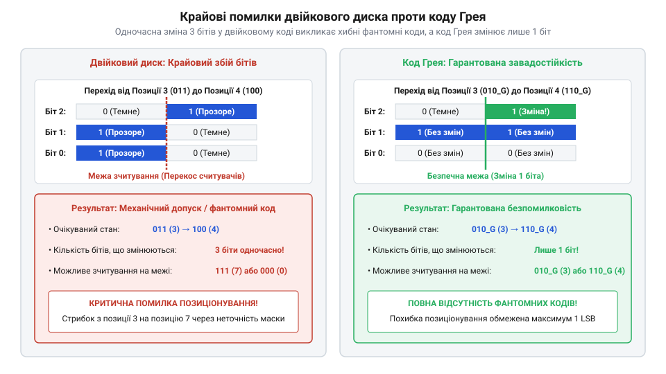
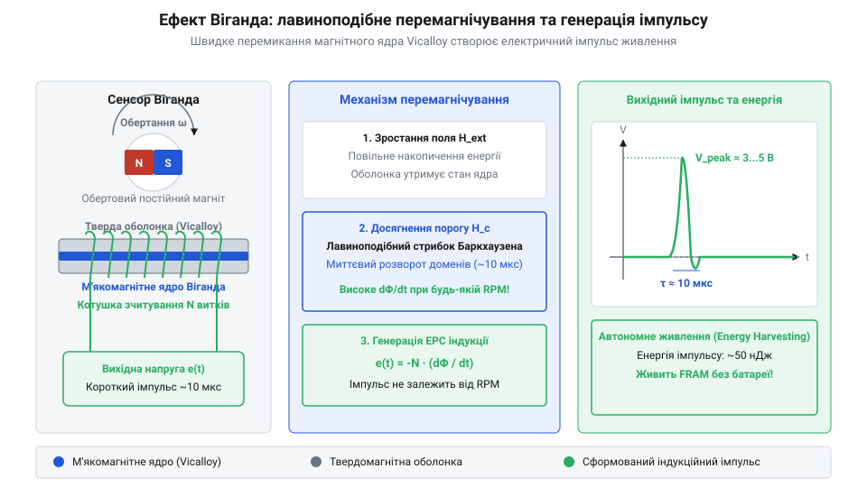

# Еволюція абсолютного вимірювання кута: від контактних кодових дисків до Wiegand-датчиків обертів

<preknowlist>
- [Оптичні та механічні інкрементальні енкодери](root:cat-hw-controls/rotary-encoders-quadrature) — принцип квадратурного вимірювання та обмеження відносного відліку імпульсів
- [Оптичні та індуктивні давачі положення органів вводу](root:cat-hw-controls/optical-and-inductive-position-encoders) — фізика фотоелектричного розпізнавання відкритих і закритих ділянок маски
</preknowlist>

## Проблема збереження кута після знеструмлення

У середині XX століття, на тлі бурхливого розвитку авіаційних сервомеханізмів, систем автопілотування та радарних антенних постатів, інженери зіштовхнулися з викликом точного вимірювання кутового положення вала. Ранні автоматичні системи спиралися на прецизійні дротяні потенціометри (від латинського *potentia* — можливість та грецького *metron* — вимірювання, @@en|potentiometer@@). Потенціометри видавали аналоговий сигнал, який вимірював [поворотний потенціометр](root:cat-hw-controls/rotary-potentiometer), але пружний рухомий щітковий контакт швидко зношував резистивний шар, спричиняючи шуми, лінійний дрейф та втрату точності при вібраціях.

З появою перших електронних обчислювачів на зміну аналоговим давачам прийшли інкрементальні імпульсні лічильники (від латинського *incrementum* — приріст, @@en|incremental counter@@). Вони ґенерували серії електричних імпульсів під час обертання диска, які підсумовувалися у тригерах оперативних регістрів. Проте така схема мала фундаментальну вразливість: при раптовому збої або плановому вимкненні електроживлення вміст лічильників миттєво зникав, позбавляючи систему будь-якої інформації про поточну позицію вала.

Для відновлення відліку інкрементальні давачі вимагали тривалої та ризикованої процедури базавання — гомінгу (від англійського *home* — вихідний нуль, @@en|homing procedure@@). Серводвигун змушений був насліпо обертати вал важкого механізму до спрацьовування електромеханічного кінцевого вимикача, який фіксував лише грубу наближену зону нульової позиції. Після цього обчислювач переходив у режим уповільненого пошуку, доки оптична сенсорна головка не вловлювала вузький світловий імпульс — це була [індексна мітка Z-канала](root:cat-hw-controls/rotary-encoders-quadrature), що являла собою єдину прозору щілину на скляному диску енкодера для прив'язки до точного точкового нуля. У важких промислових верстатах та радарних вежах така процедура гомінгу спричиняла аварійні зіткнення вузлів при збої вимикачів, тривалі простої обладнання та небезпечне самовільне падіння вертикальних вантажів під дією сили тяжіння. Цей технічний кут спонукав розробників відмовитися від накопичувального відліку та створити фізичну абсолютну маску (від латинського *absolutus* — безумовний, @@en|absolute mask@@) — кодовий диск із унікальним комбінаторним малюнком секторів, стан якого зчитується миттєво при подачі живлення без найменшого механічного зсуву вала.

## Контактні диски та кодові збої

Перші абсолютні давачі кута, створені на початку 1950-х років для військових балістичних обчислювачів, мали роторні друковані плати з декількома концентричними доріжками та пружними металевими щітками. Кожна доріжка відповідала одному біту двійкового розряду. Невдовзі контактні щітки почали замінювати безконтактними масками на скляних дисках із фотолітографічним нанесенням непрозорих секторів, де стан кожного біта визначався фотодіодною матрицею, як це описують [оптичні давачі положення](root:cat-hw-controls/optical-and-inductive-position-encoders).

Проте використання прямого двійкового коду на кодовому диску виявило важку фізичну проблему — гонки станів або крайовий збій (від англійського *race condition* — змагання сигналів, @@en|race condition@@). На скляних дисках із високою точністю фотолітографічного нанесення непрозорих секторів та рознесених уздовж радіуса фотодіодах кожен біт оцифровувався окремим оптоелектронним каналом. При кодовому переході між сусідніми кутовими секторами в двійковій системі змінювали свій стан одразу декілька розрядів (наприклад, при переході від позиції `7` = `0111₂` до `8` = `1000₂` змінюються всі 4 біти). Через мікроскопічні геометричні неточності крайки непрозорої фотоемульсії диска, технологічний розкид порогів спрацьовування світлочутливих елементів фотодіодної матриці та різний час наростання фотоструму біти перемикалися не одночасно, а з розкидом у кілька мікросекунд.

*Порівняльний аналіз контактного двійкового диска та маски коду Ґрея, що ілюструє виникнення крайового збою при одночасному перемиканні кількох бітів.*

У цей перехідний момент сенсорний вузол фіксував хибні проміжні коди (наприклад, `1111₂` = 15 або `0000₂` = 0). Для контуру керування сервоприводу такий хибний сплеск координати сприймався як раптовий стрибок вала, викликаючи сильні ударні навантаження в механіці та аварійне відключення системи.

Розв'язання цієї проблеми запропонував дослідник лабораторій Bell Labs Френк Ґрей (Frank Gray). У березні 1953 року він запатентував спеціальний дзеркальний двійковий код (патент US 2,632,058, @@en|Gray code@@). Головна властивість коду Ґрея полягає у тому, що при переході між будь-якими двома сусідніми кутовими секторами змінює свій стан **лише один біт** (відстань Хеммінга `d_H = 1`, на честь Річарда Хеммінга, @@en|Hamming distance@@). Це повністю усунуло ризик виникнення проміжних фальшивих комбінацій при зчитуванні маски.

## Механічні редуктори багатооборотного відліку

Однооборотні кодові диски із кодом Ґрея забезпечили точне вимірювання кута у межах одного повного оберту від `0°` до `360°`. Однак у ходових гвинтах верстатів з ЧПК, лебідках та поворотних платформах радіолокаторів вал здійснює десятки й сотні повних обертів. Після проходження точки `360°` однооборотний давач скидався в нуль і втрачав відлік номеру оберту.

Для вирішення цього завдання в 1960-х роках інженери розробили багатооборотні редукторні енкодери (від латинського *reductio* — повернення назад; англ. @@en|gear train encoder@@). Всередині корпусу давача встановлювали прецизійну батарею з кількох послідовних мікроредукторів із фіксованим передавальним відношенням `k = 2ᵐ` (наприклад, `1:16`, де `m = 4` біти). Кожне проміжне зубчасте колесо з'єднувалося з власним додатковим кодовим диском, оцифрованим окремою фотодіодною матрицею. Головний виклик такого об'єднання полягав у тому, що через механічний люфт шестерень кодовий диск другого ступеня `D₁` переключав свої розряди не строго в момент обнулення першого диска `D₀`, а з часовим зсувом. Для усунення помилок на межах обертів застосували математичний алгоритм фазового узгодження кодів (від англ. @@en|phase alignment window@@): точне число обертів `T` обчислювалося шляхом корекції грубої позиції другого диска `P₁` за допомогою старших розрядів точної позиції першого диска `P₀` через операцію округлення, після чого формувалася загальна багатооборотна позиція `P_total` з урахуванням одноборотної бітності `N_ST`:

        T = round(P₁ - P₀ / k)               [обчислення цілочисельної кількості обертів]
        P_total = T · 2ᴺ_ST + P_ST           [обчислення підсумкової багатооборотної координати]

Цей алгебраїчний алгоритм давав змогу повністю компенсувати кутовий люфт зубчастої передачі в межах до `±180° / k`, формуючи єдину абсолютну координату, яка зберігала і поточний кут, і кількість обертів без джерела живлення.

Проте механічні редукторні батареї мали суттєві конструктивні вади:

- Мертвий хід та люфт (від англійського *backlash* — проміжний зазор, @@en|backlash@@): кінематичний зазор між зубами шестерень спричиняв похибку відліку при зміні напрямку обертання вала, що вимагало застосування складних пружних розрізних шестерень.
- Момент інерції та механічний знос: висока кількість обертових деталей обмежувала граничну швидкість вала та прискорювала знос зубчатих передач.
- Габарити та маса: багатоступеневий редуктор суттєво збільшував довжину корпусу давача.

Ці фізичні обмеження механічних редукторних батарей спонукали інженерів до пошуку компактних безакумуляторних електронних лічильників обертів.

## Винахід дроту Віганда та енергонезалежність

У 1974 році американський винахідник Джон Віганд (John R. Wiegand) зробив відкриття, яке згодом кардинально змінило архітектуру багатооборотних давачів. Він виявив особливий ефект перемагнічування в спеціально обробленому феромагнітному дрітові зі сплаву заліза, кобальту та ванадію (Вікалой, @@en|Vicalloy@@). Під час виготовлення дріт зазнавав складної термомеханічної обробки — скручування та розтягування, внаслідок чого утворювалася двошарова структура: м'яка магнітна середина та жорстка зовнішня оболонка (дріт Віганда, @@en|Wiegand wire@@).

Коли зовнішнє магнітне поле від постійного магніту, закріпленого на валу енкодера, досягає порогового значення, магнітні домени м'якого ядра миттєво змінюють свою полярність. За своєю природою це серія надшвидких макроскопічних стрибків Баркгаузена (на честь Генріха Баркгаузена, @@en|Barkhausen jumps@@), під час яких одна доменна стінка (від англійського *domain wall*, @@en|domain wall@@) зривається зі стопорів кристалічної ґратки та розганяється вздовж ядра до швидкості близько 500…1000 m/s. Цей лавиноподібний стрибок перемагнічування (ефект Віганда, @@en|Wiegand effect@@) відбувається за частки мікросекунди. Швидка зміна магнітного потоку `dB/dt` наводить у зчитувальній котушці, намотаній довкола дроту, короткий високовольтний електричний імпульс амплітудою 3…5 V.

*Схема перемагнічування дроту Віґанда та формування індукційного імпульсу живлення при обертанні постійного магніту.*

Головна фізична цінність ефекту Віганда полягає у тому, що амплітуда та енергія сформованого імпульсу взагалі не залежать від швидкості обертання вала — імпульс є однаково потужним як при 10 000 об/хв, так і при надповільному повороті вала. Формований індукційний спалах здатний виконувати збір енергії (від англійського *harvesting* — збір врожаю, @@en|energy harvesting@@). Енергії одного імпульсу (близько декількох наноджоулів) цілком достатньо для короткочасного пробудження наднизькоспоживаючої електронної мікросхеми лічильника та запису оновленої кількості обертів у сегмент сегнетоелектричної оперативної пам'яті (від англійського *ferroelectric RAM*, @@en|ferroelectric RAM@@, FRAM).

Завдяки дроту Віганда багатооборотні енкодери позбулися важких механічних редукторних каскадів і вимагаючих регулярної заміни літієвих батарейок, які мали обмежений термін служби та ризик витікання електроліту.

## Міфи першості та сучасний синтез

Розвиток технологій абсолютного оцифрування кута супроводжувався суперечками щодо патентного пріоритету та спробами переписати історію винахідництва. У радянській та пізнішій російській технічній літературі тривалий час поширювався міф про те, що дзеркальний двійковий код нібито був незалежно розроблений вітчизняними інженерами ще до робіт Bell Labs. Проте аналіз архівних патентних першоджерел свідчить протилежне: Френк Ґрей подав патентну заявку US 2,632,058 ще у листопаді 1947 року (патент видано у 1953 році), розробивши свій код для вакуумних електронно-променевих кодерів імпульсно-кодової модуляції. Спроби приписати пріоритет радянським розробникам з'явилися значно пізніше й базувалися на безапеляційних твердженнях без наведення давніших публікацій чи патентних формул.

Сучасний абсолютний енкодер є результатом глибокого технологічного синтезу двох незалежних фізичних принципів:

1. **Однооборотний відлік (однооборотний режим, @@en|single-turn@@):** високоточний оптичний або магнітний диск із маскою коду Ґрея, як описують [оптичні та індуктивні давачі положення](root:cat-hw-controls/optical-and-inductive-position-encoders), забезпечує визначення абсолютного кута у межах одного оберту (від `0°` до `360°`) із високою роздільною здатністю до 18–24 бітів.
2. **Багатооборотний відлік (багатооборотний режим, @@en|multi-turn@@):** безакумуляторний модуль на основі дроту Віганда підраховує повні оберти вала (до 16 бітів, або 65 536 обертів) за будь-яких умов живильної мережі.

Об'єднаний цифровий вектор координати передається у контур керування сервоприводу через завадостійкі послідовні інтерфейси (SSI, BiSS-C, EnDat). Це забезпечує миттєве визначення абсолютного положення виконавчого механізму одразу при включенні живлення без процедури гомінгу та зсуву [дрейфу нуля](root:cat-hw-controls/stick-drift-mitigation).
