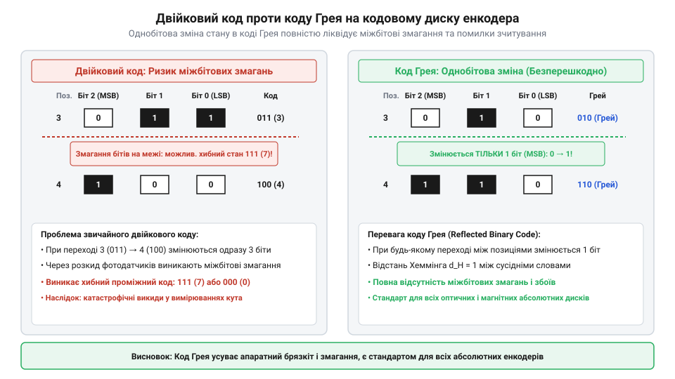
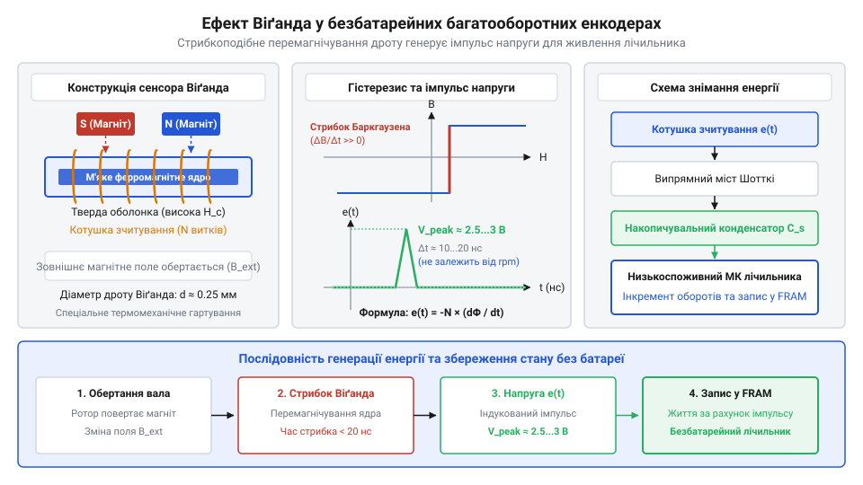

# Еволюція абсолютних енкодерів: від електромеханічних щеточних дисків до оптичних кодових масок і сенсорів Віґанда

<preknowlist>
- [Кулачкові перемикачі (Cam Switches) та пакетні вимикачі](root:cat-hw-controls/rotary-cam-switches) — фізична будова кулачкового вала та контактних ламелей
- [Оптичні та механічні інкрементальні енкодери](root:cat-hw-controls/rotary-encoders-quadrature) — відмінність інкрементального рахунку імпульсів від абсолютного кодування положення
</preknowlist>

## Проблема міжбітових змагань і код Грея

У середині XX століття стрімкий розвиток радіолокаційних систем, авіаційної навігації та перших верстатів із числовим програмним керуванням поставив перед інженерами завдання точного вимірювання кутового положення вала. На відміну від [інкрементальних енкодерів](root:cat-hw-controls/rotary-encoders-quadrature), які втрачали точку відліку при знеструмленні, новий клас пристроїв мав миттєво видавати абсолютний цифровий код поточного кута. Перші конструкції абсолютних селекторів базувалися на дисках із прямою двійковою системою числення, де кожна концентрична доріжка відповідала одному двійковому розрядові. Однак при використанні чистого двійкового коду виникла катастрофічна фізична проблема міжбітових змагань (англ. *race condition*, від англ. *race* — гонка та *condition* — стан, @@en|race condition@@).

Під час обертання диска сусідні кутові сектори часто вимагають одночасної зміни кількох бітів. Наприклад, при переході від значення 7 (двійкове `0111`) до значення 8 (двійкове `1000`) мають одночасно переключитися всі чотири біти. Через неминучі механічні допуски виготовлення, неспіввісність зчитувачів та технологічні похибки розмикання або замикання окремих каналів відбувається не в одну мікросекунду. В цей нескінченно малий часовий інтервал зчитувальна матриця фіксує хибні проміжні коди, такі як `1111` (15) або `0000` (0). Для автоматики це означало раптові вибухові стрибки виміряного кута на 180 градусів, що призводило до збоїв у системах позиціонування та поломок приводів.

Розв'язанням цієї інженерної кризи став винахід американського фізика Френка Ґрея (англ. *Frank Gray*, @@en|Frank Gray@@) з лабораторій Bell Labs. У 1953 році він запатентував безперервний дзеркальний двійковий код, який пізніше отримав назву @@en|Gray code@@ (код Грея). Ключова математична особливість @@en|Gray code@@ полягає у тому, що при переході між будь-якими двома сусідніми кутовими секторами змінює свій стан лише один біт. Для апаратної обробки в цифрових обчислювачах алгоритм формування @@en|Gray code@@ з прямого двійкового числа `B` реалізується через побітову операцію «виключного АБО» (@@en|XOR@@, від англійського *exclusive OR*):

```text
G = B ⊕ (B >> 1)                         [пряме перетворення двійкового коду B у код Грея G]
```

Старший біт `Gₙ` завжди збігається зі старшим бітом `Bₙ`, а кожен наступний розряд обчислюється як `Gᵢ = Bᵢ₊₁ ⊕ Bᵢ`. Зворотне декодування з @@en|Gray code@@ у двійковий числовий формат для мікроконтролера виконується послідовним сумуванням за модулем 2 від старшого розряду до молодшого (`Bᵢ = Bᵢ₊₁ ⊕ Gᵢ`), що алгоритмічно реалізується через циклічний розрядний зсув та ітеративний @@en|XOR@@.

ΔB = 1                  [умова відсутності міжбітових змагань]


*Порівняння двійкового коду та коду Грея на кодовому диску із демонстрацією усунення міжбітових змагань.*

Завдяки цій властивості навіть за наявності механічних похибок зчитувач при межевому положенні може помилитися лише на один сусідній дискретний крок, що повністю усунуло небезпеку катастрофічних збоїв відліку.

## Електромеханічні щіткові диски та їхнє зношення

Перші практичні абсолютні енкодери 1940–1950-х років виготовлялися як контактні електромеханічні пристрої. На текстолітовий або керамічний диск шляхом травлення наносили струмопровідні мідні доріжки, вкриті сплавами благородних металів (золото-паладієвими або срібно-родієвими покриттями), з ізоляційними проміжками, що формували кодову маску Грея. Зчитування здійснювалося за допомогою блоку пружинних щіток із берилієвої бронзи або платино-іридієвих сплавів (від англ. @@en|sliding contact@@ — ковзний контакт), які ковзали по поверхні диска і замикали електричне коло. Для узгодження з релейними та ламповими логічними схемами кожен контактний канал підключався за електричною схемою з підтягувальними резисторами (від англ. @@en|pull-up resistor@@) номіналом `R_pullup ≈ 10...47 кОм` до шини живлення `V_CC`: при ковзанні щітки по ізоляційній ділянці резистор формував високий логічний рівень напруги `V_CC`, а при попаданні на заземлений струмопровідний сектор напряму закорочував лінію на землю `0 В`.

Попри простоту реалізації та відсутність потреби у складній електронній обробці, контактна схема мала серйозні конструктивні недоліки. Головною проблемою залишався сухий механічний знос контактних ламелей та стрічкових щіток. Схожі обмеження ковзного контакту притаманні будові [поворотного потенціометра](root:cat-hw-controls/rotary-potentiometer) та [кулачкових перемикачів](root:cat-hw-controls/rotary-cam-switches). Ситуацію ускладнював брязкіт контактів (англ. *contact bounce*, від англ. *bounce* — відскок, @@en|contact bounce@@) — мікроскопічні відскоки щітки від поверхні під час вібрацій, що генерували високочастотні завади. Крім того, у промисловому середовищі на контактах накопичувався пил та утворювалися оксидні плівки, що спричиняло обрив кіл. Допустима швидкість обертання вала контактних енкодерів не перевищувала 200–300 об/хв, а ресурс вимірювався лише сотнями тисяч обертів, що змусило інженерів шукати безконтактні фізичні принципи зчитування.

## Оптичні кодові маски та фотоприймальні матриці

Справжній технологічний стрибок відбувся у 1960–1970-х роках із появою перших напівпровідникових випромінювачів та фотодіодів. Контактні металеві диски замінили на прозорі скляні або фотогравіровані металеві кодові маски (англ. *optical code disc*, @@en|optical code disc@@), де темні сектори затримували світло, а прозорі — вільно пропускали промінь.

З одного боку кодового диска встановлювали лінійку джерел світла, а з протилежного — прецизійну фотоприймальну матрицю (англ. *photodiode array*, @@en|photodiode array@@). Використання оптичного зчитування дозволило повністю усунути механічне тертя та брязкіт контактів, завдяки чому робоча швидкість обертання зросла до 10000 об/хв і більше. Використання методів фотолітографії дозволило зменшити ширину кодових доріжок до кількох мікрометрів, підвищивши роздільну здатність однооборотних селекторів із 4–6 біт до 12–16 біт (до 65536 дискретних станів на один оберт). Однак зі зменшенням ширини щілин виник оптичний бар'єр: дифракція світла розмивала межі між секторами, знижуючи контрастність фотоструму. Для подолання дифракційного розмиття між рухомим диском та фотодіодами встановили нерухому аналітичну сітку — індикаторну маску (англ. *indicator mask*, @@en|indicator mask@@, від латинського *indicare* — вказувати). Збіг та перекриття растрових штрихів ротора й маски створили просторову модуляцію світлового потоку з чіткими крутими фронтами. Скляні кодові диски з аналітичною маскою стали стандартом для високоточного промислового електроприводу, на базі якого функціонують сучасні [оптичні та індуктивні давачі](root:cat-hw-controls/optical-and-inductive-position-encoders) положення.

## Ефект Віґанда та безбатарейне багатооборотне лічильне

Визначення точного кута в межах одного оберту виконує однооборотний енкодер (@@en|single-turn encoder@@), але промислові електроприводи та підйомні механізми вимагають відліку сотень або тисяч повних оборотів вала. Механічні багатоступеневі редуктори додають інерцію та габарити, а електронні лічильники з літієвими батареями загрожують втратою даних у разі розряджання акумулятора під час тривалих простоїв.

Розв'язанням проблеми став винахід американського інженера Джона Віґанда (@@en|John R. Wiegand@@) 1970-х років. Спеціально оброблений дріт зі сплаву вікалой (@@en|Vicalloy@@ — кобальт-залізо-ванадієвий сплав) піддають механічному скручуванню під термообробкою, утворюючи м'яке магнітне осердя та тверду зовнішню оболонку.

Коли зовнішній постійний магніт на валу обертається повз дріт, м'яке осердя утримує початковий стан намагніченості до досягнення порогового значення індукції. Потім відбувається миттєва лавиноподібна переорієнтація магнітних доменів — великий стрибок Баркгаузена (@@en|large Barkhausen jump@@).


*Стрибкоподібна зміна намагніченості осердя дроту Віґанда наводить короткий імпульс напруги в котушці для автономного живлення лічильника.*

Ця зміна магнітного потоку наводить у зчитувальній котушці (англ. *pickup coil*, @@en|pickup coil@@) короткий імпульс напруги амплітудою понад `2–3 V` та енергією близько `10–20 nJ`. Амплітуда імпульсу взагалі не залежить від швидкості обертання вала. Електрична схема випрямляє цей імпульс діодним мостом та накопичує заряд у конденсаторному буфері (англ. *storage capacitor*, @@en|storage capacitor@@). При досягненні порогової напруги накопичувальний ключ схеми керування живленням (англ. *power management IC*, @@en|power management IC@@) відкриває вихідний транзистор і подає живлення на наднизькоспоживаючий обчислювач. За декілька мікросекунд мікроконтролер визначає напрямок обертання, обчислює новий інкремент і здійснює послідовний запис у ферроелектричну енергонезалежну пам'ять (англ. *ferroelectric RAM*, @@en|FRAM@@) до того, як конденсатор розрядиться. На відміну від систем, де працюють [оптичні та механічні інкрементальні енкодери](root:cat-hw-controls/rotary-encoders-quadrature) із зовнішнім живленням, так виник безбатарейний багатооборотний енкодер (@@en|multi-turn encoder@@) із повною автономністю за технологією збору енергії (@@en|energy harvesting@@). Детальний фізичний розрахунок індукції та котушок збору енергії висвітлюють [датчики положення на ефекті Віґанда](root:hw-sensing/wiegand-sensor-and-energy-harvesting).

## Цифрові інтерфейси та спростування історичних міфів

Перші абсолютні давачі передавали кутове положення через паралельну шину даних. Для високої роздільної здатності потрібно було від 16 до 24 окремих провідників, що утворювало громіздкі джгути та знижувало надійність зв'язку на великих відстанях у порівнянні з тим, як працюють [оптичні та інкрементальні енкодери](root:cat-hw-controls/rotary-encoders-quadrature).

Прорив відбувся в середині 1980-х років із появою послідовного синхронного інтерфейсу (англ. *Synchronous Serial Interface*, @@en|Synchronous Serial Interface@@, @@en|SSI@@). Використання двох диференційних пар RS-422 (сигнали тактування та даних) дозволило замінити 24 провідники чотирма та передавати кутовий код на сотні метрів. За діаграмою тактування @@en|SSI@@ майстер генерує імпульси CLK, і за першим спадним фронтом енкодер фіксує поточний код та послідовно передає біти від старшого до молодшого. Між кадрами лінія CLK утримується у високому стані, викликаючи спрацьовування моностабільного мультивібратора з затримкою паузи `tₘ` (близько `12–20 µs`). Якщо наступний тактовий фронт надходить до закінчення `tₘ`, енкодер передає той самий кадр повторно. Наприкінці 1990-х років розвиток мікроконтролерів привів до відкритих двонаправлених протоколів @@en|BiSS-C@@ та @@de|EnDat@@. Протокол @@en|BiSS-C@@ додав безперервне передавання розширеної діагностики та апаратний розрахунок контрольної суми (англ. *cyclic redundancy check*, @@en|CRC@@, від латинського *cyclicus* — циклічний) для перевірки цілісності кадру у високошвидкісних сервосистемах, на базі чого працюють сучасні [оптичні та індуктивні давачі](root:cat-hw-controls/optical-and-inductive-position-encoders) положення.

Розвиток технології супроводжувався появою сталих технічних міфів. По-перше, Джон Віґанд не розробляв свій ефект для кутових датчиків: у 1970-х роках патент створювався для магнітних карт доступу та ключів security-систем, а застосування дроту як безбатарейного генератора імпульсів для багатооборотного відліку винайшли інженери-датчикарі значно пізніше.

По-друге, код Грея (@@en|Gray code@@) винайшов Френк Грей (@@en|Frank Gray@@) у Bell Labs і запатентував 1953 року (US Patent 2,632,058) зовсім не для оптичних масок положення, а для імпульсно-кодової модуляції в телевізійних системах передачі даних. Конструктори кодових дисків адаптували цей математичний винахід для усунення міжбітових змагань на електромеханічних комутаторах.
