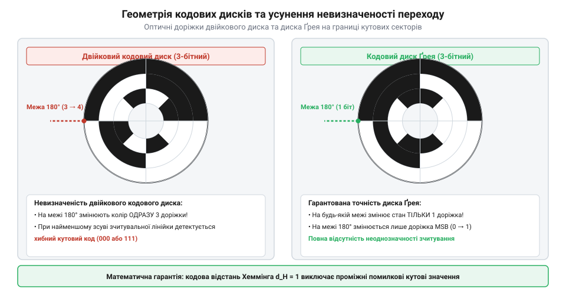
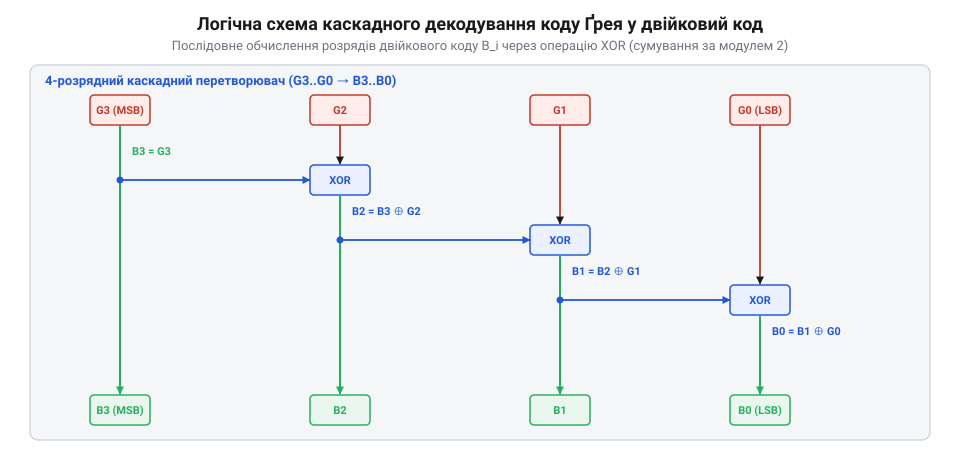

# Математичні розрахунки перетворення коду Грея, кутової роздільної здатності та бітності абсолютних енкодерів

<preknowlist>
- [Абсолютні поворотні енкодери: однооборотні та багатооборотні](root:cat-hw-controls/rotary-encoders-absolute-single-multi-turn) — фізичний устрій, принцип зчитування кодових дисків та призначення абсолютного позиціонування
- [Оптичні та механічні інкрементальні енкодери](root:cat-hw-controls/rotary-encoders-quadrature) — квадратурне кодування, підрахунок імпульсів та поняття роздільної здатності
</preknowlist>

## Похибки оцифрування та геометрія коду Грея

У цифрових системах кутового позиціонування зчитування позицій кодового диска у звичайному двійковому коді викликає апаратні похибки на межах суміжних секторів. Під час обертання вала перехід від позиції `3` (`011`₂) до позиції `4` (`100`₂) вимагає одночасної зміни стану одразу трьох контактних або оптичних доріжок. Через механічні допуски виготовлення маски та асинхронність спрацьовування фотоприймачів розмикання й замикання фотодіодів відбувається несинхронно. У мікросекундному інтервалі переключення на кодовій шині виникають паразитні проміжні комбінації `111`₂ (`7`) або `000`₂ (`0`), що спричиняють хибні кидки позиції у контурі цифрового сервоприводу.


*Геометрія кодового диска: асинхронні перехідні стани двійкового коду проти однобітової комутації коду Грея.*

Для усунення проміжних хибних станів застосовують рефлексивний бінарний код Грея (від англ. @@en|reflected binary Gray code@@). Назва «рефлексивний» походить від алгоритму його математичної побудови через рекурсивне дзеркальне відображення векторів: для формування `(n + 1)`-бітної послідовності `G_(n+1)` вихідну `n`-бітну послідовність `G_n` записують у зворотному порядку, після чого до першої половини елементів дописують префікс `0`, а до дзеркально відображеної другої половини — префікс `1`. Таке дзеркальне подвоєння гарантує, що на межі стику двох половин змінюється лише старший долучений біт з `0` на `1`, тоді як усі молодші біти залишаються абсолютно ідентичними. У результаті будь-які два сусідні числові вектори відрізняються станом лише одного біта, а відстань Геммінга (від англ. @@en|Hamming distance@@) між ними завжди дорівнює одиниці:

Однак коли кількість кутових секторів K на кодовому диску не є ступенем двійки 2ⁿ (наприклад, при десятковому відліку або використанні двійково-десяткового коду Грея, від англ. @@en|Gray-BCD@@), пряме застосування коду Грея ламає умову однобітової зміни при переході від останньої позиції K - 1 до нульової відмітки. Для збереження відстані Геммінга d_H = 1 на стику циклу використовують симетричний інвертований код зі зсувом бази (від англ. @@en|Excess Gray code@@). У цьому алгоритмі робочу вибірку з K кодових слів центрують симетрично всередині повного 2ⁿ-бітного простору, відсікаючи рівні частки з обох країв матриці. Для десяткового лічильника (K = 10, n = 4) початковий двійковий індекс зсувають на величину m = (2⁴ - 10) / 2 = 3, обираючи комбінації від 3 до 12. Оскільки дзеркальна симетрія коду Грея відносно центральної осі зберігає сусідство крайніх векторів, перехід від 9-ї позиції до 0-ї відбуватиметься зі зміною лише одного біта, що гарантує безперебійне оцифрування кута у некратних шкалах позиціонування.

```
d_H(G_u, G_v) = 1                               [умова однобітової зміни суміжних станів]
```

Оскільки при переході між сусідніми секторами диска змінюється стан лише одного фотоприймача, виникнення паразитних проміжних комбінацій стає фізично неможливим. На відміну від інкрементальних каналів у [оптичних та механічних інкрементальних енкодерах](root:cat-hw-controls/rotary-encoders-quadrature), абсолютна кодова маска Грея дає змогу миттєво визначити точний кут вала одразу після подачі живлення без попереднього пошуку нульової мітки. Математичний зв'язок між бітами позиційного двійкового слова `B = (Bₙ₋₁, ..., B₀)` та кодом Грея `G = (Gₙ₋₁, ..., G₀)` виражається через побітову операцію виключного «АБО» (від англ. @@en|exclusive OR@@, XOR, символ `⊕`):

```
G_i
= B_i ⊕ B_i₊₁                                   [порозрядне додавання за модулем 2 із старшим сусіднім бітом]
```

При цьому старший розряд коду Грея завжди збігається зі старшим розрядом двійкового коду (`Gₙ₋₁ = Bₙ₋₁`). Така дзеркальна геометрія обмоток та оптичних доріжок гарантує відсутність збоїв при високих швидкостях обертання та вібраціях.

## Математичні алгоритми перетворення коду Грея

Для виконання арифметичних обчислень у цифровому контролері зчитаний з енкодера вектор коду Грея `G` необхідно декодувати у позиційну двійкову систему `B`. Оскільки старший біт залишається незмінним `Bₙ₋₁ = Gₙ₋₁`, обчислення молодших розрядів виконують послідовним рекурсивним додаванням за модулем 2 згори донизу:

```
B_i = B_i₊₁ ⊕ G_i                               [рекурсивне відновлення двійкового біта]
```

Підставляючи вираз для кожної попередньої ланки у рекурсивне співвідношення, отримуємо пряму формулу кумулятивного підсумовування всіх старших розрядів коду Грея:

```
B_i
= Gₙ₋₁ ⊕ Gₙ₋₂ ⊕ ... ⊕ G_i                       [кумулятивне додавання за модулем 2 всіх старших бітів Грея]
```


*Схемотехнічна та логічна структура каскадного перетворювача коду Грея: послідовне обчислення двійкових бітів через елементи виключного «АБО».*

У мікроконтролерах для прискорення обчислень замість циклу по окремих бітах застосовують паралельний побітовий алгоритм на основі зсувів та операцій XOR. Кількість каскадних степенів зсуву визначається розрядністю кодового слова `N` і дорівнює логарифмічній кількості кроків `log₂ N`. Для розрядності `N = 16` біт обчислення вимагає 4 послідовних зсуви (на 1, 2, 4 та 8 бітів), а для `N = 32` біт додається п'ятий крок зсуву на 16 бітів. Кожен наступний каскад подвоює величину зсуву `2ᵏ` (де `k` від 0 до `log₂ N - 1`), поширюючи операцію XOR на всі старші розряди за логарифмічну складність `O(log₂ N)` замість послідовного бітового циклу `O(N)`. Для `N`-бітного кодового слова вектор `B` обчислюють за каскадною схемою логічного зсуву праворуч:

Окрім прямого декодування, у завданнях симуляції та тестування виникає потреба зворотного перетворення двійкового числа у код Ґрея. Алгебраїчно кожен біт коду Ґрея обчислюється як сума за модулем 2 двох сусідніх розрядів двійкового числа `g_i = b_i ⊕ b_i₊₁`. У мовах C/C++ це зворотне кодування виконується за одну тактну операцію без використання циклів через побітовий зсув праворуч та операцію виключного АБО: `g = b ^ (b >> 1)`. Логічний зсув `b >> 1` вирівнює старший сусідній біт `b_i₊₁` навпроти поточного біта `b_i`, а операція XOR формує одиницю лише тоді, коли сусідні розряди відрізняються. Оскільки при переході від числа `b` до `b + 1` змінний перенос у двійковій системі поширюється від молодших бітів до старших, формула `g = b ^ (b >> 1)` гарантує, що у підсумковому векторі `g` змінюється лише один біт, запобігаючи збоям опитування дискретних ліній, як у [кодових DIP-перемикачах](root:cat-hw-controls/rotary-dip-switches).

**Умова: декодування 4-бітного вектора коду Грея G = 1100₂ (десяткове 8 в коді Грея відповідає 12 у двійковому)**

```
B₀ = G ^ (G >> 1)                               [перший каскад зсуву на 1 біт: B₀ = 1100₂ ^ 0110₂ = 1010₂]
B₁ = B₀ ^ (B₀ >> 2)                             [другий каскад зсуву на 2 біти: B₁ = 1010₂ ^ 0010₂ = 1000₂]
B  = B₁                                         [підсумковий двійковий вектор: 1000₂ = 8]
```

Отриманий двійковий код `B` відповідає точній дискретній позиції вала, яка далі перераховується у кутові одиниці.

## Розрахунок роздільної здатності та похибки квантування

Кутова роздільна здатність (від англ. @@en|angular resolution@@) `N`-бітного абсолютного енкодера визначається кількістю дискретних станів `K = 2ⁿ`, на які ділиться повний оберт вала `360°`. Мінімальний вимірюваний кут — дискретність (ціна наймолодшого розряду, від англ. @@en|Least Significant Bit@@, LSB) `Δθ_deg` у градусах обчислюється за формулою:

```
Δθ_deg = 360° / 2ⁿ                              [кутовий крок у градусах]
```

Для високоточних систем позиціонування дискретність переводять у кутові мінути `Δθ_min` та кутові секунди `Δθ_sec`:

```
Δθ_min = 21600' / 2ⁿ                            [кутовий крок у мінутах дуги]
Δθ_sec = 1296000'' / 2ⁿ                         [кутовий крок у секундах дуги]
```

**Умова: обчислення параметрів роздільної здатності для 12-бітного однооборотного енкодера (N = 12)**

```
K
= 2¹²                                           [кількість дискретних позицій]
= 4096                                          [значення кількості секторів]

Δθ_deg
= 360° / 4096                                   [поділ повного оберту на 4096 частин]
= 0.087890625°                                  [роздільна здатність у градусах]

Δθ_sec
= 1296000'' / 4096                              [переведення повного оберту у секунди дуги]
= 316.40625''                                   [значення дискретності у секундах]
```

Гранична похибка квантування (від англ. @@en|quantization error@@) `ε_q` являє собою неусувну математичну невизначеність оцифрування безперервного кута і дорівнює половині ціни молодшого розряду (від англ. @@en|Least Significant Bit@@, LSB):

```
ε_q = ± (1 / 2) · Δθ                            [гранична кутова похибка квантування]
```

Оскільки цифровий вихід енкодера змінюється стрибкоподібно в центрі або на межі кожного сектора, реальне фізичне положення вала у межах одного дискретного інтервалу `Δθ` може відхилятися від відлікованого цифрового значення щонайбільше на `± Δθ / 2`. У вимірювальних механізмах, виконавчих важелях та поворотних столах ця кутова невизначеність транслюється у лінійний зсув позиціонування `Δs_q` на винесеному радіусі `r` (від англ. @@en|radius@@) від осі обертання.

Для обчислення лінійної похибки кутову похибку `ε_q` переводять із градусів у радіани `ε_q_rad = ε_q_deg · (π / 180°)`. Оскільки для високих розрядностей кут квантування є малою величиною (`ε_q_rad << 1`), довжина дуги колового сектора (від англ. @@en|arc length@@) практично збігається з довжиною хорди, а лінійний зсув `Δs_q` обчислюється за формулою:

```
ε_q_rad
= (1 / 2) · (360° / 2ⁿ) · (π / 180°)           [переведення половини дискретності у радіани]
= π / 2ⁿ                                        [кутова похибка квантування у радіанах]

Δs_q
= r · ε_q_rad                                   [значення лінійного зсуву на радіусі r]
= r · (π / 2ⁿ)                                  [формула лінійного зсуву квантування]
```

Приміром, при радіусі плеча `r = 0.5 м` і розрядності енкодера `N = 12` біт (`2¹² = 4096`) лінійне відхилення досягає `Δs_q = 0.5 · (π / 4096) ≈ 0.383 мм`, що для прецизійних маніпуляторів є суттєвою величиною. Зменшення лінійного зсуву `Δs_q` досягається збільшенням розрядності `N` або використанням понижувальної механічної передачі. На відміну від аналогових давачів, як-от [поворотні потенціометри](root:cat-hw-controls/rotary-potentiometer) чи [давачі RVDT](root:cat-hw-controls/rvdt-operating-principles), похибка квантування абсолютного енкодера не залежить від температури чи нестабільності живлення і строго визначається обраною розрядністю `N`.

Окрім дискретизації, на підсумкову точність вимірювання суттєво впливає геометричний ексцентриситет (від англ. @@en|eccentricity error@@ — похибка ексцентриситету) — радіальне зміщення `e` між геометричним центром кодового диска та фізичною віссю обертання вала. Цей механічний дефект монтажу викликає періодичну синусоїдальну кутову похибку `Δθ_ecc(θ) ≈ (e / R_disc) · sin(θ)` відносно поточного кута `θ`, де `R_disc` — радіус кодової доріжки диска. Максимальне значення цієї похибки у радіанах дорівнює `ε_ecc = e / R_disc`. Наприклад, при радіусі доріжки `R_disc = 20 мм` навіть мікроскопічний зсув `e = 5 мкм` формує кутову похибку `ε_ecc = 5 / 20000 = 2.5 · 10⁻⁴ рад ≈ 51.6''`, що перевищує ціну наймолодшого розряду `LSB` для розрядностей `N ≥ 14` біт. Сумарна кутова похибка пристрою визначається сумою `ε_total = ε_q + ε_ecc`. Для нейтралізації першої гармоніки ексцентриситету в прецизійних енкодерах використовують диференціальне оптичне зчитування двома діаметрально протилежними матрицями: усереднення їхніх сигналів `θ_avg = (θ₁ + θ₂) / 2` математично усуває синусоїдальний розбаланс і відновлює номінальну вимірювальну точність.

```
ε_q = ± (1 / 2) · Δθ                            [гранична похибка квантування]
```

На відміну від аналогових давачів, як-от [поворотні потенціометри](root:cat-hw-controls/rotary-potentiometer) чи [давачі RVDT](root:cat-hw-controls/rvdt-operating-principles), похибка квантування абсолютного енкодера не залежить від температури чи нестабільності живлення і строго визначається обраною розрядністю `N`.

## Комбінаторика багатооборотних енкодерів та розщеплення

Коли технологічний вузол здійснює більше одного повного оберту, однооборотний енкодер втрачає абсолютну позицію після переходу через нульову відмітку. Щоб не втратити відлік при вимкненні живлення, багатооборотний енкодер (від англ. @@en|multi-turn encoder@@) поєднує підрахунок кута в межах одного оберту та збереження кількості повних обертів. Для цього цифрове кодове слово кадрується у єдиний послідовний вектор із загальною бітністю N.

Загальна розрядність N складається з розрядності кута однооборотного енкодера (від англ. @@en|single-turn encoder@@) N_single та розрядності лічильника обертів N_multi:

N = N_single + N_multi

У кадрі передачі даних старші біти відповідають за кількість обертів, а молодші — за кутове положення всередині поточного оберту. Для розщеплення сирого двійкового значення `W` загальною довжиною `N` біт застосовують побітові операції маскування (від англ. @@en|bit mask@@) та зсуву (від англ. @@en|bit shift@@). Проте у реальних вимірювальних протоколах (зокрема BiSS-C чи розширеному SSI) повне кодове слово кадру містить додаткові сервісні розряди — біти стану (від англ. @@en|status bit@@): біт апаратної помилки `E` (від англ. @@en|Error bit@@), біт попередження `W` (від англ. @@en|Warning bit@@) та розряди контрольної суми CRC. У цьому разі загальна довжина кадру збільшується на `N_status` бітів, які розміщуються молодшими розрядами за кодом позиції. Для правильної вибірки даних обробник спочатку відсікає службовий хвост за допомогою попереднього зсуву `W_clean = W_raw >> N_status` або маскування, і лише після верифікації прапорців `E` та `W` здійснює подальше розщеплення на кутову та обертову складові.

Отримання кутової складової single_turn здійснюється накладанням маски з молодших N_single одиниць:

mask_ST = (1 << N_single) - 1
single_turn = W & mask_ST

Виділення кількості обертів multi_turn виконується логічним зсувом кадру вправо на N_single бітів:

multi_turn = W >> N_single

Завдяки цьому лінійний переміщувач або вал сервоприводу визначає абсолютну кутову позицію θ_abs за формулою:

Особливої уваги вимагає математичний механізм обробки реверсивного руху вала при переході через нульову позначку `0°` (від англ. @@en|zero-crossing@@). Під час обертання проти годинникової стрілки в момент перетину нуля однооборотне значення `single_turn` скачкоподібно змінюється від `0` до максимального значення `2ⁿ - 1` (`4095` при `n = 12`), а лічильник обертів зменшується на одиницю, викликаючи недобір розрядів (від англ. @@en|underflow@@). Для запобігання похибкам обчислення загального кута прошивка застосовує арифметику за модулем (від англ. @@en|modulo arithmetic@@ — арифметика за модулем) `2^(N_multi)` та інтерпретує значення `multi_turn` як знакове число у доповняльному коді (від англ. @@en|two's complement@@ — доповняльний код) у діапазоні від `-2^(N_multi - 1)` до `+2^(N_multi - 1) - 1`. Якщо між двома послідовними оцифровками зафіксовано перехід `single_turn_old < ΔLSB` та `single_turn_new > 2ⁿ - ΔLSB`, алгоритм розпізнає реверсивний перехід межі та корегує обертовий вектор `multi_turn_signed`, що унеможливлює виникнення хибних кутових стрибків на `360°` у закритому контурі сервоприводу.

θ_abs = multi_turn × 360° + (single_turn / 2ⁿ) × 360°

де n = N_single — бітність однооборотного каналу. Таке розщеплення дає змогу однозначно позиціонувати вал без необхідності використання додаткових батарейних лічильників чи повернення у базисну точку при відмові живлення, як це робиться в [інкрементальних енкодерах](root:cat-hw-controls/rotary-encoders-quadrature).

## Алгебра циклічних контрольних сум CRC

Передача даних високої розрядності від [абсолютних поворотних енкодерів](root:cat-hw-controls/rotary-encoders-absolute-single-multi-turn) через промислові послідовні інтерфейси SSI та BiSS-C відбувається в умовах потужних електромагнітних завад. Для гарантії цілісності кадру до інформаційного слова додається циклічний контрольний код CRC (від англ. @@en|cyclic redundancy check@@, CRC).

Математичний апарат CRC базується на поліноміальному діленні в полі Галуа (від англ. @@en|Galois field@@) GF(2). У цій алгебрі додавання та віднімання коефіцієнтів замінені на побітову операцію «виключне АБО» (XOR) без переносу розрядів.

Інформаційний вектор даних розглядається як поліном `D(x)`. Математичний вибір структури твірного полінома (від англ. @@en|generator polynomial@@) `G(x)` ступеня `k` визначає викривальну здатність коду: для стовідсоткового виявлення будь-яких подвійних бітових помилок `G(x)` не повинен ділити без остачі біном `xⁿ + 1` при довжині кадру `n < 2ᵏ - 1` (наприклад, у BiSS-C поліном `G(x) = x⁶ + x + 1` гарантує виявлення подвійних і непарних помилок у кадрі до 63 бітів). Перед обчисленням остачі інформаційний поліном зсувається вліво на `k` бітів:

D'(x) = D(x) × xᵏ

Значення контрольної суми R(x) визначається як остача від ділення зсунутого полінома D'(x) на твірний поліном G(x) за модулем 2:

D'(x) = Q(x) × G(x) ⊕ R(x)

де Q(x) — частка від ділення, а R(x) — залишок ступеня, меншого за k. Для обчислення CRC на приймальній стороні каскадно виконується покроковий зсув та ділення.

Розглянемо приклад обчислення 6-бітного CRC для твірного полінома BiSS-C:

G(x) = x⁶ + x + 1        [двійковий вектор 1000011]

Покроковий процес обчислення залишку реалізується зсувним регістром зі зворотним зв’язком:

[крок 1] M(x) = D(x) × x⁶
[крок 2] R(x) = M(x) mod G(x)      [ділення в GF(2) за допомогою XOR]

Якщо при обчисленні на стороні приймача остача від ділення усього отриманого каду разом із блоком CRC дорівнює нулю, кадр вважається доставленим без помилок. У разі виявлення розбіжності контролер відкидає дані або ініціює повторне опитування енкодера, запобігаючи хибному спрацьовуванню виконавчих механізмів.
