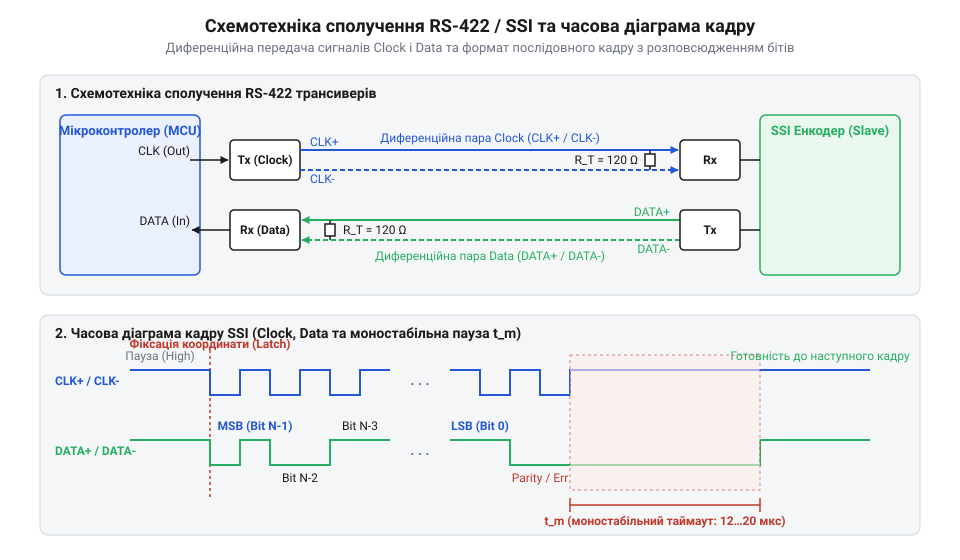

# Прецизійний вузол зчитування абсолютного енкодера через протокол SSI з апаратно-програмним конвертером коду Грея

<preknowlist>
- [Абсолютні поворотні енкодери: однооборотні та багатооборотні](root:cat-hw-controls/rotary-encoders-absolute-single-multi-turn) — розуміння принципу формування коду Ґрея та дискретизації кута
- [Оптичні та індуктивні давачі положення органів вводу](root:cat-hw-controls/optical-and-inductive-position-encoders) — знання фізичних принципів оптичного та магнітного зчитування міток
</preknowlist>

## Проблема завад у промислових енкодерах

Промислові електромагнітні завади від частотних перетворювачів та двигунів спотворюють однополярні цифрові сигнали TTL/CMOS, а звичайні [оптичні та механічні інкрементальні енкодери](root:cat-hw-controls/rotary-encoders-quadrature) втрачають підрахунок імпульсів при збоях живлення, що вимагає тривалого повернення у базове положення. Для збереження координати застосовують [абсолютні поворотні енкодери](root:cat-hw-controls/rotary-encoders-absolute-single-multi-turn) з диференційною шиною RS-422 (від англ. @@en|Recommended Standard 422@@) та синхронним послідовним протоколом SSI (від англ. @@en|Synchronous Serial Interface@@). Придушення синфазної завади (від англ. @@en|common-mode noise@@) витою парою базується на вимірюванні різниці потенціалів `U_diff = (U_sig + U_cm) - (-U_sig + U_cm) = 2 · U_sig`, де синфазна складова `U_cm` повністю віднімається компаратором.

Паралельна передача 24-бітного кутового коду вимагає 24 провідників і на довгих трасах стикається з перекосом затримки поширення (від англ. @@en|propagation delay skew@@). Технологічний розкид параметрів жил створює часову неузгодженість `t_skew`, яка при зміні кількох бітів викликає перегони сигналів (від англ. @@en|race condition@@) та фіксацію некоректних координат. Застосування протоколу @@en|SSI@@ усуває ці вади: кутовий кадр передається послідовно через дві диференційні пари `CLK` та `DATA` (чотири провідники `CLK+`, `CLK-`, `DATA+`, `DATA-`), де зчитування кожного біта прив'язане до фронту `CLK` без ризику часового розкиду розрядів.

## Схемотехніка диференційного кросу RS-422 та SSI

Фізичне сполучення мікроконтролера з енкодером @@en|SSI@@ реалізується двома диференційними парами: тактовою лінією `CLK` (від англ. @@en|clock@@ — тактовий сигнал), яку генерує контролер, та лінією даних `DATA` (від англ. @@en|data@@ — дані) від енкодера. Для узгодження електричних рівнів застосовують прийомопередавачі @@en|RS-422@@ (наприклад, мікросхеми MAX490 або SN75176).


*Принципова схема підключення трансиверів RS-422 до мікроконтролера та часова діаграма тактування й зчитування даних SSI-кадру.*

Для запобігання відбиттю сигналів (від англ. @@en|signal reflection@@ — відбиття сигналу) на кінцях ліній встановлюють термінуючі резистори. Величина термінатора `R_T = 120 Ом` обирається рівною хвильовому опору витої пари:

[Розрахунок термінуючого опору лінії]
R_T = Z_0 = 120 Ω

На лінії `CLK` термінатор монтують біля приймача енкодера, а на лінії `DATA` — біля трансивера контролера. При диференційній напрузі драйвера `U_OD = 2 В` струм навантаження становить `I_diff = U_OD / R_T = 2 / 120 ≈ 16.7 мА` (струмовий пік при `5 В` сягає `41.7 мА`), що не перевищує ліміт MAX490 у `60 мА`. Для захисту від сплесків перенапруги та статики лінію шунтують двонаправленими TVS-діодами (від англ. @@en|transient voltage suppressor@@ — супресор тимчасових перенапруг) з робочою напругою `U_WM = 5.0...6.8 В` (наприклад, @@en|SM712@@ або @@en|SMBJ5.0CA@@), які обмежують завади нижче допустимих `±14 В` входу, а шину живлення фільтрують керамічними конденсаторами `0.1 мкФ`.

Для захисту ліній @@en|RS-422@@ від завад використовують кабель вита пара з комбінованим екрануванням S/FTP або SF/UTP з опліткою (від англ. @@en|braided shield@@ — плетений екран) та фольгою (від англ. @@en|foil shield@@ — фольгований екран). Одноточкове заземлення екрана біля шасі контролера запобігає виникненню паразитного контуру заземлення (від англ. @@en|ground loop@@ — земляна петля) і протіканню струмів 50 Гц. При вимогах норм @@en|EMC@@ (від англ. @@en|electromagnetic compatibility@@ — електромагнітна сумісність) застосовують двостороннє гібридне заземлення з боку енкодера через RC-ланцюг (`R = 1 МОм`, `C = 10 нФ`, `U_rms = 1 кВ`), який блокує низькочастотні струми та скидає високочастотні завади. Кабель @@en|SSI@@ прокладають на відстані понад 30 см від силових ліній або у заземлених металорукавах.

## Дешифрація коду Ґрея та SSI-кадру

Послідовний кадр @@en|SSI@@ складається з `N` бітів, що зчитуються на кожному тактовому імпульсі `CLK`. Перший спадаючий фронт `CLK` фіксує поточний стан [давача положення](root:cat-hw-controls/optical-and-inductive-position-encoders). Далі послідовно передаються старші біти багатооборотного лічильника (Multiturn), біти однооборотного кута (Singleturn), прапори апаратних помилок `nERR` та `nWARN`, а також біт парності або контрольна сума. По завершенню передачі лінія `CLK` утримується у високому рівні протягом паузи `t_m = 12...20 мкс` (моностабільний таймаут), після чого енкодер готовий до нового циклу опитування.

Щоб уникнути кодових помилок при переході між сусідніми позиціями, значення кута виводиться в коді Грея (від англ. @@en|Gray code@@ — рефлексивний двійковий код). Декодування коду Грея `G` у класичний двійковий код `B` реалізується побітовим додаванням за модулем 2 (XOR):

[Математичний алгоритм конвертації коду Грея]
B_N = G_N
B_i = B_(i+1) ⊕ G_i      [побітове додавання за модулем 2]

У програмі на мовах C/C++ це виконується ефективним циклічним побітовим зсувом та операцією `^`:

```c
uint32_t gray_to_binary32(uint32_t gray) {
    uint32_t mask = gray >> 1;
    while (mask != 0) {
        gray ^= mask;
        mask >>= 1;
    }
    return gray;
}
```

У типовому 25-бітному кадрі @@en|SSI@@ 12 старших бітів відводяться під багатооборотний лічильник Multiturn (0…4095 обертів), а 13 наступних — під однооборотне кутове положення Singleturn (0…8191 відліків на 360°). За кодовим полем розміщуються інверсні апаратні прапори `nERR` та `nWARN`. Нульове значення `nWARN` попереджає про деградацію сигналу (забруднення кодового диска чи перегрів), дозволяючи провести обслуговування до виникнення збою, тоді як `nERR = 0` сигналізує про критичну апаратну відмову й вимагає блокування видачі координат. Наприкінці кадру передається біт парності (від англ. @@en|parity bit@@ — біт парності) або контрольна сума CRC-8 для відфільтрування спотворених пакетів при появі завад.

## Програмний модуль зчитування та валідація CRC

Програмний драйвер @@en|SSI@@ формує тактові імпульси, виділяє бітові поля положення та перевіряє цілісність пакета. На довгих лініях затримка поширення сигналу в мідному провіднику `t_prop ≈ 5 нс/м` обмежує граничну частоту тактування `f_CLK`:

[Гранична частота тактування шини від довжини кабелю L]
T_CLK / 2 > 2 · t_prop · L
f_CLK < 1 / (4 · t_prop · L)      [критерій узгодження затримки розповсюдження]

Для перевірки цілісності кадру застосовують циклічний контрольний код CRC-8 (від англ. @@en|cyclic redundancy check@@, @@en|CRC@@) з поліномом `0x07` або біт парності (від англ. @@en|parity bit@@). При побітовому додаванні за модулем 2 (XOR) кожен байт зсувається з маскою `0x80`, а для високошвидкісного зчитування використовують 256-байтну таблицю (від англ. @@en|lookup table@@). При розбіжності CRC або помилці парності драйвер виставляє прапорець `SSI_FLAG_CRC_MISMATCH` чи повертає `std::nullopt`, утримуючи останнє валідне положення ротора. Реалізація мовами C та C++ забезпечує конвертацію коду Ґрея (від англ. @@en|Gray code@@) і діагностику:

:::tabs
:::code proj-industrial-absolute-encoder-ssi-interface/c/ssi_encoder.h 1-36
:::code proj-industrial-absolute-encoder-ssi-interface/c/ssi_encoder.c 1-67
:::code proj-industrial-absolute-encoder-ssi-interface/c/main.c 1-27
<!-- slide -->
:::code proj-industrial-absolute-encoder-ssi-interface/cpp/SsiEncoder.hpp 1-52
:::code proj-industrial-absolute-encoder-ssi-interface/cpp/SsiEncoder.cpp 1-67
:::code proj-industrial-absolute-encoder-ssi-interface/cpp/main.cpp 1-36
:::

Модуль перетворює сирий кадр у цілочисельні оберти та кут `0...360°`, забезпечуючи стабільну роботу сервоприводу.
