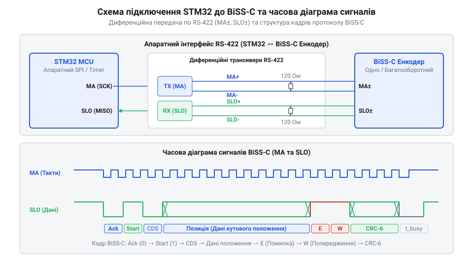

# Проєкт промислового зчитування абсолютного енкодера по інтерфейсу BiSS-C на мікроконтролері STM32

<preknowlist>
- [Оптичні та механічні інкрементальні енкодери](root:cat-hw-controls/rotary-encoders-quadrature) — розуміння принципів формування кутового положення та різниці між інкрементальним і абсолютним зчитуванням
- [Принцип роботи та конструкція давача RVDT](root:cat-hw-controls/rvdt-operating-principles) — принципи побудови систем зворотного зв'язку за положенням у промислових приводах
</preknowlist>

## Проблема зчитування прецизійного кутового положення

У промислових сервоприводах системи числового програмного керування найменший зсув виконавчого вала призводить до браку всієї обробки. Традиційні [оцінки кута потенціометрами](root:cat-hw-controls/rotary-potentiometer) чи індуктивні рішення на кшталт [давачів RVDT](root:cat-hw-controls/rvdt-operating-principles) вимагають високоточного аналогово-цифрового перетворення та схильні до дрейфу через температурну нестабільність компонентів.

З іншого боку, квадратурні [інкрементальні енкодери](root:cat-hw-controls/rotary-encoders-quadrature) формують лише імпульси відносного переміщення. Якщо під час роботи стається аварійне відключення живлення або потужна електромагнітна завада від частотного перетворювача спотворює лічильник імпульсів у мікроконтролері, поточна координата втрачається. Для відновлення відліку привод змушений виконувати процедуру пошуку базової мітки, що неприпустимо для прецизійних верстатів та робототехнічних маніпуляторів.

Для вирішення цієї проблеми застосовують @@en|absolute encoder@@ (абсолютний енкодер). Він зберігає унікальний цифровий код для кожного кутового положення вала навіть після повного знеструмлення. Щоб передавати цей код на мікроконтролер @@en|STM32@@ зі швидкістю у кілька мегагерц без затримок і втрати цілісності, використовують відкритий синхронний послідовний протокол @@en|BiSS-C@@ (від англ. @@en|Bidirectional Synchronous Serial@@). Протокол забезпечує передачу даних за схемою «ведучий-ведений» (@@en|master-slave@@) із постійним контрольним сумуванням кожного кадру. На відміну від застарілого однонаправленого інтерфейсу @@en|SSI@@ (від англ. @@en|Synchronous Serial Interface@@), який передає лише поточні координати й позбавлений зворотного каналу від мікроконтролера до давача, @@en|BiSS-C@@ реалізує повноцінний двонаправлений обмін. Протокол @@en|EnDat 2.2@@ (від нім. @@en|Encoder Data Interface@@) також підтримує запис і зчитування реєстрів, проте вимагає почергового перемикання режимів між передачею позиції та доступом до пам'яті. Натомість у @@en|BiSS-C@@ передача параметрів конфігурації, температурних даних та вмісту внутрішнього @@en|EEPROM@@ відбувається у фоновому регістровому каналі паралельно з безперервним опитуванням координати, не порушуючи детермінованих циклів керування сервоприводом.

## Схемотехніка сполучення STM32 та RS-422

Фізичний рівень шини @@en|BiSS-C@@ побудовано на диференційних лініях стандарту @@en|RS-422@@. Схема сполучення складається з двох кручених пар: однонапрямкової лінії тактування @@en|MA@@ (від англ. @@en|Master Ack@@), що передається від мікроконтролера до енкодера, та зворотної лінії даних @@en|SLO@@ (від англ. @@en|Slave Out@@).

*Апаратне сполучення диференціальних трансиверів RS-422 з мікроконтролером STM32 та часова структуризація кадрів BiSS-C.*

Для узгодження імпедансу крученої пари із хвильовим опором 120 Ом на кожному кінці лінії встановлюють термінальні резистори. На боці прийому лінії @@en|SLO@@ біля @@en|STM32@@ додають резистори апаратного підтягування @@en|fail-safe biasing@@, які утримують стабільний логічний рівень високого стану у разі обриву кабелю чи відключення передавача. Розрахунок дільника захисного зсуву спирається на забезпечення різниці потенціалів `V_ID = V_A - V_B`, яка перевищує поріг спрацьовування приймача `+200 мВ`. При напрузі живлення `V_CC = 3,3 В` та наявності термінального резистора `R_T = 120 Ом` пара резисторів `R_FS` (верхній до `V_CC` на лінії `SLO+`, нижній до землі `GND` на лінії `SLO-`) утворює дільник із напругою `V_ID = V_CC · R_T / (2 · R_FS + R_T)`. Для утримання `V_ID ≥ 200 мВ` сумарний опір `2 · R_FS + R_T` має бути не більшим за `1980 Ом`, звідки максимальний номінал кожного резистора підтягування становить `R_FS ≤ 930 Ом` (у реальних схемах обирають стандартні резистори `680 Ом` або `750 Ом` для збереження запасу завадостійкості). Диференційні трансивери перетворюють сигнали рівня @@en|LVTTL@@/@@en|CMOS@@ з виводів мікроконтролера у диференційні напруги, захищаючи цифровий тракт від синфазних завад.

## Апаратне тактування та формування кадрів

Тактування шини @@en|BiSS-C@@ здійснюється генерацією прямокутних імпульсів на лінії @@en|MA@@. У мікроконтролерах @@en|STM32@@ або @@en|ESP32@@ для цього зручно використовувати периферійний модуль @@en|SPI@@ у режимі Master. Вивід тактування @@en|SCLK@@ підключають до входу передавача @@en|MA@@, а вивід прийому даних @@en|MISO@@ — до виходу приймача @@en|SLO@@.

Коли лінія @@en|MA@@ перебуває у високому стані, енкодер знаходиться у режимі очікування. З появою першого спадаючого фронту енкодер запікає поточний стан кутового диска і видає на лінію @@en|SLO@@ стартовий біт (лог. 0), після чого слідує виконавчий біт @@en|Control/ACK@@ (лог. 1). Далі послідовно передаються інформаційні біти: багатооборотний лічильник, кутова позиція в межах одного обороту, статусні прапорці апаратної помилки @@en|Error@@ (E) та попередження @@en|Warning@@ (W), а також 6-бітна контрольна сума @@en|CRC-6@@.

Параметри шини та структура кадру задаються у конфігураційних структурах драйвера:

:::code proj-stm32-biss-c-absolute-encoder-interface/c/main/bissc_encoder.h 15-38

Ініціалізація периферії SPI здійснюється налаштуванням швидкості тактування (зазвичай від 1 до 10 МГц) та викликом стандартного драйвера:

:::code proj-stm32-biss-c-absolute-encoder-interface/c/main/bissc_encoder.c 38-79

Після завершення зчитування всіх бітів кадру для коректного закриття транзакції @@en|BiSS-C@@ необхідна витримка паузи тактування на лінії @@en|MA@@ у високому логічному рівні. Ця пауза визначається специфікацією енкодера як час моностибілізатора (англ. @@en|monoflop time@@, t_m або t_out), який зазвичай становить від 10 до 40 мкс (наприклад, t_out ≥ 20 мкс). Під час тримання лінії @@en|MA@@ у високому стані понад t_out внутрішня логіка енкодера скидає свій послідовний зсувний регістр, завершує цикл таймауту (англ. @@en|timeout@@) і готується до запікання нового значення позиції за першим спадаючим фронтом наступного кадру. Якщо мікроконтролер відновить тактування до закінчення часу t_out, енкодер сприйме це як повторний запит у режимі мульти-кадру та видасть застарілі або зміщені дані. Тому в драйверах на @@en|STM32@@ інтервал між опитуваннями шини @@en|SPI@@ або запусками @@en|DMA@@ програмно розраховують і обмежують так, щоб пауза між пакетами гарантовано перевищувала максимально можливе значення t_out з урахуванням розкиду частоти тактування.

## Програмне декодування Грея та перевірка CRC

Після зчитування послідовного масиву бітів із регістра прийому @@en|SPI@@ необхідна програмна обробка кадру. У багатьох оптичних та [індуктивних енкодерах](root:cat-hw-controls/optical-and-inductive-position-encoders) значення кутової позиції кодується в коді Ґрея (від англ. @@en|Gray code@@) для запобігання збоям під час переходу між сусідніми секторами.

Перетворення коду Ґрея у стандартне двійкове число виконується побітовою операцією виключального АБО (@@en|XOR@@):

:::code proj-stm32-biss-c-absolute-encoder-interface/c/main/bissc_encoder.c 11-19

Для перевірки цілісності кадру використовують циклічний залишковий код @@en|CRC-6@@ з генераторним поліномом P(x) = x⁶ + x¹ + x⁰ (маска 0x43). За специфікацією @@en|BiSS-C@@ підсумкове значення CRC підлягає інверсії:

:::code proj-stm32-biss-c-absolute-encoder-interface/c/main/bissc_encoder.c 21-36

Алгоритм обробки прийнятого кадру розпаковує біти позиції, перевіряє активність прапорців помилок E та W (у @@en|BiSS-C@@ вони активні в низькому рівні log. 0) і порівнює обчислений @@en|CRC-6@@ із прийнятим. Проте побітовий розрахунок для довгої послідовності бітів створює значне навантаження на процесорне ядро, що є критичним під час виконання драйвера в обробниках переривань (англ. @@en|Interrupt Service Routine@@, ISR) мікроконтролерів @@en|STM32@@ на частотах опитування понад 10 кГц. Для оптимізації швидкодії застосовують табличний метод (англ. @@en|look-up table@@, LUT): заздалегідь розрахована таблиця з 64 або 256 байтових значень дозволяє замінити побітові зсуви на декілька швидких операцій вибірки з пам'яті та побітового виключального АБО (@@en|XOR@@). Під час обробки чергового байта кадру поточний залишок @@en|CRC-6@@ використовується як індекс у таблиці, що скорочує час верифікації контрольної суми до кількох тактів процесора і забезпечує детермінованість часових інтервалів у реальному часі навіть при використанні прямого доступу до пам'яті (англ. @@en|Direct Memory Access@@, DMA).

:::code proj-stm32-biss-c-absolute-encoder-interface/c/main/bissc_encoder.c 82-145

У об'єктно-орієнтованій реалізації на C++ розбір кадру та конвертація в двійкові координати виглядає наступним чином:

:::code proj-stm32-biss-c-absolute-encoder-interface/cpp/AbsoluteEncoder.cpp

Завдяки верифікації @@en|CRC-6@@ та апаратній обв'язці @@en|RS-422@@ драйвер виявляє крок спотворення даних і блокує виконання хибних команд у приводі.
