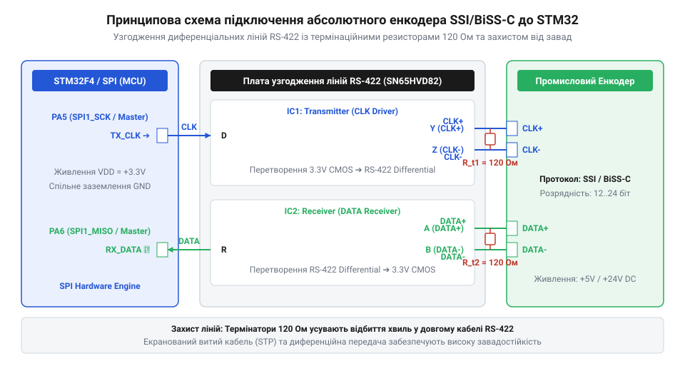
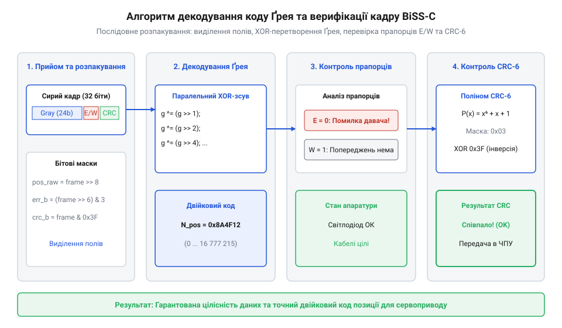

# Проєкт інтерфейсу зчитування абсолютного енкодера по протоколу SSI/BiSS-C на STM32

<preknowlist>
- [Оптичні та механічні інкрементальні енкодери](root:cat-hw-controls/rotary-encoders-quadrature) — розуміння різниці між квадратурним імпульсним відліком та абсолютним кодуванням.
- [Абсолютні поворотні енкодери: однооборотні та багатооборотні](root:cat-hw-controls/rotary-encoders-absolute-single-multi-turn) — фізичні принципи кодування Ґрея, будова багатооборотних дисків та структура протоколів SSI/BiSS-C.
</preknowlist>

## Схемотехніка узгодження RS-422 та підключення

Промислові [абсолютні енкодери](root:cat-hw-controls/rotary-encoders-absolute-single-multi-turn) часто працюють у середовищі з високим рівнем електромагнітних завад, де передача звичайних однополярних цифрових сигналів спричиняє спотворення даних. Для надійного зчитування інформації на відстані до сотень метрів використовують диференційну лінію стандарту @@en|RS-422@@.

У протоколах @@en|SSI@@ (від @@en|Synchronous Serial Interface@@) та @@en|BiSS-C@@ застосовують дві двійкові пари: тактову лінію MA (від @@en|Master Ack/Clock@@) та лінію даних SLO (від @@en|Slave Out@@). Оскільки мікроконтролери STM32 працюють із однополярними рівнями 3.3 В, для сполучення з диференційним кабелем потрібен двонапрямний мікросхемний трансивер (від @@en|transmitter-receiver@@, «трансивер»), такий як MAX485, SN65HVD82 або quad-приймач MAX3095.



Для передачі тактового сигналу MA лінійний передавач конвертує вихідний сигнал SCK мікроконтролера у протифазні лінії MA+ та MA-. На приймальному боці даних SLO диференційний приймач перетворює різницю потенціалів між SLO+ та SLO- у прямокутний сигнал TTL/CMOS для входу MISO мікроконтролера.

На кінцях диференційних ліній виникають хвильові відбиття сигналів, що спричиняють хибні спрацьовування. Для їх гасіння паралельно виходам SLO+ та SLO- безпосередньо біля приймача встановлюють узгоджувальний термінатор (від @@en|terminator@@) — резистор R_T = 120 Ом, що відповідає хвильовому опору витої пари. Крім того, для запобігання невизначеного стану лінії при вимкненому енкодері додають резистори захисного зсуву (англ. @@en|fail-safe biasing@@): лінію SLO+ підтягують до 3.3 В через 1 кОм, а SLO- заземлюють через 1 кОм.

Для вибору номіналів резисторів захисного зсуву необхідно забезпечити, щоб різниця потенціалів між лініями у стані спокою перевищувала поріг спрацьовування (англ. @@en|differential threshold voltage@@, від лат. @@la|differentia@@ — різниця) диференційного приймача RS-422, який для трансиверів серії MAX485 становить `V_th = 200 мВ`. Позначимо напругу живлення схеми як `V_CC` (3.3 В), розрахункову напругу зсуву як `V_AB`, термінальний опір як `R_T` (120 Ом), а опір кожного з двох резисторів захисного зсуву (англ. @@en|fail-safe biasing@@) як `R_b`. Задавши цільовий диференціальний поріг `V_AB = 0.25 В` (250 мВ) з урахуванням запасу завадостійкості, розрахунок опору `R_b` виконують за ланцюжком рівнянь:

    V_AB = V_CC · R_T / (2 · R_b + R_T)                            [формула дільника напруги захисного зсуву]
    2 · R_b + R_T = V_CC · R_T / V_AB                               [визначення знаменника дільника]
    R_b  = (R_T / 2) · (V_CC / V_AB - 1)                           [визначення опору резистора підтяжки]
         = (120 / 2) · (3.3 / 0.25 - 1)                            [підстановка V_CC = 3.3 В, V_AB = 0.25 В]
         = 60 · (13.2 - 1)                                         [ділення напруги живлення на дифпоріг]
         = 60 · 12.2                                               [обчислення коефіцієнта дільника]
         = 732 Ом                                                  [мінімальний розрахунковий опір R_b]

Отримане значення `R_b = 732 Ом` округлюють у менший бік до найближчого стандартного номіналу `R_b = 680 Ом` з ряду E24. При цьому фактична дифнапруга в стані спокою становить `V_AB = 3.3 · 120 / (2 · 680 + 120) = 0.268 В` (268 мВ), що з гарантованим запасом перевищує апаратний поріг спрацьовування приймача `V_th = 200 мВ` та усуває брязкіт і хибні відліки при відключенні енкодера.

## Налаштування периферії STM32 для SSI

Прийом послідовних кадрів від абсолютних енкодерів на STM32 найзручніше реалізувати через апаратний модуль @@en|SPI@@ (від @@en|Serial Peripheral Interface@@) у режимі Master Receive. Це дозволяє генерувати тактову частоту MA та автоматично зчитувати вхідні біти без залучення ядерних ресурсів процесора.

Для стабільного обміну лінію SCK мікроконтролера підключають до передавача MA, а вхід MISO — до виходу приймача SLO. Периферійний модуль SPI налаштовують у повнодуплексний або однонапрямний прийомний режим (англ. @@en|Master Receive Only@@). Оскільки передача даних в SSI відбувається по зрізу або фронту тактового імпульсу, фазу та полярність тактування обирають за специфікацією енкодера: найчастіше CPOL = 0 (низький рівень лінії в спокої) та CPHA = 1 (зчитування біта по другому фронту імпульсу).

Частота тактування обирається дільником (англ. @@en|prescaler@@) шини APB. Для довжин кабелю до 10 метрів стандартна частота становить від 100 кГц до 2 МГц. Однак при збільшенні довжини витої пари виникає кабельна затримка поширення сигналу (англ. @@en|propagation delay@@, від лат. @@la|propagatio@@ — розповсюдження), яка обмежує максимальну частоту обміну. Позначимо довжину кабелю як `L` (у метрах), питому затримку сигнального провідника як `t_delay_per_meter` (5 нс/м), час затримки в трансиверах RS-422 як `t_transceiver` (30 нс на компонент), а час встановлення входу MISO мікроконтролера як `t_setup` (20 нс). Повний час затримки кругового проходу `t_prop` та максимальна частота тактування `f_SCK_max` для траси завдовжки `L = 50 м` обчислюються за ланцюжком рівнянь:

    t_cable   = L · t_delay_per_meter
              = 50 · 5                                                  [затримка сигналу в одному напрямку]
              = 250 нс                                                  [одностороння кабельна затримка]
    t_prop    = 2 · t_cable + 2 · t_transceiver
              = 2 · 250 + 2 · 30                                        [затримка подвійного проходу туди й назад]
              = 500 + 60                                                [сума кабельної та приладової затримок]
              = 560 нс                                                  [повний час кругової затримки сигналу]
    T_SCK_min = 2 · (t_prop + t_setup)
              = 2 · (560 + 20)                                          [мінімальний період тактового сигналу]
              = 2 · 580                                                 [подвоєний інтервал для обох фронтів]
              = 1160 нс                                                 [граничний період тактування шини SPI]
    f_SCK_max = 1 / T_SCK_min
              = 1 / 1.16                                                [підстановка періоду у мікросекундах]
              = 862 кГц                                                 [максимально припустима частота SPI]

Отриманий розрахунок показує, що для лінії 50 метрів максимальна частота тактування SPI обмежена значенням `862 кГц` (практично обирають дільник `500 кГц`), адже спроба тактувати енкодер на частоті `2 МГц` призведе до того, що біт даних SLO повернеться до мікроконтролера вже після закінчення стробуючого фронту MISO.

    f_SCK = f_PCLK ÷ Prescaler

Після видачі пачки тактових імпульсів енкодер передає послідовність бітів кадру, починаючи зі старшого біта (MSB). Завершення зчитування кадру вимагає витримки часової паузи моностабільного таймера енкодера:

    t_pause ≥ t_m

Час паузи t_m (зазвичай від 12 до 20 мкс) є критичним для повернення енкодера у стан готовності до наступного опитування. Якщо пауза між викликами SPI буде коротшою за t_m, енкодер сприйме наступне опитування як запит повтору того самого кадру.

## 3. Декодування коду Ґрея та координата

Під час вичитання сирого кадру даних із кодового диска абсолютного енкодера першим завданням є відновлення двійкового значення позиції. На відміну від [інкрементальних енкодерів](root:cat-hw-controls/rotary-encoders-quadrature), де позиція формується відліком імпульсів, абсолютний енкодер передає кодову комбінацію кожного положення вала. Для запобігання помилкам зчитування при переході між сусідніми секторами вимірювальної шкали оптичні диски кодують за допомогою `@@en|Gray Code@@` (від англ. *Gray code*). У коді Ґрея під час переходу від одного числа до сусіднього змінює свій стан лише один двійковий біт, що усуває помилки зчитування через неідеальність позиціонування оптичних зчитувачів.

Однак для виконання арифметичних обчислень кута у мікроконтролері код Ґрея необхідно перетворити у прямий двійковий формат (`@@en|Binary@@`). Перетворення відбувається шляхом послідовного каскадного додавання за модулем 2 (`@@en|XOR@@`): старший біт двійкового числа дорівнює старшому біту коду Ґрея, а кожен наступний молодший двійковий біт обчислюється як сума по модулю 2 попереднього двійкового біта та поточного біта Ґрея.

```
b₃₁ = g₃₁
bᵢ = bᵢ₊₁ ⊕ gᵢ      [обчислення i-го розряду двійкового коду]
```

Для апаратної прискореної реалізації у мікропроцесорах застосовують побітове зсування та операцію `@@en|XOR@@`, що дозволяє перетворити 32-бітне значення коду Ґрея за 5 обчислювальних операцій замість циклічного перебору бітів.

Після відновлення двійкових даних кадру `@@en|BiSS-C@@` мікроконтролер перевіряє цілісність отриманого кадру за допомогою контрольної суми `@@en|CRC-6@@` (від англ. @@en|Cyclic Redundancy Check@@, скорочено @@en|CRC@@). Передавач енкодера генерує 6-бітний код над інформаційним корисним навантаженням за твірним поліномом (англ. @@en|generator polynomial@@, від грец. @@el|poly-@@ — багато) P(x) = x⁶ + x + 1 (з маскою `0x03`). Згідно зі специфікацією BiSS-C результат CRC інвертується перед відправкою. Позначимо вхідний двійковий кадр даних як `D` (`101101₂`), поліном-дільник як `P` (`1000011₂`), зсунутий кадр із доданими 6 нулями як `D'` (`101101000000₂`), а проміжні остачі ділення по модулю 2 (`XOR`) як `R_1`, `R_2`, `R_3`. Покроковий розрахунок 6-бітної остачі ділення та підсумкової контрольної суми `CRC_BiSS` виконується за ланцюжком рівнянь:

    D'       = D << 6
             = 101101000000₂                                             [зсув кадру на 6 бітів для CRC-6]
    R_1      = D' ⊕ (P << 5)
             = 101101000000₂ ⊕ 100001100000₂                             [перше побітове додавання XOR]
             = 001100100000₂                                             [остача першого кроку ділення]
    R_2      = 1100100000₂ ⊕ (P << 3)
             = 1100100000₂ ⊕ 1000011000₂                                 [друге побітове додавання XOR]
             = 0100111000₂                                               [остача другого кроку ділення]
    R_3      = 100111000₂ ⊕ (P << 2)
             = 100111000₂ ⊕ 100001100₂                                   [третє побітове додавання XOR]
             = 000110100₂                                                [сира остача ділення R_raw = 110100₂]
    CRC_BiSS = ~R_raw & 0x3F
             = ~110100₂ & 111111₂                                        [інверсія бітів остачі за специфікацією]
             = 001011₂                                                   [підсумкове значення CRC-6 дорівнює 0x0B]

Отримане значення `CRC_BiSS = 001011₂` (`0x0B`) додається в кінець телеграми. Приймальний мікроконтролер виконує тотожний покроковий алгоритм ділення над отриманим корисним навантаженням і порівнює обчислений результат із прийнятим по шині значенням `CRC_BiSS`: збіг кодів підтверджує відсутність спотворень відліків позиції.


*Алгоритм декодування кадру даних енкодера з перевіркою цілісності.*

Телеграма містить розряди однооборотного відліку `@@en|Single-Turn@@` (ST), лічильника повних обертів `@@en|Multi-Turn@@` (MT) та два статусних біти апаратного стану `nERROR` і `nWARN`. Однооборотна кутова позиція в градусах `θ` розраховується як відношення отриманого значення відліків до максимально можливої кількості відліків на один повний оберт:

```
θ = (N_st / 2ⁿ) × 360.0      [обчислення кута в градусах для n-бітного Single-Turn]
```

Нижче наведено програмну реалізацію низькорівневих функцій декодування коду Ґрея, розрахунку CRC-6 та розбору кадрів у мовах C та C++.

:::tabs
== C
:::code proj-stm32-ssi-biss-absolute-encoder-interface/c/gray_code.h
:::code proj-stm32-ssi-biss-absolute-encoder-interface/c/biss_crc.h
:::code proj-stm32-ssi-biss-absolute-encoder-interface/c/encoder_ssi.c 20-103
== C++
:::code proj-stm32-ssi-biss-absolute-encoder-interface/cpp/include/encoder_driver.hpp 51-72
:::code proj-stm32-ssi-biss-absolute-encoder-interface/cpp/src/encoder_driver.cpp 16-83
:::

## 4. Обробка помилок та системна інтеграція

У промислових системах автоматики та робототехніки надійність передачі даних позиції є критичною. Порушення цілісності сигналу через обрив лінії RS-422, завади на шині або забруднення оптичного диска енкодера може призвести до аварійного кидка координати в контурі керування сервоприводом. Для виявлення таких станів драйвер аналізує апаратні індикатори `nERROR` та `nWARN`, які передаються у кожному кадрі протоколу BiSS-C та SSI. 

Обидва статусні біти мають інверсну логіку `@@en|Active-Low@@`: значення `0` вказує на наявність несправності. Прапорець `nERROR = 0` сигналізує про катастрофічну апаратну відмову (обрив вимірювальних світлодіодів, переповнення лічильника обертів або зсув кодового диска), тоді як `nWARN = 0` попереджає про падіння інтенсивності випромінювання або досягнення температурного порогу.

Якщо під час перевірки кадру виявлено незбіг обчисленої та прийнятої суми `@@en|CRC-6@@` або зафіксовано біт `nERROR`, кадр позначається як недостовірний (`EncoderStatus::CrcError` або `EncoderStatus::HardwareError`). У сервоконтурі недостовірне значення позиції відкидається, а регулятор виконує екстраполяцію координати за попередньою швидкістю або переходить у безпечний режим зупинки.

Для зручності прив'язки енкодера до механічного нуля виконавчого механізму драйвер забезпечує програмування віртуального зміщення (англ. @@en|Zero Offset@@). Відносна координата розраховується із застосуванням бітової маски для захисту від від'ємного переповнення при зворотній циркуляції (англ. @@en|reverse rollover@@, від лат. @@la|reversus@@ — повернений) вала через нульову точку. Позначимо сумарну розрядність енкодера як `N_total = ST + MT` (наприклад `17 + 12 = 29 біт`), маску розрядності як `MASK_pos = 2²⁹ - 1` (`0x1FFFFFFF`), поточну виміряну позицію як `N_full`, а записане зміщення нуля як `N_zero`. У разі обертання у зворотному напрямку, коли `N_full` (200 відліків) стає меншим за `N_zero` (1000 відліків), покроковий математичний розрахунок відносної координати `N_rel` виконується за ланцюжком рівнянь:

    MASK_pos   = (1 << 29) - 1
               = 536870912 - 1                                             [обчислення 29-бітної бітової маски]
               = 536870911                                                 [значення маски MASK_pos у десятирічній системі]
    N_diff_raw = N_full - N_zero
               = 200 - 1000                                                [віднімання нуля при N_full < N_zero]
               = -800                                                      [проміжне від'ємне значення різниці]
    N_rel      = N_diff_raw & MASK_pos
               = (-800) & 536870911                                        [побітове маскування від'ємного числа]
               = (-800 + 536870912)                                        [еквівалент додавання періоду шкали 2²⁹]
               = 536870112                                                 [коректна відносна позиція на межі шкали]

Отриманий розрахунок показує, що побітова операція `& MASK_pos` математично еквівалентна приведенню за модулем `2²⁹`. Це автоматично перетворює від'ємне число у коректну позицію поблизу верхньої межі багатооборотного лічильника, усуваючи збої контуру керування при переході через нуль.

```
N_rel = (N_full - N_zero) & MASK_pos      [маскування відносної позиції для N-бітної шкали]
```

Для забезпечення стійкості до відмов при апаратній [компенсації дрейфу нуля](root:cat-hw-controls/stick-drift-mitigation) та обробці сигналів з [оптичних та індуктивних давачів](root:cat-hw-controls/optical-and-inductive-position-encoders), драйвер інтегрують у періодичне переривання таймера або задачу реального часу RTOS із фіксованим квантом тактування.

:::tabs
== C
:::code proj-stm32-ssi-biss-absolute-encoder-interface/c/encoder_ssi.h 14-33
:::code proj-stm32-ssi-biss-absolute-encoder-interface/c/encoder_ssi.c
== C++
:::code proj-stm32-ssi-biss-absolute-encoder-interface/cpp/main.cpp 24-70
:::
