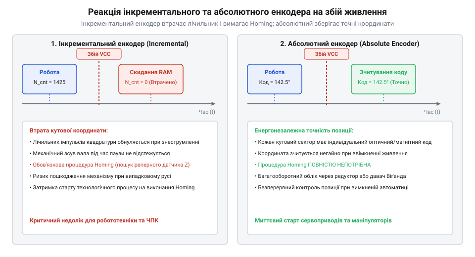
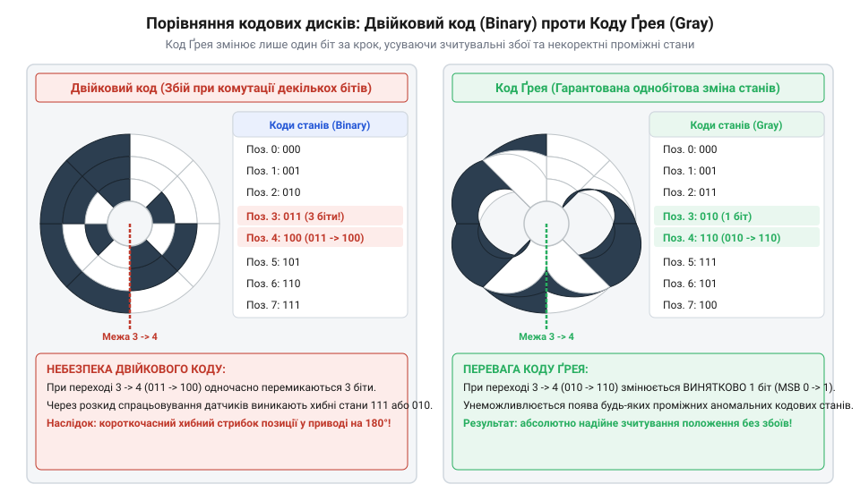
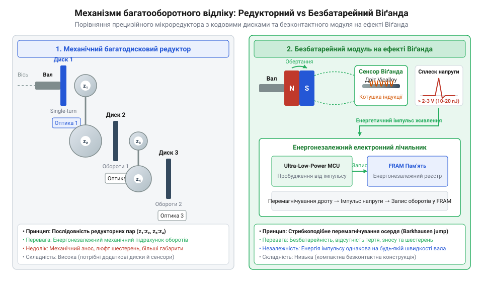
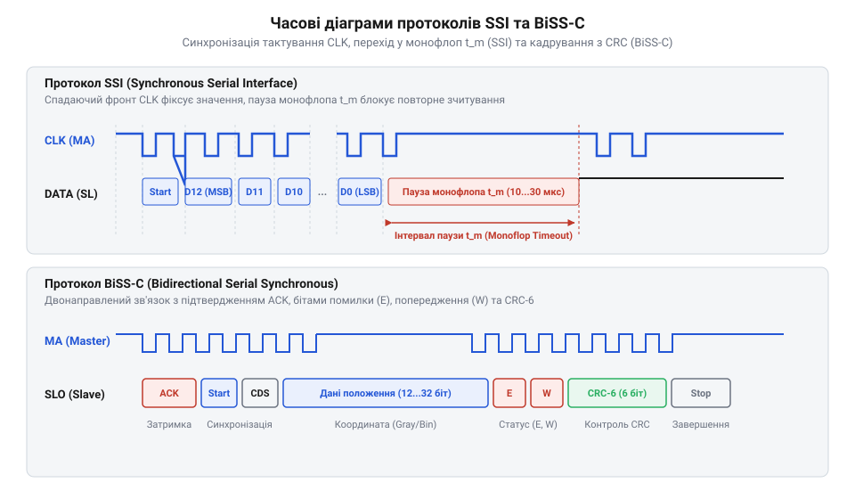
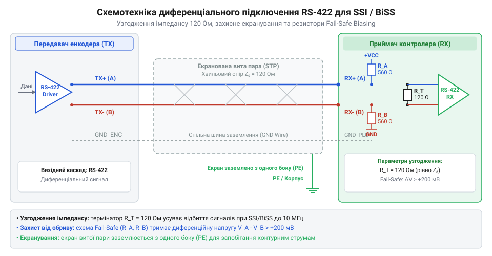

# Абсолютні поворотні енкодери: однооборотні та багатооборотні

<preknowlist>
- [Оптичні та механічні інкрементальні енкодери](root:cat-hw-controls/rotary-encoders-quadrature) — розуміння принципів квадратурного зчитування та імпульсного відліку кутового переміщення
- [Поворотний потенціометр](root:cat-hw-controls/rotary-potentiometer) — принцип абсолютного аналогового вимірювання кута та обмеження зносу контактних доріжок
</preknowlist>

## Проблема втрати позиції при вимкненні

Побудова систем точного кутового позиціонування на базі [інкрементальних енкодерів](root:cat-hw-controls/rotary-encoders-quadrature) спирається на безперервний підрахунок імпульсів від заземленої або нульової точки. Однак будь-яке короткочасне знеструмлення, скидання мікроконтролера чи імпульсна завада в лінії живлення призводять до втрати поточного значення в регістрах лічильника. Після відновлення живлення система автоматизації «насліпо» втрачає прив'язку до реального кута вала. При використанні [індуктивних давачів положення](root:cat-hw-controls/optical-and-inductive-position-encoders) для пошуку нуля фізичний гістерезис (від грецьк. @@grc|hysteresis@@ — відставання) порогової зони спрацьовування змушує впроваджувати додаткові заходи компенсації — двоприйомне наближення на повзучій швидкості (від англ. @@en|creep speed@@) та прив'язку розмикання до нульового Z-імпульсу енкодера (від англ. @@en|index pulse gating@@). Проте навіть такі комбіновані алгоритми суттєво ускладнюють керування й піддаються температурному дрейфу, залишаючи проблему втрати позиції критичною.

Щоб відновити координату, інкрементальні системи вимагають виконання процедури пошуку базової точки (від англ. @@en|homing@@). Під час базовування виконавчий механізм змушений рухатися до спрацьовування кінцевого вимикача чи [індуктивного давача положення](root:cat-hw-controls/optical-and-inductive-position-encoders). Такий підхід створює чотири критичні проблеми:
1. Часові затримки на запуск технологічного процесу: якщо привід зупинився на максимальній відстані `L_max` від нуля, сумарний час відновлення `t_home` визначається рухом на зниженій безпечній швидкості `v_home` та відкатом на ширину гістерезису датчика `L_hyst`.

        t_home = (L_max / v_home) + (L_hyst / v_search)      [сума часу руху до нуля та реверсу]

   Для великогабаритних верстатів із ходом 1.5 м і зниженою швидкості 15 мм/с таке базовування додає понад 100 секунд вимушеного простою лінії при кожному збої живлення.
2. Ризик механічного заклинювання або аварійного зіткнення робочих органів під час руху без відомої координати.
3. Похибка позиціонування через гістерезис спрацьовування датчиків нуля, люфти в механічних передачах та температурний дрейф. У багатокоординатних системах (наприклад, у 3-осьових верстатах з ЧПК чи роботах-маніпуляторах) похибка повторюваності (від англ. @@en|repeatability error@@) кожного кінцевого вимикача векторно підсумовується по всіх осях. При розкиді спрацьовування кінцевика у `±10–50 мкм` результуючий просторовий зсув інструменту після кожного базовування досягає сотень мікрон, що призводить до браків обробки та вимагає трудомісткого повторного калібрування нулів.
4. Прискорений механічний знос кінцевих вимикачів, оскільки часті цикли базовування призводять до деградації контактної пружини, зносу штовхача та підгоряння контактів, що поступово зсуває точну кутову координату нуля та підвищує ризик механічної відмови.

        t_home = (L_max / v_home) + (L_hyst / v_search)      [сума часу руху до нуля та реверсу]

   Для великогабаритних верстатів із ходом 1.5 м і зниженою швидкості 15 мм/с таке базовування додає понад 100 секунд вимушеного простою лінії при кожному збої живлення.
2. Ризик механічного заклинювання або аварійного зіткнення робочих органів під час руху без відомої координати.
3. Похибка позиціонування через гістерезис спрацьовування датчиків нуля, люфти в механічних передачах та температурний дрейф.
4. Прискорений механічний знос кінцевих вимикачів, оскільки часті цикли базовування призводять до деградації контактної пружини, зносу штовхача та підгоряння контактів, що поступово зсуває точну кутову координату нуля та підвищує ризик механічної відмови.

*Реакція системи на знеструмлення: інкрементальний енкодер втрачає значення та вимагає механічного повернення в нуль, тоді як абсолютний давач миттєво зчитує точний кут.*

На відміну від інкрементальних давачів або аналогових пристроїв на кшталт [поворотних потенціометрів](root:cat-hw-controls/rotary-potentiometer), які піддаються зносу контактних доріжок, абсолютний поворотний енкодер (від англ. @@en|absolute rotary encoder@@) здатний формувати унікальний цифровий код для кожного кутового положення вала. Кожній кутовій зоні відповідає власна комбінація сигналів, яка зчитується безпосередньо з фізичного кодового диска чи магнітної мітки. Завдяки цьому при ввімкненні пристрою керувальна електроніка миттєво отримує дійсне кутове положення без жодного механічного переміщення вала. Про те, як змінювалася апаратна реалізація таких давачів — від перших контактних щеточних дисків до сучасних безконтактних сенсорів, — розкрито у матеріалі про [еволюцію абсолютних енкодерів](root:cat-hw-controls/rotary-encoders-absolute-single-multi-turn/hist-evolution-of-absolute-rotary-encoders.md). Фізику зносу контактних доріжок та мапування напруги висвітлено в статті про [поворотні аналогові потенціометри](root:hw-components/rotary-potentiometers).

## Будова та кодування однооборотного енкодера

Конструктивно однооборотний абсолютний енкодер (від англ. @@en|single-turn encoder@@) складається з ротора з кодовим диском, джерела випромінювання (LED або діаграмного магніту) та зчитувальної матриці фотодіодів чи сенсорів Холла. У класичному оптичному енкодері на скляний або оптичний полімерний диск наносяться концентричні доріжки (від англ. @@en|tracks@@) з чергуванням прозорих і непрозорих секторів. Кількість доріжок відповідає розрядності (бітності) `N` абсолютного коду. Фізику оптичних дисків та індуктивних матриць розкрито у матеріалі про [оптичні та індуктивні давачі положення](root:hw-sensing/optical-and-inductive-position-encoders).

Роздільна здатність енкодера визначає мінімальний кут, який здатна розрізнити система, і обчислюється залежно від кількості біт `N` кодового диска. Оскільки кожна додаткова бітна розрядність вимагає нанесення окремої концентричної доріжки, фізичний діаметр диска напряму зростає із збільшенням `N`. Для зовнішньої (наймолодшої) доріжки ширину оптичного сектору обмежено межею дифракції світла та мінімальним кроком фотоприймачів (типово `2–5 мкм`), тому нарощування розрядності понад 16–18 біт на скляних дисках змушує збільшувати габарити корпусу енкодера чи переходити на схемотехнічну інтерполяцію синусно-косинусних сигналів. Дискретність системи визначається формулою:

N_positions = 2ⁿ     [кількість унікальних кутових станів на 360°]

Кутовий крок одного дискрета `Δθ` становить:

Δθ = 360° ÷ 2ⁿ     [роздільна здатність у градусах]

При використанні ззвичайного двійкового коду (від англ. @@en|straight binary code@@) виникає небезпечне фізичне явище — гонки станів (від англ. @@en|race conditions@@). При переході вала між суміжними кутовими секціями, де змінюються одразу кілька бітів (наприклад, при переході від 7 в двійковому коді `0111` до 8 `1000`), через неідеальність механічного вирівнювання фотодіодів зміна оптичних сигналів відбувається неодночасно. У проміжний момент мікроконтролер може зчитати фантомний код на кшталт `1111` (15) або `0000` (0), що спричиняє стрибки координат і аварії у сервоприводах.

*Конструкція кодового диска: у двійковому коді на межах секторів змінюються кілька бітів одночасно, викликаючи збої зчитування, тоді як у коді Ґрея змінюється лише один біт.*

Для усунення гонок станів у кодових дисках застосовують код Ґрея (від англ. @@en|Gray code@@), також відомий як рефлексивний двійковий код (від англ. @@en|reflected binary code@@). Головна властивість коду Ґрея полягає у тому, що Хеммінгова відстань (від англ. @@en|Hamming distance@@) між будь-якими двома сусідніми кутовими секціями завжди дорівнює рівно 1 біту. Навіть якщо фотодіод перемикається із затримкою, зчитане значення може відхилитися лише на один сусідній дискрет, повністю виключаючи грубі кодові викиди. Алгоритмічно перетворення стандартного двійкового коду `B` у код Ґрея `G` виконується шляхом зіставлення кожного розряду із його сусіднім старшим розрядом `G_i = B_i ⊕ B_(i+1)`, причому старший значущий біт (від англ. @@en|MSB@@) залишається незмінним `G_(N-1) = B_(N-1)`. Програмно та схемотехнічно цей алгоритм реалізується в один обчислювальний крок: двійкове число піддають побітовому зсуву вправо (від англ. @@en|bitwise right shift@@) на один розряд `B >> 1` і обчислюють побітове «виключне АБО» (від англ. @@en|bitwise XOR@@) між вихідним і зсунутим значенням:

G = B ⊕ (B >> 1)     [генерація коду Ґрея з двійкового коду]

Оскільки кожен i-й біт `B_i` піддається додаванню за модулем 2 із бітом `B_(i+1)`, який змінює свій стан удвічі рідше, операція XOR нейтралізує одночасне перемикання декількох молодших розрядів на межі секторів, що й забезпечує інверсію лише одного біта при зміні координати на одиницю.

Оскільки мікроконтролерам та ПЛК для арифметичних обчислень потрібен стандартний двійковий код, зчитаний з енкодера код Ґрея перетворюють на паралельний двійковий еквівалент. Апаратно таке декодування виконується на послідовному каскаді логічних елементів «виключне АБО» (від англ. @@en|XOR gates@@). Кожен i-й біт двійкового коду `B_i` обчислюється шляхом каскадного додавання за модулем 2 відповідного біта Ґрея `G_i` з попередньо обчисленим старшим двійковим бітом:

B_(N-1) = G_(N-1)

B_i = G_i ⊕ B_(i+1)     [для i від N-2 до 0]

У схемотехніці паралельних шин даних N-бітного енкодера така каскадна реалізація складається з послідовного ланцюжка `N-1` двохвхідних суматорів за модулем 2. Сигнал старшого біта `G_(N-1)` подається на вихід без затримки, але для обчислення молодшого біта `B_0` інформація повинна послідовно пройти через усі `N-1` вентилі XOR. Для високорозрядних енкодерів (наприклад, 16 або 18 біт) сумарна затримка поширення сигналу `t_prop = (N-1) × t_XOR` створює короткочасні гонки фронтів на вихідній паралельній шині даних під час перехідних процесів. Щоб усунути ці транзитні фантомні коди в високошвидкісних декодерах на ПЛІС чи CPLD, каскадний ланцюжок оптимізують у паралельні деревні XOR-структури (від англ. @@en|parallel prefix XOR trees@@), що скорочує затримку обчислення з лінійної складності до логарифмічної `O(log₂ N)`.

B_(N-1) = G_(N-1)

B_i = G_i ⊕ B_(i+1)     [для i від N-2 до 0]

Детальні математичні виведення, алгоритми швидкого побітового перетворення коду Ґрея на C/C++ та таблиці кутових роздільностей для енкодерів від 8 до 18 біт винесено в окремі [математичні розрахунки перетворення коду Грея](root:cat-hw-controls/rotary-encoders-absolute-single-multi-turn/math-gray-code-conversion-and-encoder-resolution.md).

Апаратна причина виникнення фантомних кодових станів у двійкових кодових дисках полягає у фізичному зсуві лінійки фотоприймачів та оптичній аберації (від англ. @@en|optical aberration@@) фокусувальних лінз LED-випромінювача. Навіть при прецизійній збірці енкодера просторовий розкид позиціонування фотодіодів (від англ. @@en|photodiode misalignment@@) та деформація кодового диска від температурного розширення викликають асинхронність перемикання каналів на межі кутових секторів. При переході між суміжними секторами один із фотодіодів реєструє зміну прозорого сектору на кілька мікросекунд раніше за сусідній, через що на внутрішній шині даних утворюється транзитний логічний стан. Мікроконтролер, опитавши енкодер саме в цей проміжний мікросекундний інтервал, інтерпретує неіснуюче значення як миттєвий кутовий стрибок вала, що спричиняє аварійний зрив регулювання у замкнених контурах сервоприводів.

## Механізми підрахунку багатооборотного переміщення

В інтенсивних промислових застосуваннях, таких як підйомні крани, ходові ґвинти верстатів з ЧПК або поворотні столи, кутове переміщення вала значно перевищує один повний оберт 360°. Однооборотний енкодер при переході через нульовий кут скидає значення з максимального коду в нуль, що приводить до втрати загального абсолютного положення механізму. Для вимірювання повного числового діапазону застосовують багатооборотні абсолютні енкодери (від англ. @@en|multi-turn encoders@@), які одночасно зчитують кут у межах поточного оберту та підраховують кількість повних обертів вала.

Існує три основних класи апаратних механізмів підрахунку обертів:
1. Механічний прецизійний редуктор (від англ. @@en|gear train counter@@) — вал енкодера приводить у рух каскад мікрошестерень із різними передавальними відношеннями. На кожній проміжній осі встановлено власний кодовий диск із оптичними або магнітними сенсорами. Така система є повністю пасивною й енергонезалежною, але вимагає високої трибологічної стійкості полімерних чи металевих шестерень. Поступовий трибологічний (від грецьк. @@grc|tribos@@ — тертя) знос профілю зубців збільшує боковий механічний люфт (від англ. @@en|backlash@@) між ступенями редуктора. При зміні напрямку обертання цей знос створює кутовий гістерезис і мертвий хід, спричиняючи накопичення похибки позиціонування проміжних дисків відносно основного вала, що на межах секторів загрожує помилковим зчитуванням лічильника обертів.
2. Електронний лічильник із резервною батареєю (від англ. @@en|battery-backed revolution counter@@) — при знеструмленні основної мережі низькоспоживаючий магнітний сенсор і лічильник продовжують працювати від вбудованої літієвої батареї чи іоністора. Недоліком є обмежений термін служби батареї (типово 3–10 років), чутливість до температурних коливань та ризик втрати даних при повному розряді елемента живлення.
3. Енергонезалежний безбатарейний модуль на ефекті Віґанда (від англ. @@en|Wiegand effect counter@@) — використовує спеціально оброблений біметалевий дріт із феромагнітним сердечником. При обертанні магніту на валу енкодера відбувається різке стрибкоподібне перемагнічування дроту Віґанда, що наводить у зчитувальній котушці коротке імпульсне ЕРС високої амплітуди. Напруга імпульсу виступає джерелом живлення (від англ. @@en|energy harvesting@@) для запису нового значення обертів у сегмент фероелектричної пам'яті (від англ. @@en|FRAM@@) без використання зовнішніх батарей. Ключовою фізичною властивістю сенсора Віґанда є те, що лавиноподібне ланцюгове перемагнічування сердечника відбувається при досягненні суворого порогового значення зміни магнітного потоку (від англ. @@en|magnetic flux threshold@@) незалежно від швидкості обертання вала. Навіть при наднизьких кутових швидкостях (менше 1 об/хв) амплітуда генерованого імпульсу напруги (типово `3–5 В` тривалістю до `10 мкс`) залишається інваріантною до швидкості руху вала, забезпечуючи стабільну енергію для надійного фіксування координати у пам'яті FRAM навіть при ледве помітному покроковому повороті ротора.

*Конструктивні схеми багатооборотних енкодерів: каскадний оптичний редуктор із проміжними кодовими дисками проти компактного безбатарейного модуля Віґанда з FRAM-пам'яттю.*

Вибір між редукторною та генераторною технологією визначається динамікою механізму та вимогами до надійності: редуктори краще переносять інтенсивні вібрації, тоді як модулі Віґанда забезпечують компактні габарити й необмежений ресурс автономної роботи. Проте при використанні безбатарейних модулів Віґанда ключовим технічним обмеженням стає температурний діапазон фероелектричної пам'яті (від англ. @@en|Ferroelectric RAM@@, @@en|FRAM@@) та температурний дрейф магнітного поля (від англ. @@en|magnetic drift@@) активаційного магніту ротора. Завдяки високій швидкості полярного перемикання кристалів, пам'ять FRAM має практично необмежений ресурс перезапису (понад 10¹⁴ циклів), але при інтенсивному обертанні вала та високих температурах фізика збереження заряду ускладнюється. За температур понад +85 °C (або +105 °C для специфічних промислових виконань) теплові коливання кристалічної ґратки зменшують стабільність фероелектричних доменів, а намагніченість роторних постійних магнітів падає. Для компенсації цього температурного дрейфу застосовують біметалеві сплави із від'ємним температурним коефіцієнтом індукції або магніти із самарій-кобальтовою структурою (SmCo), що утримують магнітний потік вище порогового рівня перемагнічування дроту Віґанда. Оскільки короткий імпульс енергозбору від котушки Віґанда має обмежений запас енергії, надійна фіксація лічильника обертів у FRAM гарантується в робочому діапазоні від -40 °C до +85 °C, перевищення якого загрожує погіршенням збереження даних (від англ. @@en|data retention@@) при раптовому знеструмленні.

## Промислові послідовні протоколи SSI та BiSS-C

Передача багатобітного абсолютного коду (наприклад, 13 біт однооборотного кута та 12 біт обертів) через паралельну шину вимагає кабелю з понад 25 провідниками, що різко знижує завадостійкість і підвищує вартість монтажу. У сучасних системах автоматизації для зв'язку з енкодерами застосовують диференціальні послідовні протоколи на базі фізичного стандарту RS-422, що потребують лише дві кручені пари (тактовий сигнал `MA` та потік даних `SLO`).

Основним класичним протоколом є синхронний послідовний інтерфейс SSI (від англ. @@en|Synchronous Serial Interface@@). Процес передачі ініціюється мікроконтролером, який подає серію тактових імпульсів на лінію `MA`. За першим спадним фронтом такту енкодер фіксує поточний стан кодового диска у внутрішньому зсувному регістрі, після чого з кожним наступним тактом послідовно видає біти абсолютного коду (починаючи зі старшого біта MSB) на лінію `SLO`. Після завершення передачі останнього біта лінія `SLO` переходить у низький рівень на час затримки моностабільного таймера `t_m` (типово 10–20 мкс). Якщо через завади чи провали тактування тривалість паузи між імпульсами `MA` перевищує поріг `t_m`, моностабільний таймер перезапускається й вважає транзакцію завершеною. Це викликає скидання зсувного регістра та розсинхронізацію кадру: наступний імпульс змушує енкодер почати передачу нового значення з біта MSB замість очікуваного поточного біта. Натомість, якщо наступна пачка тактових імпульсів подається до завершення моностабільного інтервалу `t_m`, енкодер не захоплює новий кут, а видає дубльований кадр (від англ. @@en|repeat readout@@) для виявлення випадкових збоїв. Керуючий контролер порівнює два послідовно зчитаних значення побітово: їх повний збіг підтверджує відсутність завад під час передачі, тоді як розходження сигналізує про викривлення фронтів і змушує відкинути вимірювання. Проте при збільшенні довжини кабелю виникає явище затримки поширення сигналу (від англ. @@en|propagation delay@@). Тактовий імпульс `MA` потребує часу для проходження кабелем від мікроконтролера до давача, після чого внутрішній драйвер енкодера формує інформаційний біт, який повертається назад по лінії `SLO`. Сумарний час затримки кругового проходження кадру обчислюється як сума двох шляхів по кабелю та апаратного часу реакції енкодера. Якщо частота тактування `MA` занадто висока, черговий фронт зчитування приходить до мікроконтролера раніше, ніж біт даних `SLO` встигає стабілізуватися на приймачі, що призводить до зсуву бітів та зчитування хибних координат. Через це довжина лінії безпосередньо обмежує граничну частоту тактування: якщо на коротких кабелях (до 10 м) інтерфейс працює на частотах до 2–10 МГц, то при довжині 100 м частоту `MA` змушені знижувати до 100–200 кГц.

*Часові діаграми передачі даних: однонаправлений протокол SSI із паузою моностабільного таймера t_m та двонаправлений протокол BiSS-C із фазою старт-біта, індикаторами E/W та контрольною сумою CRC.*

Більш досконалим розширенням є відкритий двонаправлений протокол BiSS-C (від англ. @@en|Bidirectional Synchronous Serial C-mode@@). На відміну від SSI, кадри BiSS-C мають сувору цифрову структуру, яка включає біти підтвердження `ACK`, старт-біт, дані позиції, діагностичні прапорці помилок `E` (Error) та попереджень `W` (Warning), а також 6-бітну контрольну суму `CRC-6`. Обчислення контрольної суми реалізується на апаратному регістрі зсуву із зворотним зв'язком (від англ. @@en|linear-feedback shift register@@, LFSR) за твірним поліномом `x⁶ + x + 1`. Математично побітовий алгоритм CRC-6 ініціалізується початковим значенням регістра `111111₂` (0x3F). Для кожного чергового біта кадру обчислюється зворотний зв'язок `FB = Data_bit ⊕ CRC_5`, після чого регістр зсувається ліворуч з інверсією молодших бітів за формулою:

CRC_new = (CRC << 1) ⊕ (FB × 0x03)     [побітовий крок LFSR за поліномом x⁶ + x + 1]

Після проходження всіх інформаційних бітів кадр піддається фінальній інверсії `CRC_out = ¬CRC`. Якщо обчислена 6-бітна сума не збігається з переданим в кінці кадру полем CRC, мікроконтролер відкидає кадр як спотворений завадою, що дозволяє керуючій системі у кожному циклі зчитування додатково виявляти оптичні забруднення, деградацію світлодіода або втрату магнітної напруженості.

Правила схемотехнічного підключення диференціальних ліній та узгодження термінальними резисторами наведено в [апаратному API-довіднику підключення SSI та BiSS-C](root:cat-hw-controls/rotary-encoders-absolute-single-multi-turn/api-absolute-encoder-ssi-biss-hardware-interface.md), а програмні структури для розбору кадрів і перевірки CRC — у [програмному API-довіднику декодування протоколів](root:cat-hw-controls/rotary-encoders-absolute-single-multi-turn/api-rotary-encoder-driver-software-interface.md). Повноцінну реалізацію драйвера зчитування BiSS-C для мікроконтролера STM32 можна переглянути у відповідному [проєкті промислового зчитування абсолютного енкодера](root:cat-hw-controls/rotary-encoders-absolute-single-multi-turn/proj-stm32-biss-c-absolute-encoder-interface.md).

## Схемотехнічне підключення та діагностика помилок

Промислова експлуатація абсолютних енкодерів вимагає дотримання строгих схемотехнічних правил монтажу диференціальних ліній RS-422 для запобігання відбиванню сигналів та наводкам від потужного силового обладнання. Диференціальні пари приймача та передавача (сигнали `MA+`/`MA-` та `SLO+`/`SLO-`) повинні мати імпедансне узгодження (від англ. @@en|impedance matching@@). На приймальному кінці кожної лінії між інверсним та неінверсним провідниками підключають термінальний резистор опором `120 Ом`, що відповідає хвильовому опору стандартного кабелю крученої пари.

*Принципова схема фізичного підключення енкодера по RS-422: термінатори 120 Ом, підтяжки fail-safe та заземлення екранованої крученої пари.*

Для захисту від невизначених логічних станів під час обриву кабелю або вимкнення передавача застосовують схему активного зсуву рівня (від англ. @@en|fail-safe biasing@@). Резистори підтяжки до живлення та землі підтримують різницю потенціалів між диференціальними лініями вище `200 мВ` у пасивному стані.

При виборі частоти тактування `f_clock` слід ураховувати довжину кабельної траси `L` та її паразитну ємність:
1. При довжині кабелю до `10 м` допустима частота тактування SSI/BiSS-C становить до `10 МГц`.
2. При збільшенні траси до `100 м` гранична частота знижується до `100 кГц` через згладжування фронтів сигналів затримкою розповсюдження (типово `5 нс/м`).

Фізична причина цього обмеження полягає у формуванні низькочастотного R-C фільтра паразитною ємністю кабелю (типово `C_spec ≈ 50 пФ/м`) та еквівалентним опором лінії `R_eq` (близько `35 Ом` при вихідному опорі трансивера `50 Ом` та термінації `120 Ом`). Для запобігання замилюванню крутих фронтів тактового сигналу `MA` тривалість фронту наростання `t_rise = 2.2 × R_eq × C_total` не повинна перевищувати 20% від тривалості півперіоду такту `T_clock / 2`. Математично гранично припустима ємність траси `C_max` обчислюється через частоту тактування `f_clock`:

C_max = 1 ÷ (4.4 × f_clock × R_eq)     [гранична паразитна ємність кабелю]

Для частоти `10 МГц` сумарна ємність кабельної траси не повинна перевищувати `650 пФ`, що обмежує довжину лінії величиною `L_max = 650 пФ ÷ 50 пФ/м ≈ 13 м`. Перевищення цієї ємності призводить до того, що диференціальний сигнал не встигає досягати порогового рівня `±200 мВ`, викликаючи фазовий дрейф такту та зчитування хибних бітів даних.

Вибір схеми узгодження ліній залежить від довжини траси та рівня електромагнітних завад:
- При довжині кабелю до `10 м` у низькошумному середовищі застосовують симетричне термінування (від англ. @@en|symmetric termination@@) одним резистором `120 Ом` між диференціальною парою.
- При трасі понад `10 м` або високому рівні синфазних наводок від частотних перетворювачів переходять на зсунуте термінування (від англ. @@en|biased termination@@) з активною підтяжкою `fail-safe` чи розділеною схемою з двох резисторів по `60 Ом` із заземленням середньої точки через конденсатор `10 нФ`. Це фільтрує синфазний шум та утримує різницю потенціалів понад `200 мВ` при розриві чи паузі передачі.

Для усунення земляних контурів (від англ. @@en|ground loops@@), що виникають через різницю потенціалів заземлення між двигуном та шафи КВП, застосовують гальванічно ізольовані трансивери RS-422 чи оптичну розв'язку (від англ. @@en|optocouplers@@). Екран кабелю заземлюють лише з одного боку — на стороні приймача КВП, щоб запобігти протіканню вирівнювальних струмів через екранувальну оплітку. Проте одностороннє заземлення перетворює протилежний незаземлений кінець екрана на антену, вразливу до високочастотних електромагнітних завад (від англ. @@en|RF noise@@) від частотних перетворювачів. Для одночасного захисту від ВЧ-завад і блокування низькочастотних струмів на стороні енкодера застосовують гібридне ємнісне заземлення через паралельний R-C ланцюжок (від англ. @@en|RC snubber circuit@@). У такій схемі екран підключається до корпусу давача через керамічний високовольтний конденсатор ємністю `10–100 нФ`, з'єднаний паралельно з вирівнювальним резистором опором `1 МОм`. Конденсатор забезпечує низький опір для високочастотних завад (шунтуючи їх на корпус енкодера), але залишається відкритим колом для низькочастотних струмів 50 Гц, тоді як резистор безпечно стікає статичний електричний заряд (від англ. @@en|ESD@@).

Апаратна діагностика у протоколі BiSS-C спирається на аналіз бітів стану `E` та `W`:
- Прапорець помилки `E = 0` інформує про критичні збої: розрив світлодіода оптичної маски, заклинювання ротора або падіння напруги живлення нижче норми. При фіксації `E = 0` керуючий контролер негайно переводить привід у режим аварійної зупинки (від англ. @@en|emergency stop@@), блокує механічне гальмо двигуна та ініціює скидання вихідних каскадів для запобігання некерованому руху.
- Прапорець попередження `W = 0` сигналізує про деградацію елементів: забруднення кодового диска пилом, перегрів сенсора або вихід швидкості обертання за межі номінальної (від англ. @@en|overspeed warning@@). На відміну від аварійного прапорця, поява `W = 0` не перериває поточний технологічний цикл, а реєструє подію в журналі предиктивного обслуговування (від англ. @@en|predictive maintenance@@) та планово знижує кутову швидкість приводу до усунення причин деградації.

Вичерпну карту підключення ліній живлення, заземлення та вибору елементної бази трансиверів наведено в [апаратному API-довіднику підключення SSI та BiSS-C](root:cat-hw-controls/rotary-encoders-absolute-single-multi-turn/api-absolute-encoder-ssi-biss-hardware-interface.md).
